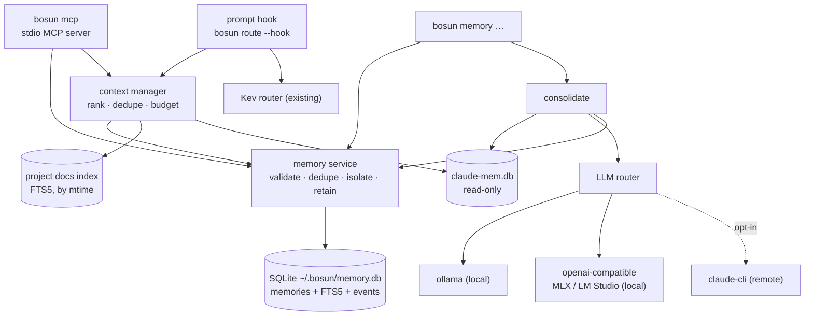
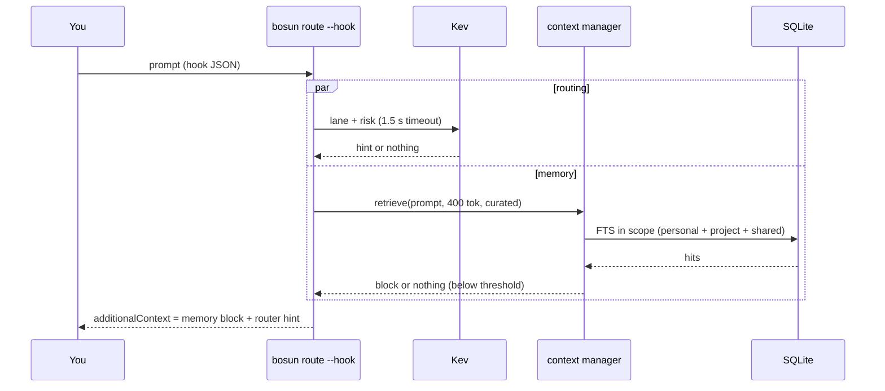
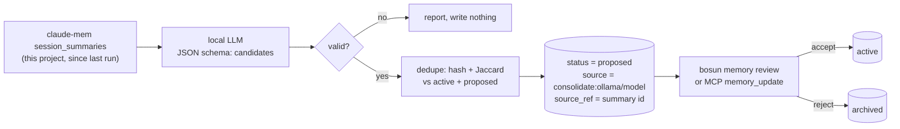
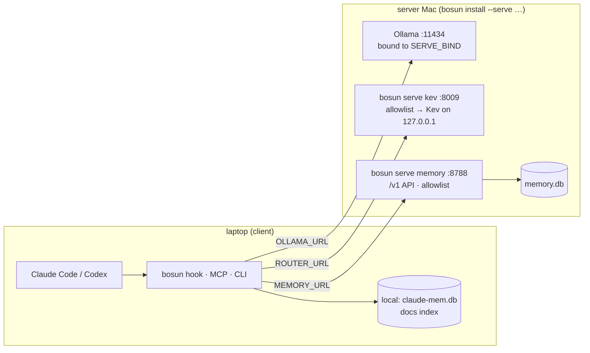

# bosun architecture: memory and context

This covers the memory layer added on 2026-09-29, and the TypeScript port that came with it. The design and its decisions (M1–M13) are in `docs/specs/2026-09-29-bosun-memory-design.md`; the build record, with every ruling, is in `docs/plans/2026-09-29-bosun-memory-ledger.md`. The roles, skills, executors and Orca parts are described in [README.md](README.md).

## Overview

Everything runs in-process. There's no daemon, except `bosun serve` on a server Mac in the optional split setup.



## Modules

| Module | Does |
|---|---|
| `lib/memory/types.ts` | Memory, Category, Status, Ctx, Query, Hit, `MemoryApi`, `MemoryProvider`, `MemoryError` |
| `lib/memory/sqlite.ts` | `openDb` (0600, WAL, `busy_timeout=2000`), ordered migrations, `tx`, query terms, hashing, Jaccard |
| `lib/memory/service.ts` | `MemoryService`: validation, dedupe, an event per change, retention, isolation; `openMemory` picks local or remote |
| `lib/memory/project.ts` | project identity from the git `origin` URL (read from `.git/config`, no git spawn) |
| `lib/memory/remote.ts` | `RemoteStore`: the same `MemoryApi` over HTTP to `MEMORY_URL` |
| `lib/memory/claudemem.ts` | read-only provider over claude-mem: this repo's observations and session summaries |
| `lib/memory/docs.ts` | this repo's Markdown in FTS5, re-read only when a file's mtime changes |
| `lib/context.ts` | `retrieve()`: rank, dedupe, fit a token budget, format |
| `lib/llm.ts` | `generate()`: Ollama → OpenAI-compatible → (opt-in) `claude -p`, retries, JSON validation, usage log |
| `lib/consolidate.ts` | claude-mem summaries → proposed memories |
| `lib/mcp.ts` | `bosun mcp`: JSON-RPC 2.0 over stdio, 7 tools |
| `lib/serve.ts` | `bosun serve memory|kev`: bind, allowlist, the `/v1` API, a Kev forwarder, the `authorize()` point |
| `lib/memory/cli.ts`, `bench.ts` | the `bosun memory` verbs; bench and eval |
| `lib/log.ts`, `lib/metrics.ts` | a JSON-lines log with redaction; op timings and the stats report |

## A prompt, end to end



- The existing skip rules still apply: `/` commands, `!` shell escapes, prompts under 3 words, `#noroute`, and `BOSUN_DEPTH` inside executors.
- Any failure in the memory part leaves it out (fail open) and logs `hook.memory`. The router hint still arrives.
- `bin/bosun` has a fast path for `route --hook`: it loads only the hook's modules (6 ms of imports against 16 ms for the full CLI). Until a first memory exists, the hook opens no database and loads no memory modules.
- `bin/bosun` flushes and exits when a command is done: an aborted request to a host that drops packets would otherwise keep the process alive for ~10 s (the OS connect timeout), past Claude's 5 s hook timeout.

## Storage

`~/.bosun/memory.db`: `memories` (+ `memories_fts`, porter unicode61, external content kept in sync by triggers), `memory_events` (the audit trail), `docs` (+ `docs_fts`), and `schema_migrations`.

- **Keys and dedupe:** `id` is `m_<time base32><random hex>`. `hash` is sha256 of the normalized title and body (lowercase, collapsed whitespace). A partial unique index on `(project, category, hash)` over non-archived rows makes exact duplicates impossible; `store` returns the existing memory instead.
- **Scope:** readable means personal, this project, `shared`, or a project in `MEMORY_LINKED_PROJECTS`. Writable means personal or this project. Ids out of scope are "not found", never "forbidden".
- **Versions:** `update` needs the version you read (optimistic concurrency). A mismatch returns `conflict` with the current version.
- **Retention:** session memories expire after `MEMORY_SESSION_TTL_DAYS` (7), applied when the database opens, each with an `expire` event. `prune` purges archived memories older than `MEMORY_PURGE_AFTER_DAYS` (90). Events outlive a purge.
- **Migrations:** each one runs with its version row inside one `BEGIN IMMEDIATE`; a failure rolls back and leaves the database as it was. The version is re-read inside the transaction, so processes opening a new database at the same time migrate it once.
- **Concurrency:** WAL plus `busy_timeout=2000`. The switch to WAL retries on `SQLITE_BUSY`, because SQLite skips the busy handler for that lock upgrade (two processes creating the database at once used to fail).

## Ranking

For each source (curated, docs, claude-mem), the context manager fetches up to 20 hits and scores each one:

```
score = bm25_norm × weight + 0.3 × 2^(−age / halfLife) + 0.05 × ln(1 + access_count)
```

- **bm25_norm:** FTS5 `bm25()` divided by the best hit of that source (0–1).
- **weight:** curated 1.0, docs 0.8, claude-mem 0.6.
- **halfLife:** session memories 1 day, other curated 60, docs 90 (by file mtime), claude-mem 30.

Then:
- **Dedupe:** same hash, or a word-set Jaccard ≥ 0.8. The higher score wins.
- **Gate:** a hit must contain at least `minMatched` distinct words of the task (counted by FTS5's own `highlight()`, so stemming counts; the hook uses `CONTEXT_HOOK_MIN_TERMS`, 2). Normalizing by a source's best hit gives that hit a relevance of 1.0 however weak the match, so without this gate one shared common word ("first", "uses") would inject a note.
- **Budget:** greedy by score. Each line is at most `CONTEXT_ITEM_CHARS` (400) characters; the whole block fits `budgetTokens`, estimated as characters ÷ 4 and always shown as `~`. Nothing below `minScore` (the hook uses 0.35).
- **Query:** stop words go; identifiers are kept and split (`fetchCart` → `fetchcart fetch cart`); at most 24 terms, each quoted, OR-joined. User text never becomes FTS syntax, and a 50 KB prompt is still a small query.

**Known limit:** `minScore` still mostly prunes the tail; the word gate does the real filtering. Use `bosun memory eval` with your own labelled queries before tuning either.

## MCP

`bosun mcp` speaks newline-delimited JSON-RPC 2.0 on stdio, with protocol `2025-11-25`; it echoes `2025-06-18` and `2025-03-26` when asked for them. stdout carries protocol messages only.

| Tool | Hints | Notes |
|---|---|---|
| `memory_search` | read-only | private memories left out |
| `memory_get` | read-only | a private body comes back as `[private]` |
| `memory_store` | not destructive | returns the existing duplicate instead of a second copy |
| `memory_update` | destructive, idempotent | `expectedVersion` required; `status: active` accepts a proposal |
| `memory_delete` | destructive, idempotent | archives (soft) |
| `context_retrieve` | read-only | curated + docs + claude-mem, default budget ~1000 tokens |
| `project_knowledge_search` | read-only | docs + claude-mem |

- **Inputs:** every schema has `additionalProperties: false`, so a tool argument can't set the project.
- **Errors:** validation and business errors come back as `isError` results, never quoting stored content. Output is capped at `MCP_MAX_CHARS` (20,000).
- **Protocol errors:** unknown method (including `server/discover`) → `-32601`, batch → `-32600`, parse error → `-32700`, unknown tool → `-32602`.
- **Registration:** `bosun install` registers the server with `claude mcp add --scope user`, and with `codex mcp add` in each Codex home (Orca's too). Uninstall removes them, and `bosun doctor` checks them.

## LLM router and consolidation

- **Chain:** `LLM_PROVIDERS` (default `ollama`; `openai` means an OpenAI-compatible server such as `mlx_lm.server` or LM Studio).
- **Timeouts and retries:** each attempt times out after `LLM_TIMEOUT_S` (60). Timeouts and connection errors are retried `LLM_RETRIES` (1) times, with backoff. Bad or schema-invalid JSON counts as a failure, is not retried, and moves on to the next provider.
- **Remote:** `claude -p --restricted` (haiku) is added only when `LLM_REMOTE=claude`, the caller allows remote, and the content isn't private.
- **Usage log:** each attempt writes one line to `~/.bosun/llm-usage.jsonl`, with no content.



## Split setup



- **API:** `GET /v1/health`; `POST /v1/memory/{store,search,get,update,delete,accept,reject}`; `POST /v1/context/retrieve`.
- **Requests and replies:** every request carries `ctx`, and every reply is `{ ok, data | error: { code, message } }` with `not_found`, `conflict`, `invalid` or `unavailable`.
- **Limits:** JSON only, bodies ≤ 64 KB.
- **Client ranking:** the client ranks curated hits from `/v1/memory/search` together with its own local docs and claude-mem hits.
- **Safety:** the bind address (Tailscale by default, never `0.0.0.0` unless you set it) plus a source-IP allowlist. There are no tokens in v1; clients already send `MEMORY_TOKEN` as a Bearer header, and `authorize()` is where checking it goes.

## Measured numbers

All on this machine: Apple M5 Pro, 48 GB, Node 24.21.0, SQLite 3.53.4. Only these measurements, and the spec's §2 baseline, are quoted anywhere.

| What | Number | How |
|---|---|---|
| store | p50 0.15 ms, p95 0.32 ms | `bosun memory bench`, 10,000 synthetic memories (seed 42), one transaction each |
| search (FTS5, limit 10, with matched-word counts) | p50 3.83 ms, p95 5.53 ms | same, 200 queries |
| context retrieve (curated, ~400 tokens) | p50 5.11 ms, p95 7.22 ms | same |
| budget adherence | 200/200 within ~400 tokens (max ~398, average ~315) | same |
| hook, memory part | p50 30.6 ms, p95 40.1 ms | same corpus, 20 hook runs, Kev unreachable |
| hook, wall clock | p50 75 ms, p95 94 ms | same |
| hook wall clock by store | no memory yet 51 ms, 10k store 73 ms; pre-memory JS 48 ms; bare `node -e 0` 24 ms | 30 runs each, compile cache warm |
| `bosun help` | 51 ms (TS port before memory: 39 ms; JS baseline §2: 58 ms) | 20 runs |
| test suite | 87 tests, 13.8 s (baseline: 43 tests, 12.8 s) | `npm test` |
| type stripping cost | cold 67 ms vs plain JS 32 ms for ~3,000 lines; with the compile cache 33 ms | synthetic module graph |

**The spec target is missed at 10,000 memories.** The memory part of the hook was to stay under a p95 of 30 ms; it measured 36.6–40.1 ms across runs (this machine's run-to-run noise is several ms).
- **What was fixed:** project identity no longer spawns `git` (that was 17 ms), the hook no longer loads every CLI module (10 ms), and with no memories yet it costs about 3 ms over the pre-memory hook.
- **What's left:** a cold-process SQLite open, plus bm25 over the thousands of rows each synthetic query matches (the generated vocabulary has no stop words).
- **Next steps if it matters:** a long-lived memory process, or capping FTS matches.

No token savings are claimed: the stats report shows estimated tokens injected per prompt, and nothing has been measured before and after.

## Limitations and future work

- **Deferred by design (spec §9):**
  - Cognee: re-evaluate if `bosun memory eval` shows a gap on multi-hop questions.
  - Embeddings and vectors: add them only if eval shows a full-text gap.
  - Rust.
  - MCP protocol `2026-07-28`.
  - For the split setup: tokens and TLS, an offline queue and sync, multiple users, a Linux server.
- **Not verified here (needs the real install):** `claude mcp add`/`codex mcp add` argument formats on your versions; whether Codex starts MCP servers in the project directory (the project id comes from the server's cwd when `CLAUDE_PROJECT_DIR` is absent); `claude -p --output-format json` usage fields; Ollama's handling of `format` with every schema keyword we send; a real Tailscale bind.
- **Git edge cases:** project identity reads `.git` directly, so an origin set through `includeIf` or a `GIT_DIR` override falls back to a path-based id.
- **Docs index:** Markdown only, files over 256 KB are skipped, and repos without git aren't indexed.
- **Consolidation:** it skips near-duplicates rather than proposing them. The report lists each one, with the memory it resembles.
