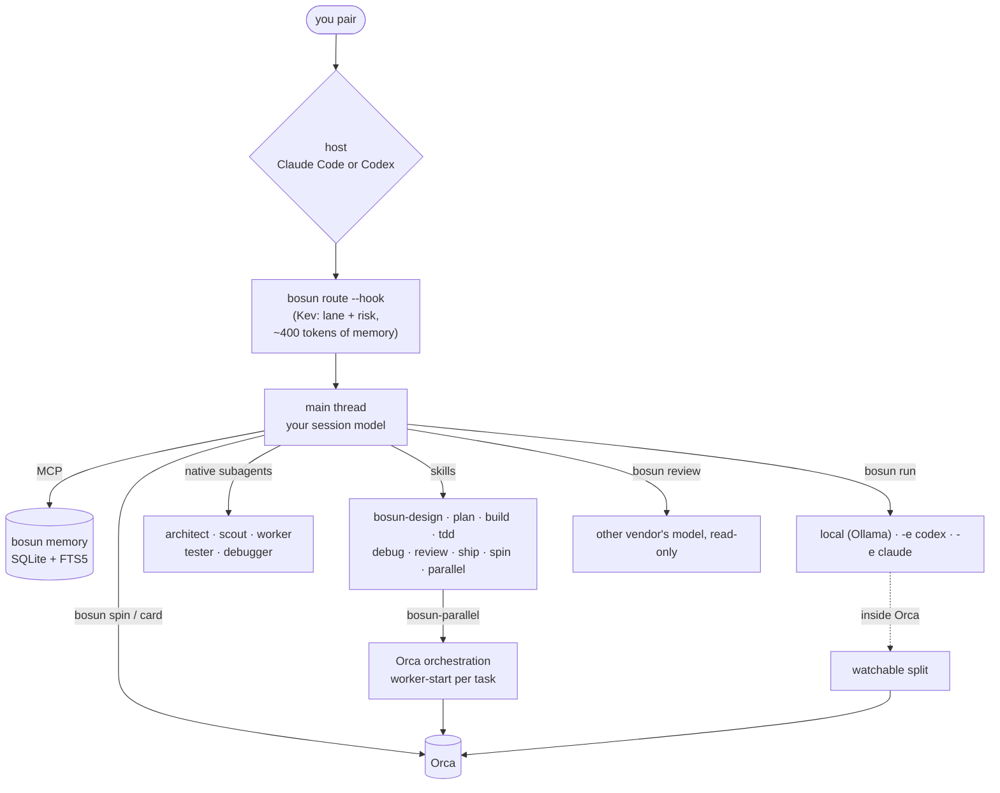
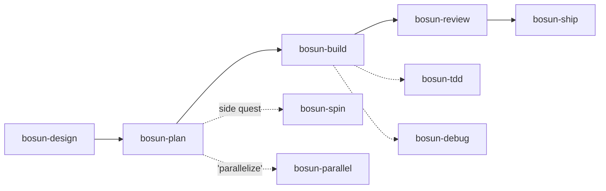
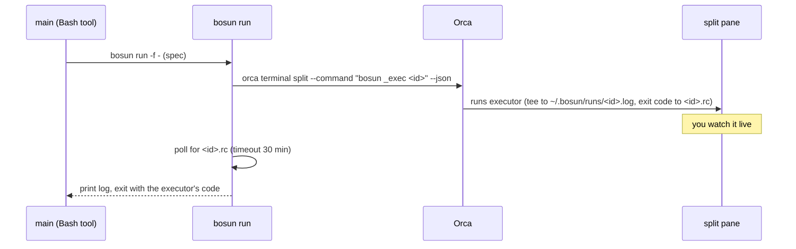
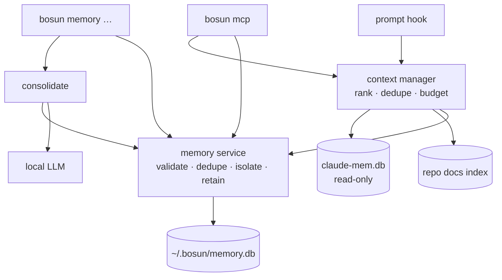

# bosun

**Pair with one agent; bosun routes the rest.**

You drive a single session in Claude Code, Codex, or both. bosun gives that session:
- a crew of roles
- a full skill set
- a local model for mechanical edits
- the other vendor's model as reviewer
- Orca for side quests and, when you ask, parallel work
- a local-first memory: curated notes you review, a few of them added to each prompt, and MCP tools on demand

Built for an M5 Pro with 48 GB, subscription logins, and TypeScript/Node services. It's a TypeScript CLI that Node ≥ 24 runs directly (native type stripping), with zero runtime dependencies.



## Roles

Each role has one source file, `roles/<role>.md`. It's rendered as a Claude subagent (`bosun-<role>`) and a Codex agent (`bosun_<role>`), so the two rosters can't drift. Models come from `~/.bosun/config.env`; `bosun roles` prints the live table.

| Role | Claude | Codex | Can | For |
|---|---|---|---|---|
| **main** | your session (Opus) | your session (gpt-6-sol) | everything | you pair here and it decides |
| architect | opus · high | gpt-6-astra · high | read-only | 2–3 options, a recommendation, an executor-ready spec |
| scout | haiku | gpt-6-luna · low | read-only | where is X, call sites, summaries |
| worker | sonnet | gpt-6-luna · high | edit + test/lint/tsc | spec'd edits that need reasoning |
| tester | sonnet | gpt-6-luna · high | test files only | tests, and the red step of TDD |
| debugger | sonnet | gpt-6-luna · high | read + run, no source edits | repro → hypotheses → root cause; hands off to the architect after 2 misses |
| reviewer | `bosun review`: **gpt-6-sol** from Claude, **opus** from Codex | | read-only | every diff before it ships (the subagent is only the fallback) |
| local | `bosun run` → qwen3.6 in Ollama | same | fenced edits | mechanical edits, $0 |

## Skills

Thirteen skills in `skills/`; the installer links the same files into `~/.claude/skills` and `~/.agents/skills` for both hosts. The four context and OpenAI guidance skills also have repository-local links in `.agents/skills`, so Codex can discover them in this checkout without installing bosun. Reload skill discovery or start a new session if they do not appear yet.



| Skill | When | What it does |
|---|---|---|
| bosun-design | a change with an open decision | at most 3 questions → architect options → you pick |
| bosun-plan | an approved design or a clear goal | task specs (lane, files, change, must-not-change, verify) in `~/.bosun/plans/` |
| bosun-build | a plan or a spec | per task: dispatch by lane, read the diff, run verify yourself, escalate after 2 failures |
| bosun-tdd | test-first | the tester writes red, local or worker makes it green, then refactor |
| bosun-debug | a bug or failing test | the debugger reproduces and finds the root cause, then a minimal fix through build |
| bosun-review | before shipping, or `--pr N` | the cross-vendor reviewer → each finding checked against the code → fix the real ones |
| bosun-ship | ship / commit / PR | an evidence gate, then messages; commits or PRs only when you ask |
| bosun-spin | "spin this off" | a self-contained spec → a new Orca worktree + agent; you keep pairing |
| bosun-parallel | "parallelize this" | independent tasks → supervised Orca workers with each role's model |
| [bosun-openai-models](skills/bosun-openai-models/SKILL.md) | model choice or migration | dated GPT-6.1 Sol / Astra / Luna guidance, reasoning controls, and bosun config mapping |
| [bosun-codex](skills/bosun-codex/SKILL.md) | Codex integration work | CLI, config, skills, MCP, hooks, sessions, and native compaction |
| [bosun-chatgpt](skills/bosun-chatgpt/SKILL.md) | ChatGPT product or integration questions | Chat / Work / Codex distinctions, access, shared usage, and supported tools |
| [bosun-handoff](skills/bosun-handoff/SKILL.md) | save or resume task context | portable resume documents and checking the planned automatic handoff |

**Auto-handoff status (2026-10-04):** designed as a required v1.0 feature in [topic 8](docs/research/08-features.md) and [the completed roadmap](docs/plans/2026-10-01-bosun-v1.0-roadmap.md), but not implemented in v0.2. The proposed `[compact]` settings do not work in the current environment-file config. The handoff skill supports manual task-state transfer; it does not create a background context monitor.

**Release plan:** all selected work, including graph enrichment, the Ink dashboard and remote support, belongs to one v1.0. The roadmap uses internal implementation phases and one final ship gate; package-version changes wait until shipping.

**Latest v1.0 direction:** OpenCode becomes the primary experience, with native OpenCode, Codex and Claude Code support behind the same core. Local Ollama Clef-Flash replaces Kev's execution router and separate Python service; the handoff summarizer stays a separate model. See [the host/router revision](docs/research/09-opencode-clef.md). This is planned behavior; v0.2 code still uses Kev and has no OpenCode adapter.

`bosun install --replace-plugins` turns off the plugins that overlap with these (superpowers, mattpocock-skills, code-review) and records what it disabled. `bosun uninstall` turns back on only those.

## Orca

- **Watchable runs.** Inside Orca, `bosun run` opens a split next to you and runs the executor there. You watch it live: Claude runs stream each step (`→ Edit src/order.ts`), Codex prints its own progress. The main model gets only the final result and the exit code.
  - Closed split: if you close it mid-run, `bosun run` returns right away (exit 130, partial log).
  - Split never starts: after 30 s it runs inline instead, and never twice.
  - Timeout: after `RUN_TIMEOUT_MIN` (30), bosun stops the executor.
  - Placement: the split opens next to the terminal that asked for it.
  - Cleanup: runs older than a week are pruned from `~/.bosun/runs`.
- **`bosun spin`** creates a child worktree with `claude`, `codex` or `local` working on a self-contained spec. It starts from the default branch unless you pass `--stacked`.
- **`bosun card <status> "comment"`** keeps your worktree card current. Skills call it at checkpoints, and it does nothing outside Orca.
- **bosun-parallel** drives Orca's own `orchestration` skill: `worker-start --worktree new-child --agent … --model … --effort …`.



## Memory

bosun keeps **curated** memory: facts you or the assistant chose to keep, such as decisions and why, conventions, gotchas and your preferences. It lives in `~/.bosun/memory.db` (SQLite with FTS5, mode 0600). claude-mem stays as it is: bosun reads its database read-only, and never stores the same thing twice.

**Local hook limitation during the v1.0 build:** ordinary default WAL installs remain held. An explicitly prepared READY public view can supply non-expiring local notes only with an independent owner `MEMORY_SOURCE_ID` binding from the initial plan/cutover receipt. Missing/mismatched bindings or invalid/pending/stale views hold without falling back to primary rows. Strict owner apply/reconcile is available below; no configuration or storage is activated automatically. Compatible unactivated rollback stores retain qualified reads. Owner CLI, MCP and remote memory behavior remain compatible. [ADR 0007](docs/adr/0007-bound-public-memory-reader.md) records the public reader, demonstrated bounded capacity and remaining restore/performance gates.

For qualified local public-view or rollback reads, router work finishes before the reader opens. Both local paths omit every finite-expiry note in SQL before packing: a pipe write can cross expiry under backpressure or an event-loop stall, and the timer cannot prove a hard delivery deadline. Non-expiring notes remain useful; finite-expiry local handoff support is still a ship gate. The connection stays held through packing and the actual native stdout callback, then releases. Memory delivery currently requires Node on POSIX pipe/socket stdout; file/TTY/Windows/Bun sinks omit local notes before DB open. Advice remains available, with no synchronous-sink latency guarantee. Local envelopes cap at 16 KiB; larger notes are dropped before advisory delivery. A pending write error/signal/250 ms event-loop timeout ends the one-shot hook with the reader retained to teardown, because native probes showed stdout `destroy`/`closed` can still flush later. That path records no completion/injection metric. This is native acceptance, not host acknowledgement or a total latency guarantee; [ADR 0004](docs/adr/0004-wal-read-view-protocol-qualification.md#local-caller-handoff-slice-7b1) records the evidence and remaining activation gates.

An explicit production storage primitive keeps primary write admission across a native SQLite-aware owner backup and persistent writer-floor commit. Real local memory/owner CLI, MCP docs and server callers recognize an applied explicit floor and use registered synchronous admission; normal unactivated stores remain compatible. Initial installation is available only through the explicit owner cutover commands below. Default paths are `<db-dir>/memory-view/public.db` and `<db-dir>/memory-backups`, with `MEMORY_VIEW_PATH`/`MEMORY_BACKUP_DIR` overrides; pending/unknown/mismatched gates fail closed before legacy chmod/migration. Cutover requires canonical owner-only 0700 directories/0600 single-link files. Strict plans report missing directories and legacy0755 modes as BLOCKED; the separate reviewed preparation commands can prepare the initial absent-view layout. [ADR 0005](docs/adr/0005-explicit-memory-writer-floor-cutover.md) records native admission and writer fencing.

```text
bosun memory cutover prepare-plan [--create-view-directory] [--create-backup-directory] [--json]
bosun memory cutover prepare --plan TOKEN --clients-stopped [--json]
bosun memory cutover plan [--retain-unreferenced] [--json]
bosun memory cutover apply --plan TOKEN --clients-stopped [--json]
bosun memory cutover reconcile --plan TOKEN --source-id UUID --clients-stopped [--retain-unreferenced] [--json]
bosun memory cutover recover-plan --source-id UUID [--retain-unreferenced] [--json]
bosun memory cutover recover --plan TOKEN --source-id UUID --clients-stopped [--retain-unreferenced] [--json]
bosun memory cutover restore-plan --source-id OLD_UUID [--retain-unreferenced] [--json]
bosun memory cutover restore --plan TOKEN --source-id OLD_UUID --new-source-id NEW_UUID --clients-stopped [--retain-unreferenced] [--json]
bosun memory cutover restore-reconcile-plan --source-id OLD_UUID --new-source-id NEW_UUID [--retain-unreferenced] [--json]
bosun memory cutover restore-reconcile --plan TOKEN --source-id OLD_UUID --new-source-id NEW_UUID --clients-stopped [--retain-unreferenced] [--json]
```

Stop every memory/MCP/docs/server client yourself. If the initial layout needs preparation, request only the missing leaf directories with the create flags, review every exact path/action in `prepare-plan`, then run `prepare` with that token and the stopped attestation. Preparation narrows only known owner directories at 0755/0750 to 0700 and single-link primary/WAL/SHM files at 0644/0640 to 0600; it can create only explicitly requested view/backups leaves at 0700 under existing owner parents. It holds any existing view, unknown/pending/orphan inventory, links, unowned paths, unsupported headers/sizes and other modes. It never recursively creates/changes permissions, deletes, opens SQLite, installs a floor or writes binding/configuration. Partial failures leave conservative changes and require inspection/replanning; permission broadening and deletion are never rollback actions.

After preparation, obtain a fresh strict `cutover plan`. Planning uses filesystem metadata and minimal headers without opening mutable SQLite; schema, floor and clients remain unverified. An absent view/empty backup directory produces an apply candidate and a new source UUID: **save that UUID independently before applying**. Both kinds of token bind configured paths/identities/metadata for a five-minute admission window; they are editable review/freshness bindings, not authorization seals or proof of drain. `--clients-stopped` is operator attestation, and no process drain/restart is automated. Existing CLI initialization can still create config as before; the whole CLI is not zero-IO.

Apply verifies the fresh plan and exact native schema under write admission, installs the planned UUID/floor and returns HOLD. Keep clients stopped through separate explicit publication and owner `MEMORY_SOURCE_ID` binding, then reopen all authorities; cached pre-floor/v1 writers are fenced. A strict reconcile plan is an unverified filesystem candidate, requires your independently saved `--source-id` before mutation, and **revokes READY to HOLD**. If an apply receipt is lost, a committed floor can reconcile using that saved planned UUID and a fresh token. Failed operations may have an unknown outcome; inspect and replan before reconciliation or eligible incomplete recovery.

`recover-plan` requires the independently saved initial UUID and inspects only the journal-free rollback view through native read-only SQLite, retaining a lease while verifying its exact gate/reference. Primary SQLite schema/floor remain unverified until admission. A valid format-1 copying gate can reference an empty/unfinished artifact with null digest; a backed gate requires its completed artifact's exact digest. `recover` requires absent primary floor and same-epoch gate before effects, then makes a **fresh exact backup of current source** under continuous admission, preserving the prior referenced artifact and source epoch. Already-committed floors require explicit reconcile; no generation is reset. Applied-without-floor, unknown pre-intent views and journals remain held; current-reference restore has its separate workflow below.

Bounded inventory permits up to 32 UUID `.db` owner-only single-link files, 64 MiB each and 256 MiB total; recovery requires capacity for one more artifact. Unreferenced files have **unverified ownership**: only metadata/count is reported, their bytes are never read/hashed/adopted/deleted. If they coexist, review `--retain-unreferenced` at both planning and mutation; it acknowledges preservation, not ownership. Use `plan --retain-unreferenced` followed by matching explicit reconcile for a committed floor with retained leftovers. Recovery automatically preserves its previously verified reference; the receipt distinguishes that reference from separately acknowledged unrelated files. Unknown names/links/modes/oversize/sidecars remain blocked. Ordinary open/hook/MCP/server never recover automatically. Verified external drain/restart, general orphan disposition, broader interrupted-storage recovery and durability remain ship gates. [ADR 0008](docs/adr/0008-strict-owner-memory-cutover.md) records exact scope and sidecar/freshness limits.

`restore-plan` verifies the current referenced backup and generates a new source UUID before effects: **save both old and new UUIDs independently**. `restore` preserves a fresh native backup of current source, restores recorded memories/audit/docs with explicit keys and privacy/scope/expiry, rotates the epoch and returns HOLD. An immutable pending intent fences readers/cached writers; hooks inspect only its filename. After an unknown outcome, obtain `restore-reconcile-plan` with both saved UUIDs. Reconciliation checks the exact old/new native floor, never replays restore, and preserves intervening writes/generation. A pending owned view journal is planned using only filesystem/minimal database metadata and the immutable capsule: no native SQLite handle, journal payload or backup bytes are opened, and view/reference remain **unverified**. Only explicit reconciliation after actual source-floor admission may let SQLite recover it; unknown floors/layouts and invalid recovered schema stay held. Reopen authorities and separately publish/set the new owner binding. Referenced mid-backup sidecars, receipt-only journals and arbitrary backup selection remain held. [ADR 0009](docs/adr/0009-owned-memory-restore.md) records the state machine, bounds and trusted-application qualification.

`bosun memory publish [--json]` explicitly publishes a public snapshot only for an already-applied local floor. It upgrades the fixed rollback inode and writer format, fences cached old writers, and commits validated public rows/FTS/READY under primary admission. Supported mutations revoke it to HOLD until another explicit publish; no automatic rebuild runs. Private/unclassified/expired/audit/docs/owner-backup data is excluded from public tables/receipts, while the owner recovery metadata remains in its own table. HOLD is audience revocation, not physical erasure. A post-commit cleanup failure may report an unknown outcome if a lease prevents re-HOLD. Publication and reading share finite limits of 10,000 rows, 16 MiB encoded and a 64 MiB view; source plus WAL remains capped at 64 MiB. The guarded 10,000-row medium-body corpus now publishes READY and supplies correct scoped get/search and actual native hook notes. The earlier 4 MiB encoded-cap HOLD is historical; this functional result does not qualify every 10k corpus or performance. Oversized preflight artifacts remain unchanged and ineligible even if their stored marker was READY. The reader retains its same-inode lease through native delivery and omits finite-expiry local notes; broader interrupted-storage recovery, verified drain/restart, durability and finite-expiry handoff remain gates. [ADR 0006](docs/adr/0006-explicit-public-memory-publication.md) records measurements and exact limits.

Doctor's memory check creates/migrates nothing: missing stays absent, mutable WAL is held without claiming its schema is verified, and compatible rollback files report their queried migration version. The writer-discovery probe can open WAL and perform native sidecar housekeeping; it is not the zero-write hook reader.

- **Categories:** `personal` (you, in every project), `project` (this repo), `session` (expires after `MEMORY_SESSION_TTL_DAYS`, 7).
- **Projects:** a project is the hash of the repo's normalized `origin` URL. Every clone, worktree and machine of a repo shares one project memory. Projects can't see each other, unless a memory is `shared` or you list a project in `MEMORY_LINKED_PROJECTS`.
- **Each prompt:** when the storage path is qualified/available, the hook adds up to ~400 tokens (estimated) of the most relevant curated notes, next to Kev's hint. A note must share at least `CONTEXT_HOOK_MIN_TERMS` (2) distinct words with the prompt and score `CONTEXT_HOOK_MIN_SCORE` (0.35); otherwise the hook stays silent. It fails open when anything goes wrong, and until you store a first memory it opens nothing at all. The ordinary read APIs filter expiry without archiving; local hook handoff additionally omits finite-expiry notes. Readers never touch access/version/events/mode. Legacy hook/context telemetry and routing inference still run outside that reader; the whole hook is not yet zero-IO or lean.
- **On demand (MCP, `bosun mcp`):** `memory_search`, `memory_get`, `memory_store`, `memory_update`, `memory_delete`, `context_retrieve` (curated + this repo's Markdown docs + claude-mem, ranked and fitted to a budget) and `project_knowledge_search` (docs + claude-mem).
- **Private:** `--private` memories stay out of hook/search/context output. MCP get/store/update/delete replies for private or unclassified records contain only `{memory:{private:true}}`, without title, body, tags, provenance, IDs, hashes, events, timestamps, versions, duplicate or status details. Explicitly private input is blocked before every inference provider, including local models. `memory add --private --auto` uses the first line (up to 80 characters) and no suggested tags; explicit title/tags win. Logs and metrics use finite metadata fields and never serialize titles, bodies, prompts, arbitrary nested objects, or error messages/causes.

**Foundation privacy fixes (2026-10-04):** private auto suggestions now make zero model calls, and new route observations contain validated decision metadata plus a random ID per observation. Prompt snippets and text-derived route hashes are no longer written. Historical logs are left unchanged; their prompts are never redisplayed by label/stats/eval. Existing stored memory IDs, scope and content hashes retain their storage semantics.

Legacy SQLite privacy flags are conservative: only stored integer `0` is public, and only stored integer `1` enables sharing across projects. Empty, text, blob and other numeric flags stay protected or unshared. Owner get/search can still inspect in-scope content; duplicate requests and edits that omit flags preserve the stored values. Use the owner CLI's explicit `memory update <id> --public` to reclassify a protected note. MCP continues to permit opaque private edits/deletes and cannot make a note public.

Use `bosun route --private …` or `route --hook --private` to skip routing and retrieval for a private request. Hook payloads can also mark `private: true` or `privacy: "private"`; malformed explicit privacy markers fail closed. Unmarked v0.2 hook input retains its existing routing behavior until typed host adapters carry classification. There is no automatic secret detection: mark private input explicitly. Full v1.0 screening, enrichment and live-host qualification remain implementation work in [the roadmap](docs/plans/2026-10-01-bosun-v1.0-roadmap.md).
- **Proposals:** `bosun memory consolidate` has the local model turn this repo's recent claude-mem session summaries into **proposed** memories. Nothing becomes durable until you accept it in `bosun memory review` (or with MCP `memory_update`).

| You want | Do |
|---|---|
| Remember something | `bosun memory add -t "Use pnpm" --tags tooling "Always pnpm install; npm breaks the lockfile"` (`--auto` suggests title and tags) |
| Find it | `bosun memory search lockfile`, `bosun memory get <id>` (with its audit trail) |
| Change or drop it | `bosun memory update <id> -b "…"`, `bosun memory delete <id>` (archive), `bosun memory purge <id>` |
| Review proposals | `bosun memory consolidate`, then `bosun memory review` |
| Housekeeping | `bosun memory prune` (expired → archived, archived > 90 days → purged) |
| Numbers | `bosun memory stats` (this project's id, p50/p95 per operation, hook injections, LLM calls), `bosun memory bench`, `bosun memory eval <queries.jsonl>` |



More in [ARCHITECTURE.md](ARCHITECTURE.md): the schema, the ranking formula, and measured numbers.

## Split setup (optional)

Kev, the LLMs and memory can each run on another machine, for example a Mac Studio, with your laptop as the client. Each has its own URL: `ROUTER_URL`, `OLLAMA_URL`, `MEMORY_URL`. Empty means local, as before.

```bash
# on the server Mac: only the listed services, bound to its Tailscale IP
bosun install --serve kev,llm,memory
# on each client: it prints the exact line to run
bosun install --remote kev=http://100.x.y.z:8009,llm=http://100.x.y.z:11434,memory=http://100.x.y.z:8788
```

- **Bind:** `SERVE_BIND` defaults to the server's Tailscale IPv4. Without Tailscale, install refuses until you set a LAN IP. It's never `0.0.0.0` unless you set it.
- **Allowlist:** `bosun serve` answers 403 to any source outside `SERVE_ALLOW` (default `127.0.0.1/32,100.64.0.0/10` plus the bind address's subnet). Ollama can't filter by IP, so it relies on its bind address.
- **No tokens yet (v1):** anyone who can reach the memory port can read your memory, so keep it on a private network. The API is versioned (`/v1`), and one `authorize()` point is ready for auth later.
- **Transport:** plain HTTP. Tailscale encrypts it (WireGuard); a plain LAN doesn't.
- **When the server is down:** the hook's memory part gives up after `REMOTE_HOOK_TIMEOUT_MS` (300) and stays silent. After `REMOTE_TIMEOUT_MS` (5000), the owner CLI retains "memory server unreachable at …"; MCP returns "memory unavailable" with the closed `unavailable` code. There's no offline queue: writes while offline fail visibly.
- claude-mem, the docs index, the hook and the MCP server always run on the client. Only the curated store moves.
- `bosun doctor` checks each URL, the server's `/v1/health` (a version mismatch is a warning), and the model on the remote Ollama. `bosun uninstall` removes the server's services, and on a client puts the URLs back.

## Install (not run yet)

```bash
cd ~/Developer/bosun
npm test                                     # 87 offline checks: no installs, no network, sandboxed HOME
./install.sh --host both --replace-plugins   # or --host claude / --host codex; drop --replace-plugins to keep your plugins
```

It sets up Ollama (≥ 0.34) with a 64K context and one model at a time, pulls `qwen3.6:35b-a3b-coding-nvfp4` (~22 GB), installs Kev (`kev-0.8b`), links `~/.local/bin/bosun`, wires each host (including the `bosun` MCP server: `claude mcp add --scope user`, and `codex mcp add` in each Codex home), runs `bosun doctor`, and ends with a smoke test in which the local model fixes a one-line bug. **Codex only:** open `codex` once, run `/hooks`, and trust the bosun hook.

**Codex inside Orca:** Orca gives Codex its own home folder (`CODEX_HOME`) and manages its `hooks.json`. bosun writes its rules and agents there too, so Codex in Orca gets the same roles and skills. The Kev hint appears only in Codex outside Orca, because Orca rewrites that `hooks.json`.


- **What it preserves:** wiring is idempotent. Your hooks (codegraph, orca, …), permissions and rules are kept. `settings.json` and `hooks.json` are backed up to `*.bak-bosun` first.
- **Broken config:** a `settings.json` or `hooks.json` that isn't valid JSON, or a hand-broken bosun marker in `CLAUDE.md`/`AGENTS.md`, stops install, uninstall and rewiring before anything is changed.
- **Uninstall:** `bosun uninstall` undoes only what bosun did:
  - removes its services, hook, permissions, rules, agents and skills, plus any file it created
  - removes its own `~/.local/bin/bosun` link and its own `~/.zshrc` PATH line
  - puts your own Ollama.app launchctl values back
  - moves your own files that it had set aside back in place
  - re-enables the plugins it disabled (`--replace-plugins` stays in effect across re-installs until then)

  It keeps the models, the Kev checkout, `~/.bosun` and the `*.bak-bosun` backups.

## Daily use

| You want | Do |
|---|---|
| Normal work | `claude` or `codex` as usual; the bosun block and Kev's hint steer delegation |
| Force a lane | say it: "architect this", "have the tester write the red test", "offload to local" |
| Skip the router once | add `#noroute` |
| Local edit by hand | `bosun run "add nullable deliveryWindow to OrderDto + mapper; verify: yarn tsc --noEmit"` |
| Other plan's model | `bosun run -e codex "…"` (GPT) / `bosun run -e claude "…"` (Sonnet) |
| Cross-vendor review | `bosun review`, `bosun review --pr 123` |
| Side quest | `bosun spin --agent codex "…"` |
| Health | `bosun doctor`, `bosun status`, `bosun roles` |
| Free RAM | `bosun stop` … `bosun start` (hosts keep working; hints and local runs pause) |
| Other local model | `bosun model devstral-small-2:24b` |
| Tune the router | `bosun label`, then `bosun eval` (after about a week) |
| Memory | `bosun memory add …`, `bosun memory search …`, `bosun memory review` (see [Memory](#memory)) |

`bosun label` displays only observation ID/time and decision fields, including for historical rows. Correlate these with your own current session before assigning a ground-truth lane; skip observations you cannot identify. Metadata cannot reconstruct an old task, so the label workflow no longer provides prompt replay or groups repeated prompts by a content hash. Legacy ten-character IDs still join their existing labels for evaluation; historical prompt records are never automatically rewritten or deleted.

## Local model and harness

| Model | Size | Notes |
|---|---|---|
| **qwen3.6:35b-a3b-coding-nvfp4** ✅ | 22 GB | SWE-bench Verified 73.4, Terminal-Bench 2.0 51.5; MoE with 3B active on Ollama's MLX engine |
| devstral-small-2:24b (fallback) | 15 GB | 65.8, from a different model family, so a Qwen template bug won't take out both |
| muse-glimmer:30b-nvfp4 | 17 GB | 76.0 but dense (slower); try it for harder edits |
| qwen3.8:27b-mlx | 18 GB | strongest agentic scores, but Ollama #17778 breaks tool loops for now |

- **`LOCAL_HARNESS=claude`** (the default) runs `claude -p --bare`: 3 tools, a system prompt of about 400 characters, and a dummy `ollama` key. It never touches your subscription.
  - Why `--bare`: Ollama's Anthropic endpoint doesn't cache prompts (#18431), so the full ~27K-character prompt would be re-read on every turn.
- **`LOCAL_HARNESS=codex`** runs `codex exec --oss` in the macOS sandbox: repo-only writes, `.git` protected, no network.
- **Executor rules** travel inside the prompt, because Ollama's Responses API drops developer-role messages (#18305).
- **LiteLLM was removed.** Both CLIs talk to Ollama directly.

## Safety

- **Local Claude executor:** `--bare`, the dummy key, and `ANTHROPIC_AUTH_TOKEN` plus the parent session's own `CLAUDE_CODE_*` variables stripped. The e2e test asserts that no `Authorization` header ever reaches the endpoint.
- **Executor fence** (Claude, `dontAsk`):
  - The only commands that run: read commands, `git mv`, `mkdir -p`, test/lint/tsc, and `git status/diff/log/show`.
  - `-e claude` and the Claude reviewer also run `--restricted`: your user and project settings can't widen what they're allowed to do.
  - Always denied: commit, push, reset, checkout, restore, clean, stash, rebase, `rm`, and the web.
- **Codex executors:** the OS sandbox with no network.
- **Reviewer:** read-only on both vendors (Claude: Read/Glob/Grep only; Codex: `-s read-only`).
- **Codex host:** `bosun` commands need localhost and `~/.bosun`, so the Codex rules block tells the model to ask to run them outside the sandbox. You approve once.
- **Guard:** `BOSUN_DEPTH` keeps executors from spawning more work, and the hook stays silent inside them.
- **Spin-offs and parallel workers** are told not to commit, push, or fan out further. Orca's depth limit backs that up.
- **High-risk prompts** (payments, orders, invoices, auth, data, infra) always go to the main thread.
- **Memory:** `bosun memory` is never auto-allowed for the model (the owner CLI shows private content and can purge), and MCP can mark a memory private but never make it public again. Project isolation comes from your environment (cwd, `CLAUDE_PROJECT_DIR`), never from tool arguments. Out-of-scope ids read as "not found". MCP and curated context check classification before accessing returned content, even when a remote adapter ignores filtering; model exposure requires an own boolean `private: false`. Denied mutation/read replies use a constant opaque placeholder. Model-facing memory errors carry finite text/codes without provider messages or current-version details. Stored IDs/scope, owner CLI reads/mutations and historical files remain unchanged. The local reader is qualified for bounded legacy rollback stores and independently bound READY public views; safe WAL fallback, atomic private mutation authorization, races and writer/index/expiry separation remain implementation work. Remote generation rejects explicitly private input and `LLM_REMOTE=claude` is off by default.

## Tests

`npm test` uses the mandatory Node launcher. It verifies containment before importing application code, then runs the offline suite sequentially against isolated HOME, bosun/host/XDG/temp roots, stub CLIs, registered ephemeral loopback mocks and fixture databases. Inherited credentials, provider settings and user configuration are removed. Installer/supervisor/model commands use stubs; filesystem, SQLite, child-process and network guards prevent accidental external effects. Every test rejects direct `node --test` invocation. **Never run bosun tests under Bun.**

Supported commands (no dependency installation or model pulls):

```sh
npm test
node scripts/run-tests.mjs --suite containment --runtime node
node scripts/run-tests.mjs --suite legacy --runtime node
node scripts/run-tests.mjs --suite privacy --runtime node
node scripts/run-tests.mjs --suite exposure --runtime node
node scripts/run-tests.mjs --suite readonly --runtime node
node scripts/run-tests.mjs --suite publicreader --runtime node
node scripts/run-tests.mjs --suite readview --runtime node
node scripts/run-tests.mjs --suite hooklease --runtime node
node scripts/run-tests.mjs --suite benchmark --runtime node
node scripts/run-tests.mjs --suite core,contracts,boundaries --runtime node
node scripts/run-tests.mjs --suite router,opencode --runtime node
npm run boundaries
npm run typecheck
```

`all` is the default suite; it contains containment probes, legacy tests, privacy/exposure canaries, core/Router acceptance tests, native protocol fixtures, native read-only SQLite/read-view qualification and boundary fixtures. `readview` tests a synthetic WAL writer/public rollback-view protocol, backup, revocation, process crashes and explicit bypass limits; it activates no production view. `hooklease` qualifies actual local reader lifetime through child stdout handoff/cancellation on POSIX. `benchmark` selects the existing memory/benchmark/eval regressions while retaining their legacy coverage. `exposure` covers private memory metadata, malformed adapters and actual legacy SQLite flags, opaque receipts and safe error replies, including guarded stdio MCP and transaction-time mutation classification. `readonly` proves only the implemented MemoryStore read subset and real local hook; writable MemoryStore acceptance remains unfinished. `contracts` selects `core`, Clef `router` and `readonly`. `router` and `opencode` use synthetic loopback fixtures, never live models/hosts. Known comma-separated groups are supported and selected files run once. Every selected application suite runs the containment probes first. Unknown options, groups and runtimes fail instead of skipping checks. The typecheck launcher uses the existing local compiler with the same isolated environment.

`cutover` exercises the explicit production backup/floor primitive only on guarded synthetic WAL databases: exact data preservation, persistent old-writer fencing, real process-crash recovery, fresh backups after rolled-back attempts, identity/epoch rejection and finite cleanup failures. It activates no owner database or public view.

`writer` covers registered real local APIs, owner CLI, stdio MCP, authoritative HTTP serve, docs writes, retention/touch, path overrides/holds and read-only doctor behavior. `memory` selects existing memory/MCP/serve/context compatibility tests and retains their legacy coverage. Both use synthetic guarded roots; registered fixture floors are prepared only with the production explicit primitive.

`publication` covers production explicit publication/CLI, v2 writer fencing, native leases, multiprocess contention/crashes, actual hot-journal recovery, private/backup projection, late clocks/expiry, capacity and uncertain post-commit receipts. It activates no owner database.

`publicreader` qualifies the production bound public reader, scoped projection and unchanged reader footprint, expected epoch/schema/identity holds, independent row/encoded/physical/source-WAL limits, native retained revocation/delivery/cancel/kill/backpressure, finite-expiry omission/stalls, and pending hot-journal holds. `hooklease` also covers the legacy rollback expiry omission. `publication` includes useful scoped and native hook delivery from the 10,000-row medium-body corpus. All fixtures are synthetic; broader interrupted-storage recovery, verified process drain/restart, durability, finite-expiry handoff and designated-Mac p95 remain unqualified.

`owner` includes current-reference restore, new-epoch fencing, seven native process-kill checkpoints, old/new-floor no-replay reconciliation, bounded capsule/identity races and explicit retention. It also covers filesystem-only real CLI plan footprints, reviewed initial legacy-layout preparation and partial/close/identity failures, strict permission/layout blockers, independently planned source UUID and explicit apply/reconcile, closed/live WAL admission freshness, private/audit/ID preservation, stale/invalid inputs, native fencing, READY revocation, receipt-loss reconciliation and finite adversarial errors. It does not stop/restart clients or activate owner storage/configuration.

`bosun memory bench` keeps store/search/context measurements separate from hook delivery. Hook wall times cover attempts; recorded outcomes identify verified injections, no-memory/held, failed and unqualified runs. Default-WAL holds report no retrieval latency. A hook-memory timing requires both successful child output containing memory and that child's matching metric; child failures never count as retrieval.

`node bin/bosun memory bench --n 10000 --public-view` explicitly prepares, plans/applies and publishes only its generated temporary corpus, saves its independent planned epoch and binds child hooks to it. It clears configured owner memory/view/backup/epoch/remote/claude-mem selections, starts no model/service, and removes its generated storage/metrics afterward. The guarded seed-42 10k run delivers 20/20 actual native hook injections; timings describe successful runs on the executing machine, without qualifying the designated-Mac target. Omit `--public-view` to retain the default unactivated-WAL hold arm. Normal CLI configuration loading and content-free migration logging still initialize metadata as before; this option activates no owner memory storage or binding.

The [offline Clef/OpenCode prototype](ARCHITECTURE.md#offline-native-protocol-prototypes-2026-10-05) adds an explicitly selected decision adapter and pinned native metadata codecs/read-only probe. The existing Kev default/service remains active. Fixtures establish no model calibration, loaded readiness, verified context occupancy or automatic handoff; native host wiring and complete lifecycle migration remain implementation work.

`npm run boundaries` checks the production import graph with the existing local TypeScript AST/TypeChecker API: core dependencies/globals, resolved aliases, type imports/reexports, literal dynamic imports, loader indirection, cycles and production/test/cross-adapter edges. It checks source structure, not compiled-hook size/latency or arbitrary JavaScript purity. [The current extraction](ARCHITECTURE.md#compatible-core-extraction-2026-10-04) records the remaining legacy seams.

The suite covers:

- config precedence
- router hints and the cases where it stays silent
- roles rendering for both hosts
- wiring twice, then unwire restoring everything
- plist escaping
- the exact executor and reviewer flags
- the watch/fallback/closed-split paths
- spin and card
- a lint that every role, skill and command a skill mentions actually exists
- memory: storage, updates and version conflicts, duplicates, project isolation, retention, privacy, migrations, concurrent writers, FTS-safe queries
- context ranking, dedupe and budgets; the hook with memory (silent, fail-open, a 50 KB prompt); the claude-mem and docs providers
- the LLM router (timeouts, retries, bad JSON, fallback, remote gating), consolidation and review
- a real stdio MCP session; MCP registration in both hosts
- the split setup: `bosun serve` + the remote client (same results as local), the allowlist, unreachable and foreign servers, `install --serve` and `--remote`

The real-Claude fixture is excluded from the default runner and does no executable discovery at import. It requires an explicit absolute `BOSUN_TEST_REAL_CLAUDE` setting and a qualified live-host launcher; that launcher is not implemented or authorized yet. The offline guard rejects real host binaries even if installed.

This guard prevents accidental effects in trusted repository tests. It is not an OS security sandbox: arbitrary native code, inherited file descriptors, deliberate monkeypatch removal and native helpers cannot be treated as hostile-code isolation. SQLite file opens/ATTACH and known native helper operations are checked explicitly; symlink checks do not eliminate concurrent filesystem races. Real native Git is pinned from an existing local installation, with sandbox cwd, clean config, disabled hooks and file-only transport. External services, DNS, UDP, socket paths and unregistered loopback ports are denied; registered mocks can serve HTTP/HTTPS clients across guarded children. Run-root cleanup retires registered detached Node test children before removing their files.

## Files

```
bin/bosun            entry            lib/cli.ts       commands        lib/config.ts   settings + paths
lib/roles.ts         role rendering   lib/route.ts     hook (Kev+mem)  lib/services.ts launchd, Ollama, Kev
lib/orca.ts          watch/spin/card  lib/exec.ts      run + review    lib/wire.ts     host wiring + MCP registration
lib/context.ts       rank + budget    lib/mcp.ts       MCP server      lib/serve.ts    bosun serve memory|kev
lib/llm.ts           LLM router       lib/consolidate.ts proposals     lib/log.ts, metrics.ts  logs + numbers
lib/memory/          store (service, sqlite, project, remote), providers (claudemem, docs), CLI, bench
roles/*.md           6 roles          skills/bosun-*/  13 skills       policy.md       the CLAUDE.md/AGENTS.md block
config.default.env   defaults         test/            node:test       docs/           specs, plans, ledgers
ARCHITECTURE.md      memory design, data flow, measured numbers
```
