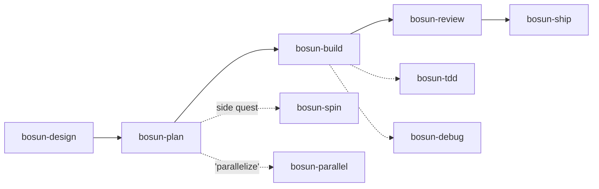
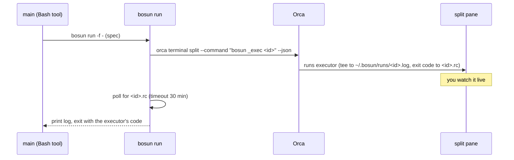
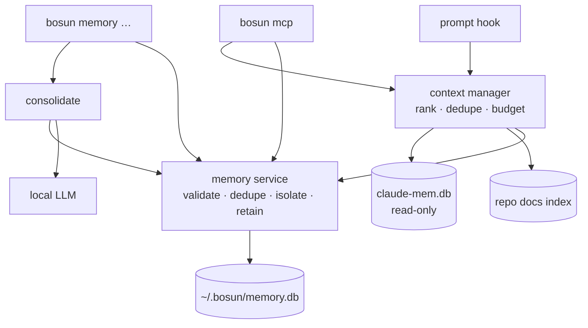
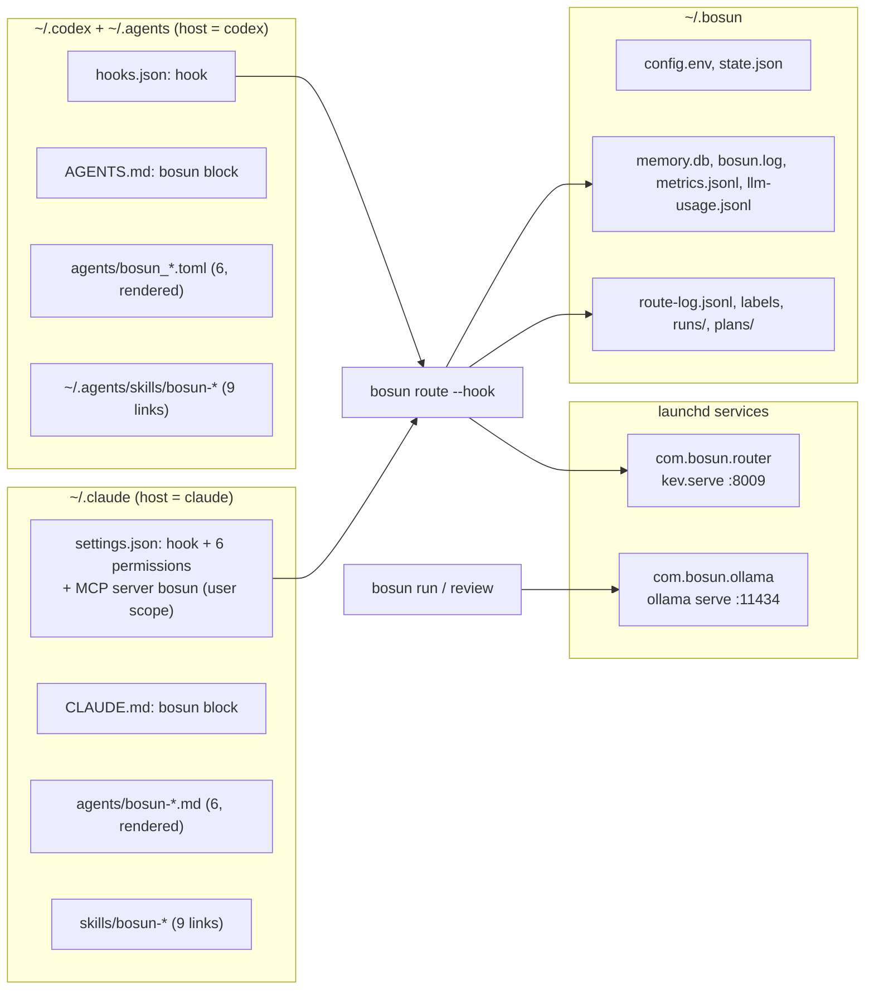

# bosun

**Pair with one agent; bosun routes the rest.**

You drive a single session in Claude Code, Codex, or both. bosun gives that session:
- a crew of roles
- a full skill set
- a local model for mechanical edits
- the other vendor's model as reviewer
- Orca for side quests and, when you ask, parallel work
- a local-first memory: curated notes you review, a few of them added to each prompt, and MCP tools on demand

Built for an M5 Pro with 48 GB, subscription logins, and TypeScript/Node services. It's a TypeScript CLI that Node ≥ 24 runs directly (native type stripping), with zero runtime dependencies.


## Roles

Each role has one source file, `roles/<role>.md`. It's rendered as a Claude subagent (`bosun-<role>`) and a Codex agent (`bosun_<role>`), so the two rosters can't drift. Models come from `~/.bosun/config.env`; `bosun roles` prints the live table.

| Role | Claude | Codex | Can | For |
|---|---|---|---|---|
| **main** | your session (Opus) | your session (gpt-6-sol) | everything | you pair here and it decides |
| architect | opus · high | gpt-6-astra · high | read-only | 2–3 options, a recommendation, an executor-ready spec |
| scout | haiku | gpt-6-luna · low | read-only | where is X, call sites, summaries |
| worker | sonnet | gpt-6-luna · high | edit + test/lint/tsc | spec'd edits that need reasoning |
| tester | sonnet | gpt-6-luna · high | test files only | tests, and the red step of TDD |
| debugger | sonnet | gpt-6-luna · high | read + run, no source edits | repro → hypotheses → root cause; hands off to the architect after 2 misses |
| reviewer | `bosun review`: **gpt-6-sol** from Claude, **opus** from Codex | | read-only | every diff before it ships (the subagent is only the fallback) |
| local | `bosun run` → qwen3.6 in Ollama | same | fenced edits | mechanical edits, $0 |

## Skills

Nine skills in `skills/`, linked into `~/.claude/skills` and `~/.agents/skills`: the same files for both hosts.



| Skill | When | What it does |
|---|---|---|
| bosun-design | a change with an open decision | at most 3 questions → architect options → you pick |
| bosun-plan | an approved design or a clear goal | task specs (lane, files, change, must-not-change, verify) in `~/.bosun/plans/` |
| bosun-build | a plan or a spec | per task: dispatch by lane, read the diff, run verify yourself, escalate after 2 failures |
| bosun-tdd | test-first | the tester writes red, local or worker makes it green, then refactor |
| bosun-debug | a bug or failing test | the debugger reproduces and finds the root cause, then a minimal fix through build |
| bosun-review | before shipping, or `--pr N` | the cross-vendor reviewer → each finding checked against the code → fix the real ones |
| bosun-ship | ship / commit / PR | an evidence gate, then messages; commits or PRs only when you ask |
| bosun-spin | "spin this off" | a self-contained spec → a new Orca worktree + agent; you keep pairing |
| bosun-parallel | "parallelize this" | independent tasks → supervised Orca workers with each role's model |

`bosun install --replace-plugins` turns off the plugins that overlap with these (superpowers, mattpocock-skills, code-review) and records what it disabled. `bosun uninstall` turns back on only those.

## Orca

- **Watchable runs.** Inside Orca, `bosun run` opens a split next to you and runs the executor there. You watch it live: Claude runs stream each step (`→ Edit src/order.ts`), Codex prints its own progress. The main model gets only the final result and the exit code.
  - Closed split: if you close it mid-run, `bosun run` returns right away (exit 130, partial log).
  - Split never starts: after 30 s it runs inline instead, and never twice.
  - Timeout: after `RUN_TIMEOUT_MIN` (30), bosun stops the executor.
  - Placement: the split opens next to the terminal that asked for it.
  - Cleanup: runs older than a week are pruned from `~/.bosun/runs`.
- **`bosun spin`** creates a child worktree with `claude`, `codex` or `local` working on a self-contained spec. It starts from the default branch unless you pass `--stacked`.
- **`bosun card <status> "comment"`** keeps your worktree card current. Skills call it at checkpoints, and it does nothing outside Orca.
- **bosun-parallel** drives Orca's own `orchestration` skill: `worker-start --worktree new-child --agent … --model … --effort …`.



## Memory

bosun keeps **curated** memory: facts you or the assistant chose to keep, such as decisions and why, conventions, gotchas and your preferences. It lives in `~/.bosun/memory.db` (SQLite with FTS5, mode 0600). claude-mem stays as it is: bosun reads its database read-only, and never stores the same thing twice.

- **Categories:** `personal` (you, in every project), `project` (this repo), `session` (expires after `MEMORY_SESSION_TTL_DAYS`, 7).
- **Projects:** a project is the hash of the repo's normalized `origin` URL. Every clone, worktree and machine of a repo shares one project memory. Projects can't see each other, unless a memory is `shared` or you list a project in `MEMORY_LINKED_PROJECTS`.
- **Each prompt:** the hook adds up to ~400 tokens (estimated) of the most relevant curated notes, next to Kev's hint. A note must share at least `CONTEXT_HOOK_MIN_TERMS` (2) distinct words with the prompt and score `CONTEXT_HOOK_MIN_SCORE` (0.35); otherwise the hook stays silent. It fails open when anything goes wrong, and until you store a first memory it opens nothing at all.
- **On demand (MCP, `bosun mcp`):** `memory_search`, `memory_get`, `memory_store`, `memory_update`, `memory_delete`, `context_retrieve` (curated + this repo's Markdown docs + claude-mem, ranked and fitted to a budget) and `project_knowledge_search` (docs + claude-mem).
- **Private:** `--private` memories never reach the model: not the hook, not `memory_search` or `context_retrieve`, and not a remote LLM. `memory_get` hides their body. Logs and metrics never hold titles, bodies, prompts or keys.
- **Proposals:** `bosun memory consolidate` has the local model turn this repo's recent claude-mem session summaries into **proposed** memories. Nothing becomes durable until you accept it in `bosun memory review` (or with MCP `memory_update`).

| You want | Do |
|---|---|
| Remember something | `bosun memory add -t "Use pnpm" --tags tooling "Always pnpm install; npm breaks the lockfile"` (`--auto` suggests title and tags) |
| Find it | `bosun memory search lockfile`, `bosun memory get <id>` (with its audit trail) |
| Change or drop it | `bosun memory update <id> -b "…"`, `bosun memory delete <id>` (archive), `bosun memory purge <id>` |
| Review proposals | `bosun memory consolidate`, then `bosun memory review` |
| Housekeeping | `bosun memory prune` (expired → archived, archived > 90 days → purged) |
| Numbers | `bosun memory stats` (this project's id, p50/p95 per operation, hook injections, LLM calls), `bosun memory bench`, `bosun memory eval <queries.jsonl>` |



More in [ARCHITECTURE.md](ARCHITECTURE.md): the schema, the ranking formula, and measured numbers.

## Split setup (optional)

Kev, the LLMs and memory can each run on another machine, for example a Mac Studio, with your laptop as the client. Each has its own URL: `ROUTER_URL`, `OLLAMA_URL`, `MEMORY_URL`. Empty means local, as before.

```bash
# on the server Mac: only the listed services, bound to its Tailscale IP
bosun install --serve kev,llm,memory
# on each client: it prints the exact line to run
bosun install --remote kev=http://100.x.y.z:8009,llm=http://100.x.y.z:11434,memory=http://100.x.y.z:8788
```

- **Bind:** `SERVE_BIND` defaults to the server's Tailscale IPv4. Without Tailscale, install refuses until you set a LAN IP. It's never `0.0.0.0` unless you set it.
- **Allowlist:** `bosun serve` answers 403 to any source outside `SERVE_ALLOW` (default `127.0.0.1/32,100.64.0.0/10` plus the bind address's subnet). Ollama can't filter by IP, so it relies on its bind address.
- **No tokens yet (v1):** anyone who can reach the memory port can read your memory, so keep it on a private network. The API is versioned (`/v1`), and one `authorize()` point is ready for auth later.
- **Transport:** plain HTTP. Tailscale encrypts it (WireGuard); a plain LAN doesn't.
- **When the server is down:** the hook's memory part gives up after `REMOTE_HOOK_TIMEOUT_MS` (300) and stays silent. The CLI and MCP say "memory server unreachable at …" after `REMOTE_TIMEOUT_MS` (5000). There's no offline queue: writes while offline fail visibly.
- claude-mem, the docs index, the hook and the MCP server always run on the client. Only the curated store moves.
- `bosun doctor` checks each URL, the server's `/v1/health` (a version mismatch is a warning), and the model on the remote Ollama. `bosun uninstall` removes the server's services, and on a client puts the URLs back.

## Install (not run yet)

```bash
cd ~/Developer/bosun
npm test                                     # 87 offline checks: no installs, no network, sandboxed HOME
./install.sh --host both --replace-plugins   # or --host claude / --host codex; drop --replace-plugins to keep your plugins
```

It sets up Ollama (≥ 0.34) with a 64K context and one model at a time, pulls `qwen3.6:35b-a3b-coding-nvfp4` (~22 GB), installs Kev (`kev-0.8b`), links `~/.local/bin/bosun`, wires each host (including the `bosun` MCP server: `claude mcp add --scope user`, and `codex mcp add` in each Codex home), runs `bosun doctor`, and ends with a smoke test in which the local model fixes a one-line bug. **Codex only:** open `codex` once, run `/hooks`, and trust the bosun hook.

**Codex inside Orca:** Orca gives Codex its own home folder (`CODEX_HOME`) and manages its `hooks.json`. bosun writes its rules and agents there too, so Codex in Orca gets the same roles and skills. The Kev hint appears only in Codex outside Orca, because Orca rewrites that `hooks.json`.



- **What it preserves:** wiring is idempotent. Your hooks (codegraph, orca, …), permissions and rules are kept. `settings.json` and `hooks.json` are backed up to `*.bak-bosun` first.
- **Broken config:** a `settings.json` or `hooks.json` that isn't valid JSON, or a hand-broken bosun marker in `CLAUDE.md`/`AGENTS.md`, stops install, uninstall and rewiring before anything is changed.
- **Uninstall:** `bosun uninstall` undoes only what bosun did:
  - removes its services, hook, permissions, rules, agents and skills, plus any file it created
  - removes its own `~/.local/bin/bosun` link and its own `~/.zshrc` PATH line
  - puts your own Ollama.app launchctl values back
  - moves your own files that it had set aside back in place
  - re-enables the plugins it disabled (`--replace-plugins` stays in effect across re-installs until then)

  It keeps the models, the Kev checkout, `~/.bosun` and the `*.bak-bosun` backups.

## Daily use

| You want | Do |
|---|---|
| Normal work | `claude` or `codex` as usual; the bosun block and Kev's hint steer delegation |
| Force a lane | say it: "architect this", "have the tester write the red test", "offload to local" |
| Skip the router once | add `#noroute` |
| Local edit by hand | `bosun run "add nullable deliveryWindow to OrderDto + mapper; verify: yarn tsc --noEmit"` |
| Other plan's model | `bosun run -e codex "…"` (GPT) / `bosun run -e claude "…"` (Sonnet) |
| Cross-vendor review | `bosun review`, `bosun review --pr 123` |
| Side quest | `bosun spin --agent codex "…"` |
| Health | `bosun doctor`, `bosun status`, `bosun roles` |
| Free RAM | `bosun stop` … `bosun start` (hosts keep working; hints and local runs pause) |
| Other local model | `bosun model devstral-small-2:24b` |
| Tune the router | `bosun label`, then `bosun eval` (after about a week) |
| Memory | `bosun memory add …`, `bosun memory search …`, `bosun memory review` (see [Memory](#memory)) |

## Local model and harness

| Model | Size | Notes |
|---|---|---|
| **qwen3.6:35b-a3b-coding-nvfp4** ✅ | 22 GB | SWE-bench Verified 73.4, Terminal-Bench 2.0 51.5; MoE with 3B active on Ollama's MLX engine |
| devstral-small-2:24b (fallback) | 15 GB | 65.8, from a different model family, so a Qwen template bug won't take out both |
| muse-glimmer:30b-nvfp4 | 17 GB | 76.0 but dense (slower); try it for harder edits |
| qwen3.8:27b-mlx | 18 GB | strongest agentic scores, but Ollama #17778 breaks tool loops for now |

- **`LOCAL_HARNESS=claude`** (the default) runs `claude -p --bare`: 3 tools, a system prompt of about 400 characters, and a dummy `ollama` key. It never touches your subscription.
  - Why `--bare`: Ollama's Anthropic endpoint doesn't cache prompts (#18431), so the full ~27K-character prompt would be re-read on every turn.
- **`LOCAL_HARNESS=codex`** runs `codex exec --oss` in the macOS sandbox: repo-only writes, `.git` protected, no network.
- **Executor rules** travel inside the prompt, because Ollama's Responses API drops developer-role messages (#18305).
- **LiteLLM was removed.** Both CLIs talk to Ollama directly.

## Safety

- **Local Claude executor:** `--bare`, the dummy key, and `ANTHROPIC_AUTH_TOKEN` plus the parent session's own `CLAUDE_CODE_*` variables stripped. The e2e test asserts that no `Authorization` header ever reaches the endpoint.
- **Executor fence** (Claude, `dontAsk`):
  - The only commands that run: read commands, `git mv`, `mkdir -p`, test/lint/tsc, and `git status/diff/log/show`.
  - `-e claude` and the Claude reviewer also run `--restricted`: your user and project settings can't widen what they're allowed to do.
  - Always denied: commit, push, reset, checkout, restore, clean, stash, rebase, `rm`, and the web.
- **Codex executors:** the OS sandbox with no network.
- **Reviewer:** read-only on both vendors (Claude: Read/Glob/Grep only; Codex: `-s read-only`).
- **Codex host:** `bosun` commands need localhost and `~/.bosun`, so the Codex rules block tells the model to ask to run them outside the sandbox. You approve once.
- **Guard:** `BOSUN_DEPTH` keeps executors from spawning more work, and the hook stays silent inside them.
- **Spin-offs and parallel workers** are told not to commit, push, or fan out further. Orca's depth limit backs that up.
- **High-risk prompts** (payments, orders, invoices, auth, data, infra) always go to the main thread.
- **Memory:** `bosun memory` is never auto-allowed for the model (the CLI shows private bodies and can purge), and MCP can mark a memory private but never make it public again. Project isolation comes from your environment (cwd, `CLAUDE_PROJECT_DIR`), never from tool arguments. Out-of-scope ids read as "not found". Private memories never reach a host or a remote LLM, and the remote LLM (`LLM_REMOTE=claude`) is off by default.

## Tests

`npm test` runs 87 checks offline, against a temp HOME, stub `claude`/`codex`/`orca`, a mock Kev/Ollama/Anthropic server, and fixture claude-mem databases:
- config precedence
- router hints and the cases where it stays silent
- roles rendering for both hosts
- wiring twice, then unwire restoring everything
- plist escaping
- the exact executor and reviewer flags
- the watch/fallback/closed-split paths
- spin and card
- a lint that every role, skill and command a skill mentions actually exists
- an end-to-end run of the **real `claude` binary** against the mock endpoint
- memory: storage, updates and version conflicts, duplicates, project isolation, retention, privacy, migrations, concurrent writers, FTS-safe queries
- context ranking, dedupe and budgets; the hook with memory (silent, fail-open, a 50 KB prompt); the claude-mem and docs providers
- the LLM router (timeouts, retries, bad JSON, fallback, remote gating), consolidation and review
- a real stdio MCP session; MCP registration in both hosts
- the split setup: `bosun serve` + the remote client (same results as local), the allowlist, unreachable and foreign servers, `install --serve` and `--remote`

Run it after updating Claude Code or Codex. `npm run typecheck` checks the types (strict); it needs `npm install` once for the dev-only `typescript` and `@types/node`.

## Files

```
bin/bosun            entry            lib/cli.ts       commands        lib/config.ts   settings + paths
lib/roles.ts         role rendering   lib/route.ts     hook (Kev+mem)  lib/services.ts launchd, Ollama, Kev
lib/orca.ts          watch/spin/card  lib/exec.ts      run + review    lib/wire.ts     host wiring + MCP registration
lib/context.ts       rank + budget    lib/mcp.ts       MCP server      lib/serve.ts    bosun serve memory|kev
lib/llm.ts           LLM router       lib/consolidate.ts proposals     lib/log.ts, metrics.ts  logs + numbers
lib/memory/          store (service, sqlite, project, remote), providers (claudemem, docs), CLI, bench
roles/*.md           6 roles          skills/bosun-*/  9 skills        policy.md       the CLAUDE.md/AGENTS.md block
config.default.env   defaults         test/            node:test       docs/           specs, plans, ledgers
ARCHITECTURE.md      memory design, data flow, measured numbers
```
