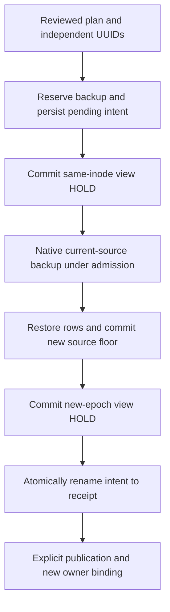

# 0009 · Explicit owned memory restore and source rotation

**Status:** Implemented for the current verified backup, journal-free owned layouts and explicit reconciliation of a bound pending restore's view journal. Interrupted-backup recovery, orphan disposition and process drain remain gates. **Date:** 2026-10-06.

## Decision

Restore is a separate explicit owner operation. It uses the current backup referenced by the verified cutover gate, rather than accepting an arbitrary file or discovering an expected identity from candidate storage. It restores the recorded memories, audit events and docs, including their privacy, scope, status, expiry, explicit keys and migration timestamp. A fresh native backup of the current source is preserved before restoration. Neither the old backup nor the current-source backup is overwritten.

```text
bosun memory cutover restore-plan --source-id OLD_UUID [--retain-unreferenced] [--json]
bosun memory cutover restore --plan TOKEN --source-id OLD_UUID --new-source-id NEW_UUID --clients-stopped [--retain-unreferenced] [--json]
bosun memory cutover restore-reconcile-plan --source-id OLD_UUID --new-source-id NEW_UUID [--retain-unreferenced] [--json]
bosun memory cutover restore-reconcile --plan TOKEN --source-id OLD_UUID --new-source-id NEW_UUID --clients-stopped [--retain-unreferenced] [--json]
```

The owner independently supplies the old source UUID. Initial planning generates the new source UUID and attempt UUID before effects: save both source UUIDs independently before mutation. Tokens expire after five minutes and bind reviewed metadata; they are editable freshness bindings, not authorization seals. Matching explicit retention acknowledgement permits bounded unreferenced artifacts to coexist without adopting or reading them. `--clients-stopped` remains operator attestation, with no automated stop/restart or configuration change.

## Planning and audience revocation

Journal-free planning uses filesystem identity/minimal primary-WAL headers and a retained native read-only lease on the rollback view. It never opens the mutable primary or a backup through SQLite. Completed referenced backup digests stay internal. Primary schema/floor and stopped clients remain unverified until admission. The existing strict owner inventory and canonical owner-only path rules apply, including full permission bits, single-link files and refusal of unknown names, links and sidecars.

When a pending restore has one bounded owner-only `<view>-journal`, reconciliation planning opens **no native SQLite handle**. It reads only filesystem metadata/minimal database headers and the pinned immutable capsule (plus its independently bound prior receipt, if any). It opens neither journal nor backup bytes, requires both saved UUIDs and exact capsule source/view/backup inodes, and labels the current view/reference **unverified** in JSON and plain CLI output. The plan binds journal inode, size and timestamps along with the rest of the reviewed inventory. It cannot establish source floor, recovered schema, journal provenance or outcome; those remain explicit mutation checks. Receipt-only journals and all other pending sidecars remain held.

An immutable owner-only `<view>.restore` capsule binds old gate/generation, both source UUIDs, the new attempt, a reserved pre-restore backup inode and any prior receipt. Its presence fences ordinary open, cached registered writes and public reading. Readers check only filename presence, including dangling links; they never open owner JSON or recovery artifacts. HOLD revokes the audience and does not physically erase previous public rows.



Native primary write admission spans the backup and logical restore. Existing schema and floor triggers remain installed; the private restore UDF is guarded by current source/view/pending identities. Explicit keys are inserted into the existing memories/events/docs tables, preserving gaps and rebuilding FTS through the source triggers. Full canonical path, owner, mode, sidecar and identity checks run after fallible checkpoints and immediately before source COMMIT. Success rotates the source epoch, resets the restored generation to zero and returns HOLD. Old bindings remain ineligible even after later publication. Reopen authorities and separately publish/bind the new UUID before delivery.

## Interrupted operation reconciliation

The immutable pending capsule is evidence of a particular attempted restore, not proof that source DML committed. Reconciliation requires both independently saved UUIDs, exact native floor/schema and matching gate/artifact identities under admission.

| Authoritative source state | Explicit reconcile behavior |
|---|---|
| Exact old floor and original generation | Restore transaction rolled back. Preserve current rows and generation, rotate the epoch without replay, return `rolled_back` and HOLD. |
| Exact new floor | Finish metadata only; preserve current generation and rows, return the recorded outcome and HOLD. |
| Exact completed receipt after subsequent writes | Verify receipt and current epoch, revoke READY to HOLD, preserve intervening writes/generation; no restore replay. |
| Unknown floor, contradictory capsule, unsafe journal or artifact | Hold with a finite error; no guessed repair or artifact adoption. |

Pending journal recovery is admitted only by explicit `restore-reconcile`. Before writable view open, the operation pins the capsule and journal metadata, takes primary `BEGIN IMMEDIATE`, validates the exact source schema/floor and independently supplied old/new UUIDs, and checks source/view/backup identities and the old completed reference digest. An old floor must match the capsule's original generation; its reserved fresh backup may still be empty or unfinished. A committed new floor must match the exact derived gate and completed fresh backup digest. Matching retention acknowledgement remains required for unreferenced artifacts. Freshness and capsule/journal identity are rechecked immediately before writable view open.

SQLite then performs its native rollback recovery; bosun does not read/parse journal payloads, replay restore rows, replace the view inode or delete/adopt unknown files. The recovered view must pass the exact schema, gate and public-state checks before metadata convergence can proceed. If native recovery changes storage and later validation fails, the operation reports an **unknown outcome**, preserves the pending capsule and leaves ordinary, cached and reader authorities fenced. No source restoration or epoch rotation is committed in that failure path. A fresh journal-free plan will hold the invalid recovered view for review.

This authority rule shares publication's owner-only bounded journal filesystem checks and admitted source/reference binding. It is a trusted-application boundary, not authentication of a journal creator against a hostile process with the same UID. A well-shaped filesystem candidate alone does not authorize recovery.

A legitimate explicit format-1 to publication-format-2 upgrade remains compatible with completed receipt reconciliation. Receipt replacement verifies the old receipt identity/hash first. The final rename is followed by directory fsync. Failure after COMMIT or rename can report an unknown outcome; it does not guarantee that a pending file remains or that data rolled back. Obtain a new reconcile plan rather than blindly replaying restore.

## Bounds and qualification

Capsules are at most 16 KiB. Reads pin an `O_NOFOLLOW` descriptor, compare full pre-read descriptor/path metadata, allocate only the validated length, use bounded reads and recheck metadata afterward. The single admitted view journal is between 512 bytes and 64 MiB and its payload stays native-only. Restore loads at most 100,000 combined rows and 64 MiB of encoded field bytes. Backup inventory remains at most 32 files, 64 MiB each and 256 MiB total, with capacity reserved for one fresh artifact on initial restore. Owner JSON and private-record values never enter public receipts, tokens or reader projections.

Twelve restore cases cover real CLI planning footprints, format-1/2 data parity, fixed inodes/FTS/keys, old-binding and cached-writer fencing, native reader leases and contenders, seven actual SIGKILL checkpoints, repeated reconciliation with intervening writes, source/view replacement before COMMIT, capsule growth, post-rename fsync uncertainty, strict flags/IDs/tokens, publication upgrades, malformed storage and matching retained-artifact acknowledgement. The coordinator independently passed 321 application tests and 18 containment groups under guarded Node, plus strict typecheck and boundaries. Detailed counts live in the implementation ledger (`../plans/2026-10-04-bosun-v1.0-implementation-ledger.md`; historical citation, recover via `21d5dc6:PATH`).

Five additional guarded cases qualify the pending journal slice. Synthetic trusted-owner view transactions within real pending old/new restore intervals force dirty SQLite pages to spill and sync a nonzero hot header before actual SIGKILL. Metadata-only plans and fenced ordinary/cached/read-only authorities preserve their full footprints; constructor tracing proves zero native planning opens and zero writable view opens on rejected admitted source/floor/backup authority. JSON/plain CLI labels, independent UUIDs, stale/substituted journal identities, unknown names/links/modes/sidecars, short/oversize journals, backup bytes, private canaries and invalid recovered schema are checked. Admitted source-open rejection fixtures allow only volatile primary SHM payload housekeeping; canonical metadata and primary/WAL/view/journal/capsule/backup bytes stay checked. Explicit convergence preserves source rows/generations and both fresh/old backup bytes, keeps the view inode, discards uncommitted spill rows, returns HOLD and never replays restore. Repeated reconciliation preserves later registered writes. Coordinator independent focused checks passed 113/113 application tests plus 18 containment; full regression passed 326/326 plus 18 containment, with strict typecheck, boundaries and documentation checks.

This qualification covers the current verified backup, tested clean-journal checkpoints and that bound pending view-journal recovery. Referenced mid-backup sidecars, receipt-only journals, arbitrary backup selection/import, general orphan disposition, hostile same-user filesystem races and storage/power-loss durability remain unqualified. No owner database/configuration, live host, service, dependency or model is activated. Process drain/restart, finite-expiry handoff, performance and the rest of the single-v1.0 roadmap remain required. [ADR 0008](0008-strict-owner-memory-cutover.md) supplies the preparation, inventory and admission rules; [ADR 0006](0006-explicit-public-memory-publication.md) and [ADR 0007](0007-bound-public-memory-reader.md) govern separate publication and delivery.
