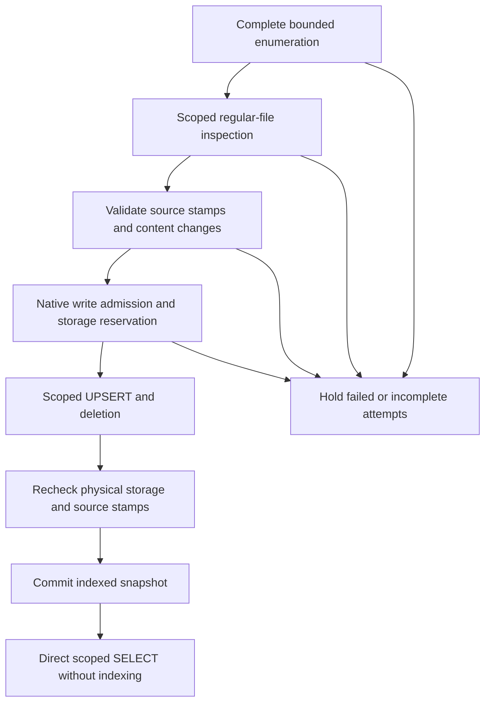

# 0011 · Scoped docs snapshots and explicit indexing

**Date:** 2026-10-06. **Status:** Implemented for guarded native plain/registered sessions; daemon scheduling and general storage growth remain gates.

## Decision

`SqliteDocs` implements the existing ContextSource/MemoryProvider interfaces over an established SQLite session. Its immutable scope contains a canonical root, project ID and excluded nested roots. Direct search performs SELECT/projection only, with no filesystem discovery, Git, indexing or telemetry. It authorizes the configured project from trusted caller equality or explicit linked-project policy. SQL binds both project and root prefix before projection and excludes nested roots. Absolute stored path keys, relative result IDs, FTS rank/snippet/title and row sequence remain compatible. No eighth port or schema migration is introduced.

`SqliteDocsIndex` performs explicit indexing with injected complete enumeration, source inspection, storage eligibility and measurement. The effectful `docs-filesystem` helper owns bounded Git/filesystem work. Query/index modules cannot import the helper, legacy state or ambient clocks. Exact forwarding and adapter seams remain enforced by the AST boundary checker.

The legacy `Docs` composition continues to index before search while daemon callers migrate. A held attempt returns no docs and preserves saved rows. Its direct `index` return retains the existing changed/removed counts; the explicit index API additionally reports `indexed` or `held`. This compatibility closure still performs Git/filesystem/metrics effects.

## Enumeration, ownership and deletion

Indexing requires a successful complete NUL-terminated Git listing before deletion. Failure, truncated output, process/output limits, count overflow or transient source errors hold the whole attempt. The operation never treats failed enumeration as an empty directory or truncates a complete inventory and deletes its unvisited records.

Source inspection checks the actual canonical root and every ancestor without following symlinks. Nested `.git` presence is metadata only; its payload is not read by the source probe. Missing, directory, symlink, hardlink and oversized sources have stable rejected dispositions. Transient errors or changed stamps hold the attempt. Deletion is restricted to stored rows matching the configured root **and project**, preserving other worktrees/projects. Same-project nested rows have ambiguous indexer ownership in the existing schema: retain them and exclude their roots from the outer query instead of guessing adoption/deletion. Scope exclusions are snapshots and require a newly validated scope to change.

The native helper opens bounded regular files with `O_NOFOLLOW`, pins descriptor/path/ancestor stamps before reading and validates them afterward and around admitted DML. A listed file is read even when its timestamp matches a saved row; content/title/mtime comparison prevents unchanged UPSERTs. This catches preserved-timestamp edits while keeping row sequence, generation and READY state unchanged for identical inputs. Descriptor close failure holds indexing and attempts one identity-bound retry; persistent failure does not prove release.

## Bounds and outcomes

Enumeration is at most 2,000 files and 2 MiB output. Each file is at most 256 KiB. Saved docs are bounded at 10,000 rows and 16 MiB encoded fields; source preflight uses a conservative UTF-8 upper estimate, so the limits do not promise that every corpus below them is eligible. The index also reserves estimated source/WAL space using eight times changed encoded fields plus 12 KiB per changed/deleted row, then checks actual physical sizes after DML. These are conservative eligibility checks, **not a proved bound on pending SQLite/FTS allocation at COMMIT**. Existing registered writer construction/admission checks remain intact; callback PRAGMA permissions are unchanged. Central final-COMMIT storage growth and recovery remain explicit same-v1.0 gates.

Source checks repeat under write admission before DML and afterward; failure after DML rolls it back. Registered writes retain existing generation, HOLD and writer-fencing behavior. A retained native READY lease permits queries and blocks index mutations; release allows mutation and revokes READY to HOLD. Measurements contain only fixed operation, finite duration, success and changed/removed counts. Timing/sink failures do not change committed receipts; arbitrary source/dependency errors become finite errors without file paths, bodies or titles.

Direct queries read an indexed snapshot. They do not establish live filesystem revocation, global filesystem atomicity, a model delivery lease or isolation from hostile processes with the same UID. Legacy opener/config/metrics effects and arbitrary native WAL-open housekeeping remain separate boundaries. No owner database/configuration, live host/service, dependency/model install or product version is activated by the fixtures.

## Qualification and dependent work

Native regressions reproduce failed-list deletion, cap truncation, outside-symlink exposure and cross-project prefix deletion on the prior implementation. Direct/compatible plain and registered fixtures cover complete bounds, actual worktrees/nested repos, scoped linked access, unchanged query footprints, row/FTS parity, native leases/HOLD/format fencing, malformed/truncated listings, short reads/source races, physical eligibility, actual CLI/stdio MCP/context canaries and ambient-free direct imports. Coordinator additions reproduce and fix preserved-timestamp edits and uncertain descriptor cleanup, preserving unchanged snapshots. Actual counts and final verification are recorded in [the implementation ledger](../plans/2026-10-04-bosun-v1.0-implementation-ledger.md).

Daemon migration must select direct queries and schedule explicit indexing with fresh scope/recovery handling. Lean hook/config snapshots, CLI retention/sharing semantics, broader storage/disposition/drain and all native/Clef/handoff/graph/dashboard/remote gates remain required for the single v1.0. [ADR 0010](0010-writable-memory-adapter.md) records the shared session and dependency architecture.
