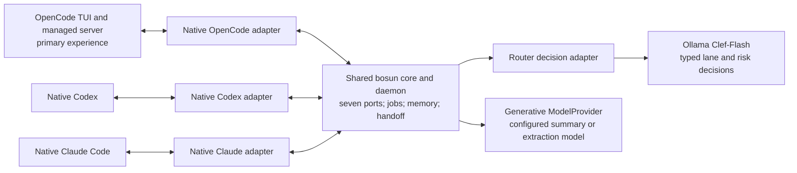
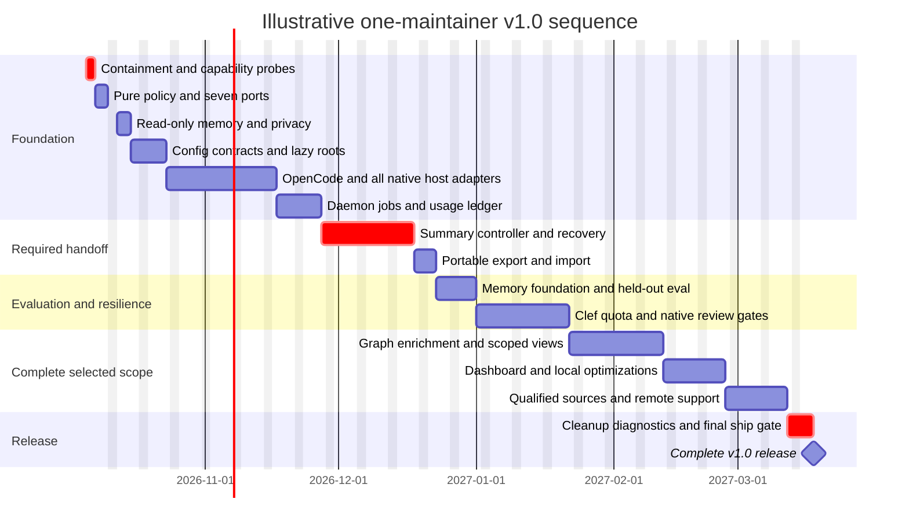

# bosun v1.0 roadmap

**Latest owner scope amendment, 2026-10-12:** keep **OpenCode 2 primary with Codex and Claude Code supported**, confirmed by “Keep supported hosts”; **omit cleanup from the plan**. This supersedes the earlier same-day OpenCode-only/removal amendment. Preserve native runners/controls/profiles and their qualification gates, all non-host features, explicit models/privacy and one final verified commit. The owner also requests **Bun only, after verifying its prior test-safety issues first**; do not bypass containment or continue Node runs as a silent fallback. [The direct-delivery plan](2026-10-06-bosun-v1.0-direct-delivery.md) now has four remaining items: host integration/handoff (including Bun safety), quality evaluation, final qualification, and delivery. OpenCode2.0.27 remains the source-pinned target, without V1 fallback. No new generic ACP scope is inferred; leave its existing code untouched. Older Node-only/cleanup and OpenCode1 details below are historical, not authority to prune retained hosts or run unsafe tests.

**Implementation route revised 2026-10-06:** the owner requested direct final-runtime delivery and one clean final commit. Use [the direct-delivery plan](2026-10-06-bosun-v1.0-direct-delivery.md) for sequencing; this document retains accepted feature scope. Fine-grained compatibility migration is superseded; the owner approved direct delivery and implementation resumed.

Research completed 2026-10-04. The filename retains the original 2026-10-01 planning date. This is an implementation plan, not evidence that v1.0 features exist. v0.2.0 remains unchanged.

The owner's release policy, updated 2026-10-04: **one v1.0 release containing all selected work**. Implementation phases are internal checkpoints, with one final ship gate. Do not assign features to subsequent versions or bump the package version during this build.

Build the single-Mac foundations first, then complete enrichment, the interface and remote support before shipping. **Make OpenCode the primary experience, with native OpenCode, Codex and Claude Code support behind the same seven ports. Replace Kev with local Clef-Flash decision routing. Include automatic fresh-context handoff, graph memory, the Ink dashboard and two-Mac support in the same v1.0; activate graph retrieval only when it beats the lexical baseline.**

The [research decision register](../research/README.md) records owner choices and dated defaults. The eight source notes are [runtime](../research/01-runtime.md), [protocol](../research/02-protocol.md), [libraries](../research/03-libraries.md), [abstractions](../research/04-abstractions.md), [topology](../research/05-cli-topology.md), [architecture](../research/06-architecture.md), [graph memory](../research/07-graph-memory.md) and [features](../research/08-features.md). Estimates below overlap those notes; do not add all their totals together.

The owner's subsequent OpenCode/Clef request is researched in [09 · OpenCode and Clef](../research/09-opencode-clef.md). That revision supersedes the earlier two-host/Kev implementation choices while preserving historical measurements.

## Decision log

“Owner” means an explicit recorded preference. “Baseline” means a selected result/default from topics 1–5. “Research default” means a recommendation from this continuation, available to revise; it is not a new owner approval.

| Decision | Status | Result and reason |
|---|---|---|
| Release scope | Owner, 2026-10-04 | Everything selected belongs to one v1.0. Internal dependency phases replace separate release milestones; ship after the complete scope is ready. |
| Audience and topology | Owner | One user, up to two Macs; daemon accepted; no server Mac yet. Prioritize the single-Mac path. |
| Primary host and native support | Owner, 2026-10-04; first-class interpretation documented in topic 9 | OpenCode-centric onboarding, managed sessions and examples; native OpenCode, Codex and Claude Code HostAdapters/AgentRunners in the same build. Core behavior is shared, with per-host capability qualification. |
| Execution router | Owner, 2026-10-04 | Clef-Flash through local Ollama `/v1/systemone` replaces Kev. Retire Kev's Python/uv service; validate typed decision responses and re-evaluate thresholds. Generative summarization uses a separate ModelProvider. |
| Runtime and distribution | Baseline, topics 1/5 | Bun 1.4.x, portable `node:*` code, one compiled `bosun` with splitting/bytecode; Node LTS remains the escape hatch. Original-Mac measurements justify the choice, not a fresh benchmark here. |
| Current Node baseline | Dated correction, topic 6 | Node 26 is Current on 2026-10-04, scheduled for LTS on 2026-10-28. Keep the current Node LTS leg until the transition; never label a future release already LTS. |
| SQLite | Owner + baseline | Raw `node:sqlite`, existing migrator/IDs; approved vanilla dylib for sqlite-vec, FTS-only degradation when unavailable. |
| Transport | Baseline, topic 2 | HTTP/1.1 JSON over local UDS; SSE; stdio JSON-RPC/MCP. One method/schema table drives all adapters. Remote TCP is opt-in with Tailscale, bearer token and allowlist. |
| Libraries | Baseline, topic 3; release scope updated by owner | Lazy commander, Zod, Hono on node:http, MCP server v2, smol-toml, LogTape and Ink. Build the dashboard after daemon state/SSE exist. Exact versions from the dated library note need implementation-time revalidation; no dependencies were installed for this research. |
| Agent loop | Owner, topics 4/9 | Native OpenCode server/CLI, Codex CLI/app-server and Claude Code CLI plus generic ACP. OpenCode's existing harness is the primary loop; do not embed or rewrite it in bosun. Evaluate local harnesses before a scoped own-loop decision. |
| Extension surface | Owner/baseline, topic 4 | Seven ports: HostAdapter, AgentRunner, ModelProvider, MemoryStore, ContextSource, Workspace, Router. Compiled lazy registry; ACP/MCP/OpenAI-compatible HTTP for outsiders. |
| Package and dependencies | Research default, topic 6 | Single package, feature use cases and adapters, four composition roots; no workspaces/DI container. A resolved import graph and hook bundle check enforce boundaries. This supersedes topic 3's provisional workspace suggestion. |
| Hook configuration | Research default, topic 6 | Admin parses TOML + Zod and atomically generates a versioned JSON snapshot. Hook closure stays `node:*` + lean internal code; no smol-toml exception. Manual edits require validation/reload. |
| Writer and fallback | Baseline tightened by topic 6 | One long-lived daemon writer; read-only hook fallback; short in-process CLI/MCP writes only on known pre-dispatch connection failure. Never replay a mutation after an ambiguous timeout/lost response. |
| Installation | Owner/baseline, topics 4/5; topic 9 revision | OpenCode profile/plugin, native agents, shared skills and MCP via manifest-owned scoped configuration; preserve JSON/JSONC precedence. Claude plugin after a one-day spike; Codex respects Orca's managed home/hooks. Homebrew stable path, exact undo and no shell-file edits. |
| Test safety | Owner + research default | No current Bun suite. Implement an enforced HOME launcher/preload, child and symlink checks and stub process effects first. A future Bun leg still requires explicit authorization. |
| Memory levels | Research default, topic 7 | L0 external evidence references; L1 facts; L2 scoped entities/relations; L3 summaries; L4 reviewed profiles. Implement all selected levels in this build, starting with SQLite L1–L2/minimal lineage; qualify graph, vectors and extraction separately before activation. Kùzu is archived. |
| External graph tools | Owner clarification, 2026-10-04 | Graphify/CodeGraph are optional user-installed sources, enabled only against verified export/MCP contracts. Missing tools/identities do not block development or release; no automatic installation. Bosun's own graph memory remains required scope. |
| Privacy and external memory | Owner/contract, corrected in topic 7 | Private data never reaches any model, including local embeddings/extraction. This overrides topic 4's permissive local capability sketch. Scope/validity/deletion apply to all derivatives. claude-mem stays external and read-only. |
| Automatic compact/handoff | Owner, 2026-10-02 | Configurable summarizer at active context threshold, fresh context, portable handoff. Native compaction alone does not fulfill it. Managed-session capability probes and retention/recovery evals are release gates. |
| Model selection | Owner/context constraint | Preserve an explicitly chosen model; new skills document GPT-6.1 Sol/Astra/Luna without changing defaults. The later any-ModelProvider handoff request permits optional native CLI summarizers; router/consolidation retain the earlier local-first/no-ChatGPT-plan default. |
| Two-Mac memory | Research default, topic 7; release scope updated by owner | Implement an authenticated authoritative server profile and permitted local read views in this build, after the local path. Use two isolated daemon instances for integration tests; owning a server Mac is not a prerequisite for building support. No live SQLite/WAL copying, multi-master synchronization or CRDT system. |

The [Node schedule](https://github.com/nodejs/Release/blob/main/schedule.json) and [Kùzu archive](https://github.com/kuzudb/kuzu) were checked 2026-10-04. Earlier measurements were taken on the original M5 Pro/48 GB Mac; installed versions on this Mac are Node 24.16.0 and Codex 0.160.0. OpenCode/Ollama are absent from this shell's PATH; no live host/model behavior was tested here.

## OpenCode primary, with three first-class native hosts

This is feasible through the existing HostAdapter and AgentRunner seams. OpenCode is the primary user journey and the first adapter implemented; Codex and Claude Code remain directly selectable native hosts and workers/reviewers. Each must pass the common role/skill/MCP, job/access, review, memory, quota-status, artifact and managed-handoff acceptance matrix before shipping. First-class support means a supported native workflow, not identical APIs or automatic control of arbitrary existing UI sessions.

| Host | Native adapter/control surface | Shared contract |
|---|---|---|
| OpenCode, primary | External managed server over native HTTP/SSE; thin local plugin; attached OpenCode TUI; explicit CLI jobs | Normalized sessions/events/permissions/usage; canonical role/skill sources; bosun owns its job/transfer ledger |
| Codex | Native CLI for bounded jobs; owned app-server for managed interactive threads | Same contracts, native model/effort/login, Orca-managed-home protection |
| Claude Code | Native CLI stream; supported hooks/statusline; qualified plugin wiring | Same contracts, native model/effort/login, preserved configuration/statusline |

The inspected OpenCode baseline is [v1.18.34](https://github.com/anomalyco/opencode/releases/tag/v1.18.34), with [native server APIs](https://opencode.ai/docs/server/) and [context-only SDK submission](https://opencode.ai/docs/sdk/). Revalidate the exact upstream version/schema when implementation starts. Its v2 SDK/plugin docs use a different contract; do not combine them with v1 examples. Use a thin native client instead of bundling OpenCode's full harness into bosun. Starting/attaching that external host is explicit; hooks never auto-start either service. Bosun's own daemon remains UDS-first; OpenCode's authenticated loopback HTTP is native-adapter transport.



Keep native harness identity separate from provider/model identity. OpenCode running an OpenAI or Claude model is still OpenCode, not native Codex or Claude Code. Its docs describe ChatGPT login/API access; account/model support must be verified. Use a supported API/cloud provider for Claude models inside OpenCode, or delegate to the user's native Claude Code process. Do not import Claude Pro/Max credentials into OpenCode. The earlier local-first router/consolidation policy stays in place. [OpenCode providers](https://opencode.ai/docs/providers/), [Codex authentication](https://learn.chatgpt.com/docs/auth), [Anthropic credential rules](https://code.claude.com/docs/en/legal-and-compliance#authentication-and-credential-use).

## Clef-Flash routing migration

Select local `clef-flash:9b` through Ollama's [decision API](https://docs.ollama.com/capabilities/decision). The [model card](https://ollama.com/library/clef-flash) requires Ollama 0.35.1+; verify actual model/digest, capabilities and residency during implementation. It is a typed decision model, not the `[compact]` summarizer. Keep lane/risk schemas, deterministic high-risk override and selected-model policy; validate responses and evaluate thresholds on held-out examples. Concentration/confidence is not calibrated probability of correctness, and Kev's existing threshold is not automatically valid for Clef.

Retire the Kev training-run configuration, uv/Python service, `/v1/models` readiness assumptions and Kev-specific remote proxy/flags through backed-up config/manifest migration. Reuse Ollama, with provider-neutral router naming. Existing explicit remote endpoints need a reported migration; no guessed rewrite, auto-install or model pull. Run Clef only in explicit router/job/dispatch use cases outside hook/plugin callbacks; these can read permitted completed hints or enqueue bounded work, never wait for inference. Missing/invalid decisions leave work in the main thread. No private/unknown-scope input or prompt-content logs reach Clef. See [topic 9's complete migration requirements](../research/09-opencode-clef.md#5-clef-flash-evidence-and-migration).

## Internal implementation phases and one ship gate

All phases below belong to v1.0. Their exit criteria allow the next dependent work to proceed; they are not separate releases. Features rejected by the research remain outside scope. Optional experiments and unresolved adapter capabilities need an explicit evidence-based disposition before shipping, rather than an automatic assignment to a later version.

### Phase A · Safe host orchestration and automatic handoff

Scope: one binary; ports and composition roots; TOML migration/snapshot; shared contract/errors; UDS daemon/jobs/SSE; OpenCode-primary native integration plus native Codex/Claude and ACP; Clef routing/Kev retirement; Orca and git-worktree; manifest installation plans; stronger FTS and additive memory graph foundation; mandatory managed-session auto-handoff and portable state transfer; bounded quota holds and the selected small reliability features.

Exit criteria:

- Existing commands, memory IDs, scope/private behavior and role fences retain parity. Keep migration aliases during the build and document their final supported spellings before shipping. No remaining legacy import exceptions or cycles. All seven port suites and compiled entry smokes pass.
- Test launcher rejects missing/outside-root HOME before imports, symlink escape and real supervisor calls; children share the same guard. All development/CI test commands use it. No test writes into a personal host home or invokes a real installer/service.
- One daemon per BOSUN_HOME; 0700 directory/0600 socket; default has no TCP listener or client auto-spawn. Lock/start races, data/schema/version skew, drain/restart, SSE backpressure/cancel and read-only fallback are verified. Mutation ambiguity produces a recorded unknown outcome, never blind retry.
- Hook has only the approved dependency closure; no stdout/color detection at import, no model/embedding calls, synchronous remote dependency, indexing or expiry/access writes. Bun-specific dylib/extension setup stays outside its closure; fallback uses standard FTS with default SQLite, never sqlite-vec. Verify fallback against a DB containing optional vector tables with the extension absent; incompatibility/deadline exhaustion omits memory. Designated-Mac targets: ≤8 ms p50 against a stub daemon, ≤15 ms p95 with a warm daemon/10k fixture; report cold first-exec separately. General CI reports timing with a coarse regression guard.
- Private body/title/tag/derivative canaries never reach any provider, hook or model-facing endpoint. Content-free telemetry fixes the current router prompt-log leak. Revocation/expiry/purge invalidates graph, FTS, vectors, summaries and caches before another read can serve them.
- Automatic handoff works for the declared supported **bosun-managed OpenCode, Codex and Claude Code** session versions: valid telemetry, threshold crossing, bounded permitted-source summary, atomic artifact, fenced prompt admission, idle destination startup, fresh-session acknowledgement, source retirement and failure recovery. Qualify OpenCode no-reply seeding and destination TUI/session selection. Owner constraints/permissions survive; a pending or unknown tool effect is reconciled rather than replayed. Unsupported existing UI sessions are explicitly manual and excluded from automatic support claims.
- Portable import verifies checkout/dirty files/dependencies and artifact checksums before work resumes. A document alone is sufficient only when the needed checkout state already exists; patch/untracked bundles are explicit exports. Credentials and processes never transfer implicitly.
- Native OpenCode/Codex/Claude pass the common acceptance matrix with documented per-host capabilities. OpenCode role/skill/MCP/plugin configuration and all manifest adoption/undo/release assets pass guarded tests. Clef schema/failure/privacy/evaluation checks pass, with no selected Kev/Python-service dependency. Live plugin, managed-session and launchd/TCC probes occur only in an authorized isolated setup. No installation happens merely because this plan is complete.

The stronger FTS path is usable at this internal checkpoint. Graph work continues in Phase B; completing its foundation alone does not complete the selected memory scope. Failure of the automatic-handoff gate blocks calling that required feature complete.

### Phase B · Graph memory, interface and optimizations

Implement bounded graph retrieval, local embedding/extraction adapters, reviewed merge/contradiction proposals, MCP hybrid retrieval, scoped L3 summaries and reviewed L4 profiles. Each model-assisted path operates only on permitted non-private inputs; no inference moves onto the hook. Provide optional read-only external ContextSource integration over verified exports/MCP. Users install/configure Graphify/CodeGraph only when needed; validate tool-specific compatibility at that point, leave absent sources disabled and never auto-install. Those tools are not development or release prerequisites.

Complete the Ink dashboard over existing jobs/quota/handoff/SSE state, cache-stability evaluation/rendering, bounded consolidation scheduling, opt-in local notifications, safe worktree reconcile/prune previews and sanitized profile export. Run local-harness evaluations within this build; a local loop requires evidence that existing host/ACP harnesses fail representative tasks and a scoped decision.

Exit criteria: selected capabilities are implemented with usable commands/configuration and recovery checks; every activated enrichment beats its previous baseline under a stated budget; no privacy/scope/staleness leaks; default review work stays ≤5 minutes/day; model/index revisions can be rebuilt/disabled safely. The TUI handles disconnection and explicit job actions without adding hook imports or a second state machine. An optimization that fails its benefit gate is recorded with its evaluation and disposition, not claimed as a gain.

### Phase C · Remote support and publishing readiness

Implement the authenticated server profile, stable project identity across clones, asynchronously refreshed permitted local views and visible offline-write behavior. Validate two isolated daemon instances, separate homes/checkouts and transport/authentication stubs before any real deployment. Document supported login/boot/TCC conditions and remote setup; the owner currently has no server Mac. Actual server provisioning is a deployment choice, not an unfinished software feature to defer to another release.

Exit criteria: remote outage/skew/revocation tests, no cross-user/project leakage, no two writers merging SQLite files, explicit supported offline semantics, documented profiles/trust boundaries and guarded clean-home onboarding/release checks. Live installation or second-machine deployment remains a separately authorized action. Public plugin protocols, multi-master sync and a full agent platform remain rejected scope.

### Final v1.0 ship gate

- Every selected capability in Phases A–C and migration steps 0–11 is implemented, documented and validated. No selected work is silently moved to a subsequent version; internal checkpoints do not trigger a release or package-version bump.
- Automatic handoff passes host capability, retention, tool-isolation and ownership/recovery qualification for each declared supported host. All privacy, containment, migration, installation and compiled-entry checks pass.
- Graph/enrichment evaluation is complete against the stronger lexical baseline under the actual token/latency budgets. Activation remains gated; an evaluated opt-in or disabled path is clearly labelled. A failed required gate or unavailable required adapter needs a recorded resolution before the ship decision. Optional Graphify/CodeGraph absence is an expected disabled-source state and does not block shipping; no unverified tool compatibility is claimed.
- Dashboard, remote/local-view behavior, portable transfer and diagnostics are usable; release assets and docs describe the full supported scope and limitations. Only at the actual ship step set the release/package metadata to v1.0 and publish through the requested release workflow.

## Migration steps and verification

Use the [complete v0.2 file map](../research/06-architecture.md#62-complete-v020-migration-map). Move one caller behind compatible forwarding exports at a time. Preserve IDs/schema behavior until its migration is separately implemented; keep behavioral assertions while relocating tests.

The commands below are **proposed implementation interfaces**, not runnable research results. Their scripts, suites, fixtures and build paths must be created in the relevant step; none were run here. The first step also routes existing test/typecheck/build subprocesses through the guarded environment. `--suite` selects declared test groups; it must not silently ignore an unknown group.

| Step | Concrete deliverable and green boundary | Estimate / future verification |
|---|---|---|
| 0 · Contain tests and qualify surfaces | HOME-first paths; mandatory launcher/preload; stub interpreters/PATH; child/symlink guards; three native managed-session capability/schema probes, OpenCode ingress/no-reply/UI checks and Clef/Ollama decision fixtures; no real installation/model calls from tests | 1–2 days for containment; native/router qualification allowance below · `node scripts/run-tests.mjs --runtime node --suite containment,host-capabilities,router-contract` |
| 1 · Extract policy/ports | Pure text/domain/errors, seven contracts, factory registry; old entry points delegate through forwarding exports. Graph check resolves aliases/reexports/dynamic literals, rejects unhandled computed imports and detects cycles | 2–3 days · `node scripts/check-boundaries.mjs` and `node scripts/run-tests.mjs --runtime node --suite core,contracts` |
| 2 · Isolate memory/context | Inject config/clock/metrics; truly read-only reader; scope/private policy before providers; query/index/expiry split; eliminate private metadata/model suggestions. Preserve old memory/HTTP/MCP assertions | 2–3 days · `node scripts/run-tests.mjs --runtime node --suite memory,privacy,fallback` |
| 3 · Contracts/config/libraries | One method/error table, lazy commander, TOML migration and hook snapshot; Hono UDS/SSE and MCP version fixtures; embedded assets and stdout import fix | 4–6 days · `node scripts/run-tests.mjs --runtime node --suite config,transport,mcp` and `node scripts/check-hook-bundle.mjs` |
| 4 · Host/runner/workspace adapters | Native OpenCode server/plugin/config first; canonical role/skill/MCP rendering; Claude plugin probe; Codex managed-home discovery; plan/apply manifest; shared native event/access/provider identity contracts; ACP stub; Orca/git-worktree. Keep direct wiring if an optional plugin probe fails | Original two-host foundation 10–15 days; OpenCode allowance below · `node scripts/run-tests.mjs --runtime node --suite hosts,runners,opencode,workspace,manifest` |
| 5 · Daemon/jobs and router cutover | Lock/home discovery, bounded jobs/SSE, durable job ledger/cancellation, client env allowlist, safe fallback/cache/version checks, drain/restart; Clef decision adapter/model readiness and conservative fallback; manifest-owned Kev service/remote/config migration; retire file rendezvous after parity | 5–10 days plus shared qualification allowance · `node scripts/run-tests.mjs --runtime node --suite daemon,jobs,router,recovery` and `node scripts/bench-hook.mjs --binary dist/bosun --fixture test/fixtures/memory-10k.db` |
| 6 · Required handoff and quota state | All three owned native host adapters; active-context telemetry; bounded summary/atomic files; source admission fence, idle startup/acknowledgement and lease/recovery; OpenCode destination session selection; portable validation; held jobs and provider-specific quota data | Handoff 12–18 days; quota 5–7; portable import 2–4 beyond the shared artifact; third-host allowance below · `node scripts/run-tests.mjs --runtime node --suite handoff,opencode,quota,recovery` and `node scripts/eval-handoff.mjs --fixture test/fixtures/handoff` |
| 7 · Memory foundation/evaluation | Add L1 wrappers, scoped nodes/aliases/edges and minimal lineage; improve lexical baseline; held-out hook packing and policy fixture; manual/deterministic links | 5–8 days, this roadmap's additional estimate · `node scripts/run-tests.mjs --runtime node --suite graph,privacy,migration` and `node scripts/eval-memory.mjs --fixture test/fixtures/memory-eval.json --baseline fts` |
| 8 · Memory enrichment and context sources | Bounded traversal/fusion; optional vector/extraction providers and derived-table invalidation; reviewed proposals; MCP hybrid retrieval; scoped L3/L4 and provenance drill-down; verified export/MCP source contracts. Optional Graphify/CodeGraph profiles stay disabled unless installed/configured and qualified; absent-tool behavior is covered by fixtures | Provisional 10–18 days for enrichment plus 4–8 for external-source contracts/adapters; tool-specific qualification is conditional on user configuration · `node scripts/run-tests.mjs --runtime node --suite enrichment,context-sources,privacy,recovery` and the held-out memory evaluation for each enrichment arm |
| 9 · Dashboard and remaining local features | Ink over daemon state/SSE; stable rendering/cache evaluation; bounded consolidation; opaque local notifications; worktree reconcile/prune previews; sanitized profile export | 9–16 days in topic 8, excluding rounding · `node scripts/run-tests.mjs --runtime node --suite dashboard,consolidation,notifications,workspace,profiles` and compiled TUI/CLI smokes |
| 10 · Remote authority and local views | Authenticated server profile; stable project identity; permitted asynchronous local views; revocation/expiry and visible unavailable writes. Test two isolated daemons/checkouts, not a live DB copy | Topic 8's 1–3 days covers read views after prerequisites; remote/auth/identity work shares steps 3–5 and 8 · `node scripts/run-tests.mjs --runtime node --suite remote,auth,offline,privacy` |
| 11 · Cleanup, onboarding and one release | Resolve compatibility aliases; remove forwarding imports; update architecture/ADRs/full migration guide; diagnose all supported capabilities; build every entry and embedded asset; manifest drift/undo and reproducible release checks; complete the final ship gate | 1–2 days for cleanup; onboarding from feature note · `node scripts/check-boundaries.mjs` and `node scripts/verify-release.mjs --binary dist/bosun` |

Architecture extraction alone is 10–16 engineer-days; the overlapping ports/daemon foundation is 30–40 days (6–8 engineer-weeks), per topic 6. That is a foundation estimate, not the complete release. The row ranges describe uncertainty and dependencies, not independent projects to sum blindly. The full v1.0 estimate includes handoff, reliability, enrichment, interface and remote work; re-estimate after capability and source-schema probes.

Map the remaining feature work explicitly: #2 privacy/log screening belongs to steps 2–3; #6 usage ledger to step 5; #7 deterministic dispatch/review evidence to steps 4–5; #5 router evaluation follows that state model, verified with `node scripts/eval-router.mjs --fixture test/fixtures/router-eval.json`; #8 diagnostics/onboarding belongs to step 11. Topic 8's #9, #11–#13, #15 and #16 belong to step 9; #14 belongs to step 10. The stdout fix (#10) is already funded in step 3. These scripts and fixtures are future deliverables, not existing commands. Track shared work once in the implementation ledger.

Before any schema cutover, take a SQLite-aware backup, drain/restart old long-lived MCP/writer clients and establish the supported writer-version floor. v0.2 code does not implement the new handshake: a new handshake cannot make an already running old writer safe. Add transactional SQL invalidation/generation changes where legacy-compatible memory mutations remain possible; otherwise retire that writer path before enabling derived views. Never copy a live DB/WAL pair as a backup or sync strategy.

Build/migration verification additionally requires strict typecheck and Biome, compiled subcommand smokes, `.env`/`bunfig.toml` canary isolation, UDS permissions/path-length checks, manifest plan/apply/undo goldens and crash-injection around migrations/installation/handoff acknowledgement. A future Bun launcher leg is added only after containment review and explicit authorization; the current ban remains.

## Required automatic compact/handoff

```toml
[compact]
enabled = true
model = "ollama:qwen3:8b"
threshold = 0.70
```

These are v1.0 settings. v0.2's environment-file parser does not accept them. Split the provider prefix once so `qwen3:8b` remains the model name; host model/effort parsing is a separate contract. Any configured ModelProvider can summarize permitted input, including local/OpenAI-compatible providers and optional native Claude/Codex CLI adapters. Native CLI login stays with the user's unmodified client; no borrowed credentials or own subscription-backed loop.

Implement the controller as a core use case using existing HostAdapter/AgentRunner/ModelProvider/Workspace capabilities and daemon state. Probe telemetry, pause/quiesce, fresh-session creation and acknowledgement independently. Do not infer one capability from another, or introduce a generic eighth orchestration port.

Telemetry is version-qualified active input with model identity, full prefix/body scope and the host's effective model capacity; cached/reasoning breakdowns are not added twice. Unknown, stale, out-of-order or model-mismatched samples disable automatic triggering. Use a completed-turn boundary, one crossing per context generation and fresh samples after native resets. Claude's percentage is against the full model window; a smaller native window may preempt 0.70. Report `native_threshold_preempts_handoff` and require a documented compatible managed-profile setting or explicitly chosen earlier threshold before claiming automatic support. Never silently change the denominator or disable native protection.

The OpenCode adapter uses the latest completed inference step and effective provider/model limits, with native overflow reserves tracked separately; session-wide cumulative usage is not occupancy. Its no-reply seed, prompt-admission fence, tool quiescence and destination selection need qualification. A new root session provides the candidate fresh context; native compaction/fork do not. Keep v1/v2 contract differences explicit. See [topic 9's native integration design](../research/09-opencode-clef.md#6-opencode-integration-design).

The local Codex 0.160.0 schema confirms event/request shapes, but not live occupancy semantics. Its `last` usage is a candidate to qualify; cumulative `total` is not the trigger. CLI summarizer tool isolation is also a gate: read-only sandbox alone permits tools/external effects. Until approved-input-only/tool-free behavior is verified, that summarizer adapter is unavailable; local/OpenAI-compatible candidates can be evaluated independently. See [topic 8's host matrix and gates](../research/08-features.md#612-verified-host-surfaces), [Claude statusline](https://code.claude.com/docs/en/statusline), [Claude window controls](https://code.claude.com/docs/en/model-config), [Codex app-server](https://learn.chatgpt.com/docs/app-server) and [config reference](https://learn.chatgpt.com/docs/config-file/config-reference).

State sequence: observe valid active occupancy → mark one threshold crossing/lease → quiesce at a completed-turn boundary → reconcile tools/jobs → summarize bounded allowed evidence → validate/persist artifact → prepare an idle fresh context with its small manifest/summary → acknowledge readiness → atomically transfer ownership → release the destination to work and retire the source. The destination cannot execute task tools before ownership transfer; a prose instruction to wait is insufficient. Use a verified idle-thread/startup barrier or equivalent managed runner control. Before transfer, failures retain the source; after uncertain startup/transfer, hold until durable state and process/session status are reconciled. Never reactivate the source merely because acknowledgement timed out.

Large histories need incremental cursors/chunked summaries and source references: an 8B model cannot ingest the original ~675k-token session in one call. Machine manifests supply authoritative branch/commit/diff/check/job facts; a summarizer must not invent them. Redaction and source policy precede all model calls. Native overflow protection remains enabled while bosun attempts handoff.

A fresh start is essential: resuming/forking history or injecting `additionalContext` preserves the old history; native compaction uses the host's own summarizer. Existing unmanaged UI sessions get a saved artifact and documented manual fresh start. No keyboard automation or undocumented compaction injection is part of this plan.

The immutable JSON manifest and readable Markdown live under a 0700 handoff directory, files 0600, published via validated temporary files and durable rename/pointer commit. Bind task/authorization facts, source/session/model, completed-event cursor, pending effects, branch/base/commit and dirty-file hashes, dependencies/MCP needs, check outcomes, immediate next action, source versions and checksum. Permission facts and actual repo/job state are deterministic fields, not inferred prose. L0 stores a scoped reference; a handoff never auto-promotes itself to accepted memory.

Proposed qualification: 12 sanitized sessions covering changing constraints, huge/compacted history, interrupted tools and machine transfer. Preserve every permission/prohibition/accepted decision, ≥95% labelled actionable facts and correct next action in ≥11/12; no critical inventions, policy leaks or duplicate effects. Inject crashes at publication/start/ack/ownership boundaries. Report local/native/API and deterministic arms separately, full token/cache/startup costs, warm/cold latency and recovery. Final incremental pause target ≤15 s p95; initial bootstrap may take up to 120 s before manual fallback. These are activation targets; no savings or latency has been measured here.

## Feature ranking and cuts

The top eight from [topic 8](../research/08-features.md#4-options-and-ranked-candidates) are ranked by owner need, avoided failures and effort. All have high expected value; the risk column defines their bounded implementation. Days are increments after foundations, not measured delivery time.

| Rank | Feature and practical outcome | Dependencies | Days | Principal risk / bound |
|---|---|---|---:|---|
| 1 | Mandatory automatic fresh-session handoff | Qualified host/runner controls, daemon jobs, ModelProvider, lineage | 12–18 | Lost constraints/duplicate work; quiesce, startup barrier, acknowledgement and ownership recovery gates. |
| 2 | Remove router prompt logs; screen ingress/export | Logging, shared privacy policy, derivative invalidation | 1–2 | Scanner misses; minimization is primary and a clean scan never overrides private status. |
| 3 | Quota-aware holds and allowed cross-vendor routing | Runner/Router, job ledger and uncertain-outcome model | 5–7 | Stale quota or hidden substitution; preserve selected model, hold unknown effects. |
| 4 | Portable handoff export/import with checkout checks | #1 artifact, Workspace, stable project IDs | 2–4 | Missing dirty work; explicit secret-screened patch/untracked bundle and base/hash validation. |
| 5 | Held-out router/outcome evaluation | #2 redacted fixture, Router, actual verify outcomes | 3–5 | Tuning-label leakage; session/repo split and shadow thresholds, no automatic retraining. |
| 6 | Per-attempt, provider-unit-aware usage ledger | Shared events, runners/providers, job storage | 2–4 | Double counts/mispriced subscriptions; exclusive attempts and observed units with coverage labels. |
| 7 | Deterministic dispatch rules and revision-bound review evidence | Runner fences, shared policy, job holds | 3–5 | Risk heuristics miss cases; retain main-thread handling, invalidate evidence when files change. |
| 8 | Capability diagnostics and onboarding | Host plans, install manifest, release assets, #1/#3 | 2–3 | A diagnostic changes state; read-only checks never start a model, trust hooks or install. |

Their **30–48-day** total precedes foundation overlap. The stdout fix (0.25–0.5 day) is already part of hook extraction. Basic jobs, installer and worktree adapters are already in the foundation estimate; do not charge them again as features. Privacy #2 funds the observed log fix and screening integration, not a second full memory-policy project. Portable #4 reuses #1's artifact. Handoff evaluation is included in #1, not an extra add-on.

Remaining selected v1.0 increments, implemented after their dependencies: stable cache rendering 1–2 days; bounded consolidation scheduling 2–4; opaque local notifications 0.5–1; worktree reconcile/prune previews 1–2; Ink dashboard 4–6; remote authority/local read views 1–3 after transport/auth/identity prerequisites; sanitized profile export 0.5–1. Their core prerequisites are funded separately. Graph enrichment and verified ContextSources are additionally estimated in step 8. All this work belongs to the same build; benefit gates determine activation, not release numbering.

Quota behavior is conservative: known low/exhausted headroom holds new background jobs, and a reset timestamp is followed by supported access verification. An explicitly selected Sonnet/vendor/model is pinned. Work and Codex share usage, so moving between them is not another quota pool. Report subscription bucket/credit units, API costs only from observed categories and a dated rate card, and local tokens/time separately; no universal dollar-savings number. See [current Work/Codex pricing](https://learn.chatgpt.com/docs/pricing).

Cuts: arbitrary UI takeover; whole-history small-model calls or inference on the hook; credential borrowing/automatic paid overage; unknown-effect replay; online router learning; automatic fact/profile promotion; generic agent platform or policy DSL; autonomous high-risk execution/auto-merge bots; Slack/email services; offline multi-master/CRDT/live DB sync; automatic auth/MCP migration; marketplace/new plugin protocol; multiple binaries/HTTP2/3/ORM. The selected Ink dashboard is included.

## Risks, probes and fallback

| Risk / trigger | Probe or gate | Fallback / decision |
|---|---|---|
| Managed telemetry/reset control differs by host/version | OpenCode/Codex/Claude native fixtures plus authorized completed-turn/fresh-start, admission-fence and destination-selection probes | Keep unsupported sessions manual; resolve any required native-host gate before shipping. |
| Clef decision/schema/threshold or model residency differs from Kev | Ollama 0.35.1+ capability fixture; named lane/risk schema validation, held-out calibration and warm/cold resource evaluation | Deterministic main-thread fallback; no inference on hooks, no private model input or inherited accuracy/speed claim. |
| OpenCode API/plugin generations or config precedence differ | Pin native release/schema; JSON/JSONC/manifest goldens and bypass/cleanup tests | Thin native adapter with declared capabilities; do not mix v2 SDK hooks into v1 wiring or silently overwrite host configuration. |
| Unknown side effect after timeout, quota limit, process death or transfer | Durable job/ownership ledger and crash tests around dispatch/ack | Hold as indeterminate and reconcile. Retry only known unstarted/idempotent operations. SQLite locks do not make external tools exactly-once. |
| Summary loses a constraint, privacy or evidence | Retention/critical-fact/recovery eval; manifest fields bypass prose generation | Keep source, retry within bounded policy or use native/manual compaction; never erase the source on summary creation alone. |
| Small local model is slow or context-limited | Bounded chunks, warm/cold timing and quality comparison | Incremental deterministic/source-ref fallback; no synchronous hook inference. |
| Graph helps benchmark scores but hurts packed retrieval | Same-budget held-out comparison against improved lexical baseline | Leave graph off; retain stronger FTS and explicit navigation links. |
| Private metadata or cross-project graph bridge leaks | Adversarial canaries before seeds, each hop, final pack and cached/derived reads | Fail closed for that source; disable enrichment and fix policy before activation. |
| External evidence expires or is edited/deleted | Parent-version/generation checks; deletion/availability tests | Dirty derivatives are ineligible immediately; recompute only permitted surviving support. |
| Bun/SQLite/compiled splitting regression | Exact pins, guarded future runtime matrix, all-entry compile smokes | Portable Node code; FTS without extension; splitting-disabled build only if budgets still pass. |
| Hono/MCP/ACP or plugin behavior differs from docs | Isolated transport and protocol stubs; small capability probes | Plain node:http, direct host wiring, native runners; resolve the supported adapter contract within this build. |
| launchd/TCC denial or disabled Login Item | Authorized probe in protected folders; status/doctor fixtures | Read-only hook/local client work where safe; explain disabled service, never silently re-enable. |
| Manifest adoption conflicts with manual user edits | Hash/backup/intent-log interruption tests and drift report | Preserve edited files and report a concrete unresolved entry; no guessed deletion. |
| Shared quota/model access is misreported | Timestamped supported signals, account/model identity, provider-specific units | Unknown/stale means hold or explicit selection; Work/Codex are one usage pool. |
| Two Macs diverge or server does not exist | Two isolated daemon/checkouts for auth/outage/project-ID probes; separately authorized real deployment | Complete remote support and local-view tests in this build; document deployment prerequisites. Keep one authority and visible offline semantics. |
| Optional Graphify/CodeGraph source is absent or has an unknown schema | Verify disabled-source behavior; inspect the actual installation/export only when the user configures it | Continue with bosun memory/other sources; do not auto-install or claim compatibility. Optional tool absence is not a ship blocker. |

## Sequence and estimated capacity

Reserve approximately **85–135 engineer-days (17–27 five-day weeks)** for the complete single-release scope. This provisional envelope extends the earlier 80–125-day plan by 5–10 days for the third native host, OpenCode managed ingress/UI qualification and Clef lifecycle/schema migration beyond already-funded common evaluation. The existing allowances remain 30–40 for the overlapping foundation, 30–48 for the top-eight increments, 5–8 for graph foundations/evaluation, 10–18 for enrichment, 4–8 for source qualification/adapters and roughly 10–19 for the remaining local/remote increments. Shared work overlaps; do not mechanically sum every row. Native-host qualification, tool isolation, recovery and unknown source schemas can expand the range; revise it after early probes. No estimate is measured throughput.

An illustrative single-maintainer sequence uses 118 working days below. The 2026-10-05 start date serves only to render dependencies; it is **not a promised release date**, and holidays/availability are not modeled. Privacy lands before new inference/export; OpenCode integrates first and the native matrix covers all three hosts. Enrichment, interface and remote work follow those foundations; only the final checkpoint ships.



The critical native-handoff/router probes are early even though their implementations land after adapters/jobs. Optional Graphify/CodeGraph checks run only when configured and are outside the required path. Internal foundation checkpoints and manual artifacts can be reviewed earlier; they do not trigger a release or complete the mandatory automatic feature. Build the single-Mac path first, then finish all selected enrichment, interface and remote work before the one ship gate.

## Next implementation action

Start with test containment, native OpenCode/Codex/Claude managed-session probes and Clef/Ollama decision fixtures, then implement steps 1–5 behind compatibility exports with OpenCode integrated first. No owner clarification blocks this foundation work. The probes determine concrete adapters and update the estimate before dependent features are built. Continue through steps 6–11 in the same build; optional source integrations remain conditional on user setup, and no selected feature is assigned a separate version.

The research created documents and repository skills only. No source migration, installation, personal-config write, model pull or live agent/embedding run was performed. Document diagrams/links were validated separately; future verification commands above are not test results.
