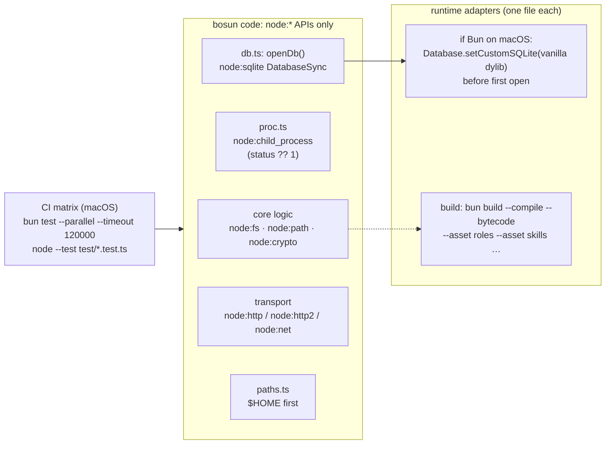

# 01 · Runtime and language

Checked 2026-10-01 on the owner's Mac (Apple M5 Pro, 48 GB, macOS Darwin 27.0.0). Bun 1.4.2 (Homebrew), Node 24.21.0 (Volta). Every number below was measured here unless a source is cited.

## 1. Question

Should bosun v2 run on **Bun**, stay on **Node 24 LTS**, or move to something else: Deno 2, Go, Rust, or a hybrid such as a TS core with a native hot path? If Bun, how do we keep the lock-in low?

## 2. TL;DR

- **Pick Bun 1.4.x as the runtime, but write the code against `node:*` APIs.** On this machine Bun runs bosun's current code and its whole suite (87/87) after two one-line fixes and two test-runner flags. Node stays as a second CI runtime, so falling back to Node 26 LTS is a config change, not a port.
- **Startup is where Bun wins:** `bun -e 0` takes **4.4 ms** p50 against **19.6 ms** for `node -e 0`, and **23.3 ms** through the Volta shim that the installed hook really uses.
- **The real hook** (`bin/bosun route --hook`, Kev unreachable) is **~34 ms on Bun against ~66 ms on Node** at 1k memories (p50), and **~46 ms against ~71 ms** at 10k. As a Bun-compiled single binary it's **25 ms and 37 ms**. With no memory store it's **8.4 ms compiled, 12.3 ms on Bun, and 38 ms on Node**.
- **Bun alone doesn't meet the 30 ms memory-part target at 10k.** The memory part is p95 ~36 ms on Bun against 40–50 ms on Node. What's left is per-process work: a cold SQLite connection, a cold JIT, and bosun's own retrieve logic. The runtime isn't the blocker. A lean hook-shaped script meets the target on Bun: **12.4 ms** wall at 10k, compiled with bytecode and vanilla SQLite.
- **Pair Bun with a daemon for the most headroom.** With a warm daemon (topic 5), a Bun-compiled thin client takes **11.2 ms** wall, including a 10k-row FTS5 query. `curl`, standing in for a native Go/Rust client, takes **9.9 ms**. A native client saves ~1.3 ms, which isn't worth a second language. A Node client takes 27 ms.
- **macOS SQLite is Bun's one real trap.** On macOS, Bun uses Apple's system `libsqlite3` (3.54.0 here), which has `OMIT_LOAD_EXTENSION` (so no sqlite-vec) and an encryption codec. It was **1.6× slower on a warm FTS5 query** than Node's bundled SQLite (6.1 ms against 3.5 ms at 10k) and **2.7× slower cold** from C. `Database.setCustomSQLite(<vanilla dylib>)` fixes both. Homebrew's `sqlite` 3.53.4 is already on this Mac; with it, extensions load and the query matches Node.
- **Use `node:sqlite` on Bun, not `bun:sqlite`.** Both are equally fast here, and `node:sqlite` runs on both runtimes. `bun:sqlite` silently binds NULL for the bare named parameters bosun uses, unless you pass `strict: true`.
- **All 32 Bun test failures come from 2 root causes.** 17 are a real Bun bug: `os.homedir()` ignores runtime `$HOME` changes (oven-sh/bun#29244, open). 16 are a harness assumption: the stub CLIs use `#!/usr/bin/env node`, and there is no `node` on the sandbox PATH under Bun. One test is in both groups. Hidden behind them are a 5 s default per-test timeout and single-process file sharing in `bun test`. **Safety:** because of the homedir bug, running this suite under Bun without isolating HOME writes into the real `~/.bosun`, `~/.claude` and `~/.codex`.
- **Don't choose Go, Rust or Deno.** Go and Rust would mean rewriting ~5,200 lines and losing the TypeScript SDKs: the Claude Agent SDK is TS and Python only. They pay off only if the owner rules out a daemon *and* the lean Bun hook still misses. Deno 2.9 gives nothing over Bun for bosun.

## 3. bosun constraints that matter here

| Constraint | Why it decides the runtime |
|---|---|
| Per-prompt hook: target 30 ms for the memory part, Claude kills it at 5 s | A new process starts on every prompt, so runtime startup and cold module loading are paid each time. Today it measures ~40 ms p95 for the memory part and ~75–94 ms wall (HANDOFF.md). |
| A single user, macOS only (one or two Macs) | macOS-specific behaviour matters most: system SQLite, code signing, Homebrew, launchd. Windows and Linux are nice to have. |
| No runtime dependencies today, no build step | A runtime that runs TS directly (Node ≥ 24 or Bun) keeps that. A compiled binary adds a build step, but only for releases. |
| APIs in use (inventory of `lib/`, `test/`) | `node:path` and `node:fs` (34 and 33 imports), `node:test`/`assert` (15), `node:child_process` (11: `spawnSync` with stdio inherit/pipe, `input`, `env`, PATH lookup, `timeout`), `node:sqlite` (7, FTS5, WAL), `node:os`, `node:crypto`, `node:readline`, `node:http` (3: `bosun serve`, test mocks), `node:module` (`enableCompileCache`), plus `fetch`, `AbortSignal.timeout` and `Atomics.wait` |
| Files read relative to the repo | `config.default.env`, `package.json`, `roles/`, `skills/` and `policy.md` are read from `REPO`. This matters for single-binary builds (§5.5). |
| Future vectors and graph (topic 7) | These need SQLite extension loading (sqlite-vec) or a fallback in JS. |
| Subscription logins, local models | The runtime has to spawn `claude`, `codex` and `ollama` reliably with an exact env: the signal, env and PATH semantics of `child_process`. |

## 4. Options

| Option | Startup floor (measured) | Current hook, p50 at 10k | bosun suite | SQLite extensions on macOS | Single binary | Porting cost | TS SDK sharing | Maturity risk |
|---|---|---|---|---|---|---|---|---|
| **Node 24 LTS / 26 LTS** | 19.6 ms (23.3 via Volta) | 70–73 ms | 87/87 | yes (`allowExtension`) | SEA: `postject` needed on 24, `--build-sea` from 25.5 | none | full | lowest; 24 enters maintenance 2026-10-20, 26 becomes LTS 2026-10-28 |
| **Bun 1.4.2, `node:*` APIs** | 4.4 ms | 44–47 ms | 87/87 after 2 one-liners + flags | only with `setCustomSQLite` to a vanilla dylib | `bun build --compile`, cross-targets | ~2 lines + test script | full (the MCP TS SDK names Bun) | medium: the Rust rewrite shipped 2026-08-20 |
| **Bun, compiled binary** | 4.5 ms | 36–39 ms | same | same (the dylib lives outside the binary) | yes, 58 MB | + an assets module (§5.5) | full | medium |
| **Deno 2.9.7** | not installed, not measured | – | not tried | `node:sqlite` since 2.2 | `deno compile` | small–medium (Deno-specific test runner and permissions) | good | medium |
| **Go 1.27.1** | native: the C proxy runs the whole hook-like query in 3.2 ms (1k) and 6.8 ms (10k) | – | full rewrite | yes (cgo `mattn/go-sqlite3`) | yes | rewrite ~3,000 + ~2,200 lines | loses TS; has the Anthropic Go SDK and the MCP Go SDK, no Agent SDK | low (language); high (rewrite) |
| **Rust 1.98.1** | native, as Go | – | full rewrite | yes (`rusqlite` bundled has FTS5 + load extension) | yes | the biggest rewrite | loses TS; has the MCP `rmcp`; no official Anthropic Rust SDK | low (language); highest (rewrite) |
| **Hybrid: native thin client + TS daemon** | client 9.9 ms (curl as proxy) | – | TS side unchanged | per the daemon's runtime | client only | a second language for ~100 lines | TS in the daemon | low, but saves only ~1.3 ms over a Bun-compiled client |

### 4.1 Bun 1.4.x: maturity and Node-API compatibility

**Release state:**
- **Latest stable:** 1.4.2 (2026-09-05), after 1.4.1 (2026-09-04) and 1.4.0 (2026-08-20). [GitHub releases]
- **1.4.0 is the first release since Bun was rewritten from Zig in Rust.** The Bun team says the port kept the whole suite ("0 tests skipped or deleted", 60,000+ tests on 6 platforms), introduced 19 known regressions that were all fixed before release, and keeps about 4% of the Rust code in `unsafe`. [bun-in-rust, 2026-07-08]
- **1.4.1 fixed 202 issues.** Several were regressions from 1.4.0: fetch timeouts, an http.Server listen retry, and crashes. Others matter to bosun: a macOS signal-delivery crash when two SIG listeners fired during `Bun.spawn`, macOS `fs` calls that threw `EINTR` instead of retrying, and `Bun.spawn` with piped stdio failing with `EBADF` inside `bun test` on macOS. [bun-v1.4.1 blog]
- **Expect patch churn on 1.4.x. Pin the version.**

**Ownership and use:**
- "Bun was acquired by Anthropic in December 2025". [bun-in-rust]
- Claude Code itself runs on Bun. The local `~/.local/share/claude/versions/2.1.286` binary contains `Bun v1.4.3 (macOS arm64)`, checked with `strings`. The host bosun wraps already depends on Bun.

**Node-API status, from the official compatibility page (checked 2026-10-01, page baseline Bun v1.4.2 / Node v26):** [nodejs-compat]

| Module | Status | What matters for bosun |
|---|---|---|
| `node:child_process` | 🟡 | The gaps are IPC handle passing, `channel.ref/unref`, piping one child's stdout into another's stdio, and extra `spawnSync` stdio pipes. bosun uses none of these. The spawn, `spawnSync`, env, PATH lookup, stdio inherit/pipe, `input` and `timeout` paths all passed bosun's tests and a direct probe. |
| `node:sqlite` | 🟢 "Fully implemented"; the 1.4 blog says it passes 100% of Node's sqlite tests | "On macOS, Bun uses the system `libsqlite3.dylib`. `loadExtension()` requires a full SQLite build … call `require("bun:sqlite").Database.setCustomSQLite(path)`". `backup()` is synchronous. |
| `node:test` | 🟡 | The in-process API works **only under `bun test`**. Missing: "Node's `--test` CLI runner mode", `mock.module()`, snapshots, coverage and `node:test/reporters`, and `only` doesn't filter. I checked this: a node:test file run outside `bun test` fails with "Cannot use test outside of the test runner". |
| `node:http` | 🟢 | `http.Server` doesn't extend `net.Server`, and `listen(handle)`/`fd` are ignored. `bosun serve` passed its tests. |
| `node:http2` | 🟢, "94% of Node.js's test suite passes" | I checked an h2c server here with **trailers**, which gRPC needs; it worked on Bun. |
| `node:fs` | 🟢, 98% of Node's suite | – |
| `node:module` | 🟡 | `enableCompileCache` exists (`typeof` is `function`); bosun's `bin/bosun` runs unchanged. |
| `node:os` | 🟢 | `userInfo()` reads `USER`, `SHELL` and `HOME` from the environment. **Not listed:** `homedir()` snapshots `HOME` at startup (below). |
| `process` | 🟡 | Signals work. I probed it: a child's SIGTERM and SIGINT handlers ran and set the exit codes, and `spawnSync` with `timeout` gave SIGTERM/ETIMEDOUT exactly as on Node. |

**Bun's own servers:**
- **`Bun.serve`:** HTTP/2 is **experimental**, and "WebSockets over HTTP/2, server push, and response trailers (needed by gRPC) are not supported". HTTP/3 is experimental and needs TLS; it can't run over a Unix socket. Unix domain sockets are supported. [http/server docs] This matters for topic 2: gRPC on Bun has to go through `node:http2`, not `Bun.serve`.

**Open Bun issues that matter to bosun (checked 2026-10-01):**
- **[#29244](https://github.com/oven-sh/bun/issues/29244), open since 2026-04-13:** `os.homedir()` returns the `HOME` from process start and ignores later `process.env.HOME` changes. It still reproduces on 1.4.2. The fix PR [#42599](https://github.com/oven-sh/bun/pull/42599) has been open since 2026-09-13. This is the cause of 17 of the 32 test failures (§5.3).
- **[#42891](https://github.com/oven-sh/bun/issues/42891):** a change to `process.env` doesn't reach the native `environ`, so `getenv` in addons and FFI misses it. Children spawned through `child_process` *do* see the change, which I checked.
- **[#39877](https://github.com/oven-sh/bun/issues/39877):** `bun:sqlite` binds NULL, with no error, for a bare or unknown named parameter. I reproduced it: `{ id: 2 }` for `:id` returns `null` unless the database is opened with `strict: true`. bosun uses bare named parameters (`service.ts` lines 78, 127 and 140). Bun's `node:sqlite` handles them correctly.
- **[#44084](https://github.com/oven-sh/bun/issues/44084):** `node:sqlite` `StatementSync.get()` is about 1.5× slower than on Node when turning rows into objects (reported on Linux). **[#44187](https://github.com/oven-sh/bun/issues/44187):** Bun's SQLite on Linux is built without `DEFAULT_MEMSTATUS=0`, so several threads contend on a mutex. Neither is a hot path for bosun on macOS.
- **Found here, not caught by the tests:** in `spawnSync` of a missing binary, Bun returns `status: undefined` where Node returns `null`. bosun's `sh()` turns `null` into code 1 but passes `undefined` through, and `undefined` is falsy. I found no matching issue with `gh search issues --repo oven-sh/bun "spawnSync status undefined"`. The fix is a normalisation in one shared place: `r.status ?? 1`.

### 4.2 Node 24 LTS (or 26 LTS)

**Strengths:**
- It's the known-good baseline: 87/87 in 13.5 s here.
- Type stripping is stable (v24.12.0), and `node:sqlite` is "Stability: 1.2 – Release candidate". [Node typescript.md and sqlite.md at v24.21.0]
- Extensions work: `new DatabaseSync(path, { allowExtension: true })` plus `loadExtension()`. I checked this here with a small test extension.

**Schedule:** Node 24 moves to maintenance on 2026-10-20, and Node 26 becomes LTS on 2026-10-28. [nodejs/Release schedule.json] Staying on Node means moving to 26.

**Weaknesses:**
- Startup is ~20 ms, two thirds of the hook budget, before any bosun code runs. Volta adds 3.7 ms more, and it's what `#!/usr/bin/env node` finds on this Mac.
- A Node thin client to a daemon still took 27 ms (`node:net`) to 40 ms (`node:http`).
- On Node 24, a single-executable application (SEA) needs the `postject` npm package. The built-in `--build-sea` arrived in v25.5.0, and SEA is "Stability: 1.1 – Active development". [SEA docs] It couldn't be measured without installing something.

### 4.3 Deno 2.9.7

- Latest stable is v2.9.7 (2026-09-17). [GitHub releases]
- `node:sqlite` has been supported since Deno 2.2. `node:child_process` and `node:test` are listed as "Fully Supported". `node:http2` is partial: several session and stream methods are stubs. [Deno Node APIs page, updated 2026-07-30]
- `deno compile` cross-compiles to macOS, Linux and Windows, embeds files with `--include`, and ad-hoc signs by default. [deno compile docs, updated 2026-08-06]
- It isn't installed, so nothing was measured. It's V8-based like Node, and the Deno docs quote no startup figure.
- **Verdict:** nothing that Bun doesn't already give bosun, a smaller ecosystem, and its own test and permission model to learn.

### 4.4 Go 1.27.1

**Strengths:**
- A single static binary with native startup.
- A C program on this Mac, standing in for any native language, runs the same open + FTS5 bm25 + print in **3.2 ms** (1k rows) and **6.8 ms** (10k) p50 with a vanilla SQLite. With Apple's system SQLite it takes 6.6 ms and 18.4 ms.
- **SDKs exist:** the official MCP Go SDK is at v1.8.0 (2026-09-14), and `anthropic-sdk-go` at v1.78.0 (2026-09-30).
- **SQLite:** `mattn/go-sqlite3` is cgo and needs the `sqlite_fts5` build tag, with extension loading on by default. `modernc.org/sqlite` v1.60.1 is cgo-free and embeds SQLite 3.53.4; its docs page doesn't state FTS5 support. [READMEs / pkg.go.dev]

**Costs:**
- A rewrite of ~3,000 lines of `lib` and ~2,200 lines of tests.
- **No Claude Agent SDK:** `anthropics` publishes it for TypeScript and Python only. [anthropics org]
- It splits bosun's language from the MCP TypeScript ecosystem.

### 4.5 Rust 1.98.1

**Strengths:**
- The same native startup as Go.
- `rusqlite`'s bundled build compiles `-DSQLITE_ENABLE_FTS5` and `-DSQLITE_ENABLE_LOAD_EXTENSION=1`. [libsqlite3-sys build.rs]
- The official MCP Rust SDK `rmcp` is at v3.5.0 (2026-09-28).

**Costs:**
- There's no official Anthropic Rust SDK.
- It's the biggest rewrite, with the slowest iteration for a single-maintainer tool.

### 4.6 Hybrid: a native thin hook client and a TS daemon

- **Measured,** against a warm `node:http` daemon on a Unix socket that runs the 10k FTS5 query per request (§5.2): `curl` (native C) 9.9 ms, a Bun-compiled client 11.2 ms.
- **So a Go or Rust client** saves ~1.3 ms. That costs a second toolchain, a second release pipeline and a second language to review.
- **What the daemon changes:** it takes away most of what makes the runtime matter, the cold SQLite connection, cold JIT and module loading. It doesn't take away the client's own startup. Node as a client (27 ms) still uses up the budget; Bun (11 ms) leaves ~19 ms of headroom.
- **`curl` directly as the hook command:** that would need care to fail open (`curl -m 0.5 … || true`). It's a topic 5 question.

## 5. Measurements

**Machine:** Apple M5 Pro, 48 GB, macOS Darwin 27.0.0.

**Runtimes and SQLite:**

| Runtime | Path | SQLite it uses |
|---|---|---|
| Node 24.21.0 | real binary `~/.volta/tools/image/node/24.21.0/bin/node`; the shim is `~/.volta/bin/node` | bundled SQLite 3.53.4 |
| Bun 1.4.2+43848b5a7 | `/opt/homebrew/bin/bun` | Apple's system SQLite 3.54.0 |
| Homebrew `sqlite` 3.53.4 | `/opt/homebrew/opt/sqlite/lib/libsqlite3.dylib` | already installed |

**Background load:** Microsoft Defender and an Aikido endpoint agent were running, so expect a few ms of noise. Rounds were interleaved where it mattered.

**Harness:**
- hyperfine isn't installed, so I compiled a 30-line C timer (`clang -O2 bench.c`).
- For each command it runs `posix_spawnp` N times after 5 warm-ups, with stdout and stderr to `/dev/null` and stdin from a file. It prints min, p50, p95, max and mean, and counts nonzero exits (all were 0).
- Its own overhead: `bench 20 - /usr/bin/true` gives p50 1.5 ms.

<details><summary>Harness and hook-like script (to reproduce)</summary>

```c
// bench N STDIN_FILE cmd args...  (posix_spawnp, 5 warm-ups, ms stats)
for (int i = -5; i < n; i++) { posix_spawn_file_actions_addopen(&fa, 0, in, O_RDONLY, 0); /* 1,2 -> /dev/null */
  double t = now(); posix_spawnp(&pid, cmd[0], &fa, NULL, cmd, environ); waitpid(pid, &st, 0); if (i >= 0) ms[i] = now() - t; }
```

```js
// hook-node-sqlite.mjs; the bun:sqlite twin swaps DatabaseSync→Database and prepare→query
import { DatabaseSync } from 'node:sqlite'; import fs from 'node:fs';
const file = process.env.DB; const q = fs.readFileSync(file + '.query', 'utf8');   // 6 quoted terms OR-joined
const db = new DatabaseSync(file); db.exec('PRAGMA busy_timeout = 2000; PRAGMA journal_mode = WAL;');
const rows = db.prepare(`SELECT m.id, m.title, bm25(memories_fts) AS score FROM memories_fts JOIN memories m ON m.seq = memories_fts.rowid
  WHERE memories_fts MATCH ? AND m.status = 'active' ORDER BY score LIMIT 20`).all(q);
db.close(); process.stdout.write(JSON.stringify({ hookSpecificOutput: { hookEventName: 'UserPromptSubmit', additionalContext: rows.slice(0, 5).map((r) => r.title).join('\n') } }) + '\n');
```

**Corpus:**
- The same corpus as `bosun memory bench`: mulberry32 seed 42 and a 2,000-word syllable vocabulary.
- Each row has a 5-word title and a 40–120-word body.
- The FTS5 table uses external content with `tokenize='porter unicode61'`, and the database is in WAL mode.
- I built one database with 1,000 rows and one with 10,000.
</details>

### 5.1 Startup and the hook-shaped script

`bench 50 - <cmd>`. All times are ms, p50 / p95.

| Command | 1k rows | 10k rows |
|---|---|---|
| `node -e 0` (real binary), no database | 19.6 / 21.8 | – |
| `node -e 0` through the Volta shim | 23.3 / 24.8 | – |
| `bun -e 0` | **4.4 / 4.8** | – |
| Bun-compiled `console.log(0)` | 4.5 / 5.8 | – |
| node + `node:sqlite` | 23.4 / 25.7 | 27.3 / 30.0 |
| bun + `bun:sqlite` (Apple SQLite) | 13.1 / 14.5 | 20.8 / 22.6 |
| bun + `node:sqlite` (Apple SQLite) | 12.7 / 15.2 | 20.3 / 21.8 |
| `bun build --compile`, `bun:sqlite` | 11.6 / 19.5 | 20.1 / 30.3 |
| `--compile --bytecode --format=esm`, `bun:sqlite` | 8.8 / 16.7 | 21.9 / 27.4 |
| `--compile`, `node:sqlite` | 14.0 / 21.1 | 19.8 / 29.1 |
| bun script + `setCustomSQLite(homebrew)` | 14.9 / 15.9 | 17.5 / 19.1 |
| **`--compile --bytecode` + `setCustomSQLite(homebrew)`** | **8.2 / 9.3** | **12.4 / 15.3** |
| C + Apple SQLite (native proxy) | 6.6 / 11.0 | 18.4 / 21.7 |
| C + Homebrew SQLite (native proxy) | 3.2 / 3.6 | 6.8 / 7.2 |

**Inside the process** (`prof.mjs`, 10k rows, typical of 3 runs):

| Runtime and SQLite | open | first query | warm query |
|---|---|---|---|
| Node, bundled 3.53.4 | 2.0 ms | 4.0 ms | 3.5 ms |
| Bun, Apple 3.54.0 | 2.8 ms | 7.8 ms | 6.1 ms |
| Bun, Homebrew 3.53.4 via `setCustomSQLite` | 1.8 ms | 4.4 ms | 3.8 ms |

**Why Apple's SQLite is different:** `PRAGMA compile_options` shows it builds with `CODEC=see-cccrypt`, `ENABLE_SQLLOG`, `ENABLE_STMT_SCANSTATUS`, `OMIT_LOAD_EXTENSION`, `DEFAULT_WAL_SYNCHRONOUS=1` and `THREADSAFE=2`, none of which Homebrew's build has. I didn't isolate which option causes the slowdown.

**What this means:**
- Bun's runtime overhead over native C is small: 20.8 − 18.4 = 2.4 ms on the same Apple SQLite.
- The big differences are **process startup** (Node) and **which SQLite you link** (Bun on macOS).

### 5.2 The real hook: `bin/bosun route --hook`

**Setup:**
- `HOME` and `BOSUN_HOME` point at scratch directories. I seeded them through bosun's own `MemoryService.store` with the bench corpus: 1k or 10k memories, one in ten personal.
- `ROUTER_URL=http://127.0.0.1:1`, so Kev is unreachable and the connection is refused at once.
- `CLAUDE_PROJECT_DIR` points at the scratch directory, and stdin is a matching 6-word prompt.
- Every runtime produced the same `additionalContext`, 3 notes.
- "Compiled" means `bun build --compile --bytecode --format=esm bin/entry.mjs`, a copy of `bin/bosun`. It needs one scratch-only patch, `REPO = process.env.BOSUN_REPO || …`, because a compiled binary can't read `package.json` next to itself (§5.5).

**Wall clock:** 3 interleaved rounds of `bench 30`. Each cell gives the range of p50s, then the range of p95s.

| Store | Node 24 (real binary) | Bun 1.4.2 | Bun-compiled |
|---|---|---|---|
| none (hook opens no database; `bench 40`) | 37.9 / 40.5 (Volta: 41.8 / 45.6) | 12.3 / 12.6 | 8.4 / 14.0 |
| 1k | 64.7–68.1 / 75.4–81.5 | 30.8–35.6 / 36.0–44.1 | 24.8–25.4 / 26.9–33.3 |
| 10k | 69.9–72.9 / 80.8–84.6 | 43.8–46.8 / 52.6–53.9 | 35.8–39.3 / 44.3–46.6 |

**Memory part:** the `hook` op in `metrics.jsonl`, two series of 40 runs (p50 / p95).

| Store | Node | Bun (Apple SQLite) | Bun (Homebrew SQLite) |
|---|---|---|---|
| 1k | 25.5–27.2 / 33.3–37.5 | 20.6 / 24.3–24.4 | 22.0 / 25.9 |
| 10k | 30.8–31.5 / 40.3–49.8 | 27.8–28.4 / 35.6–35.9 | 29.1 / 35.8 |

**Breakdown at 10k (p50):**

| Op | Node | Bun (Apple) | Bun (Homebrew) |
|---|---|---|---|
| `db.open` | 1.1 | 2.1 | – |
| `memory.search` | 6.9 | 11.2 | 8.5 |
| `context.retrieve` | 17.5 | 16.4 | 15.0 |

- **Module loading** costs about the same on both runtimes: the hook modules take 4.8–6.1 ms on Node (compile cache on) against 6.2–7.5 ms on Bun, and the memory modules take 1.4–1.8 ms against 0.6–1.2 ms.
- **WAL writes** are cheap: one small `UPDATE` commit takes 0.02–0.06 ms at p50.
- **So the memory part is dominated by cold per-process work:** a cold connection and page cache, cold JIT, and retrieve's two FTS passes. In a warm process the same retrieve takes ~5 ms (HANDOFF bench: context p50 5.11 ms).

**Warm daemon and thin clients:**
- **Setup:** a `node:http` daemon on a Unix socket, `d.sock` (relative path, because macOS limits `sun_path` to 104 bytes), running one 10k-row FTS5 query per request. `bench 50`, p50 / p95.
- **Node daemon:**

  | Client | Time |
  |---|---|
  | `curl --unix-socket` (native) | 9.9 / 11.2 |
  | Bun-compiled `node:net` client | 11.2 / 12.3 |
  | Bun-compiled `node:http` client | 12.6 / 13.8 |
  | Bun script, `node:net` | 17.8 / 18.1 |
  | Bun script, `node:http` | 21.4 / 23.0 |
  | Node script, `node:net` | 27.0 / 28.6 |
  | Node script, `node:http` | 39.5 / 41.9 |

- **The same daemon on Bun** (Apple SQLite, so a slower query): curl 12.2 / 12.8, Bun-compiled client 14.7 / 19.5, Node client 41.8 / 44.4.
- **Bun's `fetch({ unix })` with a relative path** failed with `FailedToOpenSocket`, so I left it out.

### 5.3 The test suite under Bun

The repo was copied to the scratchpad and run with `HOME` pointed at scratch. The real repo was never touched.

| Run | Result | Time |
|---|---|---|
| `node --test test/*.test.ts` (baseline) | 87 pass | 13.5 s |
| `bun test ./test/` (as-is) | **54 pass, 1 skip, 32 fail** (the same as the earlier quick attempt) | 17.4 s |
| + homedir fix only (`--parallel --timeout 120000`) | 71 pass, 16 fail | – |
| + `node` on the stub PATH only (same flags) | 70 pass, 17 fail | – |
| + both fixes, default flags | 79 pass, 1 skip, 1 fail, 1 error (6 tests never ran) | – |
| + both fixes, `--timeout 120000` | 86 pass, 1 skip | 29.8 s |
| **+ both fixes, `--parallel --timeout 120000`** | **87 pass, 0 fail** | **12.2–13.2 s** |

**Failure classes** (the ablations above give each test to a class; one test is in both):

| Class | Tests | Root cause | Classification | Fix |
|---|---|---|---|---|
| **A. `os.homedir()` is stale** | 17: `wire.test.ts` 7, `context.test.ts` 3 (hook), `memory.test.ts` 3, `config.test.ts` 2, `services.test.ts` 1 (plist), `mcp.test.ts` 1 (MCP registration, also in class B) | `lib/config.ts` has `P.HOME = os.homedir()`. `fresh()` changes `process.env.HOME` in the process, but Bun's `homedir()` returns the value from startup ([#29244](https://github.com/oven-sh/bun/issues/29244)). In-process code reads and writes the *start-time* home, while spawned children use the sandbox, so backups (`.bak-bosun`) and configs are "missing". | **A real Bun incompatibility** (open bug, fix PR open) | One line: `get HOME() { return process.env.HOME \|\| os.homedir(); }` (Node's `homedir()` checks `$HOME` first anyway) |
| **B. No `node` for the stubs** | 16: `orca.test.ts` 5, `exec.test.ts` 4, `serve.test.ts` 3, `cli.test.ts` 1, `llm.test.ts` 1, `services.test.ts` 1, `mcp.test.ts` 1 (the shared one) | The stub CLIs start with `#!/usr/bin/env node`, and the sandbox PATH is `stubs:${dirname(process.execPath)}:/usr/bin…`. Under Bun that is Homebrew's Cellar `bin`, which has no `node`, so every stub dies with `env: node: No such file or directory`. | **A test-harness assumption** | One line in `helpers.ts`: symlink `node → process.execPath` in the stub dir (Bun acts as Node when started under that name), or write the stubs with `#!${process.execPath}` |
| C. 5 s default timeout | 1: `run (watch, hardening)` | `bun test` defaults to a 5,000 ms per-test timeout; `node:test` has none. After the timeout, Bun kills the test's children ("killed 1 dangling process"), and the test's later assertion then fails. | Test-runner difference | `--timeout 120000`, or `[test] timeout` in bunfig |
| D. One process shared by all files | 1 skip: `e2e` | `bun test` runs "every file in one shared global" by default. `e2e.test.ts` computes `command -v claude` at module load, after other files have changed `process.env.PATH`. | Test-runner difference | `--parallel` (each file gets a fresh global, and workers are processes), or compute `REAL` lazily |

**What wasn't a problem:**
- No failures were in SQLite, memory, context, MCP, the LLM router or HTTP serving themselves.
- The `node:test` API and `node:assert/strict` work under `bun test`.

> **Safety finding.** Because of class A, bosun's tests under Bun write to whatever `HOME` Bun started with. The earlier quick attempt ran at 01:04. After it, the real `~/.bosun/config.env` holds the test fixture `LOCAL_MODEL=other  # mine` / `HOSTS=codex`, and the real `~/.bosun/state.json` has `replacePlugins`, `disabledPlugins`, and a `created` list that includes `~/.codex/AGENTS.md`. The wire and uninstall tests probably touched `~/.claude`, `~/.codex`, `~/.agents` and `~/Library/…` in the same way. I didn't inspect or change them further. The owner should review them. **Rule for the future:** only run the suite under Bun with `HOME` pointed at a throwaway directory, and add a guard in `helpers.ts` that fails if `P.HOME !== process.env.HOME` after `fresh()`.

### 5.4 SQLite extensions: what works

**Setup:** `ext.dylib` is a small test extension that registers `hello()`, built with `clang -dynamiclib` against the Homebrew headers.

| Runtime / driver | Default | With `setCustomSQLite('/opt/homebrew/opt/sqlite/lib/libsqlite3.dylib')` |
|---|---|---|
| Node 24 `node:sqlite` (`allowExtension: true` + `enableLoadExtension(true)`) | loads ✓. Without `allowExtension`: `ERR_INVALID_STATE extension loading is not allowed` | n/a |
| Bun `bun:sqlite` `loadExtension` | ✗ "This build of sqlite3 does not support dynamic extension loading" | ✓ (SQLite 3.53.4) |
| Bun `node:sqlite` `{ allowExtension: true }` | ✗ throws at construction: `ERR_LOAD_SQLITE_EXTENSION … built with SQLITE_OMIT_LOAD_EXTENSION` | ✓ |

**What this means for sqlite-vec and graph extensions (topic 7):**
- **On Bun under macOS,** an extension needs a vanilla `libsqlite3.dylib` on disk, and `setCustomSQLite` has to run before the first `Database` is opened. It "is a no-op" on Linux and Windows, where Bun links its own SQLite statically. [bun:sqlite docs]
- **A compiled binary** still loads that dylib from outside itself.
- **sqlite-vec's own guide** documents the same macOS workaround for Bun, and `node:sqlite` with `allowExtension: true` for Node ≥ 23.5. [sqlite-vec JS docs] sqlite-vec's latest release is v0.1.9 (2026-03-31).
- **A fallback with no extension at all** for topic 7: brute-force dot products over a `Float32Array` take 5.7 ms (Bun) and 6.1 ms (Node) warm for 10k × 768-d, and 59–65 ms for 100k × 768-d. That's fine inside a daemon, but not per prompt, since each process would load ~30 MB of vectors.
- **WAL on Apple's SQLite:** Apple builds it with persistent WAL, so `-wal` and `-shm` files stay after close on macOS. [bun:sqlite docs] It's harmless for bosun.

### 5.5 Single binary: what breaks today

- **Compiling the CLI works:** `bun build --compile --bytecode --format=esm bin/entry.mjs` bundles 26 modules in 73 ms.
- **But the binary dies at start** with `ENOENT … '/$bunfs/package.json'`. `config.ts` reads `package.json` and `config.default.env` next to `REPO`, which is inside the binary's virtual filesystem, so the data files need to be embedded:
  - `--asset <dir>`, new in 1.4 ("embedded files live under `import.meta.dir` … reachable via `node:fs`"), or
  - `import … with { type: "file" }` [executables docs].

  The alternative is to install them to `~/.local/share/bosun`, which `P.SHARE` already names.
- **Size:** 58 MB per binary, 59.6 MB with bytecode. The compiled Claude Code binary is 225 MB.
- **Signing:** ad-hoc signed automatically (`codesign -dv` shows `flags=0x20002(adhoc,linker-signed)`).
- **A side benefit:** `process.execPath` under Homebrew's Bun is `/opt/homebrew/Cellar/bun/1.4.2/bin/bun`, a versioned path. The MCP registration and the launchd plists bake it in today, so `brew upgrade bun` would break them, the same class of problem as the Volta deferred minor. A compiled binary's `execPath` is the binary itself.

## 6. Recommendation

**Bun 1.4.x as the runtime for bosun v2, coded to `node:*` APIs, released as a Bun-compiled single binary, with Node 26 LTS kept green in CI as the escape hatch.**

**Rationale:**
1. **Startup is the per-prompt cost that the language actually controls:** 4.4 ms against 19.6–23.3 ms. On the real hook, Bun removes 25–35 ms wall with no code changes, and compiling removes another ~8 ms.
2. **The port costs almost nothing:** two one-line fixes (`P.HOME`, `sh()` status) and test flags. The code stays TypeScript with no build step for development.
3. **It keeps the ecosystem:** the MCP TS SDK names Bun as a supported runtime, and the Claude Agent SDK is TS or Python only. Claude Code, the host, ships on Bun.
4. **A native language isn't needed:** a Bun-compiled thin client is within 1.3 ms of a native one against a daemon. A lean Bun hook-shaped script meets the 30 ms target per process (12.4 ms at 10k, compiled with vanilla SQLite).



**Risks, and how to contain them:**

| Risk | Mitigation |
|---|---|
| The Rust rewrite is 6 weeks old; 1.4.1 fixed 202 issues | Pin an exact Bun version in CI and in the release build. Upgrade on purpose, after the dual-runtime suite passes. Keep Node 26 green, so a bad release means shipping on Node. |
| Apple SQLite: slow FTS, no extensions | Put `setCustomSQLite` in one place. Discover the dylib in this order: `BOSUN_SQLITE_LIB`, then `/opt/homebrew/opt/sqlite/lib/libsqlite3.dylib`, then `/usr/local/opt/sqlite/lib/libsqlite3.dylib`. Fall back to Apple's SQLite with extensions reported as off in `bosun doctor`. |
| `os.homedir()` (#29244) and env-to-native (#42891) | Never call `os.homedir()` directly; add a guard test. Pass env to children explicitly, as bosun already does with `env:`. |
| `bun:sqlite` bare-parameter NULLs (#39877) | Don't use `bun:sqlite`. `node:sqlite` on Bun was as fast here and binds bare names correctly. |
| Concentration: Bun and Claude Code are both Anthropic's | Accept it (it's also why Bun is well-funded and exercised). The `node:*` discipline keeps the exit cheap. |

**What would change the call:**
- **Node 26 LTS:** if a Bun patch release breaks `child_process`, `node:sqlite` or `bun test` on macOS and the fix takes longer than one release. The same `node:*` code runs there, but the hook loses ~25 ms, so a daemon becomes mandatory.
- **Go for a hook binary only:** if the owner rules out a daemon *and* a lean, compiled Bun hook on vanilla SQLite still misses 30 ms p95 at the real store size. The native floor measured here is 6.8 ms at 10k. The rest would stay TS.

## 7. Open questions for the owner

These are the only two that change the outcome. Each has a default I'll assume unless you say otherwise.

1. **Is a long-lived local daemon acceptable?** (The approved v1 design said no, and topic 5 decides.)
   - **If yes:** a Bun-compiled thin client + a warm daemon gives an 11 ms hook, with lots of headroom.
   - **If never:** the hook stays per-process. Then Bun is still the choice, but the hook path has to be rewritten lean (one query, compiled, vanilla SQLite). If that still misses, a Go hook binary is the fallback.
   - **Default:** yes, with the in-process path kept as a fallback when the daemon is down.
2. **May bosun depend on a vanilla SQLite dylib on macOS?** (Homebrew's `sqlite` is already installed here.)
   - It's needed for extensions such as sqlite-vec, and for Node-level FTS speed on Bun.
   - **If not:** Bun on macOS stays FTS-only on Apple's SQLite, and topic 7 has to do vectors in JS inside a daemon.
   - **Default:** yes, discovered at runtime, with a degraded FTS-only mode.

## 8. Roadmap implications

1. **Portability fixes, on Node today:**
   - `P.HOME` reads `process.env.HOME` first.
   - `sh()`: `code: r.status ?? 1`.
   - `helpers.ts` stubs use `#!${process.execPath}`, or a `node` symlink.
   - A guard test that `P.HOME === process.env.HOME` after `fresh()`, so no test can write to the real home.
2. **Dual-runtime CI on macOS runners:**
   - Pin `oven-sh/setup-bun@v2` (v2.2.0) and `actions/setup-node` (v7.0.0).
   - Run `bun test --parallel --timeout 120000` and `node --test test/*.test.ts`.
   - Put the timeout in `bunfig.toml` `[test]`, so plain `bun test` behaves too.
3. **Switch the dev runtime to Bun:**
   - `bin/bosun` shebang → `#!/usr/bin/env bun`.
   - `package.json`: `engines.bun`, keeping `engines.node` for CI.
   - Scripts: `bun test` and `tsc` for typechecking. Types stay `@types/node`, since the code is node-API.
4. **One SQLite adapter** (`openDb`), with dylib discovery:
   - `setCustomSQLite` on Bun under macOS.
   - A capability flag `canLoadExtension` shown in `bosun doctor`.
   - Stay on `node:sqlite` everywhere.
5. **An assets module for the single binary:** replace the `REPO`-relative reads (`package.json`, `config.default.env`, `roles/`, `skills/`, `policy.md`) with an assets layer. It embeds them via `--asset` or `with { type: "file" }` when compiled, and uses the checkout in dev. Skills that hosts must link to get extracted to `P.SHARE`.
6. **Release pipeline:**
   - Build with `bun build --compile --bytecode --format=esm --target=bun-darwin-arm64`, and `bun-darwin-x64` if wanted.
   - Sign with Developer ID + JIT entitlements, as Bun's docs describe (this needs the owner's Apple account). Publish to GitHub Releases, with a Homebrew tap `homebrew-bosun` whose `Formula/` points at the release assets.
   - `bunx`/npm stay optional for dev: `bunx` runs `#!/usr/bin/env node` scripts with Node unless `--bun` is passed.
7. **Hook budget work (hand-off to topic 5):**
   - Prototype the warm daemon + compiled thin client. The target is ≤ 15 ms p95 wall at 10k; 11.2 ms p50 was measured.
   - Keep a lean in-process fallback.
   - Stop baking `process.execPath` into MCP registration and launchd; point them at the installed binary.
8. **Topic 2 input:** `Bun.serve` HTTP/2 is experimental and has no trailers, so gRPC would need `node:http2`, which works on Bun with trailers. Unix sockets work in both.
9. **Topic 7 input:** vectors need a vanilla SQLite on Bun under macOS, or brute force in JS (~6 ms per 10k × 768) inside a daemon.

## 9. Sources

All checked 2026-10-01.

**Bun: releases, blog, docs**
- Bun releases (1.4.0 2026-08-20, 1.4.1 2026-09-04, 1.4.2 2026-09-05): https://github.com/oven-sh/bun/releases
- Bun 1.4 release post (2026-08-20): https://bun.com/1.4 (also https://bun.sh/blog/bun-v1.4)
- "Rewriting Bun in Rust", Jarred Sumner, 2026-07-08: https://bun.com/blog/bun-in-rust
- Bun v1.4.1 (2026-09-04): https://bun.com/blog/bun-v1.4.1
- Bun v1.4.2 (2026-09-05): https://bun.com/blog/bun-v1.4.2
- Node.js compatibility (baseline Bun v1.4.2): https://bun.com/docs/runtime/nodejs-compat
- Test runner (single process, 5000 ms default timeout): https://bun.com/docs/test and https://bun.com/docs/test/runtime-behavior
- bun:sqlite (macOS system SQLite, `setCustomSQLite`, persistent WAL): https://bun.com/docs/runtime/sqlite
- Single-file executables (targets, bytecode, `--asset`, codesign): https://bun.com/docs/bundler/executables
- Bun.serve (HTTP/2 and HTTP/3 experimental, no trailers, Unix sockets): https://bun.com/docs/runtime/http/server
- Spawn: https://bun.com/docs/runtime/child-process
- Environment variables (transpiler cache): https://bun.com/docs/runtime/environment-variables
- bunx (shebang handling): https://bun.com/docs/pm/bunx

**Bun issues and PRs**
- https://github.com/oven-sh/bun/issues/29244
- https://github.com/oven-sh/bun/pull/42599
- https://github.com/oven-sh/bun/issues/42891
- https://github.com/oven-sh/bun/issues/39877
- https://github.com/oven-sh/bun/issues/44084
- https://github.com/oven-sh/bun/issues/44187

**Node.js**
- node:sqlite at v24.21.0 (Stability 1.2, `allowExtension`, `loadExtension`): https://github.com/nodejs/node/blob/v24.21.0/doc/api/sqlite.md
- TypeScript at v24.21.0 (type stripping stable in v24.12.0): https://github.com/nodejs/node/blob/v24.21.0/doc/api/typescript.md
- Single executable applications (v24: postject; `--build-sea` added in v25.5.0): https://github.com/nodejs/node/blob/v24.21.0/doc/api/single-executable-applications.md and https://github.com/nodejs/node/blob/main/doc/api/single-executable-applications.md
- Release schedule (24 maintenance 2026-10-20, 26 LTS 2026-10-28): https://github.com/nodejs/Release/blob/main/schedule.json

**SQLite**
- Compile options (`SQLITE_OMIT_LOAD_EXTENSION`, `DEFAULT_MEMSTATUS`): https://sqlite.org/compile.html
- Loadable extensions: https://www.sqlite.org/loadext.html
- sqlite-vec JS guide (Bun `setCustomSQLite` on macOS, Node `allowExtension`): https://alexgarcia.xyz/sqlite-vec/js.html
- sqlite-vec releases (v0.1.9 2026-03-31): https://github.com/asg017/sqlite-vec/releases

**Deno**
- Deno releases (v2.9.7 2026-09-17): https://github.com/denoland/deno/releases
- Node APIs (updated 2026-07-30): https://docs.deno.com/runtime/reference/node_apis/
- deno compile (updated 2026-08-06): https://docs.deno.com/runtime/reference/cli/compile/

**Go**
- Go downloads (go1.27.1): https://go.dev/dl/
- MCP Go SDK (v1.8.0 2026-09-14): https://github.com/modelcontextprotocol/go-sdk/releases
- anthropic-sdk-go (v1.78.0 2026-09-30): https://github.com/anthropics/anthropic-sdk-go
- mattn/go-sqlite3 README (cgo, `sqlite_fts5`): https://github.com/mattn/go-sqlite3
- modernc.org/sqlite (v1.60.1, cgo-free, SQLite 3.53.4): https://pkg.go.dev/modernc.org/sqlite

**Rust**
- Rust releases (1.98.1): https://github.com/rust-lang/rust/releases
- rusqlite `libsqlite3-sys/build.rs` (FTS5, LOAD_EXTENSION flags): https://github.com/rusqlite/rusqlite/blob/master/libsqlite3-sys/build.rs
- MCP Rust SDK (rmcp-v3.5.0 2026-09-28): https://github.com/modelcontextprotocol/rust-sdk/releases

**SDKs for TypeScript**
- MCP TypeScript SDK README ("runs on Node.js, Bun, and Deno"): https://github.com/modelcontextprotocol/typescript-sdk
- Claude Agent SDK TypeScript (Node.js 18+ badge): https://github.com/anthropics/claude-agent-sdk-typescript
- Anthropic SDK repositories (no Rust SDK listed): https://github.com/orgs/anthropics/repositories?q=sdk

**Distribution and CI**
- Homebrew: How to Create and Maintain a Tap: https://docs.brew.sh/How-to-Create-and-Maintain-a-Tap
- setup-bun (v2.2.0): https://github.com/oven-sh/setup-bun
- setup-node (v7.0.0): https://github.com/actions/setup-node

**Local evidence**
- Measurements (all scripts in the session scratchpad, `research-01/`): `bench.c`, `hook-*.mjs`, `prof*.mjs`, `seed.ts`, `daemon.mjs`, `client*.mjs`, `ext.c`, `sig.mjs`, `h2.mjs`, `vec.mjs`, and the test logs `bun-test*.txt`.
- The Claude Code binary is Bun 1.4.3: `strings ~/.local/share/claude/versions/2.1.286`.
