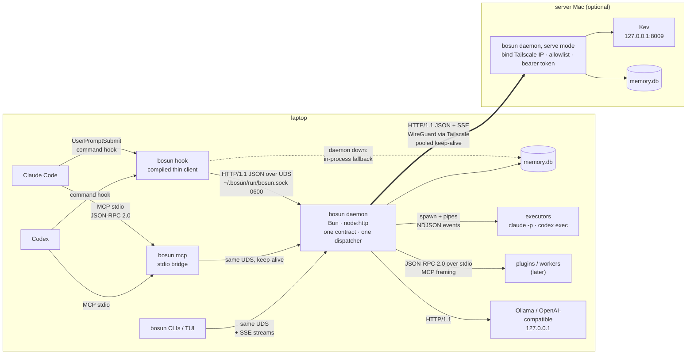

# 02 · The protocol between components

Checked 2026-10-01 on the owner's Mac: Apple M5 Pro, 48 GB, macOS 27.0.1 (Darwin 27.0.0). Bun 1.4.2+43848b5a7 (Homebrew), Node 24.21.0 (the real binary, not the Volta shim), Tailscale 1.102.4, Claude Code 2.1.286. Every number below was measured here unless a source is cited. Topic 1's numbers are the baseline and aren't re-measured.

## 1. Question

The owner asked for a "fast and reliable intercom protocol like http/2, http/3, gRPC, etc." What should bosun v1.0's components use to talk to each other on each link?

- **(a)** The per-prompt hook thin client → the local daemon. This is the latency-critical link: the hook has a 30 ms budget, and topic 1 measured ~11 ms for a warm daemon over HTTP.
- **(b)** CLIs and the TUI → the local daemon, including streamed events such as job progress and logs.
- **(c)** The laptop → the server Mac over Tailscale, for memory, the Kev router and perhaps remote executors.
- **(d)** bosun ↔ the host agents. The hosts fix these contracts: MCP (stdio and Streamable HTTP) and the Claude Code and Codex hook contracts.
- **(e)** The daemon → workers and executors, and perhaps a plugin process boundary.

## 2. TL;DR

- **Use HTTP/1.1 + JSON on every socket link.** That means a Unix domain socket (UDS) locally and plain TCP over Tailscale. Streams use SSE (`text/event-stream`). Links over stdio use JSON-RPC 2.0, newline-framed the way MCP's stdio is. **Don't use gRPC, Connect, HTTP/2 or HTTP/3.** This is the boring choice, and it was also the fastest one measured.
- **The wire protocol isn't where the time goes.** Inside a warm process, every transport costs **12–60 µs** per 1 KB request/response. That's 0.2% of the 30 ms hook budget.
- **What matters is the hook's fresh process.** A Bun-compiled thin client doing *start → one request → exit* takes **6.2–6.3 ms p50 with Bun's native `fetch({unix})`**. Raw NDJSON over `node:net` takes 6.6–6.7 ms, `node:http` 8.0 ms and `node:http2` **8.0–8.2 ms**. HTTP/2 is the *slowest* client, because its JS module has to load. UDS beats TCP by only 0.2–0.3 ms.
- **The daemon-down fallback is nearly free.** `fetch({unix})` to a missing or stale socket fails in **0.23–0.41 ms** in-process, so "try the daemon, else in-process" adds under 1 ms when the daemon is down.
- **"Reliable" also points away from HTTP/2 on these runtimes:**
  - Bun 1.4 has an open `node:http2` client stall regression ([#39796](https://github.com/oven-sh/bun/issues/39796)), and a run of node:http2 server bugs closed only in July–September 2026 (#21759, #40646, #41294).
  - `Bun.serve` has no trailers, so it can't serve gRPC.
  - Node 24's own h2c over UDS **stalled here with 32 concurrent streams**: a stream truncated to 264 bytes, the client sent RST_STREAM CANCEL, and the session hung. It reproduced on both 24.18 and 24.21.
  - HTTP/1.1 had no failures in any run.
- **Hosts:**
  - **Claude Code** now supports `type: "http"` hooks on `UserPromptSubmit` (since 2.1.63). A plain POST to the daemon would remove the per-prompt process entirely.
  - **Codex** supports only `command` hooks there.
  - **Default:** keep one compiled command thin client for both hosts, and make the Claude HTTP hook an opt-in.
- **MCP moved under us:**
  - The stable **2026-07-28** spec makes MCP stateless: no `initialize`, `server/discover` instead, version in every request's `_meta`, and closing the stream cancels the request.
  - Claude Code already negotiates it, and the TS SDK v2 (2.2.0) implements it.
  - bosun's daemon API should copy the **Streamable HTTP shape**: POST, then a JSON or SSE response per request, with close meaning cancel. The stdio MCP server becomes a thin bridge to the daemon.
- **Contract:**
  - Define it once in TypeScript, with a schema library that emits **JSON Schema 2020-12**. Zod 4 has `z.toJSONSchema` built in; topic 3 picks the library.
  - Use one method table, one dispatcher and three adapters (HTTP, stdio JSON-RPC, MCP), with no codegen and no protobuf.
  - Versioning is `/v1` + a `discover` reply + additive-only changes. A major mismatch makes the client fall back in-process.
- **Security:**
  - **Locally:** a socket at `~/.bosun/run/bosun.sock`, mode 0600 in a 0700 directory. macOS enforces this; I measured `EACCES`. There's no TCP listener on the laptop by default.
  - **Over Tailscale:** WireGuard already encrypts traffic and authenticates the device. On top of it, add the existing bind + allowlist, a **bearer token checked in `authorize()`**, and a tailnet grant that limits the port to the owner's devices. `tailscale whois` identity checks and `tailscale serve` (TLS + identity headers) are optional upgrades. mTLS isn't needed.

## 3. bosun constraints that matter here

| Constraint | Why it matters for the protocol |
|---|---|
| The hook is a **new process per prompt**, with a 30 ms target for the memory part | The client's cold start and first connect count, not steady-state throughput. Topic 1 found 4.4 ms for an empty compiled Bun binary, so the protocol client must add ≤ ~2 ms. |
| Runtime: **Bun 1.4.x, coded to `node:*`**, with Node 26 LTS green in CI (topic 1) | Every choice needs a portable server API. The Bun-only fast path (`fetch({unix})`) must have a `node:http` twin. |
| **One user, ≤ 2 Macs over Tailscale** | No load balancers, no polyglot clients, no browser clients. A request rate is a handful per prompt, so throughput is irrelevant. Debuggability (`curl --unix-socket`) is worth more than features. |
| **Hosts fix their own contracts** | Hook JSON on stdin/stdout or an HTTP POST, MCP JSON-RPC over stdio, and `claude -p --output-format stream-json` and `codex exec --json` output as NDJSON. bosun adapts to them and can't change them. |
| **No runtime dependencies today, no build step for development** | A protocol that needs codegen (protobuf/buf) adds a build step to every API change. |
| The split setup exists today | `bosun serve memory` serves HTTP/1.1 JSON `/v1/memory/*` with `{ok, data \| error}`. `RemoteStore` is its client. Kev has its own HTTP `/v1/systemone`. Safety is the bind address + a source-IP allowlist, and `authorize()` is a stub that returns `true` ([lib/serve.ts](../../lib/serve.ts)). |
| Project identity comes from the **caller's environment** (cwd, `CLAUDE_PROJECT_DIR`) | A stdio MCP process inherits it. A shared HTTP endpoint doesn't, and MCP Roots, the alternative, is deprecated in 2026-07-28. |

## 4. Options

| Option | Fresh-process client, 1 request, UDS (p50) | Warm in-process, UDS (p50) | Streaming | Bun 1.4.2 support | Node 24/26 support | Schema / codegen | Debuggable with curl | Verdict |
|---|---|---|---|---|---|---|---|---|
| **HTTP/1.1 JSON** (node:http server) | **6.2–6.3 ms** (Bun `fetch`), 8.0 ms (`node:http`) | 20–28 µs | SSE, chunked | 🟢 `node:http`, `Bun.serve`, `fetch({unix})` | 🟢 `http.request({socketPath})` | any (JSON Schema) | yes, `--unix-socket` | **pick** |
| HTTP/2 h2c (node:http2) | 8.0–8.2 ms | 18–19 µs | streams, trailers | 🟢 94% of Node's tests; open client stall #39796; `fetch` has no h2c | 🟢 Stable; **stalled here over UDS at 32 streams** | any | `--http2-prior-knowledge` | no |
| HTTP/2 h2 (TLS) | not measured (adds a TLS handshake per process) | – | as above | `Bun.serve` experimental, no trailers | 🟢 | any | yes | no: TLS to yourself |
| HTTP/3 / QUIC | n/a | n/a | streams | `Bun.serve` experimental, TLS + UDP only, **no UDS** | `node:quic` "1.0 Early development", `--experimental-quic` | any | partly | no |
| gRPC (`@grpc/grpc-js` 1.14.5) | ≥ the h2 client + protobuf loading | ≥ h2 | 4 streaming modes | via `node:http2`; a history of h2 bugs | 🟢 | **protobuf + codegen/proto-loader** | no (needs grpcurl) | no |
| Connect-RPC (`@connectrpc/connect` 2.2.0) | unary = HTTP/1.1 POST JSON | as HTTP/1.1 | envelope streams | not listed by Connect's docs | 🟢 (`connect-node` needs Node ≥ 22) | **protobuf + `buf generate`** | unary yes | take its *shape*, not its libraries |
| JSON-RPC 2.0 over stdio (MCP/LSP style) | n/a (a pipe to a child) | – | notifications | 🟢 | 🟢 | any | no | **pick for stdio links** |
| JSON-RPC 2.0 over UDS | ≈ NDJSON | ≈ NDJSON | notifications | 🟢 | 🟢 | any | `nc -U` only | no: loses HTTP status, SSE and curl |
| Raw UDS + NDJSON (`node:net`) | 6.6–6.7 ms | **12 µs** | lines | 🟢 `node:net`; ⚠ `Bun.listen` drops writes | 🟢 | any | `nc -U` | close second; not worth the custom framing |
| UDS + length-prefixed MessagePack | ≈ NDJSON + a dependency | ≈ NDJSON | frames | `@msgpack/msgpack` 3.1.3 (not built in) | same | any | no | no: JSON costs 0.3 µs per 1 KB |
| tRPC 11 / Cap'n Proto (`capnp-es` 0.0.16) | – | – | SSE/WS / RPC | – | – | TS router / capnp codegen | partly / no | no |
| SSE (for streams) | – | 1.4–1.8 M events/s | server → client | 🟢 | 🟢 | – | `curl -N` | **pick for streams** |
| WebSocket | – | – | bidirectional | `Bun.serve` only; Bun's WS client **can't use a UDS** | client only; no built-in server | – | no | no |

### 4.1 HTTP/1.1 + JSON (what bosun already speaks)

**Runtime support on Bun 1.4.2:**
- `node:http` is 🟢 "Fully implemented". The caveats are that `http.Server` doesn't extend `net.Server`, and that Bun ignores `listen(handle)` and the `fd` option. [nodejs-compat]
- `Bun.serve({ unix })` serves on a UDS. [Bun server docs]
- `fetch(url, { unix })` is Bun's native client. [Bun fetch docs]
- **Measured here:** `fetch({unix})` works with relative paths and with a 131-byte absolute path. Bun also listens and connects on a 141-byte path. Node throws `EINVAL` past `sun_path`, which is "103 bytes on macOS". [Node net docs]

**Runtime support on Node 24/26:**
- `http.request({ socketPath })` and `server.listen(path)`. [Node net/http docs]
- Node's global `fetch` (undici) has no `unix` option, so the client keeps a `node:http` twin for the Node CI path.

**Bun UDS bug report:** [#41381](https://github.com/oven-sh/bun/issues/41381) (open, 2026-09-04) says that on **Bun 1.4.0 macOS arm64**, `Bun.serve({unix})`, `node:http` `.listen(path)` and `Bun.listen({unix})` all accept and never respond. It **did not reproduce on 1.4.2 here**: all five UDS servers answered curl, nc and Bun clients through every benchmark. Keep a macOS UDS smoke test in CI anyway.

**Other Bun-specific traps found:**
- `Bun.serve` closes idle connections after **10 s** by default [server docs].
- `server.timeout(req, 0)` is inert on a unix listener ([#43816](https://github.com/oven-sh/bun/issues/43816), open).
- `requestIP()` returns `null` on a UDS [server docs].
- **`node:http` `listen({ fd })` on Bun silently ignores the fd and listens on a random port on `::`, which is every interface.** I measured port 62851. Never pass an fd to `http.listen`.
- **`node:http` on Bun did not cut a 12 s idle SSE stream,** and neither did Node.
- The daemon's server should therefore be `node:http` (portable) and not `Bun.serve`. Their speed is the same: 20 µs against 21 µs warm on a UDS.

**Shape:**
- The current `/v1` style is already the Connect unary shape: `POST /v1/<service>/<method>`, a JSON body, a JSON reply and string error codes. [Connect protocol]
- It matches MCP Streamable HTTP's shape as well: a POST answered by either `application/json` or `text/event-stream`. [MCP 2026-07-28 Streamable HTTP]

### 4.2 HTTP/2: h2c and h2

**What the RFC allows:**
- RFC 9113 deprecates the `h2c` Upgrade token and allows cleartext HTTP/2 only by "prior knowledge".
- It says "TCP head-of-line blocking is not addressed by this protocol". [RFC 9113 §1.5, §3.1–3.3]

**Bun 1.4.2:**
- `node:http2` client and server are implemented, and "94% of Node.js's test suite passes". [nodejs-compat] Topic 1 checked trailers on an h2c server.
- `Bun.serve` HTTP/2 is **experimental**. Without TLS, clients must use prior knowledge. "WebSockets over HTTP/2, server push, and response trailers (needed by gRPC) are not supported." [server docs]
- Bun's `fetch` can't speak h2c. `protocol: 'h2'` against an h2c server threw `HTTP2Unsupported` here, so h2 from `fetch` needs TLS.

**Open Bun issues (checked 2026-10-01):**
- [#39796](https://github.com/oven-sh/bun/issues/39796): the `node:http2` client stops processing inbound frames for ~28 s under load. It's a 1.3.14 → 1.4.0 regression, seen under `bun test`, and blocks grpc-js users. A fix PR exists.
- A cluster of open node:http2 server edge cases: [#43488](https://github.com/oven-sh/bun/issues/43488), [#43479](https://github.com/oven-sh/bun/issues/43479), [#43423](https://github.com/oven-sh/bun/issues/43423) and [#43893](https://github.com/oven-sh/bun/issues/43893).

**Node 24 (measured here):**
- `node:http2` is "Stability: 2 – Stable". [Node http2 docs]
- **With a Node 24 client and a Node 24 server, h2c over a UDS with 32 concurrent streams on one session:**
  - Request #25's body reached the server truncated to 264 of 976 bytes.
  - The server then saw RST_STREAM code 8 (CANCEL) on streams 25–32, and the session stalled.
  - It reproduced on Node 24.18.0 and 24.21.0, and with a pre-connected socket.
- **It didn't happen** at ≤ 16 streams, over TCP, or with Bun on either side.
- I found no matching Node issue (`gh search issues --repo nodejs/node`), and didn't root-cause it. macOS's UDS send buffer is 8 KB (`net.local.stream.sendspace`), which is a plausible trigger.

**Performance:** warm h2c on a UDS (18–19 µs) is barely ahead of HTTP/1.1 (20–23 µs). In a fresh process it's the **slowest** client (8.0–8.2 ms against 6.2–6.3 ms for `fetch`).

**What h2 would buy:** multiplexing, which bosun doesn't need at a handful of requests per prompt. An HTTP/1.1 keep-alive pool covers the CLI and remote links.

### 4.3 HTTP/3 / QUIC

- **Bun:** `Bun.serve` HTTP/3 is experimental and needs `tls`. "`http3` is not supported with unix domain sockets: QUIC requires a UDP port." [server docs] `fetch` accepts `protocol: "h3"` at runtime ([#39773](https://github.com/oven-sh/bun/issues/39773)). Several `Bun.serve(http3)` issues were opened 2026-09-20 ([#42887](https://github.com/oven-sh/bun/issues/42887), [#42889](https://github.com/oven-sh/bun/issues/42889), [#33082](https://github.com/oven-sh/bun/issues/33082)).
- **Node:** `node:quic` is "Stability: 1.0 – Early development" behind `--experimental-quic` (added v23.8.0). [Node quic docs]
- **Fit:** none. QUIC fixes TCP head-of-line blocking and connection migration on lossy networks [RFC 9000, RFC 9114]. Locally there's no network. Over Tailscale, the traffic already rides WireGuard over UDP, and a 2-Mac LAN or Wi-Fi path won't show the difference at this request rate.

### 4.4 gRPC (`@grpc/grpc-js`)

- **Library:** `@grpc/grpc-js` 1.14.5 was published 2026-09-17, with `engines.node >= 12.10` (npm registry). It has a UDS resolver (`resolver-uds.ts` in [grpc-js src](https://github.com/grpc/grpc-node/tree/master/packages/grpc-js/src)).
- **Schema:** it needs `@grpc/proto-loader` or `grpc-tools` generated code. [grpc-js README]
- **On Bun:**
  - It runs over `node:http2`. Bun announced "HTTP2 server and gRPC support … with packages like `@grpc/grpc-js`" in v1.1.31 (2024-10-18). [Bun blog]
  - grpc-js servers on Bun emitted empty DATA frames and **no trailers** until fixed by #29075 ([#21759](https://github.com/oven-sh/bun/issues/21759), closed 2026-07-24).
  - Unary response buffers were retained ([#40646](https://github.com/oven-sh/bun/issues/40646)), and `maxSessionMemory` was mis-handled into `ENHANCE_YOUR_CALM` ([#41294](https://github.com/oven-sh/bun/issues/41294)). Both are closed in September 2026.
  - The client stall [#39796](https://github.com/oven-sh/bun/issues/39796) is still open.
  - `Bun.serve` can't host gRPC (no trailers).
- **Fit:**
  - It adds the slowest client stack (h2 + protobuf) to the latency-critical hook.
  - It adds a codegen step to every API change, and binary encoding saves nothing: JSON parse + stringify of the 1 KB payload takes **0.30 µs** on Bun and 0.69 µs on Node.
  - It makes curl debugging impossible.
  - It earns its place only with polyglot clients or high fan-out, and bosun has neither.

### 4.5 Connect-RPC

- **Protocol:** the Connect protocol is HTTP/1.1- or HTTP/2-friendly.
  - **Unary** is `POST /pkg.Service/Method` with `application/json` or `application/proto`.
  - **Streams** use a 5-byte envelope (flags + big-endian length).
  - **Headers:** `connect-timeout-ms` and `connect-protocol-version: 1`.
  - **Errors** are JSON with string codes such as `unavailable`.
  - **GET** is allowed for no-side-effect methods. [Connect protocol]
- **Libraries:** `@connectrpc/connect` and `connect-node` 2.2.0 (2026-09-07; `connect-node` needs Node ≥ 22).
  - The getting-started guide requires `@bufbuild/protobuf`, `protoc-gen-es` and `npx buf generate`.
  - It mentions only Node, not Bun. [Connect Node guide]
- **Fit:** the *wire shape* is what bosun should copy: method-per-path POST JSON, string error codes and a timeout header. The libraries would bring protobuf codegen for a JSON API bosun already has.

### 4.6 JSON-RPC 2.0 (the MCP style)

- **Spec:** JSON-RPC 2.0 is "transport agnostic". It defines request, notification and response objects matched by `id`, and reserved errors −32700/−32600/−32601/−32602/−32603, with −32000…−32099 for servers. It allows batches. [JSON-RPC 2.0 spec]
- **MCP:** MCP is JSON-RPC 2.0. Its stdio messages "are delimited by newlines, and MUST NOT contain embedded newlines". [MCP transports]
- **Fit:**
  - JSON-RPC's `id`, notifications and batches matter on a *single multiplexed byte stream*: stdio to a child, or a raw socket.
  - Over HTTP, each request is already its own exchange, and `id` is redundant.
  - So use JSON-RPC 2.0 framing only where there's no HTTP: MCP stdio, and future plugin and worker processes.
- **The reuse comes from the contract, not the envelope.** Daemon methods (`memory.search`, `context.retrieve` …) map 1:1 to bosun's MCP tools, so the MCP bridge becomes a table lookup.

### 4.7 Raw UDS with NDJSON or length-prefixed frames

- **Performance:** it's the fastest warm (12 µs, ~485k req/s pipelined) and the second fastest in a fresh process (6.6–6.7 ms).
- **What it costs:** you'd hand-write framing, request ids, errors, timeouts and streaming conventions, all of which HTTP already provides. And you lose curl.
- **Bun trap:** `Bun.listen` doesn't buffer. "TCP sockets in Bun do not buffer data … manage backpressure manually with the `drain` handler" [Bun TCP docs]. Under 64 pipelined requests, my NDJSON server on `Bun.listen` got `write()` returning **0 of 1022 bytes** and silently lost replies; the client hung. `node:net` on Bun buffers correctly. If bosun ever writes a raw socket server, it must be `node:net`.
- **MessagePack** would be a dependency (`@msgpack/msgpack` 3.1.3) to save microseconds that JSON doesn't cost.

### 4.8 tRPC and Cap'n Proto

- **tRPC** 11.19.0 gives typed TS clients without codegen. But it ties the API to a TS router and its own wire conventions, and a plain method table + schemas gives the same type inference.
- **Cap'n Proto** (`capnp-es` 0.0.16) is pre-1.0 and needs schema compilation.
- Neither fits.

### 4.9 Streaming: SSE, WebSocket, h2 streams, NDJSON

**Measured over a UDS, server and client in one Bun process:**

| Stream | Throughput | Abort reaches the server in |
|---|---|---|
| SSE, `node:http` | 1.44–1.48 M events/s (~300 MB/s) | 0.59–0.62 ms |
| SSE, `node:http2` | 1.55–1.66 M events/s | 0.53–0.73 ms |
| NDJSON, `node:net` | 1.76–2.35 M events/s | 0.10–0.27 ms |

- **Bun `fetch` streams in a separate process (the real case):** both `fetch` and `node:http` clients received an event every ~6 ms from a 5 ms timer, and the server saw the abort at 299–300 ms, the moment the client aborted. With server and client in the *same* process, `fetch` streaming lagged by ~1 s. That's a test artefact, not the real case.
- **WebSocket:**
  - Node has a stable WebSocket **client** since v22.4.0, but no built-in server. [Node globals docs]
  - Bun's WebSocket client with `{ unix }` failed with "Failed to connect" here.
  - bosun's streams are server → client, and cancelling is closing.
- **So SSE is the pick.** It's also what MCP uses: closing the SSE response "MUST be treated by the server as cancellation", and long-lived streams should send `:` comment keep-alives. [MCP 2026-07-28 Streamable HTTP]

### 4.10 Host contracts (link d)

**Claude Code** (hooks reference, checked 2026-10-01; changelog at 2.1.286):
- **Handler types:** `command`, `http`, `mcp_tool`, `prompt` and `agent`. **`UserPromptSubmit` supports all five.**
- **Timeout:** the default for `command`/`http`/`mcp_tool` on `UserPromptSubmit` is **30 s**.
- **HTTP hooks** POST the hook JSON (added in **2.1.63**). Their headers support `$VAR` interpolation limited to `allowedEnvVars`. A non-2xx status, a connection failure or a timeout is a **non-blocking error**, so the hook fails open.
- **Policy controls:** `allowedHttpHookUrls` and `httpHookAllowedEnvVars` restrict HTTP hooks.
- **Unix sockets:** the docs don't mention them for HTTP hooks.
- **`mcp_tool` hooks** call a tool on a connected MCP server and parse its text like command stdout. **Rejected for bosun:** the tool would sit in the model's tool list.

**Codex** (hooks docs):
- **Handler types:** `command` and `mcp_tool` only; `prompt` and `agent` are parsed and skipped.
- **`mcp_tool`** is limited to `PreToolUse`, `PostToolUse`, `PermissionRequest`, `PreCompact`, `PostCompact`, `SubagentStart` and `SubagentStop`. **So `UserPromptSubmit` on Codex must be a command hook.**
- **Timeouts and failures:** the default timeout is 600 s, and errors fail open.

**MCP:**
- **2026-07-28 is the stable revision** (published 2026-07-28). Changes from 2025-11-25:
  - Protocol-level sessions and the `initialize` handshake are gone.
  - Every request carries `io.modelcontextprotocol/protocolVersion` and its capabilities in `_meta`.
  - Servers MUST implement `server/discover`.
  - The GET stream is replaced by `subscriptions/listen`.
  - Resumability (`Last-Event-ID`) is removed.
  - Streamable HTTP POSTs need `Mcp-Method` and `Mcp-Name` headers. [MCP changelog, MCP blog]
- **Claude Code** uses "the v2 MCP client and MCP 2026-07-28 negotiation" and sends `server/discover` to stdio servers. [Claude Code changelog]
- **bosun today:** `lib/mcp.ts` answers `server/discover` with −32601 and speaks 2025-11-25, so Claude falls back to `initialize`.
- **SDK:** TS SDK v2 (`@modelcontextprotocol/server` 2.2.0, 2026-09-28) implements 2026-07-28, "runs on Node.js, Bun, and Deno" and takes Standard Schema (Zod v4 etc.). [TS SDK README]

**Executors:**
- `claude -p --output-format stream-json` is "newline-delimited JSON for real-time streaming". [Claude headless docs]
- `codex exec --json` turns stdout into "a stream of JSON Lines", with `thread.started`, `turn.started`, `turn.completed`, `turn.failed`, `item.*` and `error` events. [Codex non-interactive docs]
- The daemon parses these pipes and re-publishes them as SSE job events.

### 4.11 Contract, schema, versioning and typed clients

**Options:**
- **Protobuf** (gRPC/Connect): it needs buf + protoc-gen-es codegen [Connect guide]. **No.**
- **OpenAPI:** a documentation format, not a source of truth for TS. Generate it later from the schemas if bosun is published.
- **JSON Schema written by hand:** bosun already has a subset validator (`lib/util.ts` `validate`), and MCP `inputSchema` is JSON Schema 2020-12 [MCP changelog, SEP-2106]. But the TS types would have to be written twice.
- **A TS-first schema library that emits JSON Schema:**
  - Zod 4 has `z.toJSONSchema()` built in, targeting Draft 2020-12 by default. [Zod docs]
  - TypeBox 1.3.34 is JSON Schema natively (npm).
  - Standard Schema is the interop layer the MCP SDK v2 accepts. [Standard Schema]
  - **Pick this** (topic 3 chooses the library).

**Design:**
- **One contract module.** `contract.ts` maps each method name to `{ params, result, stream?: event schema, idempotent }`.
- **One dispatcher:** `dispatch(method, params, ctx) → result | AsyncIterable<event>`.
- **Three thin adapters:**
  1. **HTTP:** `POST /v1/<method>`; the reply is JSON, or SSE when `stream` is set and the client sent `Accept: text/event-stream`.
  2. **JSON-RPC over stdio:** the MCP bridge and plugins.
  3. **MCP tools:** `tools/call` → dispatch, with `inputSchema` emitted from the same schema.
- **The typed client** is generic `call<M extends keyof Api>(m, params): Promise<Result<M>>`, with types inferred from the contract and no generated files.

**Versioning:**
- **Path major.** `/v1` stays; a breaking change means `/v2`, served side by side for one release.
- **Discovery.** `GET /v1/discover` returns `{ api: 1, version, schema, features[], pid }`, mirroring MCP `server/discover`.
- **Client header.** Every request carries `Bosun-Version: <client semver>`.
- **Additive-only changes within a major:** new methods, new optional fields, and unknown fields ignored by the daemon API. MCP tool schemas stay strict.
- **Unknown major:** 400 `unsupported_version` plus the supported list, like MCP's `UnsupportedProtocolVersionError`. The hook then falls back in-process, and the CLI says "restart the daemon".
- **Upgrade.** The daemon notices its own binary changed (version or inode on `discover`, or a periodic stat), drains and exits, and launchd's KeepAlive starts the new one.

### 4.12 Security

**Local UDS (links a, b, the MCP bridge):**
- **Location:** the socket is `~/.bosun/run/bosun.sock`, 36 bytes for `/Users/<name>`. Node's limit is 103, so test sandboxes need a short `BOSUN_SOCK`.
- **Permissions:** the directory is 0700. The socket is chmod'ed 0600 right after `listen`, or created under `umask 077`.
- **macOS enforces socket permissions (measured):**
  - A socket chmod'ed 000 refused its own owner with `EACCES`, and 0600 connected.
  - The default `umask 022` makes a 0755 socket, which already denies other users (they need `w`). Set 0600 explicitly anyway.
- **Peer credentials.** Bun exposes the accepted socket's fd as `sock._handle.fd`, and `getpeereid` through `bun:ffi` returned uid 502 here. But both are internal or experimental: `bun:ffi` says "Do not rely on it in production" [Bun FFI docs]. **Defer:** the file mode covers the single-user case.
- **No TCP listener on the laptop by default.** The MCP spec warns that local HTTP servers face DNS rebinding and must validate `Origin` [MCP transports]. A UDS can't be reached from a browser.
- **If the Claude HTTP hook is enabled:**
  - Bind `127.0.0.1` only.
  - Require `Authorization: Bearer <token>`. A browser can't send a custom header cross-origin without a CORS preflight, which the daemon never answers.
  - Check that `Host` is `127.0.0.1` or `localhost`, and reject any `Origin`.

**Remote (link c), in layers:**
1. **WireGuard:** "All traffic is end-to-end encrypted, always". [Tailscale kb/1093] TLS inside it adds nothing for 2 Macs.
2. **A tailnet grant.** The default policy "lets all devices in the tailnet access all other devices" [ACL samples], so restrict the port, for example `{"src": ["<owner>"], "dst": ["<server>"], "ip": ["tcp:8788"]}`. Grants are deny-by-default. [Grants]
3. **Bind to the Tailscale IP** and use the source-IP allowlist (exists). Narrow the default from `100.64.0.0/10` to the peer IPs.
4. **A bearer token** (`MEMORY_TOKEN`, already sent by `RemoteStore`), checked in `authorize()` with `crypto.timingSafeEqual`. This covers other local users and processes on the server Mac, and a misconfigured allowlist.
5. **Optional identity.** `tailscale whois --json <ip:port>` returns `UserProfile.LoginName` and `CapMap`, at **~25 ms per CLI call** here, so cache it per peer IP. App capabilities in grants can carry bosun-specific permissions. [Grants app capabilities]
6. **Optional front door: `tailscale serve`.** It can terminate TLS with a MagicDNS cert, and proxies to `unix:/path` on macOS (`tailscale serve --help`, 1.102.4). It adds `Tailscale-User-Login` / `-Name` headers, plus `Tailscale-App-Capabilities` with `--accept-app-caps`. Caveats [serve docs]:
   - These headers "are not populated for traffic originating from tagged devices".
   - It needs HTTPS certificates enabled.
   - I didn't verify that the macOS app's tailscaled can reach a 0600 socket in `~/.bosun`.

**mTLS:** a CA, rotation and two keystores for two Macs that WireGuard already authenticates. **No.**

### 4.13 Reliability

| Concern | Design |
|---|---|
| **Discovery** | A fixed socket path (`BOSUN_SOCK` overrides). Clients need no pidfile, because connecting *is* the liveness check (fails in 0.23–0.41 ms). On start, the daemon tries to connect to an existing socket: if that succeeds, another daemon is live and it exits 0; if it fails, it unlinks the stale file and listens. For `Bun.serve`, fix PR #29168 adds an unlink on SIGTERM/SIGINT (issue [#29166](https://github.com/oven-sh/bun/issues/29166) is still open); `node:http` unlinks on `close()` [Node net docs]. Nothing unlinks on SIGKILL or a crash. `pid` and `version` go in `discover`. |
| **Supervision** | A launchd LaunchAgent with `KeepAlive`. **Socket activation** is feasible but deferred. launchd's `Sockets` + `SockPathName`/`SockPathMode` keys hand the job a listening fd via `launch_activate_socket(3)` [launchd.plist(5), launch(3)]. On Bun, `net.Server.listen({fd})` works, and bridging connections into `node:http` via `emit('connection')` worked on Bun and Node, measured with a C launcher that passes fd 3. But `launch_activate_socket` is only reachable through experimental `bun:ffi` (the symbol resolved here) or a native addon. |
| **Timeouts** | **Hook → daemon:** one attempt with `AbortSignal.timeout(150 ms)`, then in-process fallback. Also set an explicit hook `timeout` in both hosts' config, since Codex defaults to 600 s and Claude to 30 s. **CLI → daemon:** a per-method timeout, with streams having none but a 5 s heartbeat. **Daemon → server Mac:** keep `REMOTE_TIMEOUT_MS` 5 s and the hook's 300 ms, which the daemon now enforces. |
| **Retries** | Only idempotent methods (flagged in the contract), once, on `ECONNRESET` or a refused connection, with jitter. Writes never retry automatically; `RemoteStore`'s visible failure stays. The client's keep-alive idle time must be **below** the server's `keepAliveTimeout` (Node default **5000 ms** [Node http docs]), or reuse races the server's close. |
| **Pooling** | The daemon keeps warm keep-alive connections to the server Mac (memory and Kev). Today every hook process opens a new TCP connection over Tailscale to both. Not measured: no second Mac was reachable. |
| **Backpressure** | Honour `write() === false` → `'drain'` in every SSE and socket writer; `Bun.listen` showed what ignoring it costs. Each subscriber gets a bounded queue, and log lines are coalesced or dropped for a slow TUI. Bodies stay ≤ 64 KB, except uploads. |
| **Cancellation** | The client closes the SSE response or aborts the fetch. The server's `'close'` event arrives in 0.5–0.7 ms and triggers an `AbortController` passed into the job step. This is MCP 2026-07-28's rule too. |
| **Version skew** | See §4.11: the hook falls back in-process on a major mismatch, the CLI warns, and the daemon restarts itself on upgrade. |

## 5. Measurements

**Machine:** as in the header. Defender and an Aikido agent were running, as in topic 1. Every script and log is in the session scratchpad, `research-02/`.

**Payload:**
- **Request:** a 976-byte JSON (`req.json`, a fake hook prompt).
- **Reply:** a 1,022-byte JSON. Every server parses the request and serializes the reply.

**Servers** (`server.mjs`, run on Bun 1.4.2 unless noted):

| Mode | Server |
|---|---|
| `h1` | `node:http` |
| `h1bun` | `Bun.serve` |
| `h2` | `node:http2` h2c |
| `nd` | `node:net` NDJSON |
| `ndbun` | `Bun.listen` NDJSON |

Each listens on TCP `127.0.0.1` or on a relative UDS path.

### 5.1 Fresh process: start → one request → exit (link a)

**Method:**
- Each client is a separate `bun build --compile --bytecode --format=esm` binary (58–61 MB). It reads the request from stdin, sends it, prints 40 bytes of the reply and exits.
- The timer is topic 1's `bench.c` (`posix_spawnp`, stdin from file, 5 warm-ups; its own overhead is p50 1.6 ms).
- `./bench 50 req.json <client>`, 3 interleaved rounds. Each cell gives the range of the three p50s, then the range of the three p95s, in ms.

| Client | UDS p50 / p95 | TCP 127.0.0.1 p50 / p95 |
|---|---|---|
| empty compiled binary (`process.exit(0)`) | 4.4–4.7 / 5.1–6.5 | – |
| read stdin + write stdout (the floor for any hook) | 5.8–6.2 / 6.0–9.4 | – |
| **Bun `fetch` (native), HTTP/1.1** | **6.2–6.3 / 6.3–6.9** | 6.4–6.5 / 6.7–6.9 |
| `node:net`, NDJSON | 6.6–6.7 / 6.8–7.1 | 6.9–7.0 / 7.1–7.5 |
| raw HTTP/1.1 over `node:net` | 6.7–6.8 / 7.1–7.2 | 7.0–7.1 / 7.8–8.1 |
| `node:http` | 8.0–8.1 / 8.2–9.3 | 7.9–8.0 / 8.0–11.0 |
| `node:http2`, h2c | 8.0–8.2 / 9.2–9.7 | 8.2 / 8.5–11.9 |
| curl 8.7.1 (native), HTTP/1.1 | 4.9–5.0 / 5.2–5.6 | 5.1–5.2 / 5.2–5.6 |
| curl, h2c prior knowledge | 4.9–5.4 / 5.3–6.0 | – |
| `sh -c` + `nc -U`, NDJSON | 6.6–6.8 / 7.5–8.2 | – |
| **daemon down:** `fetch` to a missing socket / a stale socket file | 5.2 / 6.0 and 5.1 / 5.7 | – |
| **daemon down:** `node:net` to a missing / stale socket | 6.3 / 6.7 and 6.3 / 8.1 | – |

**In-process time to the error:** `fetch({unix})` throws `FailedToOpenSocket` after **0.23 ms** for a missing socket and **0.41 ms** for a stale one.

**What this means:**
- **Bun's native fetch is the cheapest client.** It adds ~0.4 ms over the stdin/stdout floor because it loads no JS HTTP module. `node:http` and `node:http2` add ~2 ms of module init.
- **UDS saves 0.2–0.3 ms over TCP.**
- **A thin client is ~1.3 ms behind native curl,** consistent with topic 1's 1.3 ms. With topic 1's 10k-row FTS query (~4–5 ms in a warm daemon), that predicts **~11 ms wall** for the real hook, matching topic 1's 11.2 ms.

### 5.2 Warm and cold inside a process, plus throughput (links b, c)

**Method:** `client.mjs <kind> <addr> 5000 1000 32 3`.
- **Warm:** 200 warm-ups, then 5,000 sequential requests on a kept-alive connection.
- **Cold:** 1,000 requests, each on a new connection (`agent:false`, `keepalive:false`, a new session or socket).
- **Throughput:** 32 concurrent callers for 3 s on a pool, a single h2 session, or a single pipelined socket.

Each cell is the range over 2 rounds, in µs.

**Bun 1.4.2 server and client:**

| Transport | Server | Client | warm p50 / p95 | cold p50 / p95 | req/s @32 |
|---|---|---|---|---|---|
| HTTP/1.1 TCP | node:http | node:http | 43–45 / 60–97 | 128 / 139–140 | 64–65k |
| HTTP/1.1 TCP | node:http | fetch | 53–54 / 63 | 126–128 / 135–137 | 85k |
| HTTP/1.1 TCP | Bun.serve | node:http | 40–41 / 57–78 | 124–125 / 136–139 | 65–66k |
| HTTP/1.1 TCP | Bun.serve | fetch | 50 / 60–61 | 121–122 / 131 | 88–90k |
| **HTTP/1.1 UDS** | **node:http** | node:http | 21–23 / 33–41 | 44–48 / 60–68 | 125–132k |
| **HTTP/1.1 UDS** | **node:http** | **fetch** | 28 / 36–37 | 58–61 / 74–75 | 191–196k |
| HTTP/1.1 UDS | Bun.serve | node:http | 20 / 29–30 | 43 / 57 | 129–138k |
| HTTP/1.1 UDS | Bun.serve | fetch | 58 / 65–66 † | 57–59 / 63–77 | 38k † |
| h2c TCP | node:http2 | node:http2 | 41–43 / 58–60 | 150–160 / 177–221 | 74–75k |
| h2c UDS | node:http2 | node:http2 | 18–19 / 29–30 | 52–55 / 68–74 | 161–163k |
| NDJSON TCP | node:net | node:net | 30–31 / 46–50 | 112–118 / 121–128 | 113–115k |
| NDJSON UDS | node:net | node:net | **12 / 15–16** | **32 / 40–41** | **484–485k** |
| NDJSON UDS | Bun.listen | node:net | ok sequentially; **hangs when pipelined** (`write()` returned 0 of 1022 bytes, data lost) | | |

† `fetch` → `Bun.serve` on a UDS: warm ≈ cold and 38k req/s, so this pair apparently doesn't reuse connections. I didn't investigate; it's one more reason to serve with `node:http`.

**Node 24.21.0 server and client, one round:**

| Transport | warm p50 / p95 | cold p50 / p95 | req/s |
|---|---|---|---|
| HTTP/1.1 TCP, node:http | 58 / 93 | 147 / 169 | 55k @32 |
| HTTP/1.1 UDS, node:http | 24 / 53 | 54 / 88 | 98k @32 |
| HTTP/1.1 TCP, global fetch | 83 / 124 | ‡ | 25k @32 |
| h2c UDS, node:http2 | 25 / 58 | 66 / 99 | 97k **@16** |
| h2c UDS @32 | **stall**: request 25 truncated to 264 B, RST_STREAM CANCEL on streams 25–32 (§4.2). Reproduced on 24.18.0 too. Fine at ≤ 16, over TCP, and with Bun on either side (`h2conc.mjs` matrix). | | |
| NDJSON UDS, node:net | 12 / 18–21 | 36–37 / 49–50 | 498–502k @32 |

‡ In Node, `keepalive: false` is the Fetch-standard flag, not connection reuse, so undici reused connections and there's no true cold number.

### 5.3 Streaming and cancellation (link b)

- **`stream.mjs`:** 100,000 events of ~200 B over a UDS (results in §4.9), plus an "infinite" stream at one event per 5 ms that the client aborts after 2 KB.
- **`fetchstream.mjs`:** the same infinite stream with the server in a **separate process**, Bun `fetch` and `node:http` clients, 300 ms each.
  - Both clients saw 48 chunks, about 6 ms apart.
  - Server close was logged at 299–300 ms, on a Bun server and on a Node server.
- **`idle.mjs`:** a `node:http` SSE stream that stays silent for 12 s was **not cut** on Bun or on Node. `Bun.serve` would cut it at its 10 s default `idleTimeout`.

### 5.4 Probes

| Probe | Result |
|---|---|
| Bun 1.4.2 UDS servers on macOS arm64 (#41381) | `Bun.serve({unix})`, `node:http.listen(path)`, `Bun.listen({unix})` and `node:net` all answered curl, nc, fetch and node:net. **Not reproduced.** |
| Socket path > 104 bytes | Bun `fetch({unix})` with 131 bytes and Bun `node:net` listen + connect with 141 bytes: OK. Node 24: `EINVAL`. |
| Bun `fetch` h2c | `protocol: 'h2'` against an h2c server → `HTTP2Unsupported` |
| Bun WebSocket client `{ unix }` → `Bun.serve` websocket on a UDS | "Failed to connect" |
| Socket permissions on macOS | 000 → `EACCES` for the owner; 0600 → OK. Default umask 022 → socket 0755; umask 077 → 0700. `sysctl net.local.stream.sendspace` = 8192. |
| Peer uid | Bun: `sock._handle.fd` = 6, and `getpeereid` via `bun:ffi` → `{uid: 502, gid: 20}`. Node: `_handle.fd` exists, no FFI. |
| Inherited listening fd 3 (`fdlaunch.c`, mimicking launchd) | `net.Server.listen({fd: 3})`: OK on Bun and Node. **`http.Server.listen({fd: 3})` on Bun: fd ignored, listens on `::` port 62851.** On Node it works. A `net` → `http.emit('connection')` bridge works on both. `bun:ffi` resolves `launch_activate_socket` in libSystem. |
| `tailscale whois --json <own IP>` | Keys `Node`, `UserProfile` (`LoginName` …) and `CapMap`; 25 ms for the CLI call |
| JSON parse + stringify of the 976-byte request | 0.30 µs (Bun), 0.69 µs (Node) |

## 6. Recommendation

| Link | Protocol | Transport | Notes |
|---|---|---|---|
| **(a)** hook → daemon | HTTP/1.1, `POST /v1/hook` with the host's hook JSON, JSON reply (the host's output schema) | UDS `~/.bosun/run/bosun.sock` | The thin client is the compiled `bosun` binary's hook fast path, using Bun `fetch({unix})` with a 150 ms timeout, then the in-process fallback. Expect ~6.3 ms + daemon work. Uniform for Claude and Codex (`command` hooks). **Opt-in for Claude:** `type: "http"` to `http://127.0.0.1:<port>/v1/hook` with a bearer header. That removes the process, but needs a loopback TCP listener, and a down daemon shows as a hook error. |
| **(b)** CLIs/TUI → daemon | HTTP/1.1 JSON `POST /v1/<method>`; streams as SSE responses; `POST /v1/events.listen` for long-lived subscriptions | same UDS | Closing the stream cancels. Heartbeat comment every 5 s. `curl --unix-socket … -N` works for debugging. |
| **(c)** laptop → server Mac | the same HTTP/1.1 JSON + SSE, the same contract (the server runs the daemon in serve mode) | TCP on the Tailscale IP | WireGuard + grant + bind + allowlist + **bearer token**. The laptop daemon pools keep-alive connections to memory and to Kev. Kev's `/v1/systemone` stays as Kev defines it. `tailscale serve` and whois identity are optional. |
| **(d)** hosts | fixed: hook JSON; MCP JSON-RPC 2.0 over **stdio** | stdio | `bosun mcp` moves to MCP 2026-07-28 (SDK v2, topic 3) and becomes a thin bridge holding one keep-alive UDS connection to the daemon. It keeps stdio because the process inherits the project identity. No Streamable HTTP MCP endpoint on the daemon for now. |
| **(e)** daemon → executors / plugins | the hosts' NDJSON (`stream-json`, `codex exec --json`); Ollama/OpenAI-compatible HTTP; **JSON-RPC 2.0 over stdio with MCP framing** for bosun-owned plugins and workers | child pipes | A plugin can simply *be* an MCP server, with the daemon as the MCP client. No gRPC. |

**Rationale:**
1. **Fast where it counts.** The hook's cost is the client's start, and Bun's native `fetch` over a UDS is the cheapest measured client: 6.2–6.3 ms, ~1.3 ms behind curl. HTTP/2 and gRPC clients are *slower* to start (8+ ms) and give nothing back at this request rate.
2. **Reliable.** HTTP/1.1 had zero failures across every run. Each alternative failed here or has open bugs:
   - h2c stalled on Node over a UDS.
   - `Bun.listen` dropped data.
   - Bun's h2 client has an open stall.
   - `Bun.serve` cuts idle streams by default, ignores per-request timeouts on a UDS, and has no trailers.
   `node:http` on both runtimes is the most exercised path.
3. **One protocol for three links.** The same server code and contract serve the hook, the CLIs and the remote Mac, with the transport the only difference. The existing `/v1` API, `RemoteStore` and `bosun serve` evolve instead of being replaced.
4. **Aligned with MCP without being MCP.** The POST + JSON-or-SSE + close-means-cancel shape is MCP 2026-07-28's. The stdio links *are* JSON-RPC 2.0. The method table drives both.
5. **No build step.** Schemas are TS values that emit JSON Schema, and typed clients are inferred.

**Risks:**

| Risk | Mitigation |
|---|---|
| Bun UDS server regression on macOS (#41381, 1.4.0) | A CI smoke test (start the daemon on a UDS, curl it, on macOS). Pin Bun (topic 1). An escape hatch `BOSUN_LISTEN=tcp:127.0.0.1:<port>` + token. |
| Bun `node:http` quirks (`listen({fd})` → `::`, `Bun.serve` timeouts) | Never pass an fd to `http.listen`. Bridge via `net` if socket activation ever lands. Don't use `Bun.serve` for the daemon. |
| A Claude HTTP hook would put a TCP port on the laptop | Opt-in only: 127.0.0.1, bearer token, Host and Origin checks (§4.12). |
| A daemon/client version mismatch after `brew upgrade` | `discover` + `Bosun-Version`. Fall back on a major mismatch. The daemon exits when its binary changes, and launchd restarts it. |
| Hand-rolled HTTP/SSE plumbing | Small and testable: one adapter, one SSE writer that honours drain. The MCP SDK v2 handles the MCP side (topic 3). |

**What would change the call:**
- **Polyglot or third-party clients** (other languages, published integrations) → Connect-RPC, which still speaks this same POST JSON shape for unary calls, with protobuf as the source of truth.
- **High fan-out or many concurrent streams per connection** (e.g., dozens of remote executors) → HTTP/2. But first re-test Node h2 over UDS and Bun #39796.
- **Claude Code documents Unix-socket URLs for HTTP hooks** → make the HTTP hook the default for Claude, with no TCP port.
- **A lossy remote link** (laptop on mobile networks to a home server) → reconsider HTTP/3 once Bun and Node mark it stable.

## 7. Open questions for the owner

These are the only ones that change the outcome. Each has the default I'll assume unless you say otherwise.

1. **For Claude Code, should the hook be an `http` hook straight to the daemon (no process per prompt, ~6 ms saved) instead of the command thin client?**
   - It needs a loopback TCP listener with a token.
   - When the daemon is down, Claude shows a non-blocking hook error and the prompt goes without memory (no in-process fallback).
   - **Default, with updated release scope:** use one command thin client for both hosts. Qualify the opt-in `bosun install --claude-http-hook` capability after the daemon path within this build; no separate release assignment. It requires an explicit loopback listener and supported host configuration.
2. **Is the tailnet only ever your own devices?** That means no shared nodes, family members or tagged servers you don't control.
   - **If yes:** a bearer token + bind + allowlist + one grant is enough.
   - **If no:** add the `tailscale whois` identity check (LoginName must match), or front the server with `tailscale serve`.
   - **Default:** yes, your devices only.

## 8. Roadmap implications

1. **A contract module and a dispatcher:**
   - `contract.ts` maps method → `{ params, result, stream?, idempotent }` schemas, using the schema library topic 3 picks, which must emit JSON Schema 2020-12.
   - `dispatch(method, params, ctx)` returns a result or an `AsyncIterable`.
   - The current `ROUTES` in `lib/serve.ts` and the tools in `lib/mcp.ts` become entries in it.
2. **An HTTP adapter (`node:http`)** serving the same handler on two listeners:
   - **The UDS** (local, always).
   - **TCP on the Tailscale IP** (serve mode). It reuses `bindAddress()` / `allowList()`, and implements `authorize()` with a constant-time bearer check.
   - **Plus:** `GET /v1/discover`, the `Bosun-Version` check, 400 `unsupported_version`, and the 64 KB body limit kept.
3. **An SSE writer:**
   - It honours `drain`, sends `:` heartbeats every 5 s, and turns `'close'` into an `AbortSignal` for the handler.
   - It needs a bounded queue per subscriber.
   - It's used by `jobs.watch`, `logs.tail` and `events.listen`.
4. **Daemon lifecycle:**
   - `~/.bosun/run/` 0700, socket 0600, `BOSUN_SOCK` override with a ≤ 103-byte check.
   - Stale-socket probe on start, and a launchd LaunchAgent with KeepAlive.
   - Exit on binary change (upgrade).
   - `bosun doctor` shows the daemon's version, pid and skew.
5. **The hook thin client** (in the compiled binary):
   - It reads stdin, then `fetch({unix})` with a 150 ms timeout.
   - On any failure or a major mismatch, it uses the lean in-process path from topic 1.
   - It has a `node:http` `socketPath` twin for the Node CI runtime.
   - Write explicit `timeout`s into both hosts' hook config.
   - **Target:** ≤ 15 ms p95 wall at 10k memories (topic 5 owns the budget).
6. **Remote client:**
   - `RemoteStore` and the Kev call move into the daemon, with a keep-alive agent whose idle timeout is below the server's 5 s.
   - It retries idempotent methods once.
   - Narrow the default allowlist to the peer IPs, and document a tailnet grant snippet in the README split-setup section.
7. **MCP:**
   - Port `bosun mcp` to MCP 2026-07-28 (`server/discover`, `_meta` versioning) via SDK v2 (topic 3).
   - Turn it into a stdio ↔ UDS bridge over the same contract.
   - Keep 2025-11-25 fallback for older hosts while the SDK provides it.
8. **Executors (topic 4/5):** parse `stream-json` and `codex exec --json` NDJSON in the daemon, and republish as typed job events over SSE. Plugins later: JSON-RPC 2.0 over stdio with MCP framing.
9. **CI guards:**
   - A macOS UDS smoke test (Bun #41381).
   - A test that the daemon never listens on TCP unless configured.
   - A lint or test against `http.listen({fd})`.
   - Keep h2 out of the codebase. If it's ever needed, first re-run `h2conc.mjs` on the pinned runtimes.
10. **Later, optional:**
    - The Claude `http` hook (open question 1).
    - launchd socket activation (`launch_activate_socket` via a tiny native addon, or `bun:ffi` once stable, + the `net` → `http` bridge).
    - A peer-uid check via `getpeereid`.
    - `tailscale serve` / whois identity (open question 2).

## 9. Sources

All checked 2026-10-01 unless a date is given.

**Bun (docs at v1.4.2)**
- Bun.serve: HTTP/2 and HTTP/3 experimental, no trailers, `http3` not on UDS, `unix`, `idleTimeout` 10 s, `requestIP` null on UDS: https://bun.com/docs/runtime/http/server
- Node.js compatibility (baseline Node v26): `node:http` ignores `listen(handle)`/`fd`; `node:http2` 94%; `node:net` supports `listen({ fd })`; `node:child_process` IPC: https://bun.com/docs/runtime/nodejs-compat
- fetch: `unix` option, 256 simultaneous requests, keep-alive: https://bun.com/docs/runtime/networking/fetch
- TCP: `Bun.listen` doesn't buffer, manage backpressure with `drain`: https://bun.com/docs/runtime/networking/tcp
- FFI: "experimental … Do not rely on it in production": https://bun.com/docs/runtime/ffi
- Bun v1.1.31 (2024-10-18): node:http2 server + grpc-js: https://bun.com/blog/bun-v1.1.31
- Issues: [#41381](https://github.com/oven-sh/bun/issues/41381) (UDS no response, 1.4.0 macOS, open) · [#43816](https://github.com/oven-sh/bun/issues/43816) (`server.timeout` inert on UDS, open) · [#29166](https://github.com/oven-sh/bun/issues/29166) (UDS cleanup on exit) · [#39796](https://github.com/oven-sh/bun/issues/39796) (http2 client stall, open) · [#39773](https://github.com/oven-sh/bun/issues/39773) (fetch `protocol: "h3"`) · [#21759](https://github.com/oven-sh/bun/issues/21759), [#40646](https://github.com/oven-sh/bun/issues/40646), [#41294](https://github.com/oven-sh/bun/issues/41294) (grpc-js on Bun, closed) · [#43488](https://github.com/oven-sh/bun/issues/43488), [#43479](https://github.com/oven-sh/bun/issues/43479), [#43423](https://github.com/oven-sh/bun/issues/43423), [#43893](https://github.com/oven-sh/bun/issues/43893) (node:http2 open) · [#42887](https://github.com/oven-sh/bun/issues/42887), [#42889](https://github.com/oven-sh/bun/issues/42889), [#33082](https://github.com/oven-sh/bun/issues/33082) (HTTP/3 open) · [#29597](https://github.com/oven-sh/bun/issues/29597) (socket fd not exposed in Bun.serve)

**Node.js**
- net: IPC paths, "103 bytes on macOS": https://github.com/nodejs/node/blob/main/doc/api/net.md
- http2: "Stability: 2 – Stable": https://github.com/nodejs/node/blob/main/doc/api/http2.md
- quic: "Stability: 1.0 – Early development", `--experimental-quic`, added v23.8.0: https://github.com/nodejs/node/blob/main/doc/api/quic.md
- http (v24.x): `keepAliveTimeout` 5000, `requestTimeout` 300000: https://github.com/nodejs/node/blob/v24.x/doc/api/http.md
- globals: WebSocket client, not experimental since v22.4.0: https://github.com/nodejs/node/blob/main/doc/api/globals.md
- Node releases (v26.10.0, 2026-09-22): https://github.com/nodejs/node/releases

**Specs**
- RFC 9113 HTTP/2 (June 2022): https://www.rfc-editor.org/rfc/rfc9113.html
- RFC 9114 HTTP/3: https://www.rfc-editor.org/rfc/rfc9114.html · RFC 9000 QUIC: https://www.rfc-editor.org/rfc/rfc9000.html
- JSON-RPC 2.0: https://www.jsonrpc.org/specification
- Server-sent events (WHATWG HTML): https://html.spec.whatwg.org/multipage/server-sent-events.html

**MCP**
- Transports 2025-11-25: https://modelcontextprotocol.io/specification/2025-11-25/basic/transports
- 2026-07-28 changelog: https://modelcontextprotocol.io/specification/2026-07-28/changelog
- 2026-07-28 Streamable HTTP: https://modelcontextprotocol.io/specification/2026-07-28/basic/transports/streamable-http
- "The 2026-07-28 Specification" (2026-07-28): https://blog.modelcontextprotocol.io/posts/2026-07-28/
- TypeScript SDK README (v2 = 2026-07-28; Node, Bun, Deno; Standard Schema) and releases (2.2.0 / 1.31.0, 2026-09-28): https://github.com/modelcontextprotocol/typescript-sdk

**Hosts**
- Claude Code hooks reference (handler types per event, HTTP and `mcp_tool` semantics, timeouts): https://code.claude.com/docs/en/hooks (raw: https://code.claude.com/docs/en/hooks.md)
- Claude Code CHANGELOG (HTTP hooks in 2.1.63; v2 MCP client and 2026-07-28 negotiation; `server/discover` to stdio servers): https://github.com/anthropics/claude-code/blob/main/CHANGELOG.md
- Claude Code headless (`stream-json` = NDJSON): https://code.claude.com/docs/en/headless
- Codex hooks (`command` + `mcp_tool`; `mcp_tool` events; fail open; 600 s default): https://learn.chatgpt.com/docs/hooks (from https://developers.openai.com/codex/hooks)
- Codex non-interactive (`codex exec --json` JSONL events): https://learn.chatgpt.com/docs/non-interactive-mode.md (from https://developers.openai.com/codex/noninteractive)

**gRPC and Connect**
- grpc-js README: https://github.com/grpc/grpc-node/blob/master/packages/grpc-js/README.md · src (`resolver-uds.ts`): https://github.com/grpc/grpc-node/tree/master/packages/grpc-js/src
- Connect protocol: https://connectrpc.com/docs/protocol/
- Connect for Node, getting started: https://connectrpc.com/docs/node/getting-started/
- npm registry (latest, date): `@grpc/grpc-js` 1.14.5 (2026-09-17), `@connectrpc/connect` and `connect-node` 2.2.0 (2026-09-07, `node >= 22`), `@bufbuild/protobuf` 2.15.0, `@modelcontextprotocol/sdk` 1.31.0 and `@modelcontextprotocol/server` 2.2.0 (2026-09-28), `zod` 4.6.5, `typebox` 1.3.34, `@trpc/server` 11.19.0, `capnp-es` 0.0.16, `@msgpack/msgpack` 3.1.3: https://registry.npmjs.org/

**Schemas**
- Zod JSON Schema (`z.toJSONSchema`, Draft 2020-12 default): https://zod.dev/json-schema
- Standard Schema (incl. Standard JSON Schema): https://standardschema.dev/

**Tailscale**
- Serve (identity headers, not for tagged devices, HTTPS required; validated 2026-01-20): https://tailscale.com/kb/1312/serve
- `tailscale serve --help` / `tailscale whois --help` (1.102.4, local): `unix:` backends, `--tcp`, `--tls-terminated-tcp`, `--accept-app-caps`
- Grants (deny by default; validated 2026-07-24): https://tailscale.com/kb/1324/grants
- Grants app capabilities (validated 2025-12-01): https://tailscale.com/kb/1537/grants-app-capabilities
- ACL samples, the default allow-all policy (validated 2026-02-02): https://tailscale.com/kb/1192/acl-samples
- "All traffic is end-to-end encrypted, always" (validated 2024-06-18): https://tailscale.com/kb/1093/can-tailscale-decrypt-my-traffic

**Apple (local man pages, macOS 27.0.1)**
- `launch(3)`: `launch_activate_socket(name, &fds, &cnt)`
- `launchd.plist(5)`: `Sockets`, `SockPathName`, `SockPathMode`, `SecureSocketWithKey`

**bosun code read**
- [lib/serve.ts](../../lib/serve.ts) · [lib/mcp.ts](../../lib/mcp.ts) · [lib/route.ts](../../lib/route.ts) · [lib/memory/remote.ts](../../lib/memory/remote.ts) · [lib/memory/types.ts](../../lib/memory/types.ts) · [ARCHITECTURE.md](../../ARCHITECTURE.md) (split setup) · [HANDOFF.md](../../HANDOFF.md) · [config.default.env](../../config.default.env)

**Local evidence** (session scratchpad, `research-02/`)
- Harness: `bench.c` (from topic 1), `server.mjs`, `client.mjs`, `tc/*.mjs` (thin clients) and `tc/bin-*` (compiled)
- Logs: `fresh.txt`, `inproc-bun.txt`, `inproc-node.txt`
- Streaming: `stream.mjs`, `fetchstream.mjs`, `idle.mjs`
- h2 investigation: `h2srv2.mjs`, `h2srv3.mjs`, `h2conc*.mjs`, `h2cold.mjs`
- Probes: `ndprobe.mjs`, `server-partial.mjs`, `peercred.mjs`, `fdlaunch.c` + `fdserve.mjs`, `fetchprobe.mjs`, `jsoncost.mjs`
- Fetched docs: `cc-changelog.md`, `cc-hooks.md`, `cc-headless.md`
