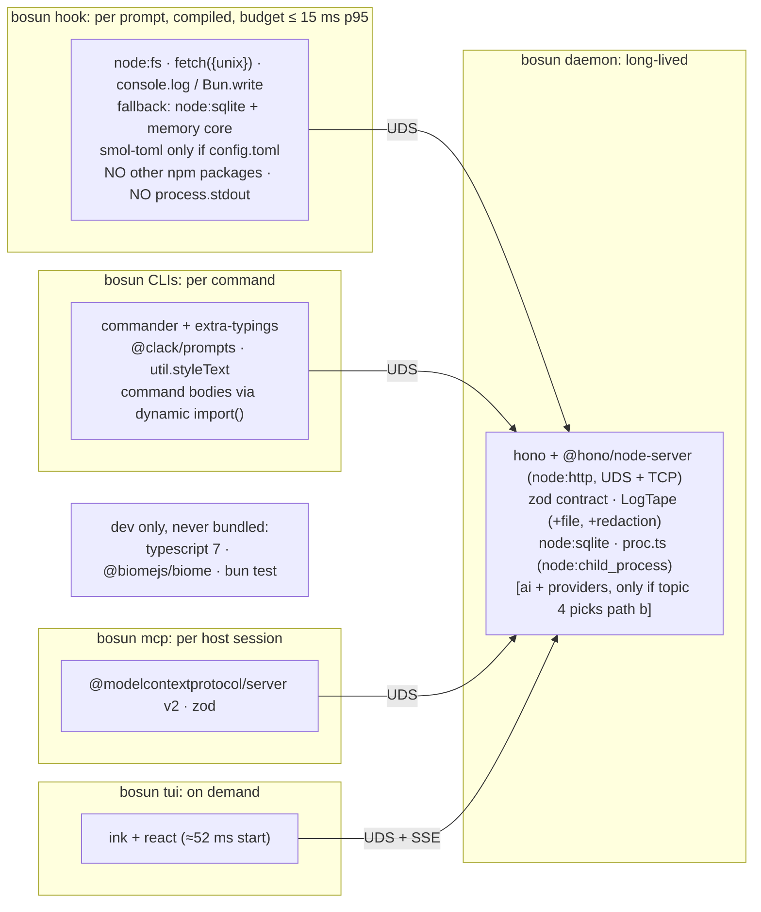

# 03 · Libraries

Checked 2026-10-01 on the owner's Mac: Apple M5 Pro, 48 GB, macOS 27.0.1 (Darwin 27.0.0). Bun 1.4.2+43848b5a7 (Homebrew), Node 24.21.0 (real binary), npm 11.19.0. Versions, dates, licences and sizes come from the npm registry and GitHub on that date. Every timing below was measured here unless a source is cited. **Nothing was installed:** the packages that were measured were extracted offline from the existing npm cache (`~/.npm/_cacache`) into the scratchpad (§5).

## 1. Question

The owner said: "I need to rely and use libraries instead of reinventing a wheel - cli package, tui, etc." For each category, which library should bosun v1.0 adopt, which hand-rolled v0.2.0 module does it replace, and what dependency policy keeps the hot path lean? The hot path is the per-prompt hook thin client, a compiled Bun binary where every millisecond counts.

## 2. TL;DR

- **The hook stays dependency-free.** The thin client and its in-process fallback import only `node:*` built-ins, `fetch` and bosun's own lean modules, so no npm package goes on the hot path. The one allowed exception is `smol-toml` (+0.2 ms compiled), and only if the config moves to TOML.
  - Measured costs in a compiled binary: Zod adds **~2 ms**, a CLI framework 1–6 ms, and Ink **~48 ms**.
  - Touching `process.stdout` at all costs **+3.6 ms** in an empty compiled binary and **+0.9 ms** in the real `fetch({unix})` client. v0.2.0's `util.ts` does this at import time, on the hook path.
- **Adopt, off the hot path:**
  - **Zod 4.6:** the contract, config and LLM-output schemas, with `z.toJSONSchema` (Draft 2020-12 by default). It's already a hard dependency of the MCP SDK v2.
  - **`@modelcontextprotocol/server` 2.2:** replaces `lib/mcp.ts`, and serves both the 2025-11-25 and 2026-07-28 eras from one entry point.
  - **Hono 4.13 on `@hono/node-server`:** its `createAdaptorServer` is a plain `node:http` server, so topic 2's choice stands. It replaces `serve.ts`'s body limit, auth, routing and SSE plumbing, and tests can run in memory.
  - **commander 15** for the CLI trees.
  - **@clack/prompts 1.8** for prompts.
  - **Ink 7** for the dashboard, loaded only by `bosun tui`.
  - **smol-toml 1.9** for the config and the Codex agent TOML files.
  - **LogTape 2.3**, with `@logtape/file` rotation and `@logtape/redaction`, for logs.
- **Keep the stdlib where it already wins:**
  - `node:sqlite` with the 30-line migrator. There's no ORM: Drizzle's stable 0.45 has no `node:sqlite` driver, and FTS5, triggers and sqlite-vec are raw SQL anyway.
  - `node:child_process` in one `proc.ts`.
  - `net.BlockList` for the CIDR allowlist and `util.parseEnv` for the legacy `config.env`. Both were verified on both runtimes.
  - The `node:test` API, run by both `bun test` and `node --test`.
- **LLM clients:**
  - Keep the ~100-line provider calls, but validate their output with Zod.
  - Ollama's native API is required anyway: its OpenAI-compatible endpoint can't set `num_ctx`.
  - Adopt the **AI SDK 7** (`ai` + `@ai-sdk/openai-compatible` + an Ollama provider) **only if topic 4 picks bosun's own agent loop**.
  - **Avoid** the Claude Agent SDK. Its darwin-arm64 package is **216 MB**, and the docs bar claude.ai login for third-party products.
  - **Avoid** the Codex SDK. It pulls a **316 MB** binary package.
  - Instead, spawn the user's own `claude` and `codex` CLIs, as today.
- **Tooling:**
  - Tests: `bun test` + `node --test` over the `node:test` API (topic 1). No vitest.
  - Lint and format: **Biome 2.5**.
  - Type-check: **TypeScript 7.0** (`tsc`, native). It checks bosun in **0.07 s against 0.47 s** for TS 6.
  - Monorepo: bun workspaces.
  - Release: compiled binaries on GitHub Releases + a Homebrew tap. Changesets waits until npm packages are published, and its Bun support is still an open PR.
- **A Bun trap the libraries don't solve:** compiled binaries **load `.env` and `bunfig.toml` from the working directory by default**. The hook runs inside arbitrary projects, so a project's `.env` (an `ANTHROPIC_API_KEY`, for example) leaks into bosun and its children. I measured this. Build with `--no-compile-autoload-dotenv --no-compile-autoload-bunfig`, which also saves ~0.6 ms, and use `bun --no-env-file` in development.
- **Dependency policy, in short:**
  - A hot-path allowlist, enforced by bundling the hook entry with `--metafile` in CI.
  - Each library loads only in the process that needs it, behind one adapter module.
  - Admission rules: a permissive licence, ≤ 5 transitive dependencies, maintained, and works with `--compile` and on Node 26.
  - Exact pins, a committed `bun.lock`, `--frozen-lockfile`, a 7-day `minimumReleaseAge`, no lifecycle scripts, and `bun audit` in CI (§6.3).

## 3. bosun constraints that matter here

| Constraint | What it means for libraries |
|---|---|
| **The hook is a new process per prompt**, a compiled Bun thin client, with a ≤ 15 ms p95 wall target (topics 1, 2) | Any import on that path is paid on every prompt. The empty compiled floor is 4.5 ms and the `fetch({unix})` client 5.4–6.4 ms (§5.3), so a 2 ms library is 30% of the client. |
| **Bun 1.4.x coded to `node:*`, with Node 26 LTS green in CI** (topic 1) | Every runtime library must run on both. Bun-only APIs (`Bun.serve`, `Bun.spawn`, `$`, `Bun.TOML`, `bun:sqlite`) are allowed only behind a twin. |
| **Releases are `bun build --compile` binaries** (topic 1) | A library must bundle: no worker files resolved by path (pino) and no runtime `require` of optional peers (Ink's `react-devtools-core`, §5.2). Native code must be a dylib bosun ships or discovers. |
| **One user today, publishing later** | Prefer boring, widely used and maintained. Small transitive trees beat feature lists, because every package is supply-chain surface in a tool that edits `~/.claude` and `~/.codex`. |
| **Subscription logins, local models** | Host CLIs (`claude`, `codex`) are spawned with an exact env (`SUBSCRIPTION_ONLY` strips API keys). An SDK that brings its own CLI binary or needs API keys doesn't fit. |
| **v0.2.0 has no runtime dependencies** | Every adoption has to replace real hand-rolled code (the inventory is below), not just add a feature. |

**Hand-rolled in v0.2.0** (read 2026-10-01):

| Module | What it hand-rolls | Size |
|---|---|---|
| `lib/cli.ts` (+ `exec.ts`, `orca.ts`, `serve.ts`, `route.ts`) | the command table, usage text, and manual `argv[i]` loops for flags. `memory/cli.ts` already uses `node:util` `parseArgs`. | 328 + ~60 lines |
| `lib/mcp.ts` | the JSON-RPC 2.0 stdio MCP server, protocol 2025-11-25. `server/discover` returns −32601. | 138 |
| `lib/util.ts` `validate()` | a JSON Schema subset validator, used for MCP inputs, the `/v1` ctx and LLM output | ~35 |
| `lib/util.ts` `C`, `say/ok/bad` | ANSI colours. **It reads `process.stdout.isTTY` at import time, on the hook path.** | ~8 |
| `lib/util.ts` `sh/step`, `orca.ts`, `exec.ts`, `llm.ts` | `spawnSync`/`spawn` wrappers | ~30 |
| `lib/llm.ts` | `fetch` calls to Ollama `/api/chat` (`format`, `num_ctx`), OpenAI-compatible `/v1/chat/completions` and `claude -p`; retries, a fallback chain, a usage log | 117 |
| `lib/config.ts` | an env-file parser with inline comments, precedence (env > `config.env` > defaults), and a regex `setKey` writer | 67 |
| `lib/log.ts`, `lib/metrics.ts` | a JSONL log with key-based redaction and no rotation; op timings + a quantile report | 17 + 57 |
| `lib/serve.ts` | a `node:http` server, a 64 KB `readBody`, a CIDR allowlist (`allowed()`), an `authorize()` stub, and a `ROUTES` table | 143 |
| `lib/memory/sqlite.ts` | ordered string migrations in `BEGIN IMMEDIATE`, a WAL-switch retry | ~40 |
| `route.ts` `label()`, `memory/cli.ts` `review()` | `node:readline` interactive prompts | ~40 |
| `roles.ts`, `services.ts` | a frontmatter parser, a Codex agent TOML renderer, a launchd plist XML renderer | ~45 |

## 4. Options

**How to read the facts columns:**
- **6-month activity** is the number of commits on the default branch since 2026-04-01, then issues opened/closed in that window (GitHub REST and search APIs).
- **Deps** is direct / transitive production dependencies. The transitive count resolves `dependencies` from registry metadata to the max-satisfying version, and excludes peer and optional dependencies.
- **Unpacked** is the package's own `dist.unpackedSize` / the whole tree's.
- Platform binaries are listed separately for darwin-arm64.

Sources: registry.npmjs.org, api.npmjs.org and api.github.com, all read 2026-10-01.

| Package | Latest | Released | Licence | 6-month activity (commits · issues opened/closed) | Deps | Unpacked (own / tree) | Weekly downloads |
|---|---|---|---|---|---|---|---|
| `commander` | 15.0.0 | 2026-05-29 | MIT | 7 · 13/14 | 0 / 0 | 203 KB / 203 KB | 607M |
| `@stricli/core` | 1.3.0 | 2026-07-16 | Apache-2.0 | 40 · 3/2 | 0 / 0 | 320 KB / 320 KB | 1.2M |
| `yargs` | 18.2.0 | 2026-09-20 | MIT | 22 · 5/94 | 6 / 13 | 231 KB / 516 KB | 308M |
| `citty` | 0.2.2 | 2026-04-01 | MIT | 6 · 6/1 | 0 / 0 | 34 KB / 34 KB | 38M |
| `cac` | 7.0.0 | 2026-02-27 | MIT | 12 · 2/0 | 0 / 0 | 40 KB / 40 KB | 58M |
| `gunshi` | 0.37.3 | 2026-09-16 | MIT | 331 · 43/46 | 0 / 0 | 242 KB / 242 KB | 121k |
| `clipanion` | 4.0.0-rc.4 | 2024-09-06 | MIT | 0 · 2/1 | 1 / 1 | 229 KB / 359 KB | 6.1M |
| `cmd-ts` | 0.15.0 | 2026-02-12 | MIT | 0 · 1/0 | 4 / 6 | 398 KB / 517 KB | – |
| `@effect/cli` | 0.77.2 | 2026-09-15 | MIT | (Effect monorepo) | 3 / 3 + peers `effect`, `@effect/platform`… | 2.1 MB / 2.8 MB (+27 MB `effect`) | – |
| `ink` | 7.1.1 | 2026-07-16 | MIT | 123 · 36/34 | 25 / 36 | 544 KB / 7.5 MB (+ `react`) | 8.8M |
| `@opentui/core` | 0.5.12 | 2026-09-22 | MIT | 400 · 141/151 | 5 / 9 | 13.1 MB / 14.2 MB + 5.3 MB native dylib | 1.1M |
| `@clack/prompts` | 1.8.1 | 2026-09-13 | MIT | 56 · 44/31 | 4 / 5 | 91 KB / 178 KB | 30M |
| `@inquirer/prompts` | 8.7.2 | 2026-09-07 | MIT | 218 · 19/23 | 10 / 24 | 25 KB / 936 KB | 49M |
| `blessed` | 0.1.81 | **2015-09-03** | MIT | 0 (last commit 2016) | 0 | – | – |
| `zod` | 4.6.5 | 2026-09-13 | MIT | 437 · 195/310 | 0 / 0 | 5.9 MB / 5.9 MB | 360M |
| `valibot` (+ `@valibot/to-json-schema` 1.8.0) | 1.5.0 | 2026-09-09 | MIT | 112 · 47/22 | 0 / 0 | 1.8 MB (+163 KB) | 24M |
| `typebox` | 1.3.34 | 2026-09-18 | MIT | 137 · 32/44 (82 releases in 6 months) | 0 / 0 | 1.5 MB | 14M |
| `arktype` | 2.2.5 | 2026-09-24 | MIT | 37 · 24/20 | 3 / 3 | 332 KB / 924 KB | 2.3M |
| `hono` | 4.13.10 | 2026-09-28 | MIT | 277 · 108/93 | 0 / 0 | 1.2 MB | 78M |
| `@hono/node-server` | 2.1.1 | 2026-08-14 | MIT | 71 · 17/16 | 0 / 0 | 132 KB | – |
| `elysia` | 1.4.30 | 2026-08-26 | MIT | 13 · 72/15 | 4 / 4 (+ peers incl. `@sinclair/typebox`) | 1.1 MB / 1.2 MB | 1.4M |
| `@modelcontextprotocol/server` (v2) | 2.2.0 | 2026-09-28 | MIT | 190 · 254/135 | 2 / 2 (`zod`, `@modelcontextprotocol/core`) | 6.1 MB / 13.3 MB | 8.7M |
| `@modelcontextprotocol/sdk` (v1) | 1.31.0 | 2026-09-28 | MIT | same repo | **17 / 91** (express, hono, cors, ajv, jose…) | 4.2 MB / 16.1 MB | 69M |
| `ai` (AI SDK) | 7.0.122 | 2026-09-28 | Apache-2.0 | 2,349 · 1,038/1,454 (363 stable releases in 6 months across the v5/v6/v7 lines) | 3 / 9 | 7.4 MB / 11.9 MB | 33M |
| `@ai-sdk/openai-compatible` | 3.0.59 | 2026-09-28 | Apache-2.0 | (AI SDK repo) | 2 / 7 | 410 KB / 3.9 MB | 9.8M |
| `ollama-ai-provider-v2` | 4.0.1 | 2026-07-08 | Apache-2.0 | 143 · (issue search refused) | 2 / 7 | 347 KB / 3.9 MB | 1.1M |
| `ollama` (ollama-js) | 0.6.3 | **2025-11-13** | MIT | 1 · 5/1 | 1 / 1 | 125 KB / 181 KB | 811k |
| `openai` | 7.23.0 | 2026-09-23 | Apache-2.0 | 946 · 37/149 | 0 / 0 | **19.0 MB** | 47M |
| `@anthropic-ai/sdk` | 0.129.0 | 2026-09-28 | MIT | 406 · 55/112 | 2 / 6 | 9.1 MB / 9.6 MB | 49M |
| `@anthropic-ai/claude-agent-sdk` | 0.3.284 | 2026-09-28 | "SEE LICENSE IN README.md" (Commercial Terms) | 172 · 172/46 | 0 + optional platform package | 4.9 MB **+ 216.1 MB** (darwin-arm64) | 13M |
| `@openai/codex-sdk` | 0.158.0 | 2026-09-28 | Apache-2.0 | (codex repo: 6,712 · 23,577/5,891) | 1 (`@openai/codex`) | 78 KB **+ 315.7 MB** (darwin-arm64 binary) | 2.1M |
| `drizzle-orm` | 0.45.3 | 2026-09-21 | Apache-2.0 | 12 · 294/156 | 0 | 10.0 MB (`drizzle-kit` tree: 209 MB) | 29M |
| `kysely` | 0.29.6 | 2026-09-16 | MIT | 211 · 43/35 | 0 | 1.6 MB | 20M |
| `c12` | **4.0.0-rc.2** (the `latest` tag) | 2026-09-22 | MIT | 40 · 1/9 | 6 / 7 (+ peers `jiti`, `giget`, `dotenv`, `magicast`) | 74 KB / 411 KB | 31M |
| `cosmiconfig` | 10.0.1 | 2026-08-30 | MIT | 20 · 7/10 | 2 / 3 | 77 KB / 1.7 MB | 153M |
| `smol-toml` | 1.9.0 | 2026-09-22 | BSD-3-Clause | 55 · 4/3 | 0 | 137 KB | 44M |
| `pino` | 10.3.1 | 2026-02-09 | MIT | 41 · 10/17 | 11 / 13 | 648 KB / 1.1 MB | 60M |
| `@logtape/logtape` (+ `/file`, `/redaction`) | 2.3.9 | 2026-09-28 | MIT | 567 · 44/44 | 0 | 859 KB (+258 KB, +180 KB) | 618k |
| `consola` | 3.4.2 | **2025-03-18** | MIT | 0 · 6/2 | 0 | 314 KB | 69M |
| `@opentelemetry/sdk-node` | 0.222.0 | 2026-08-31 | Apache-2.0 | 394 · 125/150 | **27 / 70** | 285 KB / 32.7 MB | – |
| `execa` | 10.0.1 | 2026-07-31 | MIT | 24 · 4/18 | 12 / 17 | 352 KB / 632 KB | 201M |
| `nano-spawn` | 2.1.0 | 2026-04-01 | MIT | 4 · 0/0 | 0 | 44 KB | 5.0M |
| `tinyexec` | 1.3.1 | 2026-09-03 | MIT | 54 · 11/12 | 0 | 26 KB | 172M |
| `neverthrow` | 8.2.0 | **2025-02-21** | MIT | 0 · 8/1 | 0 | 110 KB | 4.0M |
| `effect` | 3.22.2 (4.0 at `rc.118`) | 2026-09-09 | MIT | 1,826 · 623/854 | 2 / 3 | **25.9 MB** / 27.3 MB | 48M |
| `better-result` | 3.0.1 | 2026-08-11 | MIT | 60 · 30/34 | 0 | 263 KB | 7.3M |
| `vitest` | 5.0.2 | 2026-09-25 | MIT | 572 · 355/328 | 13 / 22 | 2.6 MB / 4.1 MB | 130M |
| `@biomejs/biome` | 2.5.14 | 2026-09-16 | MIT OR Apache-2.0 | 1,337 · 519/609 | 0 + platform binary | 0.7 MB + 54.3 MB | 20M |
| `oxlint` / `oxfmt` | 1.86.0 / 0.71.0 | 2026-09-28 | MIT | 4,186 · 1,110/983 (oxc monorepo) | 0 / 1 + platform binary | 2.3 MB + 11.4 MB / 8.5 MB + 6.1 MB | 27M / 17M |
| `eslint` (+ `prettier` 3.9.9) | 10.11.0 | 2026-09-18 | MIT | 360 · 158/137 | **30 / 76** | 2.8 MB / 10.9 MB (+9.5 MB) | 188M / 160M |
| `typescript` (7, native) | 7.0.2 | 2026-07-08 | Apache-2.0 | microsoft/TypeScript 910 · 545/704 | 0 + platform binary | 2.4 MB + 26.2 MB | – |
| `@changesets/cli` | 3.0.3 | 2026-09-14 | MIT | 245 · 57/209 | 21 / 39 | 87 KB / 2.0 MB | 6.5M |
| `sqlite-vec` | 0.1.9 | 2026-03-31 | MIT OR Apache-2.0 | 19 · 20/3 | 0 + platform dylib | 4 KB + 0.2 MB | – |

### 4.1 CLI framework

| | commander 15 | @stricli/core 1.3 | yargs 18 | citty 0.2 / cac 7 / gunshi 0.37 | `node:util` parseArgs |
|---|---|---|---|---|---|
| Subcommand trees | nested `Command`s; several binaries share command factories | route maps of commands; several apps share commands | yes | yes | none (manual) |
| Typed flags | via `@commander-js/extra-typings` 15.0.0 (52 KB) | inferred from the implementation's signature | partial | yes (gunshi), partial | typed `values` |
| Help / completions | help yes; completions none built in | help yes; **completions bash only** | help + bash/zsh | help; completions via `@bomb.sh/tab` 0.0.22 | none |
| Lazy commands | dynamic `import()` inside `.action()` | first-class `loader: async () => import(…)` | `commandDir` | `subCommands: () => import()` (citty), `lazy()` (gunshi) | n/a |
| Compiled cost (measured, §5.2) | **+1.9 ms** (v13.1.0, 30 commands) | not cached, not measured | **+6.2 ms** (v18.1.0) | cac +1.0 ms (v6.7.14); others not measured | +1.0 ms in-process (Bun script) |
| Maintenance | ESM-only since 15 (2026-05-29); 14 gets security fixes to May 2027 | Bloomberg, 4 releases in 6 months | active | citty/cac slow; gunshi active, 470 stars | stdlib |

**Evidence:**
- **commander:**
  - Commander 15 "is ESM only" and "requires Node.js v22.12.0 or higher". Importing it from CJS is supported in "Node.js, and Bun, and Deno".
  - Commander 14 gets "security updates until May 2027". [commander-changelog]
- **Stricli:**
  - "Commands Are Just Functions … function arguments should define command line parsing" [stricli-principles].
  - The `loader` is "designed particularly for dynamic import … only the requested command's implementation is loaded at runtime" [stricli-commands].
  - Context injection through `this` makes commands testable [stricli-context].
  - But "the only shell that `@stricli/auto-complete` supports is `bash`" [stricli-autocomplete]. The owner uses zsh (`install` edits `~/.zshrc`).
- **clipanion and cmd-ts are dormant:** clipanion's last release is 4.0.0-rc.4 from 2024, and cmd-ts has had no commits since 2026-02-12.
- **`@effect/cli`** only makes sense if all of bosun adopts Effect (§4.11).

**Pick: commander 15 (+ `extra-typings`).** It's the most-used option (607M downloads a week), has 0 dependencies, a written support policy, and +1.9 ms measured. With lazy `import()` in the actions, its cost doesn't grow with the number of commands. **Runner-up: Stricli.** Choose it if typed commands-as-functions plus injected context (topic 6) matter more than zsh completions and ecosystem size. Its startup wasn't measured.

**Replaces:** the `COMMANDS` table, `usage()`, `INSTALL_USAGE` and every `argv[i]` loop. `parseArgs` stays allowed for tiny scripts.

### 4.2 TUI and prompts

| | Ink 7 (React 19) | OpenTUI 0.5 | @clack/prompts 1.8 | @inquirer/prompts 8.7 | blessed |
|---|---|---|---|---|---|
| Model | React reconciler + Yoga flexbox | native Zig core + TS bindings; React and Solid renderers | linear prompts | linear prompts | widget tree |
| Runtimes | Node ≥ 22 (npm `engines`); Claude Code (which ships on Bun, topic 1) is a listed user [ink-readme] | `engines`: bun ≥ 1.3.0, node ≥ 26.4.0; development "requires Bun 1.4.1 or later and Zig" [opentui-readme] | Node ≥ 20.12 | Node ≥ 20.17 | – |
| Measured | 5.2.1 + React 18.3.1: **49 ms** in-process on Bun (132 ms on Node); compiled **52.5 ms** wall; needs a `react-devtools-core` stub to compile | not cached | not cached | not cached | – |
| Stability | 7.x, 9 stable releases in 6 months | **0.x, 52 stable releases in 6 months**; "OpenCode uses OpenTUI in production" | 1.x | 8.x | dead since 2016 |

**Pick:**
- **Ink 7 for the dashboard** (jobs, workers, memory review, log tail over SSE), only in `bosun tui`.
- **@clack/prompts for one-shot prompts:** install wizards, `memory review`, `route label`. Stricli's own docs recommend "clack for more advanced applications" [stricli-out-of-scope].

**Runner-up:** OpenTUI. Revisit it at 1.0, when the API stops moving. The 52 ms Ink start is fine for an interactive screen and irrelevant anywhere else, because nothing else loads it.

**Replaces:** the `node:readline` loops in `route.ts` and `memory/cli.ts`. The dashboard is new.

### 4.3 Schema, validation and the contract

| | Zod 4.6 | Valibot 1.5 | TypeBox 1.3 | ArkType 2.2 |
|---|---|---|---|---|
| JSON Schema | built-in `z.toJSONSchema`, "Default" target `draft-2020-12`, also draft 7/4/OpenAPI 3.0; `io: 'input'` vs output [zod-json-schema] | separate `@valibot/to-json-schema` | *is* JSON Schema | built-in |
| Standard Schema | yes | yes | yes | yes |
| Who already depends on it | **MCP SDK v2 (hard dep)**; peer of `ai`, `@anthropic-ai/sdk`, the Claude Agent SDK | – | Elysia peer | – |
| Measured on Bun | import 7.3 ms in-process (Node 15.8); compiled +1.9 ms (20 schemas + parse), +2.4 ms with 20 × `toJSONSchema`; binary +0.4 MB | not cached | the legacy `@sinclair/typebox` 0.34 line: 15.3 ms in-process | not cached |

**Pick: Zod 4.** The MCP server SDK already brings it, so the contract library costs 0 extra packages. It emits the Draft 2020-12 schemas that topic 2 and MCP `inputSchema` need. **Runner-up: Valibot** (smaller and modular). TypeBox fits JSON Schema natively, but it has one maintainer and shipped 82 releases in 6 months.

**Replaces:** `util.validate()` and the `Schema` type, the hand-written `inputSchema` objects in `mcp.ts`, `serve.ts`'s `CTX`, and `llm.ts`'s `SUGGEST`.

**Hot-path rule:** the contract module isn't imported by the hook. The thin client sends raw JSON and the daemon validates it. The in-process fallback reads its own trusted input, using plain defaults objects, without Zod (§6.3).

### 4.4 HTTP server and router

| | `node:http` (keep) | Hono 4.13 + `@hono/node-server` 2.1 | `Bun.serve` routes | Elysia 1.4 |
|---|---|---|---|---|
| Portability | both runtimes | Hono runs on Bun natively. `createAdaptorServer({ fetch })` returns a `node:http` server [node-server-src]. | Bun only | Bun-first; Node via `@elysiajs/node` (no release in 6 months) |
| UDS | `listen(path)` | `createAdaptorServer(...).listen(sockPath)`: it's a plain `node:http` server | `unix:` | via Bun |
| What it adds | – | routing, `bodyLimit`, `bearerAuth`, `ipRestriction` (CIDR), `streamSSE` (`writeSSE`, `onAbort`, `stream.aborted`) [hono-streaming] [hono-ip], and `app.request()` for socket-free tests | routes | typed routes, TypeBox |
| Gotchas | – | `overrideGlobalObjects` **defaults to true** and replaces the global `Request`/`Response` [node-server-readme]: set it to `false`. No built-in SSE heartbeat. | topic 2: 10 s idle cut, no trailers | 72 issues opened against 15 closed in 6 months |

**Pick: Hono on `@hono/node-server`'s `node:http` adaptor**, with `overrideGlobalObjects: false`. It keeps topic 2's "the daemon serves on `node:http`". It has 0 transitive dependencies and loads only in the daemon. It replaces `readBody` (`bodyLimit`), `authorize()` (`bearerAuth`), `allowed()` (`ipRestriction`, or `net.BlockList`), `ROUTES` and the SSE writer, and tests call `app.request()` without a socket.

**Not verified here (not cached):**
- UDS behaviour and SSE backpressure through the adaptor. The first spike must cover `write() === false` → drain, close → abort, and a 5 s heartbeat.
- Whether `ipRestriction` gets an address on a UDS. It won't: there's no remote address, so apply it to the TCP listener only.

**Runner-up: plain `node:http`** (today's code), if the spike shows an adaptor problem.

### 4.5 MCP

| | `@modelcontextprotocol/server` 2.2 | `@modelcontextprotocol/sdk` 1.31 | hand-rolled `lib/mcp.ts` |
|---|---|---|---|
| Protocol | "the 2026-07-28 MCP spec"; it "speaks both eras … and serves both from the same entry points", legacy being `initialize`, 2024-10-07 through 2025-11-25 [mcp-protocol-versions] | 2025-11-25 | 2025-11-25 only; `server/discover` → −32601 |
| Runtimes | "runs on Node.js, Bun, and Deno" [mcp-sdk-readme] | Node ≥ 18 | both |
| Schemas | Standard Schema ("bring Zod v4, Valibot, ArkType") | Zod 3/4 | the subset validator |
| Footprint | 2 / 2 deps, 13.3 MB tree (zod is 5.9 MB of it) | 17 / 91 deps | 0 |
| Support | current | "v1.x continues to receive bug fixes and security updates for at least 6 months after v2's release" | bosun |

**Pick: `@modelcontextprotocol/server` 2.2** with `McpServer` + `StdioServerTransport` + `registerTool`. The `bosun mcp` bridge is a long-lived process per host session, not per prompt, so its import cost is paid once. **Replaces:** all of `lib/mcp.ts` except the tool bodies, which become calls into the shared dispatcher (topic 2). **Avoid** v1: it brings express, hono and cors to a stdio server.

### 4.6 LLM clients

| | keep the hand-rolled `fetch` providers (+ Zod) | AI SDK 7 (`ai` + providers) | `openai` 7 / `@anthropic-ai/sdk` 0.129 | `ollama` 0.6 | Claude Agent SDK 0.3 | Codex SDK 0.158 |
|---|---|---|---|---|---|---|
| What it is | ~100 lines: Ollama `/api/chat` (`format`: schema, `num_ctx`), OpenAI-compatible, `claude -p` | multi-provider core: `generateText`/`streamText`, structured output, a `ToolLoopAgent` ("the recommended approach for building agents") [ai-agents] | one vendor's API client | an Ollama client | "a library that runs the Claude Code binary" [agent-sdk] | "spawns the CLI and exchanges JSONL events over stdin/stdout" [codex-sdk] |
| Fit for bosun's local models | yes, today | `@ai-sdk/openai-compatible` (`supportsStructuredOutputs`) [ai-openai-compat]; Ollama via the community `ollama-ai-provider-v2` or `ai-sdk-ollama` [ai-ollama] | OpenAI-compatible yes | yes, but 1 commit in 6 months and the last release was 2025-11 | n/a | n/a |
| Auth | subscriptions via the user's CLIs | API keys / local | API keys | local | "Anthropic does not allow third party developers to offer claude.ai login … including agents built on the Claude Agent SDK" [agent-sdk] | uses the codex CLI |
| Size | 0 | 9 deps, 11.9 MB tree; Node ≥ 22 | 19.0 MB / 9.6 MB, 0–6 deps | 0.2 MB | **+216 MB** binary | **+316 MB** binary |
| Measured | – | not cached | openai 6.46: compiled +0.7 ms; anthropic 0.103: +2.4 ms | – | – | – |

**Facts that drive the call:**
- **Ollama's OpenAI endpoint can't set the context size:** "The OpenAI API does not have a way of setting the context size for a model" [ollama-openai]. bosun sets `num_ctx` per call, so the native Ollama API stays.
- **The AI SDK now has "harnesses":** `HarnessAgent` with adapters for Claude Code, Codex, OpenCode, Pi, ACP and others. But "Harness packages are **experimental**", they run inside a sandbox provider (Vercel Sandbox or the in-process `just-bash`), and the Claude Code adapter is built on `@anthropic-ai/claude-agent-sdk` [ai-harness] [ai-harness-cc]. **That's topic 4 input**, not a v1.0 dependency.

**Pick: keep the provider calls** (they're small and fit Ollama's native API), but swap `validate()` for Zod and send `z.toJSONSchema` output as `format` / `response_format`. **Conditional: the AI SDK 7** (`ai` + `@ai-sdk/openai-compatible` + `ollama-ai-provider-v2`) **if topic 4 chooses path (b)**, bosun's own tool loop. It's then the provider abstraction and the loop, so bosun doesn't need to own either. **Avoid:**
- the vendor SDKs as a direct dependency (the AI SDK providers don't use them)
- the Claude Agent SDK (its binary weight, and the login policy for a tool meant to be published)
- the Codex SDK (it ships its own 316 MB codex binary)

Keep spawning the user's installed `claude -p --output-format stream-json` and `codex exec --json`, and parse the NDJSON (topic 2).

### 4.7 Database layer

| | raw `node:sqlite` + the 30-line migrator (keep) | Drizzle 0.45 | Kysely 0.29 |
|---|---|---|---|
| `node:sqlite` driver | – | **none in stable.** `drizzle-orm/src` on `main` has `bun-sqlite`, `better-sqlite3`, `libsql`, `op-sqlite` … A `node-sqlite` driver exists only on the `beta` branch. Issue #2648 and PR #4346 are open. | `SqliteDialect` wants a better-sqlite3-shaped database: `prepare()` → `{ reader, all(params[]), run(params[]), iterate() }` [kysely-sqlite]. `node:sqlite` `StatementSync` has no `reader` and spreads params, so it needs a ~30-line adapter. The community `kysely-node-native-sqlite` 1.1.0 declares `node: ^22.5.0`. |
| FTS5, triggers, sqlite-vec | raw SQL (today) | not in the schema DSL; raw SQL migrations | `sql` template |
| Migrations | ordered strings in `BEGIN IMMEDIATE`, race-safe for concurrent openers (ARCHITECTURE.md) | drizzle-kit (34 transitive deps, a 209 MB tree) | `Migrator` |
| Bun | topic 1: `node:sqlite` on both runtimes | issue #5515: "Could not resolve: node:sqlite" under Bun | pure JS |

**Pick: keep raw `node:sqlite`.** bosun's queries are FTS5 `MATCH`/`bm25()`, triggers and soon sqlite-vec, which an ORM's DSL doesn't express. The migrator is 30 lines and already handles the WAL/`BEGIN IMMEDIATE` races. **Runner-up: Kysely** with an in-repo `DatabaseSync` adapter, if topic 7's graph memory grows the query surface, since recursive CTEs read better typed. **Avoid** Drizzle until `node-sqlite` ships in a stable release.

**sqlite-vec:** the npm `sqlite-vec` 0.1.9 only resolves a dylib path inside `node_modules` (0.2 MB for darwin-arm64). In a compiled binary, ship the dylib as an `--asset`, extract it to `~/.local/share/bosun`, or take it from Homebrew. Topic 1's vanilla-SQLite rule still applies.

### 4.8 Config

| | smol-toml 1.9 + a Zod schema | `node:util` `parseEnv` (today's format) | `Bun.TOML.parse` / `import x from './c.toml'` | c12 4 (rc) / cosmiconfig 10 |
|---|---|---|---|---|
| Both runtimes | yes | yes (stable since Node 24.10.0 [node-util]); inline `#` comments verified on both | **Bun only**, parse only (no stringify) | yes |
| Writes TOML | `stringify` (needed for Codex `agents/*.toml`, today's hand-rolled `renderCodex`) | – | no | – |
| Cost | compiled +0.2 ms (1.8.0) | 0 | 0 | c12's `latest` is an RC with 4 peers; cosmiconfig searches many paths and brings js-yaml |

**Pick: smol-toml + Zod.**
- Make `~/.bosun/config.toml` the v1.0 config, with nested `[roles]`, `[hosts]`, `[llm]` and `[memory]` tables.
- Defaults live in one plain object that the Zod schema also uses (`.default(DEFAULTS.x)`). So the hook can read the config without Zod, and every other process validates it with typed errors.
- `BOSUN_*` env vars override it.
- Read an old `config.env` once with `util.parseEnv` (stdlib) and migrate it.

**Avoid** c12 and cosmiconfig. They solve project-level config discovery across formats, and bosun has one user file at a known path.

**Replaces:** `config.ts`'s `parse`, `load` and `setKey` (writes become `stringify` of the merged object) and `roles.renderCodex`. If the owner keeps the env format, the pick becomes `util.parseEnv` with no library (§7).

### 4.9 Logging and telemetry

| | LogTape 2.3 | pino 10 | consola 3 | OpenTelemetry |
|---|---|---|---|---|
| Deps | 0 (+ `@logtape/file`, `@logtape/redaction`, 0 deps each) | 11 / 13 | 0 | sdk-node 27 / 70, a 32.7 MB tree |
| Rotation, redaction | `getRotatingFileSink`; `@logtape/redaction` [logtape-sinks] | via transports | no | – |
| Compiled-binary fit | pure JS, no workers | worker threads: "it is not possible to bundle Pino *without* generating additional files" [pino-bundling]; Bun #10246 (pino-pretty compile error) is open | fine (in-process +6.8 ms on Bun) | heavy |
| Maintenance | active (68 stable releases in 6 months); one main maintainer | no release in 6 months, but active commits | **0 commits in 6 months** | active |

**Pick: LogTape** (core + `@logtape/file` + `@logtape/redaction`) in the daemon, the CLIs and the MCP bridge. It gives categories per component, levels, rotation (the daemon's log would otherwise grow forever), and redaction to replace `log.ts`'s `CONTENT` regex. **The hook doesn't import it:** on an error it appends one JSON line with `fs.appendFileSync`, as today, or the daemon logs on its behalf.

**Keep:** `metrics.ts` (JSONL timings + quantiles) as it is.

**Avoid:**
- pino (bundling)
- consola (unmaintained, and a pretty-printer rather than a logger)
- OpenTelemetry for one user. `@logtape/otel` exists (2.3.10, 9 deps) if that ever changes.

### 4.10 Process spawning

| | `node:child_process` in one `proc.ts` (keep) | nano-spawn 2.1 | tinyexec 1.3 | execa 10 | `Bun.spawn` / `$` |
|---|---|---|---|---|---|
| Both runtimes | yes; topic 1 verified env, PATH, timeout and signals on Bun | yes (wraps child_process) | yes | yes | **Bun only** |
| Sync API (launchctl, which, ...) | yes | no | no | yes | `spawnSync` |
| Line streaming (NDJSON from `claude`/`codex`) | `readline` over `stdout` | `for await (const line of subprocess)` | yes | yes | yes |
| Deps | 0 | 0 | 0 | 12 / 17 | 0 |
| Measured | – | – | 4.7 ms in-process on Bun (1.3.1) | – | – |

**Pick: keep `node:child_process` in a single `proc.ts`** (topic 1's `status ?? 1` normalisation, explicit `env`). **Runner-up: nano-spawn**, if the daemon's async job runner grows past a page. **Avoid** execa (17 transitive deps) and `Bun.spawn` (no Node twin).

### 4.11 Errors and effects

| | typed error classes + `cause` (keep, formalise) | neverthrow | better-result 3 | Effect 3 / 4 |
|---|---|---|---|---|
| Today | `BosunError` (exit code), `MemoryError` (`code`: `not_found`, `conflict`, `invalid`, `unavailable`) | – | – | – |
| Cost | 0 | stalled (last release 2025-02, 0 commits in 6 months) | young (2,000 stars), active | 25.9 MB; 4.0 still at `rc.118`. It's a paradigm: Schema, CLI, platform and layers all change. |

**Default: plain exceptions.** Use one `BosunError` with a `code` drawn from the contract's error codes, which map 1:1 to HTTP statuses, JSON-RPC errors and MCP `isError` results, plus `cause`. **Topic 6 owns this.** Effect is worth it only as an all-in architecture decision, and then it would also replace Zod, commander and LogTape. Don't adopt a Result library for parts of the codebase.

### 4.12 Tooling

| Need | Pick | Runner-up | Avoid | Evidence |
|---|---|---|---|---|
| Tests on both runtimes | the **`node:test` API**, run by `bun test` (dev) + `node --test` (CI) | – | vitest 5 (it runs on Node/Vite, so the suite would no longer exercise Bun; 22 transitive deps) | topic 1: 87/87 on both |
| Lint + format | **Biome 2.5** (one 54 MB binary, "500 lint rules" in 2.5 [biome-blog]) | oxlint 1.86 + oxfmt 0.71 (faster; oxfmt still 0.x, "passes 100% of Prettier's JavaScript and TypeScript conformance tests" [oxfmt]) | ESLint 10 + Prettier (76 + deps; typescript-eslint needs the TS JS API, which TS 7.0 "does not yet ship" [ts7]) | – |
| Type-check | **TypeScript 7.0** (`typescript@7`, `tsc`, native Go): **0.07 s against 0.47 s** for 6.0.3 on bosun (§5.4) | `@typescript/typescript6` side by side, if a tool needs the 6.0 API [ts7] | `@typescript/native-preview` (superseded; the typescript-go repo is archived) | bosun's tsconfig uses none of the removed options (`baseUrl`, `es5`, `node10`), and sets `types` explicitly, which matters now that `types` defaults to `[]` [ts7]. **Exit code 1** on errors, against 2 for TS 6. |
| Monorepo | **bun workspaces** (`workspace:*`); the `linker` defaults to `"isolated"` for new workspaces [bunfig] | – | pnpm/turbo (second toolchain) | – |
| Release | `bun build --compile --bytecode --format=esm --no-compile-autoload-dotenv --no-compile-autoload-bunfig` per target → GitHub Releases + a Homebrew tap (topic 1) | **changesets 3**, once npm packages are published | – | Bun support in changesets: PR #2181 "Add Bun support" and PR #1789 (`bun publish`, resolves `workspace:*`) are both open |

### 4.13 Other wheels with boring answers

| Hand-rolled | Replace with | Verified |
|---|---|---|
| `serve.ts` `allowed()`, a 15-line IPv4 CIDR matcher | **`net.BlockList`** (`addSubnet`, `check`), stdlib since Node 15 [node-net] | Bun 1.4.2 and Node 24: `100.64.0.0/10` and `::ffff:` mapped addresses behave the same |
| `config.ts` `parse()` env reader | **`util.parseEnv`** (only for migrating `config.env`) | both runtimes, inline comments |
| `util.C` ANSI colours | **`util.styleText`** (stable since 22.13 [node-util]), not picocolors | it works, but on Bun it touches `process.stdout` (+3 ms), so keep it off the hook |
| `roles.renderCodex` TOML strings | **smol-toml `stringify`** | – |
| `readline` prompt loops | **@clack/prompts** | – |
| roles frontmatter (`key: value`) | keep (5 lines). `yaml` 2.9.1 (0 deps) if the format grows; `Bun.YAML` is Bun-only | – |
| launchd plist XML | keep (write-only, 15 lines) | – |
| Bosun-Version skew check | a 5-line major compare (`Bun.semver` is Bun-only) | – |
| JSONL reader, quantiles, ids | keep | – |

## 5. Measurements

**Machine:** as in the header. Defender and an Aikido agent were running, as in topics 1 and 2. All scripts and logs are in the session scratchpad, `research-03/`.

**How the packages got there, without installing:**
- `extract.mjs` reads tarballs **only from the existing `~/.npm/_cacache`**, through npm's own bundled `cacache` module, and resolves each one's dependencies against versions already in the cache. It never fetches a tarball.
- Cached versions (the latest is in brackets where it differs): zod 4.6.5, commander 13.1.0 [15.0.0], yargs 18.1.0 [18.2.0] with its 12 dependencies, cac 6.7.14 [7.0.0], consola 3.4.2, smol-toml 1.8.0 [1.9.0], picocolors 1.1.1, tinyexec 1.3.1, `@sinclair/typebox` 0.34.49 [the `typebox` 1.x line], openai 6.46.0 [7.23.0], `@anthropic-ai/sdk` 0.103.0 [0.129.0], ink 5.2.1 + react 18.3.1 [ink 7.1.1 + react 19.3], typescript 6.0.3 and 7.0.2 (+ the darwin-arm64 binary), and `@types/node` 26.6.2.
- **Not cached, so not measured:** Stricli, citty, gunshi, Valibot, TypeBox 1.x, ArkType, Hono, Elysia, the MCP SDK, the AI SDK, LogTape, pino, nano-spawn, execa, Kysely, Drizzle, OpenTUI, clack, Biome and oxlint.

**Timer:** topic 1's `bench` (`posix_spawnp`, 5 warm-ups, stdout and stderr to `/dev/null`). `bench 40 /usr/bin/true` gives p50 0.9 ms here.

### 5.1 Import plus minimal use, in-process (fresh process each run)

**Method:**
- `imp.mjs <case>` takes `performance.now()` before the dynamic `import()` and after a realistic minimal use, such as a 30-command CLI parsing `memory-search "fts5 wal" --limit 5 --json`, or 20 Zod method schemas + one parse.
- Each case gets 3 warm-ups, then 25 fresh processes (`run.sh`). The table shows ms, p50 / p95.
- The first, cold runs were much slower (zod 184 ms and Ink 732 ms on Bun) while the disk and transpiler caches filled. The table is the warm state.

| Case | Bun 1.4.2 script | Node 24.21.0 |
|---|---|---|
| empty | 0.04 / 0.05 | 0.01 / 0.01 |
| `node:util` parseArgs | 1.01 / 1.06 | 1.25 / 1.26 |
| commander 13.1, 30 commands | 4.33 / 4.55 | 4.35 / 5.25 |
| yargs 18.1, 30 commands | 16.73 / 17.67 | 21.43 / 21.79 |
| cac 6.7, 30 commands | 2.24 / 2.38 | 1.63 / 1.72 |
| zod 4.6.5, import only | 7.31 / 7.52 | 15.84 / 16.31 |
| zod, 20 schemas + parse | 9.85 / 10.22 | 18.72 / 19.48 |
| zod, 20 × `toJSONSchema` | 10.07 / 10.30 | 18.90 / 19.23 |
| `zod/mini`, import + parse | 7.17 / 7.48 | 15.39 / 17.98 |
| `@sinclair/typebox` 0.34 + `Value.Check` | 15.32 / 16.98 | 26.01 / 26.33 |
| smol-toml 1.8, parse | 1.37 / 1.42 | 2.25 / 2.38 |
| picocolors | 3.91 / 3.97 | 1.69 / 1.74 |
| `util.styleText` | 4.67 / 4.86 | 1.62 / 1.66 |
| consola 3.4 | 6.81 / 6.91 | 8.75 / 10.58 |
| tinyexec 1.3, import | 4.65 / 4.87 | 3.32 / 3.36 |
| openai 6.46, construct client | 9.80 / 10.23 | 17.53 / 18.18 |
| `@anthropic-ai/sdk` 0.103, construct client | 7.78 / 8.00 | 14.16 / 14.52 |
| ink 5.2.1 + react 18, render + unmount | 49.19 / 51.48 | 131.85 / 136.75 |

`zod/mini` saves nothing on import here: it loads the same v4 core. On Bun, picocolors and `styleText` cost ~3–4 ms because they reach `process.stdout` (§5.3).

### 5.2 Compiled binaries (the shape bosun ships)

**Method:**
- One entry per library, with static imports and the same minimal use, writing with `console.log`.
- Built with `bun build --compile --bytecode --format=esm --minify`.
- `bench 40` × 3 rounds. The table shows the p50 range / p95 range over rounds 2–3 (round 1 was noisier; raw data in `compiled2.txt`).

| Binary | Wall p50 / p95, ms | Over empty | Size |
|---|---|---|---|
| empty | 4.5–4.6 / 5.2–5.8 | – | 55.4 MB |
| smol-toml 1.8, parse | 4.7–4.8 / 4.9–5.6 | +0.2 | 55.4 MB |
| openai 6.46, construct | 5.3 / 5.7–6.8 | +0.7 | 56.0 MB |
| cac 6.7, 30 commands | 5.5 / 5.8 | +1.0 | 55.8 MB |
| zod, 20 schemas + parse | 6.3–6.5 / 6.7–7.6 | +1.9 | 55.8 MB |
| commander 13.1, 30 commands | 6.4–6.5 / 6.7–9.6 | +1.9 | 57.5 MB |
| zod, 20 × `toJSONSchema` | 6.9–7.0 / 7.2–7.6 | +2.4 | 55.8 MB |
| `@anthropic-ai/sdk` 0.103, construct | 6.9–7.0 / 7.7–8.2 | +2.4 | 58.0 MB |
| yargs 18.1, 30 commands | 10.7–10.8 / 11.0–11.2 | +6.2 | 57.3 MB |
| ink 5.2.1, render + unmount | 52.5–52.6 / 53.5–54.1 | +48 | 59.3 MB |

**Ink compile gotcha:** `--external react-devtools-core` builds, but the binary dies with `Cannot find package 'react-devtools-core'`. A one-line stub package, `module.exports = { connectToDevTools() {} }`, fixes it.

### 5.3 Hot-path probes: `process.stdout` and `.env`

**Variants:** each is a one-line program, compiled with `--bytecode --format=esm`. `bench 40`, two rounds, p50 in ms (stdin is a 20-byte JSON):

| Program | r1 | r2 |
|---|---|---|
| `console.log('0')` | 5.7 | 4.6 |
| `process.stdout.write('0\n')` | **8.2** | **8.2** |
| `process.stdout.isTTY` + `console.log` | **8.3** | **8.2** |
| `await Bun.write(Bun.stdout, '0\n')` | 4.5 | 4.5 |
| `await Bun.stdin.text()` + `console.log` | 4.7 | 4.6 |
| `fs.readFileSync(0)` + `console.log` | 4.9 | 4.9 |

**The real thin client:** topic 2's `fetch({unix})` hook client, against a `node:http` UDS server that returns a 1 KB reply, `bench 50` × 3 rounds:
- **6.3–6.4 ms** p50 with `process.stdout.write`
- **5.4–5.6 ms** with `console.log`

**What this means:**
- On Bun, touching `process.stdout` even once (reading `.isTTY` is enough) costs **+3.6 ms** in an empty binary and **+0.9 ms** in the fetch client, where `fetch` already pays part of it.
- Topic 2's floor (5.8–6.2 ms) and client (6.2–6.3 ms) both used `process.stdout.write`.
- v0.2.0's `util.ts` reads `process.stdout.isTTY` at import, and `bin/bosun` flushes both streams. Both are on the hook path.

**`.env` autoload:**
- A compiled binary that prints `process.env.BOSUN_PROBE_SECRET`, run in a directory whose `.env` sets it, printed **`from-project-dotenv`** with default flags, and `unset` with `--no-compile-autoload-dotenv --no-compile-autoload-bunfig`.
- Startup: default 4.6–4.9 ms p50, against **4.0–4.1 ms** without autoload.
- The Bun docs confirm that ".env and bunfig.toml loading is **enabled**" by default in executables [bun-executables], and that the runtime auto-loads `.env` unless `--no-env-file` or `env = false` [bun-env].

### 5.4 Type-check: TypeScript 6.0.3 against 7.0.2

**Setup:** an rsync copy of `lib/`, `test/`, `tsconfig.json` and `package.json` (261 files, 5,255 lines of TS) with `@types/node` 26.6.2, `tsc -p .` (noEmit), via the real Node binary. The suite was **not** run.

| | wall (3 warm runs) | `--extendedDiagnostics` check / total |
|---|---|---|
| TS 6.0.3 | 0.46–0.48 s (first, cold: 1.84 s) | 0.23 s / 0.42 s |
| TS 7.0.2 (native) | **0.07 s** | 0.021 s / 0.044 s |

**Correctness check:** an injected `const bad: number = "x"` was reported identically by both, as `TS2322` at the same position. The exit code was **2 on TS 6 and 1 on TS 7**.

### 5.5 stdlib probes (Bun 1.4.2 and Node 24.21.0)

| Probe | Bun | Node |
|---|---|---|
| `net.BlockList`: `addSubnet('100.64.0.0', 10)`, check `100.101.2.3` / `192.168.1.2` / `127.0.0.1` / `::ffff:100.101.2.3` | true / false / true / true | same |
| `util.parseEnv('A=1   # c\nB="x y" # d\n# full\nC=\n')` | `{A:"1",B:"x y",C:""}` | same |
| `util.styleText`, `process.loadEnvFile`, `node:sqlite` | present | present |
| `Bun.TOML.parse`, `Bun.YAML.parse`, `Bun.semver` | present | – |

## 6. Recommendation

### 6.1 What loads where

### 6.2 Recommended libraries: facts

The maintenance and footprint columns use the same definitions as §4.

| Library | Version | Licence | Last release · 6-month activity | Deps · unpacked | Bun | Hot path |
|---|---|---|---|---|---|---|
| `zod` | 4.6.5 | MIT | 2026-09-13 · 437 commits, 195/310 issues | 0 · 5.9 MB (+0.4 MB in the binary) | measured: 7.3 ms import (script), +1.9 ms compiled | **no** |
| `@modelcontextprotocol/server` | 2.2.0 | MIT | 2026-09-28 · 190, 254/135 | 2 · 13.3 MB tree | README: "runs on Node.js, Bun, and Deno"; not measured | no |
| `hono` + `@hono/node-server` | 4.13.10 + 2.1.1 | MIT | 2026-09-28 / 2026-08-14 · 277, 108/93 / 71, 17/16 | 0 · 1.2 MB + 132 KB | Hono runs on Bun natively; the adaptor is `node:http` (🟢 on Bun, topic 2); not measured | no |
| `commander` (+ `@commander-js/extra-typings`) | 15.0.0 (+ 15.0.0) | MIT | 2026-05-29 · 7, 13/14 | 0 · 203 KB (+52 KB) | its changelog names Bun; v13.1.0 measured +1.9 ms compiled | no |
| `@clack/prompts` | 1.8.1 | MIT | 2026-09-13 · 56, 44/31 | 4 / 5 · 178 KB tree | pure JS; not measured | no |
| `ink` + `react` | 7.1.1 + 19.3.0 | MIT | 2026-07-16 · 123, 36/34 | 25 / 36 · 7.5 MB tree | 5.2.1 measured: 49 ms script, 52 ms compiled (needs the devtools stub); Claude Code ships Ink on Bun | no (TUI process only) |
| `smol-toml` | 1.9.0 | BSD-3-Clause | 2026-09-22 · 55, 4/3 | 0 · 137 KB | 1.8.0 measured: +0.2 ms compiled | **yes, the only exception** (if the config is TOML) |
| `@logtape/logtape` (+ `file`, `redaction`) | 2.3.9 (+ 2.3.9, 2.3.10) | MIT | 2026-09-28 · 567, 44/44 | 0 · 859 KB (+258 KB, +180 KB) | docs show Bun; pure JS, no workers; not measured | no |
| `typescript` | 7.0.2 | Apache-2.0 | 2026-07-08 · 910, 545/704 | 0 + 26.2 MB binary | dev tool; measured 0.07 s | dev only |
| `@biomejs/biome` | 2.5.14 | MIT OR Apache-2.0 | 2026-09-16 · 1,337, 519/609 | 0 + 54.3 MB binary | native binary; not measured | dev only |
| *conditional:* `ai` + `@ai-sdk/openai-compatible` + `ollama-ai-provider-v2` | 7.0.122 + 3.0.59 + 4.0.1 | Apache-2.0 | 2026-09-28 · 2,349, 1,038/1,454 | 9 / 7 / 7 transitive · ~12 MB tree | fetch-based, Node ≥ 22; not measured | no |

### 6.3 The dependency policy

1. **A hot-path allowlist.**
   - The hook entry (`bin/hook.ts`) and the in-process fallback import only `node:*` built-ins, Bun globals and bosun modules. The one exception is `smol-toml`.
   - Output goes through `console.log` or `Bun.write`. **Never touch `process.stdout`/`stderr`** and never detect colours there.
   - **Enforcement in CI:**
     - `bun build bin/hook.ts --metafile=hook.json` fails if any input path contains `node_modules/` other than `smol-toml`.
     - A bench test fails if the compiled client exceeds 8 ms p50 against a stub daemon. The measured client is 5.4–5.6 ms.
2. **One process, one stack, one seam.**
   - Each library is imported in exactly one adapter module, such as `cli/program.ts`, `daemon/http.ts`, `mcp/server.ts` or `log.ts`. Only the process in §6.1 that needs it loads it, so swapping a library is a local change (topic 6).
   - CLI command bodies load via dynamic `import()`. `bosun --help` loads commander and nothing else heavy, with a budget of ≤ 10 ms p50 compiled: the measured floor is 4.5 + 1.9 ms.
3. **Admission checklist for any new runtime dependency.** A PR names the hand-rolled code it deletes, and all of these must hold:
   - The stdlib or a portable built-in doesn't already cover it.
   - Its licence is MIT, Apache-2.0, BSD or ISC.
   - It has **≤ 5 transitive runtime dependencies**. Ink is the one listed exception, confined to the TUI process.
   - It had a stable release in the last 12 months, and issues are being closed.
   - It passes `bun build --compile` (no worker files resolved by path, no runtime `require` of optional peers) and the Node 26 CI leg.
   - It has no install scripts. Bun skips lifecycle scripts by default [bun-lifecycle], and `trustedDependencies` stays empty.
4. **Pinned and reproducible.**
   - `bunfig.toml` `[install]` sets `exact = true` and `minimumReleaseAge = 604800` (7 days, which skips freshly compromised publishes) [bunfig].
   - `bun.lock` (text) is committed, and CI runs `bun install --frozen-lockfile`.
   - Releases build with `--no-compile-autoload-dotenv --no-compile-autoload-bunfig`, and the dev shebang is `#!/usr/bin/env -S bun --no-env-file`.
5. **Audited and upgraded on purpose.**
   - CI runs `bun audit --prod --audit-level=high`, which exits 1 on findings [bun-audit].
   - Upgrades come in one batched PR a month, gated by the dual-runtime suite and the two latency budgets. Majors are upgraded deliberately, one at a time.
   - CI prints the binary size and the dependency count. The budget is ≤ 70 MB per binary; an empty one is 55.4 MB.
6. **Avoid large trees outright:** execa, pino, OpenTelemetry's `sdk-node`, drizzle-kit, the ESLint stack, MCP SDK v1, the Claude Agent SDK and the Codex SDK (216 MB and 316 MB binaries), and Effect, unless topic 6 adopts it wholesale.

### 6.4 Risks

| Risk | Mitigation |
|---|---|
| The Hono adaptor on a UDS, or SSE backpressure, misbehaves; this wasn't measured | The first daemon spike tests drain, abort-on-close and heartbeat on Bun and Node. Plain `node:http` is the fallback, and the adapter is one file. |
| MCP SDK v2 churn: 254 issues opened against 135 closed in 6 months | Pin it exactly; keep the tool bodies in the dispatcher, not in SDK callbacks. v1 has security fixes for ≥ 6 months as a fallback. |
| A Zod import creeps onto the hook path (+2 ms compiled) | The metafile CI check (rule 1). |
| LogTape is mostly one maintainer | It's 0-dependency and behind `log.ts`, so swapping it means rewriting one file. |
| The AI SDK releases constantly (363 stable releases in 6 months) | Adopt only on topic 4's path (b), pin it, and wrap it in one provider module. |
| Ink's devtools import breaks a compile | Ship the stub package in the repo (§5.2), and run a compiled-TUI smoke test in CI. |
| A Bun `.env`/`bunfig` autoload leak | Build flags + the shebang (rule 4), and a CI test that runs the binary in a directory with a `.env` canary. |
| TS 7 has no JS API, so tooling breaks | Biome doesn't need it. If a tool ever does, install `@typescript/typescript6` side by side [ts7]. |

### 6.5 What would change the call

- **Stricli instead of commander:** if typed commands-as-functions and injected context become the CLI pattern in topic 6, and bash-only completion is acceptable.
- **OpenTUI instead of Ink:** at 1.0, or if Ink's 52 ms start or React's model become a problem in the dashboard.
- **Kysely:** if topic 7's graph memory needs more than ~20 hand-written queries.
- **The AI SDK:** topic 4 path (b). Its harnesses become relevant only if they gain a local, non-sandbox runtime.
- **Effect:** topic 6 going all-in. Then Zod, commander and LogTape are replaced by Effect's Schema, CLI and Logger.
- **`util.parseEnv` instead of smol-toml:** if the owner keeps `config.env` (§7).

### 6.6 Adopt / avoid

| Category | Pick | Runner-up | Replaces in v0.2.0 | Allowed on the hot path |
|---|---|---|---|---|
| 1. CLI framework | **commander 15** + `extra-typings` | Stricli 1.3 | the `cli.ts` `COMMANDS` + `usage()`, manual `argv` loops in `cli/exec/orca/serve/route.ts` | no |
| 2. TUI and prompts | **Ink 7** (dashboard) + **@clack/prompts 1.8** (prompts) | OpenTUI 0.5 | `readline` loops in `route.ts` `label` and `memory review` (the dashboard is new) | no |
| 3. Schema and contract | **Zod 4.6** (`z.toJSONSchema`, 2020-12) | Valibot 1.5 | `util.validate()` + `Schema`, the hand-written MCP `inputSchema`s, `serve.ts` `CTX`, `llm.ts` `SUGGEST` | no (the hook sends raw JSON) |
| 4. HTTP server | **Hono 4.13 on `@hono/node-server`** (`node:http`) | plain `node:http` | `serve.ts` `readBody`, `authorize`, `allowed`, `ROUTES`, the SSE writer to come | no |
| 5. MCP | **`@modelcontextprotocol/server` 2.2** | keep the hand-rolled server | `lib/mcp.ts` (protocol, framing, `initialize`/`server/discover`) | no |
| 6. LLM clients | **keep the `fetch` providers + Zod**; the AI SDK 7 only if topic 4 picks (b) | AI SDK 7 | `llm.ts` validation (and the providers, under (b)) | no |
| 7. Database | **raw `node:sqlite` + the in-repo migrator** | Kysely 0.29 + a `DatabaseSync` adapter | nothing (keep) | yes: `node:sqlite` is stdlib |
| 8. Config | **smol-toml 1.9 + a Zod schema** (`config.toml`); `util.parseEnv` for migration | `util.parseEnv` alone (keep the env format) | `config.ts` `parse`/`load`/`setKey`, `roles.renderCodex` | smol-toml yes (+0.2 ms); Zod no |
| 9. Logging and telemetry | **LogTape 2.3** (+ `file`, `redaction`); keep `metrics.ts`; no OpenTelemetry | pino 10 (only without `--compile`) | `log.ts` (redaction regex, no rotation) | no (the hook appends one line via `fs`) |
| 10. Spawning | **`node:child_process` in `proc.ts`** | nano-spawn 2.1 | the wrappers in `util.sh/step`, `orca.ts`, `exec.ts`, `llm.ts` | n/a (the hook spawns nothing) |
| 11. Errors and effects | **typed `BosunError` with contract codes + `cause`** (topic 6 decides) | better-result 3 | merges `BosunError` + `MemoryError` | yes (own code) |
| 12. Tooling | **`node:test` API under `bun test` + `node --test`; Biome 2.5; TypeScript 7.0; bun workspaces; compiled binaries → GitHub Releases + tap** | oxlint + oxfmt; changesets 3 for npm publishing | `tsc` 6 → 7; adds lint/format (none today) | dev only |
| 13. Other | **`net.BlockList`, `util.parseEnv`, `util.styleText`, smol-toml `stringify`** | picocolors, `yaml` 2.9 | `serve.ts` `allowed()`, `config.ts` `parse()`, `util.C`, `renderCodex` | `BlockList`/`parseEnv` yes; `styleText` no (touches stdout) |

## 7. Open questions for the owner

These are the only ones that change a pick. Each has the default I'll assume unless you say otherwise.

1. **Should the v1.0 config move from `~/.bosun/config.env` to a typed `~/.bosun/config.toml`, with nested roles, hosts and providers?**
   - **Yes:** smol-toml + Zod, and `bosun` migrates the old file once.
   - **No:** `util.parseEnv`, no library, and the flat `ROLE_*` keys stay.
   - **Default:** yes.
2. **Does v1.0 need the TUI dashboard, or are clack prompts + `bosun status` enough?**
   - The dashboard is the only reason to bring React + Ink (36 transitive deps).
   - **Owner update, 2026-10-04:** include clack and the Ink dashboard in the same v1.0; build the dashboard after the daemon's SSE state exists. This supersedes the original staged-release default.
3. **Will bosun publish npm packages (for example a typed client), or only binaries?**
   - Only npm publishing needs changesets, and its Bun support is still an open PR.
   - **Default:** binaries only for v1.0.

## 8. Roadmap implications

1. **Hot-path hygiene, first and independent of the libraries:**
   - The hook entry writes with `console.log`/`Bun.write`, and `util.ts` stops reading `process.stdout.isTTY` at import (make colours lazy).
   - Releases build with `--no-compile-autoload-dotenv --no-compile-autoload-bunfig`, and the dev shebang is `bun --no-env-file`.
   - Add a `.env` canary test.
   - Expect −0.9 ms on the fetch client, and up to −3.6 ms on the in-process fallback.
2. **The policy scaffolding:**
   - `bunfig.toml`: `[install] exact`, `minimumReleaseAge = 604800`; `[test]` timeout (topic 1).
   - A committed `bun.lock`, `--frozen-lockfile` and `bun audit --prod --audit-level=high` in CI.
   - The hook metafile check, plus the hook and `--help` latency budgets.
3. **The contract (topic 2's item 1) in Zod 4:** `contract.ts` with the method → `{ params, result, stream?, idempotent }` schemas, and a JSON Schema export via `z.toJSONSchema`. Delete `util.validate`.
4. **The daemon HTTP adapter:**
   - Hono + `@hono/node-server` `createAdaptorServer({ fetch, overrideGlobalObjects: false })` on the UDS and the optional TCP listener.
   - `bearerAuth`, `bodyLimit` (64 KB), and `ipRestriction` or `net.BlockList` on TCP only, plus `streamSSE` with a 5 s heartbeat.
   - **Spike first:** drain, abort and idle on Bun and Node.
5. **MCP:** port `bosun mcp` to `@modelcontextprotocol/server` 2.2 (`McpServer`, `StdioServerTransport`, `registerTool` with the contract's Zod schemas), as a stdio ↔ UDS bridge. Both eras get tested: Claude Code (modern) and Codex (check which era it negotiates).
6. **CLI:** commander 15 + `extra-typings` across all CLIs (topic 5 decides how many), with lazy command bodies. Use @clack/prompts for `install`, `memory review` and `route label`. zsh completions (hand-written or `@bomb.sh/tab`) are deferred.
7. **Config:** `config.toml` + smol-toml + the Zod schema with a shared `DEFAULTS`, plus a one-time `config.env` migration via `util.parseEnv`. `renderCodex` moves to `stringify`.
8. **Logging:** LogTape in `log.ts` (categories per component, `getRotatingFileSink` for `~/.bosun/bosun.log`, `@logtape/redaction`). `metrics.ts` stays.
9. **LLM:** Zod validation and `z.toJSONSchema` for `format`/`response_format` in `llm.ts`. The AI SDK work item exists only if topic 4 picks path (b).
10. **Tooling:**
    - `typescript@7.0.2` (`tsc`; CI treats any nonzero exit as failure, since it's 1, not 2).
    - `@biomejs/biome` 2.5 with `biome ci` in CI.
    - bun workspaces when topic 6 splits packages.
    - Keep the `node:test` API.
11. **Small swaps:** `serve.ts` `allowed()` → `net.BlockList`; `util.C` → lazy `util.styleText`.
12. **Later, conditional:**
    - Ink 7 dashboard (open question 2), with the `react-devtools-core` stub and a compiled smoke test.
    - Kysely with a `DatabaseSync` adapter (topic 7).
    - changesets (open question 3).
    - sqlite-vec dylib shipping as an `--asset` or from Homebrew (topics 1 and 7).

## 9. Sources

All checked 2026-10-01.

**Registry and activity data (read-only queries)**
- npm registry packuments and abbreviated metadata (latest, `time`, licence, `dependencies`, `optionalDependencies`, `dist.unpackedSize`): `https://registry.npmjs.org/<package>`. Examples: https://registry.npmjs.org/zod, https://registry.npmjs.org/@modelcontextprotocol%2fserver, https://registry.npmjs.org/@anthropic-ai%2fclaude-agent-sdk-darwin-arm64/0.3.284, https://registry.npmjs.org/@openai%2fcodex/0.158.0-darwin-arm64
- npm weekly downloads: `https://api.npmjs.org/downloads/point/last-week/<package>`
- GitHub: `https://api.github.com/repos/<owner>/<repo>` (stars, archived, licence), `…/commits?since=2026-04-01T00:00:00Z` (count from the `Link` header), and search `repo:<owner>/<repo> is:issue created:>=2026-04-01` / `closed:>=2026-04-01`

**CLI**
- [commander-changelog] Commander CHANGELOG (15.0.0 ESM-only, Node ≥ 22.12, 14 supported to May 2027): https://github.com/tj/commander.js/blob/master/CHANGELOG.md
- [stricli-principles] https://bloomberg.github.io/stricli/docs/getting-started/principles
- [stricli-commands] lazy `loader`: https://github.com/bloomberg/stricli/blob/main/docs/docs/features/command-routing/commands.mdx
- [stricli-autocomplete] bash only: https://github.com/bloomberg/stricli/blob/main/docs/docs/features/shell-autocomplete.mdx
- [stricli-context] https://github.com/bloomberg/stricli/blob/main/docs/docs/features/isolated-context.mdx
- [stricli-out-of-scope] (recommends clack for prompts): https://github.com/bloomberg/stricli/blob/main/docs/docs/features/out-of-scope.mdx

**TUI**
- [ink-readme] (Yoga + React; users include Claude Code, Gemini CLI): https://github.com/vadimdemedes/ink
- [opentui-readme] (Zig core; "OpenCode uses OpenTUI in production"; development needs Bun 1.4.1+ and Zig): https://github.com/anomalyco/opentui
- @clack/prompts: https://github.com/bombshell-dev/clack

**Schema**
- [zod-json-schema] `z.toJSONSchema`, the Draft 2020-12 default, unrepresentable types, `io`: https://zod.dev/json-schema
- Standard Schema: https://standardschema.dev/
- Valibot: https://github.com/open-circle/valibot · TypeBox: https://github.com/sinclairzx81/typebox · ArkType: https://github.com/arktypeio/arktype

**HTTP**
- Hono on Node: https://hono.dev/docs/getting-started/nodejs
- [hono-streaming] `streamSSE`: https://hono.dev/docs/helpers/streaming
- [hono-ip] `ipRestriction`: https://hono.dev/docs/middleware/builtin/ip-restriction
- [node-server-readme] `overrideGlobalObjects` (default true), `autoCleanupIncoming`, `getConnInfo`: https://github.com/honojs/node-server
- [node-server-src] `createAdaptorServer`, `getRequestListener`: https://github.com/honojs/node-server/blob/main/src/server.ts and https://github.com/honojs/node-server/blob/main/src/index.ts
- Elysia: https://github.com/elysiajs/elysia

**MCP**
- [mcp-sdk-readme] (v2 = 2026-07-28; Node/Bun/Deno; Standard Schema; v1 maintained ≥ 6 months): https://github.com/modelcontextprotocol/typescript-sdk
- [mcp-protocol-versions] (legacy + modern eras from the same entry points): https://github.com/modelcontextprotocol/typescript-sdk/blob/main/docs/protocol-versions.md

**LLM and agents**
- [ai-openai-compat] https://ai-sdk.dev/providers/openai-compatible-providers
- [ai-agents] (`ToolLoopAgent`, `HarnessAgent`): https://ai-sdk.dev/docs/agents/overview
- [ai-ollama] community providers: https://ai-sdk.dev/providers/community-providers/ollama
- [ai-harness] (harnesses are experimental, sandbox providers): https://github.com/vercel/ai/blob/main/content/docs/03-ai-sdk-harnesses/01-overview.mdx and https://github.com/vercel/ai/blob/main/packages/sandbox-just-bash/README.md
- [ai-harness-cc] (built on the Claude Agent SDK; auth modes): https://github.com/vercel/ai/blob/main/content/providers/02-ai-sdk-harnesses/01-claude-code.mdx and …/02-codex.mdx
- [agent-sdk] Claude Agent SDK overview ("runs the Claude Code binary"; the claude.ai login policy): https://code.claude.com/docs/en/agent-sdk/overview
- [codex-sdk] Codex TypeScript SDK (spawns the CLI, JSONL): https://github.com/openai/codex/tree/main/sdk/typescript
- [ollama-openai] (context size can't be set through the OpenAI API): https://docs.ollama.com/api/openai-compatibility

**Database**
- Drizzle driver directories, `main` against `beta`: https://github.com/drizzle-team/drizzle-orm/tree/main/drizzle-orm/src and https://github.com/drizzle-team/drizzle-orm/tree/beta/drizzle-orm/src
- Drizzle issue #2648 (open): https://github.com/drizzle-team/drizzle-orm/issues/2648 · PR #4346 (open): https://github.com/drizzle-team/drizzle-orm/pull/4346 · issue #5515 (open): https://github.com/drizzle-team/drizzle-orm/issues/5515
- [kysely-sqlite] `SqliteDatabase`/`SqliteStatement`: https://github.com/kysely-org/kysely/blob/master/src/dialect/sqlite/sqlite-dialect-config.ts
- sqlite-vec releases: https://github.com/asg017/sqlite-vec/releases

**Logging**
- [logtape-sinks] https://logtape.org/manual/sinks
- [pino-bundling] https://github.com/pinojs/pino/blob/main/docs/bundling.md
- Bun #10246 (pino-pretty compile error, open): https://github.com/oven-sh/bun/issues/10246

**Tooling**
- [ts7] "Announcing TypeScript 7.0" (2026-07-08; no API until 7.1; `@typescript/typescript6`; breaking changes): https://devblogs.microsoft.com/typescript/announcing-typescript-7-0/
- typescript-go (archived): https://github.com/microsoft/typescript-go
- [biome-blog] (v2.5, 2026-06-05): https://biomejs.dev/blog/
- [oxfmt] https://oxc.rs/docs/guide/usage/formatter.html
- changesets PR #2181 (open): https://github.com/changesets/changesets/pull/2181 · PR #1789 (open): https://github.com/changesets/changesets/pull/1789

**Bun (docs at v1.4.2)**
- [bunfig] (`exact`, `frozenLockfile`, `minimumReleaseAge`, `linker`, security scanner): https://bun.com/docs/runtime/bunfig
- [bun-audit] https://bun.com/docs/pm/cli/audit
- [bun-lifecycle] (no lifecycle scripts by default; `trustedDependencies`): https://bun.com/docs/pm/lifecycle
- [bun-executables] (`.env`/`bunfig.toml` autoload enabled by default; `--no-compile-autoload-*`; `--asset`): https://bun.com/docs/bundler/executables
- [bun-env] (automatic `.env` loading; `--no-env-file`, `env = false`): https://bun.com/docs/runtime/environment-variables

**Node.js (v24.21.0)**
- [node-util] `parseArgs` (stable since v20.0.0), `parseEnv` (stable since v24.10.0), `styleText` (stable since v22.13.0): https://github.com/nodejs/node/blob/v24.21.0/doc/api/util.md
- [node-net] `net.BlockList` (added v15.0.0): https://github.com/nodejs/node/blob/v24.21.0/doc/api/net.md

**bosun code read**
- [lib/cli.ts](../../lib/cli.ts) · [lib/config.ts](../../lib/config.ts) · [lib/util.ts](../../lib/util.ts) · [lib/mcp.ts](../../lib/mcp.ts) · [lib/llm.ts](../../lib/llm.ts) · [lib/serve.ts](../../lib/serve.ts) · [lib/log.ts](../../lib/log.ts) · [lib/metrics.ts](../../lib/metrics.ts) · [lib/memory/sqlite.ts](../../lib/memory/sqlite.ts) · [lib/memory/cli.ts](../../lib/memory/cli.ts) · [lib/roles.ts](../../lib/roles.ts) · [lib/services.ts](../../lib/services.ts) · [bin/bosun](../../bin/bosun) · [config.default.env](../../config.default.env) · [ARCHITECTURE.md](../../ARCHITECTURE.md)

**Local evidence** (session scratchpad, `research-03/`)
- Metadata: `meta.mjs` → `meta.json`, `plat.mjs` (platform binaries, stable-release counts), `gh.sh` → `gh1–5.tsv`, `downloads.tsv`, `table.mjs`
- Offline extraction: `cacache-tgz.txt`, `extract.mjs`, `pk/`, `m/node_modules/` (+ the `react-devtools-core` stub)
- Imports: `m/imp.mjs`, `m/run.sh` → `imp-r1.txt`
- Compiled: `m/c/*.mjs`, `m/c/bin-*` → `compiled.txt` (process.stdout confound) and `compiled2.txt` (final)
- Probes: `iso/v-*.mjs` + `iso/b-*` (stdout/stdin), `iso/cl-*.mjs` + `iso/srv.mjs` (fetch client), `iso/envp.mjs` + `iso/proj/.env` (autoload), `iso/probe.mjs` (stdlib)
- Type-check: `tc/` (a copy of `lib`, `test`, `tsconfig.json`), `ts6/`, `ts7/`
- Fetched docs: `harness-overview.mdx`, `h-01-claude-code.mdx`, `h-02-codex.mdx`, `node-util.md`
