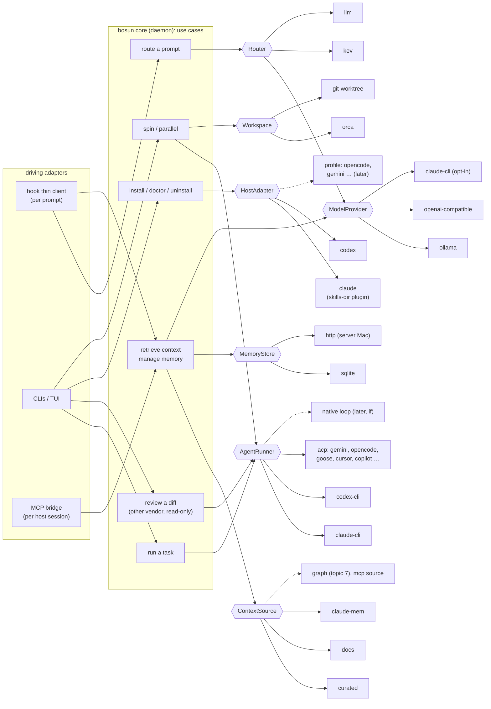
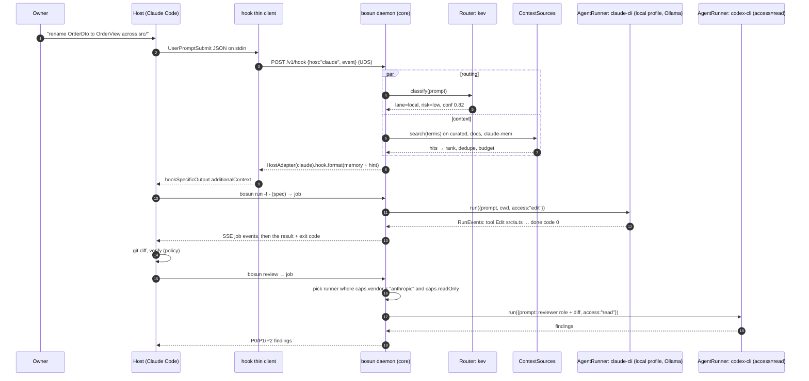

# 04 · Independence: abstracting agents, models, memory and orchestrators

Checked 2026-10-01 on the owner's Mac (Apple M5 Pro, 48 GB, macOS 27.0.1). Claude Code 2.1.286 and Orca 1.4.217 are installed; Codex, Gemini CLI, opencode, Goose, Cursor CLI and tmux aren't. Docs, terms and registries were read on that date. Topics 1–3 are the baseline: Bun 1.4 coded to `node:*`, a daemon with a thin hook client, HTTP/1.1 + JSON on sockets, JSON-RPC 2.0 on stdio, Zod, the MCP SDK v2 and binaries-only releases.

## 1. Question

**Current design update, 2026-10-04:** [09-opencode-clef.md](09-opencode-clef.md) makes OpenCode the primary native host, with native Codex/Claude Code retained and generic ACP additional. Clef-Flash replaces Kev. The seven ports and host-orchestration choice below remain; original measurements and dated source observations are historical.

The owner said: "I need this project to be independent first. so orca, claude/codex, memory, etc. it is abstracted and extended." This note answers:
- Which ports (interfaces) should bosun v1.0 have, and which adapters ship in v1.0?
- How do third parties add a host or an executor without forking?
- Should bosun stay an orchestrator over host agents (path a), or also run its own agent loop (path b)? What does each cost, and can bosun's own loop use the owner's subscriptions?
- Which open standards give independence for free?
- What does bosun look like without Orca?
- How much of v0.2.0 survives each port?

## 2. TL;DR

- **Seven ports, no more:** `HostAdapter`, `AgentRunner`, `ModelProvider`, `MemoryStore`, `ContextSource`, `Workspace` and `Router`.
  - Each has at least two real implementations in v1.0.
  - Two of them already exist in v0.2.0: `MemoryApi` and `MemoryProvider` in `lib/memory/types.ts:35-49`.
  - **Reviewer is not a port.** It's a use case: run a read-only `AgentRunner` from the other vendor.
  - **The launchd supervisor isn't a port** either. bosun runs on macOS only.
- **The leaks are concentrated.** 326 of 3,008 `lib/` lines name a vendor, and 79% of those sit in six files: `cli`, `wire`, `services`, `exec`, `orca` and `route`. The memory layer is already almost vendor-neutral (§4.1).
- **Extend through existing standards, not a new plugin API.** First-party adapters are in-process TS modules in a static table, compiled into the binary. Third parties plug in out of process:
  - **a new agent:** speak ACP
  - **a new context source:** be an MCP server
  - **a new model:** serve an OpenAI-compatible endpoint
  - **a simple new host:** a declarative TOML profile

  A bosun-specific JSON-RPC plugin protocol waits for the first real request.
- **Recommendation: path (a) now, and no bosun-owned agent loop in v1.0.**
  - Cost: ~6–7 engineer-weeks for path (a) with the ACP runner, against +5–7 for a minimal own loop and 4–6 months for a full one (§4.4).
  - Local models already have loops: `claude --bare` against Ollama's Anthropic API, `codex exec --oss`, and any ACP agent (opencode, Goose, Pi) pointed at Ollama.
  - A hybrid, a minimal own loop for local models only, is justified only if a local-model eval shows the hosts' harnesses failing.
- **Subscriptions.** A bosun-native loop **can't use the Claude Pro/Max subscription**:
  - OAuth is "intended exclusively" for Claude Code and Anthropic's own apps.
  - Developers "may not collect, store, or intermediate Claude.ai credentials or session tokens".
  - Consumer Terms §3 bans automated access except through an API key.

  Spawning the user's own unmodified `claude` binary stays allowed, and it draws from plan limits.
  - **ChatGPT changed two days ago:** "Sign in with ChatGPT" plan usage (DevDay, 2026-09-29) is open to "open-source projects, personal projects that run locally". Its Responses API takes `store:false`, `stream:true` and function tools, but no hosted tools. So a native loop could legally use the ChatGPT plan. It's a preview.
- **Standards:**
  - **Adopt:** MCP (already used), Agent Skills (already used; Claude reads only `~/.claude/skills`, the others read `~/.agents/skills`), AGENTS.md (Codex's file; Claude Code reads it since 2.1.277 when no CLAUDE.md exists), and **ACP as the generic `AgentRunner`**: one adapter reaches the 41 agents in the ACP registry.
  - **Keep native CLI adapters for Claude and Codex.** Both need third-party ACP adapters (`claude-agent-acp` 0.84 sits on the Agent SDK), and the native flags are already hardened.
  - **Skip A2A.** It's for remote, opaque, cross-organisation agents; no coding CLI speaks it.
  - **Hooks are de facto converged** (the same `hookSpecificOutput.additionalContext`), but nobody standardises them. The Agent Plugins 1.0 standard keeps hooks in client namespaces.
- **A big wiring simplification for Claude Code:** a plugin directory with `.claude-plugin/plugin.json` under `~/.claude/skills/` auto-loads in place as `<name>@skills-dir`. It carries skills, agents, hooks and MCP servers, with no trust restrictions at personal scope. That replaces most of `wireClaude`. Permissions and the CLAUDE.md policy block still need their own writes.
- **Without Orca:** `Workspace` has two adapters, `orca` and `git-worktree`.
  - The watchable split becomes a daemon job whose log streams over SSE (topic 2), plus an optional `pane` capability.
  - `card` becomes job status in the daemon.
  - Without Orca, `spin` runs headless in a git worktree, with no interactive agent pane.
- **Migration:** about 89% of `lib/` lines are vendor-neutral. The memory and context modules (~950 lines) survive ~90%; the six host-facing files (1,251 lines) survive ~45–55%, as adapter bodies. That points to "evolve into a new layout" (topic 6 decides).

## 3. bosun constraints that matter here

| Constraint | What it means for the abstractions |
|---|---|
| **The owner first, others later.** It's published as binaries, with stable interfaces (README) | Third-party extension must work against a compiled binary, so new adapters can't require recompiling bosun. That favours out-of-process protocols, which are already public standards. |
| **The owner dislikes speculative abstraction** | A port needs ≥ 2 real implementations, or a clear near-term second. Small things (Reviewer, the service supervisor) stay functions. |
| **Subscription logins are the main way models are paid for** | Claude must run through the user's own `claude` binary (§4.4.4). Executors spawn the installed CLIs with an exact env, as `SUBSCRIPTION_ONLY` does today (`exec.ts:28`). |
| **Local models on 48 GB** | Local runs need a harness that works with Ollama. Two exist today (`exec.ts:35-60`). |
| **The hook budget is ≤ 15 ms p95 wall** (topics 1–3) | Ports must not drag npm packages onto the hook path. Each host's hook parse/format lives in a lean module with `node:*` imports only. |
| **The daemon is approved** | Long-running work (executor runs, the watch view, parallel workers) moves into daemon jobs. That removes the Orca-only file rendezvous (`orca.ts:52-136`). |
| **Install nothing in hosts' homes without the owner's say-so** | Adapters plan changes (`FileChange[]`) before they apply them. That's the existing preflight/backup/state discipline (`wire.ts:39-62`), made explicit. |

## 4. Options

### 4.1 Where vendor specifics leak today (v0.2.0)

Method: `grep -c -i -E 'claude|codex|orca|ollama|kev|systemone|ROUTER_|launchctl|plist|CLAUDE|CODEX|ORCA|OLLAMA|AGENTS|claude-mem|ClaudeMem'` per file (§5).

| Vendor | Where it leaks (file:line) | What it is |
|---|---|---|
| **Claude Code** | `wire.ts:9-13` (`Bash(bosun …)` permission rules, plugin ids, the `settings.json` path, the `--host` hook command); `wire.ts:21-27` (`claude mcp add --scope user`); `wire.ts:64-77` (policy text "Agent tool → `bosun-x`", `run_in_background`); `wire.ts:113-134` (overlapping plugins); `wire.ts:151-161` (`wireClaude`: agents, skill symlinks, CLAUDE.md, hooks and permissions in `settings.json`) | install/wiring |
| | `roles.ts:7-12` (Claude tool names in `ACCESS`), `roles.ts:32-36` (agent frontmatter) | role rendering |
| | `exec.ts:16-28` (`ALLOW`, `DENY`, `FENCE`: Claude tool names and flags), `exec.ts:38-49` (`--bare` + Ollama env), `exec.ts:66-71`, `exec.ts:110-114` (`stream-json`), `exec.ts:116` (`hostNow`: `CLAUDECODE`, `CODEX_THREAD_ID`), `exec.ts:124-131` (the reviewer) | executor |
| | `route.ts:23-34` (hint text per host), `route.ts:177` (default host `claude`), `route.ts:194` (hook output shape) | hook |
| | `llm.ts:7` (imports `SUBSCRIPTION_ONLY` from the executor module), `llm.ts:33-52` (`claude -p` as an LLM) | model provider |
| | `orca.ts:44-46` (renders Claude stream events), `orca.ts:148` | executor view |
| | `memory/project.ts:71` (`CLAUDE_PROJECT_DIR`), `config.ts:18`, `cli.ts:133`, `cli.ts:226-243`, `cli.ts:262` | env, paths, doctor |
| **Codex** | `wire.ts:12`, `wire.ts:15-16` (Codex homes, including Orca's), `wire.ts:28-37` (`codex mcp add` per `CODEX_HOME`), `wire.ts:163-177` (agents TOML, AGENTS.md, `~/.agents/skills`, `hooks.json`, `/hooks` trust); `roles.ts:38-44` (agent TOML); `exec.ts:51-59`, `exec.ts:62-65`, `exec.ts:120-123`; `config.ts:19-21`; `cli.ts:235-243` | wiring, executor |
| **Orca** | `orca.ts:17-27` (detection), `orca.ts:52-136` (watch split with `.pid/.rc/.log` rendezvous), `orca.ts:147-191` (spin), `orca.ts:193-201` (card); `exec.ts:102-105`; `config.ts:21` and `wire.ts:15-16`, `wire.ts:173` (Orca's Codex home and its `hooks.json`); `skills/bosun-parallel/SKILL.md:8-15`; `skills/*/SKILL.md` (`bosun card`); `policy.md:24` | workspace, view, status |
| **Ollama** | `services.ts:53-93` (Ollama.app or a brew service, `launchctl setenv`, a version gate at 0.34), `exec.ts:44`, `exec.ts:54`, `exec.ts:99`, `llm.ts:55-58` (`/api/chat`, `num_ctx`), `cli.ts:79-86`, `cli.ts:254-259` | model provider, setup |
| **Kev** | `route.ts:44-65` (`/v1/systemone` request shape), `services.ts:95-110` (uv + git clone), `serve.ts:109-119` (a forwarder), `cli.ts:260-261` | router |
| **claude-mem** | `memory/claudemem.ts:12-27` (the v40 schema columns, the path); `memory/types.ts:47` (`Source` is a closed union with `'claude-mem'`); `context.ts:8-9` (weights and half-lives keyed by source name); `consolidate.ts:5`, `consolidate.ts:33` (a concrete `ClaudeMem` parameter); `mcp.ts:26`, `mcp.ts:39`; `memory/cli.ts:115` | context source |
| **macOS** | `services.ts:7-43` (launchd plists, `launchctl`) | supervisor (by design) |

**What's already abstract:**
- `MemoryApi` has two implementations, `MemoryService` (`service.ts:55`) and `RemoteStore` (`remote.ts:9`).
- `MemoryProvider` has three: curated, `Docs` and `ClaudeMem`.
- `llm.ts`'s `PROVIDERS` table is an informal port. `exec.ts`'s `Job` type (`orca.ts:10`) is an informal executor command.

### 4.2 The ports



**Shared types (sketch):**

```ts
type Env = Readonly<Record<string, string | undefined>>;
type Detect = { installed: boolean; version?: string; path?: string; notes?: string[] };
type Check = { ok: boolean; label: string; fix?: string };
type FileChange =
  | { op: 'write'; path: string; text: string; owned: boolean }        // owned: carries the bosun marker
  | { op: 'link'; path: string; target: string }
  | { op: 'block'; path: string; text: string }                          // the <!-- bosun:begin --> section
  | { op: 'json'; path: string; patch: (j: unknown) => unknown }         // settings.json / hooks.json
  | { op: 'run'; cmd: string; args: string[]; env?: Env; undo?: { cmd: string; args: string[] } };
```

#### 4.2.1 HostAdapter: where bosun is installed and wired

- **Why it's a port:** two real hosts today, with ~150 lines of branching in `wire.ts`, `roles.ts`, `route.ts`, `cli.ts` and `exec.ts`. Near-term thirds (opencode, Gemini CLI, Cursor CLI, Copilot CLI) all read Agent Skills and AGENTS.md (§4.5).
- **What it does:**
  - It renders roles and policy into the host's formats.
  - It **plans** changes; the core applies them with the existing backup/state machinery.
  - It parses and formats the hook JSON.
  - It reads the host's session env: `CLAUDECODE`, `CLAUDE_PROJECT_DIR`, `CODEX_THREAD_ID`.

```ts
type HostCaps = {
  subagents: boolean; plugins: boolean; promptHook: 'command' | 'command+http'; hookTrust: boolean;
  mcpStdio: boolean; readsAgentsMd: boolean; skillsDirs: string[];
};
type HostBundle = {
  roles: Role[]; skillsDir: string; policy: string;
  mcp: { command: string; args: string[] }; hook: { command: string; timeoutS: number }; permissions: string[];
};
type PromptEvent = { prompt: string; sessionId: string | null; cwd: string };
interface HostAdapter {
  readonly id: 'claude' | 'codex' | (string & {});
  readonly caps: HostCaps;
  detect(env: Env): Promise<Detect>;
  plan(b: HostBundle, cfg: Config): Promise<FileChange[]>;      // pure: install = apply(plan(...))
  planUninstall(state: InstallState): Promise<FileChange[]>;
  doctor(b: HostBundle): Promise<Check[]>;
  roleRef(role: string): string;                                // "Agent tool → `bosun:worker`" / "spawn agent `bosun_worker`"
  session(env: Env): { active: boolean; projectDir?: string; sessionId?: string };
  hook: { parse(stdin: string, env: Env): PromptEvent | null; format(context: string): string };  // lean module, node:* only
}
```

| | v1.0 | later |
|---|---|---|
| **Adapters** | **claude:** a skills-dir plugin at `~/.claude/skills/bosun/` (skills, rendered agents, `hooks/hooks.json`, `.mcp.json`), plus the CLAUDE.md block and the permission rules in `settings.json`. **codex:** today's approach (AGENTS.md block, `agents/*.toml`, `~/.agents/skills`, `hooks.json`, `codex mcp add`), with Orca's Codex home discovered by this adapter. | a declarative **profile** (TOML: instructions file, skills dir, agents dir + template, hooks file, MCP registration command) for opencode, Gemini CLI, Cursor CLI and Copilot CLI; a Codex **Agent Plugins** bundle |

**The skills-dir plugin evidence:**
- An id ending in `@skills-dir` means: "You saved a plugin directory that has a `.claude-plugin/plugin.json` under `~/.claude/skills/`".
- Such plugins load "in place and [are] never copied".
- "Personal-scope plugins have none of these restrictions." [cc-plugin-loading]
- A plugin bundles skills, agents, hooks and MCP servers. Agents are namespaced: "an agent `reviewer` in plugin `deploy-tools` appears as `deploy-tools:reviewer`". [cc-plugin-manifest]

**Two limits:**
- A plugin's `settings` takes "only `agent` and `subagentStatusLine`", so permissions can't move into it.
- "A `CLAUDE.md` at the plugin root isn't loaded as context", so the policy block stays in `~/.claude/CLAUDE.md`, or moves to a SessionStart hook. [cc-plugin-manifest]

#### 4.2.2 AgentRunner: runs a task headless

- **Why it's a port:** two real CLIs today, with branching across `buildRun`, `buildReview`, `streamed` and `execJob`. ACP adds one generic adapter for dozens more (§4.5).
- **What it does:** it turns a run spec into a child process and **normalises** the host's NDJSON or ACP stream into one event type. The daemon republishes those events as SSE (topic 2).

```ts
type Access = 'read' | 'edit';
type RunSpec = {
  prompt: string; cwd: string; access: Access; model?: string; effort?: string; maxTurns?: number;
  mcp?: { name: string; command: string; args: string[] }[]; env?: Env; signal: AbortSignal;
};
type RunEvent =
  | { t: 'text'; text: string } | { t: 'tool'; name: string; target?: string }
  | { t: 'file'; path: string; op: 'edit' | 'create' | 'delete' }
  | { t: 'permission'; tool: string; decision: 'allow' | 'deny' }
  | { t: 'usage'; tokensIn?: number; tokensOut?: number }
  | { t: 'done'; code: number; result: string };
type RunnerCaps = {
  vendor: string;                                   // reviewer rule: vendor ≠ the host's
  readOnly: boolean; sandbox: 'os' | 'tool-allowlist' | 'none';
  mcpInject: boolean; effort: boolean; localBackend: boolean; billing: 'subscription' | 'api' | 'local';
};
interface AgentRunner {
  readonly id: string;                              // 'claude-cli' | 'codex-cli' | 'acp:<agent>'
  readonly caps: RunnerCaps;
  detect(env: Env): Promise<Detect>;
  run(spec: RunSpec): AsyncIterable<RunEvent>;
}
```

| | v1.0 | later |
|---|---|---|
| **Adapters** | **`claude-cli`:** `-p --output-format stream-json`, with today's `FENCE`, `--restricted`, `--strict-mcp-config` and `SUBSCRIPTION_ONLY`. **`codex-cli`:** `exec --json`, with `-s read-only` or `workspace-write`. **`acp`:** a generic ACP client; the command comes from config or the ACP registry. **`local`** is a *profile*, not an adapter: `claude-cli` + Ollama env, or `codex-cli --oss`. | `codex-app-server` (now "experimental and unsupported"); a bosun-native loop (§4.4) |

#### 4.2.3 ModelProvider: chat/completions for routing and consolidation

- **Why it's a port:** three real providers today (`llm.ts:54-65`). The only change is moving the "may this see private content?" rule from the caller flags (`llm.ts:78-79`) into a capability.

```ts
type Msg = { role: 'system' | 'user' | 'assistant'; content: string };
type GenRequest = { task: string; messages: Msg[]; schema?: JsonSchema; model?: string; signal: AbortSignal };
type GenResult = { text: string; json?: unknown; model: string; tokensIn?: number; tokensOut?: number };
interface ModelProvider {
  readonly id: string;                                // 'ollama' | 'openai-compatible' | 'claude-cli'
  readonly caps: { structured: 'schema' | 'json-mode' | 'prompt'; local: boolean; numCtx: boolean };  // local ⇒ may see private memories
  generate(r: GenRequest): Promise<GenResult>;
  health(signal: AbortSignal): Promise<boolean>;
}
```

| | v1.0 | later |
|---|---|---|
| **Adapters** | `ollama` (native `/api/chat`, because only it sets `num_ctx` (topic 3)), `openai-compatible` (LM Studio, mlx_lm), `claude-cli` (opt-in, never private) | `anthropic-api` and `openai-api` (API keys); `openai-siwc` (the ChatGPT plan, §4.4.4) once it's out of preview |

#### 4.2.4 MemoryStore and ContextSource

- **Why they're ports:** they already are, with 2 and 3 implementations.
- **Changes:**
  - `Source` becomes an open string.
  - Each source declares its own weight and half-life. That replaces the name-keyed tables in `context.ts:8-9`.
  - Consolidation takes a structural `{ summaries(since, limit) }` instead of the `ClaudeMem` class (`consolidate.ts:33`).

```ts
interface MemoryStore extends MemoryApi { health(): Promise<{ version: string; schema: number }> }   // MemoryApi = types.ts:35-44, unchanged
type Hit = { source: string; id: string; title: string; text: string; category: string; rank: number; at: number;
             accessCount: number; hash?: string; matched?: number };
interface ContextSource {
  readonly id: string;                       // 'curated' | 'docs' | 'claude-mem' | 'graph' | 'mcp:<server>'
  readonly weight: number; readonly halfLifeDays: number;
  search(query: string, ctx: Ctx, limit: number): Promise<Hit[]>;    // never throws except 'curated' (today's rule)
  summaries?(since: number, limit: number): Summary[];               // optional capability: consolidation input
  close?(): void;
}
```

| Port | v1.0 | later |
|---|---|---|
| **MemoryStore** | `sqlite` (`MemoryService`), `http` (`RemoteStore` → the daemon's remote client) | topic 7 decides whether graph memory is a store or a source |
| **ContextSource** | `curated`, `docs`, `claude-mem` (read-only) | `graph` (topic 7); `mcp` (any MCP server's search tool, with a mapping in config); a reader for Claude Code's auto memory (`~/.claude/projects/<project>/memory/`, plain Markdown [cc-memory]) |

#### 4.2.5 Workspace: Orca, plain git worktrees, or neither

- **Why it's a port:** Orca is today's only implementation. Independence *is* the second one: `git-worktree` with `git` 2.54 (installed).

```ts
type WorkspaceCaps = { pane: boolean; status: boolean; agentTerminal: boolean };
interface Workspace {
  readonly id: 'orca' | 'git-worktree' | (string & {});
  readonly caps: WorkspaceCaps;
  active(env: Env): Promise<boolean>;
  create(o: { name: string; from: string; baseBranch?: string }): Promise<{ id: string; path: string; branch: string }>;
  remove(id: string): Promise<void>;
  pane?(o: { command: string[]; title: string; near?: string }): Promise<{ handle: string } | null>;      // Orca split
  status?(worktree: string | 'active', status: string, comment?: string): Promise<void>;                 // Orca card
  startAgent?(worktree: string, o: { host: string; prompt: string; model?: string; effort?: string }): Promise<{ handle: string }>;
}
```

| | v1.0 | later |
|---|---|---|
| **Adapters** | `orca` (all capabilities), `git-worktree` (none of the optional ones) | a `tmux` pane (not installed here; only if asked) |

#### 4.2.6 Router

- **Why it's a port:** it's small, but it has two real implementations.
  - Kev needs uv, Python, a git clone and a model download (`services.ts:95-110`).
  - An `llm` router asks the configured `ModelProvider` the same lanes/risk question, with a Zod schema.
- `decide()` (`route.ts:68-72`) stays in the core.

```ts
type Decision = { lane: 'scout' | 'local' | 'worker' | 'main'; conf: number; risk: 'high' | 'low'; riskConf: number; ms: number; router: string };
interface Router { readonly id: 'kev' | 'llm' | (string & {}); classify(prompt: string, signal: AbortSignal): Promise<Decision | null> }
```

#### 4.2.7 What is deliberately *not* a port

| Candidate | Why not |
|---|---|
| **Reviewer** | Review is a 30-line use case: collect the diff (`exec.ts:151-165`), pick the runner with `caps.vendor ≠ host` and `caps.readOnly`, and send the reviewer role's prompt. A second "reviewer" implementation would just be another `AgentRunner`. |
| **Service supervisor** (launchd) | macOS only (README constraints). Add systemd if a Linux server ever appears. |
| **Hook protocol** | Claude and Codex share the JSON shape (§4.5.6). The 5-line difference lives in `HostAdapter.hook`. |
| **Orchestrator** (DAG, supervision) | bosun's core runs jobs, and Orca's own orchestration stays reachable through the `bosun-parallel` skill when Orca is present. A port would only wrap Orca's API. |

#### 4.2.8 Ports × adapters

| Port | Capability flags | v1.0 adapters | Later | 2nd implementation |
|---|---|---|---|---|
| HostAdapter | `subagents`, `plugins`, `promptHook`, `hookTrust`, `mcpStdio`, `readsAgentsMd`, `skillsDirs` | claude, codex | opencode, gemini-cli, cursor-cli, copilot-cli (profile); codex Agent Plugins bundle | real today |
| AgentRunner | `vendor`, `readOnly`, `sandbox`, `mcpInject`, `effort`, `localBackend`, `billing` | claude-cli, codex-cli, acp (+ `local` profiles) | codex-app-server; native loop (only if §4.4 triggers) | real today; ACP reaches 41 registry agents |
| ModelProvider | `structured`, `local`, `numCtx` | ollama, openai-compatible, claude-cli | anthropic-api, openai-api, openai-siwc | real today (3) |
| MemoryStore | (none) | sqlite, http | topic 7 | real today (2) |
| ContextSource | `summaries?` | curated, docs, claude-mem | graph, mcp, claude-auto-memory | real today (3) |
| Workspace | `pane`, `status`, `agentTerminal` | orca, git-worktree | tmux | git-worktree is the independence case |
| Router | (none) | kev, llm | – | llm removes the Kev install |

### 4.3 The extension mechanism

| Mechanism | Prior art (primary source) | Isolation | Discovery | Versioning | Fit for bosun |
|---|---|---|---|---|---|
| **In-process modules in a static table** | – | none | compiled in | bosun's own semver | **v1.0, first-party adapters only** |
| **In-process plugins from directories or npm** | opencode: "Files in these directories are automatically loaded at startup"; npm plugins are "installed automatically using Bun at startup"; plugins run in-process, typed by `@opencode-ai/plugin` [opencode-plugins] | none: full trust | `~/.config/opencode/plugins/`, `.opencode/plugins/`, config | a types package | **no.** Third-party code would run inside a process that edits `~/.claude` and `~/.codex`; it's supply-chain surface (topic 3's policy); and loading code into a compiled binary is unproven |
| **A separate extension host process** | VS Code runs extensions in a separate Extension Host (local Node, web worker, or remote), activates them "lazily" by activation events, and declares compatibility via `engines.vscode` [vscode-host] [vscode-manifest] | process | marketplace + `contributes` manifest | semver range against the host API | too heavy: an RPC-proxied API surface for one user |
| **Out-of-process servers over JSON-RPC** | MCP servers; Goose's extensions *are* MCP servers ("builtin, platform, stdio, and streamable_http") [goose-ext] | process | entries in a config file | `protocolVersion` + capabilities (MCP 2026-07-28: `server/discover`, topic 2) | **yes, for context sources and tools** |
| **Out-of-process agents over JSON-RPC** | ACP: JSON-RPC 2.0 over stdio; "a single integer that identifies a MAJOR protocol version"; "Clients and Agents MUST treat all capabilities omitted … as UNSUPPORTED" [acp-init]; a registry with launch commands [acp-registry] | process | the registry JSON (version 1.0.0, 41 agents) | integer major (stable: 1) + capabilities | **yes, for runners** |
| **A declarative profile** | Claude plugin manifests, Agent Plugins `plugin.json` [cc-plugin-manifest] [agent-plugins] | none needed | config | schema `$schema` / version | **yes, for simple hosts** |

**The design:**

1. **A registry: one static table** (`adapters/index.ts`). It maps port → id → a lazy factory (`() => import('./claude-cli.ts')`), so a process loads only the adapters it uses. The hook loads none: it uses `hosts/<id>/hook.ts`, which imports only `node:*`.
2. **Selection** happens in `config.toml` (topic 3), not in code. For example:

   ```toml
   [hosts]            enabled = ["claude", "codex"]
   [runners.local]    kind = "claude-cli"  backend = "ollama"   model = "qwen3.6:35b-a3b-coding-nvfp4"
   [runners.gemini]   kind = "acp"         command = ["gemini", "--acp"]
   [runners.opencode] kind = "acp"         command = ["opencode", "acp"]   # pointed at Ollama in opencode's own config
   [context.notes]    kind = "mcp"         command = ["my-notes-mcp"]  tool = "search"  weight = 0.7
   [models.lmstudio]  kind = "openai-compatible" url = "http://127.0.0.1:1234"
   [workspace]        prefer = ["orca", "git-worktree"]
   [router]           kind = "kev"   fallback = "llm"
   ```

3. **Discovery:** `bosun agents add <id>` reads the ACP registry JSON (`https://cdn.agentclientprotocol.com/registry/v1/latest/registry.json`) and writes the command into `config.toml`. It **doesn't install anything**: the registry gives `npx` packages or binary archives with a sha256, and the user installs them. `bosun doctor` asks each configured adapter to `detect()`.
4. **How third parties add things without forking:**
   - **An agent or executor:** ship an ACP agent. Most already exist.
   - **A context source:** ship an MCP server.
   - **A model:** expose an OpenAI-compatible endpoint.
   - **A host that only needs files written:** a profile.
   - **A host that needs code:** a **bosun plugin process**, using topic 2's stdio link with JSON-RPC 2.0 and MCP framing. It answers `bosun/initialize { api: 1, kind: "host" | "runner" | …, capabilities }`, then the port's methods (`host/plan`, `runner/run` + `runner/event` notifications, `$/cancel`). **Build this only when a third party asks.** Every case the owner has today is covered by the first four.
5. **Versioning:**
   - Out-of-process contracts carry their own versions: ACP major 1, MCP date versions, and the plugin protocol's integer `api` major with additive capabilities, the same pattern as topic 2's `/v1` + `discover`.
   - The in-process TS port interfaces aren't a public API in v1.0, because releases are binaries only (topic 3). Freeze them, with semver, only if bosun ever publishes npm packages.

### 4.4 Path (a) against path (b)

#### 4.4.1 What each path is

- **(a) Orchestration over host agents.**
  - bosun installs into Claude Code and Codex (`HostAdapter`) and runs their CLIs headless (`AgentRunner`).
  - Further agents arrive through ACP.
  - bosun owns routing, memory, context, review, workspaces and the daemon. It owns no tools, no edit format and no sandbox.
- **(b) bosun also runs its own agent loop.** The minimal scope to be useful:

| Piece | Minimum | Evidence of what it takes |
|---|---|---|
| Tools | read, list/glob, grep, edit, write, bash (timeout + allowlist) | today's `ALLOW`/`DENY` (`exec.ts:16-24`) would become a policy engine |
| Edit format | search/replace blocks for local models; `apply_patch` for OpenAI models | the OpenAI Agents SDK ships an "Apply patch / editor tool" and a local "Shell tool" [oai-agents-tools] |
| Sandboxing | macOS Seatbelt per run: writes only in the worktree, no network | `@anthropic-ai/sandbox-runtime` 0.0.77 (Apache-2.0, 4 deps) enforces "filesystem and network restrictions … at the OS level, without requiring a container" [sandbox-runtime]. Codex has its own (`-s workspace-write`) |
| Permissions | allow/deny rules + an approval round-trip to the TUI or the host | none of AI SDK 7's agent docs show built-in approval [ai-agents] |
| Context management | truncating file reads, a token budget, compaction on overflow | the hosts do this; bosun would own it |
| Loop control | max steps, stop conditions, cancel | AI SDK 7 `ToolLoopAgent` with `stopWhen` and `prepareStep` [ai-agents] |
| Events | the same `RunEvent` stream as §4.2.2 | – |

#### 4.4.2 What could be reused for (b)

| Option | What it gives | What it doesn't | Verdict |
|---|---|---|---|
| **AI SDK 7** (`ai` 7.0.122, Apache-2.0, 3 deps) | `ToolLoopAgent`, providers (`@ai-sdk/openai-compatible`; Ollama via a community provider, topic 3) | no built-in file, edit or bash tools [ai-agents]; heavy churn (363 stable releases in 6 months, topic 3) | the base, if (b) happens |
| **OpenAI Agents SDK JS** (`@openai/agents` 0.18.0, MIT) | local shell and apply_patch tools, MCP; other models through its AI SDK integration [oai-agents-tools] | 0.x, OpenAI-first | a source of tool designs, not a dependency |
| **Claude Agent SDK** (0.3.284) | the full Claude Code loop | it *is* Claude Code ("a library that runs the Claude Code binary"); governed by the Commercial Terms; claude.ai login only "previously approved" [agent-sdk]; +216 MB (topic 3) | **avoid** (it's path (a) in disguise) |
| **AI SDK `HarnessAgent`** | adapters for Claude Code, Codex, Pi and ACP | "experimental"; runs in sandbox providers (topic 3) | no |
| **Pi** (`badlogic/pi-mono`, MIT, 110k stars) | a mature minimal harness: "print, JSON, or RPC mode", a TS SDK, `/login` for "a subscription or API key" [pi] | not bosun's code | **use it through ACP (`pi-acp`) instead of writing (b)** |
| **opencode** (MIT), **Goose** (Apache-2.0) | full agents with Ollama support [opencode-providers]; ACP-native (`opencode acp`, `goose acp`, from the registry) | – | same: use them through ACP |

#### 4.4.3 Cost and maintenance

Rough estimates for one experienced developer, excluding the daemon itself (topic 5):

| | **(a)** orchestration + ACP runner | **(b-min)** own loop, local models only | **(b-full)** own loop, every provider |
|---|---|---|---|
| **Scope** | 7 ports; 2 host adapters (with the Claude plugin bundle); claude-cli, codex-cli and acp runners; ollama, openai-compatible and claude-cli providers; orca and git-worktree; kev and llm routers | (a) + AI SDK 7 loop + 6 tools + an edit format + a Seatbelt sandbox + permissions + compaction + evals against `bosun run`'s smoke task (`cli.ts:202-211`) | (b-min) + Anthropic/OpenAI API providers, the SIWC ChatGPT plan, an approval UI, subagents, an MCP client, hooks, session resume, prompt caching |
| **Engineer-weeks** | **~6–7** (ports and registry 0.5, hosts 1.5, CLI runners 1, ACP runner 1–1.5, providers 0.25, context 0.5, workspace + daemon jobs 1, router 0.25) | **+5–7** (3–4 to a first useful run, then 2–3 hardening edit-format and tool-call failures on local models) | **16–26**, then 20–30% of a developer ongoing |
| **Maintenance** | track two CLIs' flags (Claude Code ships near-daily: 2.1.285 → 2.1.286 are both on disk) and ACP v1 additions; ~½ day a month | per-model tool-calling and edit-format quirks; sandbox profiles; security of shell execution | everything a coding agent vendor maintains |
| **Claude subscription** | ✓ via the user's `claude` binary | ✗ | ✗ (API key only) |
| **ChatGPT subscription** | ✓ via `codex` | ✗ (local only) | ✓ via SIWC (preview) or ✗ |
| **Local models** | ✓ (`claude --bare` + Ollama's Anthropic API; `codex --oss`; ACP agents) | ✓ | ✓ |
| **Main risk** | host flag changes; ACP adapter churn | quality below the hosts' harnesses, for real effort | scope |

#### 4.4.4 The key question: can a bosun-native loop use the owner's subscriptions?

| Account | Native loop? | Evidence |
|---|---|---|
| **Claude Pro/Max** | **No.** Only the unmodified `claude` binary may use it. | **Legal and compliance:** "OAuth authentication … is intended exclusively for purchasers of Claude Free, Pro, Max, Team, and Enterprise subscription plans and is designed to support ordinary use of Claude Code and other native Anthropic applications." Developers "should use API key authentication"; Anthropic "does not permit third-party developers to offer Claude.ai login … or to route requests through Free, Pro, or Max plan credentials", and developers "may not collect, store, or intermediate Claude.ai credentials or session tokens". The carve-out: it does not "prevent an end user from signing in to the unmodified Claude Code binary with their own Claude subscription". [cc-legal] **Consumer Terms §3** (effective 2025-10-08) bans access "through automated or non-human means … Except when you are accessing our Services via an Anthropic API Key or where we otherwise explicitly permit it". [consumer-terms] **Agent SDK:** "Unless previously approved, Anthropic does not allow third party developers to offer claude.ai login or rate limits for their products, including agents built on the Claude Agent SDK." [agent-sdk] **Billing today:** "Update June 15: We're pausing the changes … Claude Agent SDK, `claude -p`, and third-party app usage still draw from your subscription's usage limits." [sdk-plan] |
| **ChatGPT Plus/Pro** | **Yes, since 2026-09-29**, for open-source or local personal apps (a preview) | "ChatGPT plan usage is available to open-source projects, personal projects that run locally, and selected private apps." [siwc-cookbook] Requests go to the Responses API at `https://api.openai.com/v1` with the OAuth token; client registration is dynamic (`client_id=dynamic_agent_client`); scopes include `chatgpt.tokens.use.direct`. [siwc-cookbook] [siwc-overview] Each request must set `store: false` and `stream: true`, and many fields are refused (`temperature`, `max_output_tokens`, `previous_response_id` …), as are hosted tools ("Image generation, file search, Code Interpreter, native computer use, hosted MCP/connectors"); function tools aren't listed as refused. [siwc-limits] "App usage counts toward your existing plan limits." [siwc-user] The DevKit repo was created 2026-09-29 and its code is under a "Noncommercial License v1.0"; bosun would implement the OAuth flow itself. [siwc-devkit] Codex CLI keeps working as today ("Sign in with ChatGPT for subscription access"). [codex-auth] |
| **Local (Ollama)** | Yes | – |
| **API keys** (either vendor) | Yes | the Consumer Terms' API-key exception; [cc-legal] |

**So (b) can't replace (a) for Claude.** The Claude subscription is reachable only by spawning `claude`, which is path (a). A native loop's reach is local models, API keys and, as of this week, the ChatGPT plan.

#### 4.4.5 A task through the ports (path a)



### 4.5 Standards that give independence for free

| Standard | What it is | Who supports it (2026-10-01) | Adopt? |
|---|---|---|---|
| **ACP** (Agent Client Protocol) | JSON-RPC 2.0 between a client and an agent: `initialize`, `session/new` (with `cwd` + `mcpServers`), `session/prompt`, `session/update`, `session/cancel`, `session/request_permission`, optional `fs/*` and `terminal/*` [acp-overview] [acp-session]; stable protocol version 1, schema 1.24.1, repo v1.10.1 (2026-09-30), Apache-2.0 [acp-repo] | Native: Gemini CLI, Cursor, GitHub Copilot, Goose, OpenCode, Cline, Junie, Kiro CLI, Qwen Code, Mistral Vibe, OpenHands and others. By adapter: "Claude Agent (via Zed's SDK adapter)", "Codex CLI (via ACP's adapter)", Pi [acp-agents]. The registry lists 41 agents [acp-registry] | **Yes, as the generic `AgentRunner`.** Not for Claude and Codex in v1.0 (below). |
| **A2A** | agent-to-agent over HTTP: JSON-RPC 2.0, gRPC or REST bindings; an Agent Card at `/.well-known/agent-card.json`; tasks with SSE or push notifications; `A2A-Version` header [a2a-spec]. v1.0.0 (2026-03-12), v1.0.1 (2026-05-28) [a2a-repo]; Linux Foundation, joined the AAIF 2026-08-27 [a2a-home] | agent frameworks (ADK, LangGraph, CrewAI, Semantic Kernel) [a2a-home]; no coding CLI found | **No.** It's built for "opaque" remote agents across organisations; bosun's agents are local CLIs, and topic 2's HTTP contract already covers the server Mac. |
| **AGENTS.md** | "a simple, open format for guiding coding agents"; nearest file wins; stewarded by the Agentic AI Foundation [agents-md] | Codex, Jules, Factory, Aider, goose, opencode, Zed, Warp, VS Code, Devin, Junie, Amp, Cursor, RooCode, Gemini CLI, Kilo Code, Copilot coding agent, Windsurf, Augment … [agents-md]. **Claude Code** reads `AGENTS.md` since v2.1.277, by default only when no `CLAUDE.md` exists on the path; `~/.claude/CLAUDE.md` doesn't count against it [cc-memory] | **Yes**, as the format of the policy block for every non-Claude host. Claude keeps `~/.claude/CLAUDE.md`, which loads alongside a repo's AGENTS.md. |
| **Agent Skills** | a folder with `SKILL.md`: `name` (≤ 64, matches the folder) and `description` (≤ 1024) required; optional `license`, `compatibility`, `metadata`, `allowed-tools` [skills-spec]; "originally developed by Anthropic, released as an open standard" [skills-home] | 40+ clients, including Claude Code, Codex, Gemini CLI, OpenCode, Cursor, Goose, GitHub Copilot, VS Code, Amp, Junie, Kiro, Pi [skills-home]. **Directories:** Codex `$HOME/.agents/skills` [codex-skills]; Gemini CLI `~/.gemini/skills` or `~/.agents/skills` [gemini-skills]; opencode `~/.agents/skills` and `~/.claude/skills` [opencode-skills]; **Claude Code** only `~/.claude/skills`, `.claude/skills` and plugins, and it adds its own frontmatter fields [cc-skills] | **Yes** (already). Link into `~/.agents/skills` once (Codex, Gemini, opencode) and ship them in the Claude plugin. Make the skill text host-neutral (§8). |
| **Agent Plugins 1.0** | a portable bundle: root `plugin.json`, `skills/`, `mcp.json`; hooks only in "reverse-domain extension namespaces" outside the portable core [agent-plugins]. Codex reads it (root `plugin.json`, `.codex-plugin/plugin.json` fallback, `hooks/hooks.json`) [codex-plugins-build] | TSC from Amazon, Cursor, Microsoft, OpenAI and Vercel; **Anthropic not listed** [agent-plugins] | **Later**, as the Codex/Cursor/Copilot packaging. Claude uses its own `.claude-plugin/` format. |
| **MCP** | 2026-07-28 stable (topic 2); donated to the AAIF by Anthropic on 2025-12-09 [aaif] | both hosts; Goose extensions *are* MCP servers [goose-ext]; ACP passes MCP servers per session [acp-session] | **Yes** (already). It's also the extension protocol for `ContextSource`. |
| **Hooks** (Claude Code, Codex) | **Claude:** 5 handler types, HTTP hooks since 2.1.63 (topic 2). **Codex:** `command` and `mcp_tool` only; `UserPromptSubmit` output `{"hookSpecificOutput":{"hookEventName":"UserPromptSubmit","additionalContext":…}}`; plain stdout counts as context; common inputs `session_id`, `transcript_path`, `cwd`, `hook_event_name`, `model`; default timeout 600 s; plugin hooks need `/hooks` trust [codex-hooks] | two hosts with the same output shape; no neutral standard (Agent Plugins leaves hooks to client namespaces [agent-plugins]) | **Treat as one contract** with a per-host `parse`/`format` in `HostAdapter.hook`. |

#### 4.5.1 Could bosun drive Claude and Codex through ACP instead of per-host flags?

**For:**
- One code path, with structured permission requests and a real `session/cancel`.
- Per-session MCP injection: bosun's memory server could be attached to every run.
- `codex-acp` "starts the Codex App Server" and offers "ChatGPT, API key, and client-provided custom gateway authentication". [codex-acp]

**Against, for v1.0:**
- **Claude:**
  - The adapter is `@agentclientprotocol/claude-agent-acp` 0.84.0, which depends on `@anthropic-ai/claude-agent-sdk`.
  - It can use the user's own binary (`CLAUDE_CODE_EXECUTABLE`), and its login method is "Run `claude /login` in the terminal". That's compliant, but it puts a fast-moving 0.x layer between bosun and Claude Code. [claude-acp-src]
- **Codex:** `@agentclientprotocol/codex-acp` 2.0.0 depends on `@openai/codex`, which topic 3 measured as a 316 MB binary package. Both adapters arrive by `npx`, against topic 3's "binaries only, no npx" posture.
- **What would be lost:**
  - the flags v0.2.0 already relies on: `--restricted`, `--strict-mcp-config`, `--bare` with Ollama, `--permission-mode dontAsk` with the `ALLOW`/`DENY` fence, `codex exec --oss`
  - the topic 2 NDJSON parsers

**Decision:** keep native `claude-cli` and `codex-cli` runners, and use `acp` for everything else. Switch Claude and Codex to ACP only when they speak it natively, with no adapter. The `acp` runner makes that a config change.

### 4.6 Orca independence

**What bosun uses Orca for today:**

| Use | Code | Without Orca (`git-worktree` workspace) |
|---|---|---|
| **Detection** | `orca.ts:23-27` (`ORCA_PANE_KEY` + `orca status --json`) | `Workspace.active()` per adapter; `workspace.prefer` picks |
| **Watchable executor split** | `exec.ts:102-105` → `orca.ts:52-136` (`orca terminal split --command "bosun _exec <id>"`, polling `.pid/.rc/.log` in `~/.bosun/runs`, 30 s start fallback, timeout kill) | **a daemon job.** `bosun run` posts the job and streams `RunEvent`s over SSE (topic 2), so the main model still gets only the result and the exit code. The live view is `bosun jobs tail <id>` or the Ink dashboard (topic 3), both included in v1.0. With Orca, `Workspace.pane()` opens a split that just runs `bosun jobs tail <id>`. **The file rendezvous goes away in both cases.** |
| **Spin-off worktree** | `orca.ts:147-191` (`orca worktree create --parent-worktree active [--base-branch] --agent --prompt`; `orca terminal create` for `local`) | `git worktree add -b spin-<slug> <dir> <base>`, then a **headless** `AgentRunner.run()` job in that path. The difference: no interactive agent pane to drop into. The owner reviews the diff afterwards. |
| **Card status** | `orca.ts:193-201` (`orca worktree set --workspace-status`); every skill calls `bosun card`; `policy.md:24` | the daemon records job and task status, and the TUI shows it. `Workspace.status?()` is a no-op without Orca, as today. |
| **Parallel workers** | `skills/bosun-parallel/SKILL.md:8-15` (`orca orchestration worker-start --worktree new-child --agent --model --effort`, `check --wait`) | `bosun parallel <plan>`: N worktrees × N `AgentRunner` jobs in the daemon, with a concurrency cap (local models: 1, since `OLLAMA_NUM_PARALLEL=1`, `services.ts:56`). The skill keeps the Orca path when `Workspace=orca`. |
| **Orca's Codex home** | `config.ts:21`, `wire.ts:15-16`, `wire.ts:173` | owned by the codex `HostAdapter` (extra homes it discovers), not by core paths |

Orca 1.4.217 offers more (`orchestration` DAGs, decision gates, `account add` for managed Claude/Codex accounts, remote `environment`s; `orca --help` here). bosun shouldn't mirror those. The `orca` adapter exposes only `create`/`remove`/`pane`/`status`/`startAgent`.

### 4.7 Migration: what each port replaces and how much survives

Line counts from `wc -l` (§5). "Survives" means the logic moves into an adapter or the core with small edits, not a rewrite.

| Port / layer | Replaces or wraps (v0.2.0) | Lines today | Survives | What changes |
|---|---|---|---|---|
| HostAdapter | `wire.ts` (228), `roles.ts` (44), host parts of `cli.ts` install/doctor/uninstall (~150), host paths in `config.ts` (~10) | ~430 | **~50%** | Keeps: `policy()` templating, `block()`, `hookJson()`, `writeOwned`/`link`/`restoreAside`, the `created` state, `renderClaude`/`renderCodex`, the overlap-plugin logic. Claude's agent files, skill links and `claude mcp add` become one plugin bundle; doctor checks become `doctor()`. |
| AgentRunner | `exec.ts` (180), `orca.ts` `jobEnv`/`renderEvent`/`execJob` (~70) | ~250 | **~65%** | Keeps: `RULES`, `ALLOW`, `DENY`, `FENCE`, `SUBSCRIPTION_ONLY`, the `buildRun`/`buildReview` bodies, `jobEnv`, `renderEvent`. Goes: argv loops (commander), `spawnSync` inline, the Orca watch. New: event normalisation, the ACP client. |
| ModelProvider | `llm.ts` (117) | 117 | **~85%** | `PROVIDERS` becomes three adapters; `generate()`'s chain and retries stay in the core; Zod replaces `validate` (topic 3). |
| MemoryStore | `memory/types.ts`, `service.ts`, `sqlite.ts`, `remote.ts` | 465 | **~95%** | adds `health()`; `RemoteStore` moves behind the daemon's client (topic 2) |
| ContextSource | `context.ts`, `memory/claudemem.ts`, `docs.ts`, `project.ts` | 312 | **~90%** | `Source` becomes a string; weights move into adapters; `projectDir` asks `HostAdapter.session()` |
| Workspace | `orca.ts` detection/spin/card/watch (~130) | ~130 | **~40%** | spin/card commands survive; the file rendezvous is replaced by daemon jobs |
| Router | `route.ts` (204), `serve.ts` `kevServer` (12) | ~215 | **~75%** | `ask()` becomes the kev adapter; `decide()`, stats, label and eval stay; `memoryBlock` and the hook main move to the daemon |
| not a port | `services.ts` (launchd, Ollama and Kev setup, 110) | 110 | ~80% | Ollama setup becomes the ollama provider's `setup()`/`doctor()`; Kev setup goes with the kev router; launchd stays |

**Overall:**
- 2,682 of 3,008 `lib/` lines (89%) name no vendor today.
- The vendor-touching six files (1,251 lines) survive at roughly 45–55%, and the memory/context/model layer (~900 lines) at ~90%.
- Hand-rolled infrastructure goes regardless, to topic 3's libraries: `mcp.ts`, `serve.ts`, `cli.ts` dispatch, `config.ts` parsing, `util.validate`.
- **For topic 6's "rewrite or evolve":** the domain logic survives; the module layout doesn't. That's "evolve into a new package layout", not a rewrite.

## 5. Measurements

No runtime benchmarks: this topic is structural. Inventory commands, all run 2026-10-01:

| What | Command | Result |
|---|---|---|
| Vendor-specific lines | `grep -c -i -E 'claude\|codex\|orca\|ollama\|kev\|systemone\|ROUTER_\|launchctl\|plist\|CLAUDE\|CODEX\|ORCA\|OLLAMA\|AGENTS\|claude-mem\|ClaudeMem' lib/*.ts lib/memory/*.ts` | **326 of 3,008 lines.** By file: `cli.ts` 76/328, `wire.ts` 55/228, `services.ts` 47/110, `exec.ts` 39/180, `orca.ts` 26/201, `route.ts` 16/204, `llm.ts` 12/117, `claudemem.ts` 11/85, `config.ts` 10/67, `serve.ts` 7/143, `mcp.ts` 6/138, `roles.ts` 5/44, `context.ts` 4/82, `consolidate.ts` 4/56, `types.ts` 3/49, `memory/cli.ts` 2/161, `bench.ts` 2/93, `project.ts` 1/76; **0** in `util`, `metrics`, `sqlite`, `service`, `remote`, `docs`, `log` |
| ACP registry | `curl -s https://cdn.agentclientprotocol.com/registry/v1/latest/registry.json` | version 1.0.0, **41 agents**. Launch examples: `gemini` → `npx @google/gemini-cli@0.62.0 --acp`; `opencode` 1.18.34 → binary `opencode acp`; `goose` 1.52.0 → `goose acp`; `cursor` → `cursor-agent acp`; `github-copilot-cli` → `npx @github/copilot@1.0.90 --acp`; `claude-acp` → `npx @agentclientprotocol/claude-agent-acp@0.84.0`; `codex-acp` → `npx @agentclientprotocol/codex-acp@2.1.0`; `pi-acp` 0.0.34 |
| npm metadata | `registry.npmjs.org/<pkg>` | `@agentclientprotocol/sdk` 1.5.1 (2026-09-28, 0 deps, 5.8 MB); `claude-agent-acp` 0.84.0 (deps zod, diff, ACP sdk, claude-agent-sdk); `codex-acp` 2.0.0 (deps zod, diff, open, @openai/codex, vscode-jsonrpc, ACP sdk); `@openai/agents` 0.18.0; `@a2a-js/sdk` 1.2.1 (dep jose); `@anthropic-ai/sandbox-runtime` 0.0.77 (zod, commander, node-forge, socks5-server) |
| Local tools | `claude --version`, `orca --version`, `which codex tmux git` | Claude Code 2.1.286; Orca 1.4.217; codex and tmux not installed; git 2.54.0 |
| Claude CLI surface | `claude --help`, `claude plugin --help`, `claude plugin marketplace --help` | `plugin init` "Scaffold a new plugin at ~/.claude/skills/<name>/ (auto-loads next session as <name>@skills-dir)"; `plugin details` shows a "component inventory and projected token cost"; `marketplace add` takes "a URL, path, or GitHub repo" |

## 6. Recommendation

**Path (a): bosun as an orchestration layer with seven ports, in-process first-party adapters, and existing open protocols as the extension surface (ACP for agents, MCP for context, OpenAI-compatible HTTP for models, profiles for hosts). Cost ~6–7 engineer-weeks. No bosun-owned agent loop in v1.0.**

**Rationale:**
1. **It's the only path that keeps the Claude subscription.** Anthropic's terms allow it only through the user's own unmodified `claude` binary (§4.4.4). Any native loop leaves Claude behind.
2. **Local models are already served** by three harnesses bosun doesn't maintain: `claude --bare` + Ollama's Anthropic API (`/v1/messages` with tools and streaming [ollama-anthropic]), `codex --oss`, and ACP agents (opencode, Goose, Pi) on Ollama. A bosun loop would compete with them for 5–7 weeks of work.
3. **ACP is real independence.** One ~300-line client adapter (or `@agentclientprotocol/sdk`, 0 deps) reaches 41 registered agents, with versioned capabilities. No per-agent code is needed.
4. **The memory side is already abstract.** Formalising `MemoryStore` and `ContextSource` costs about a day.
5. **The Claude skills-dir plugin** removes most of the riskiest code in `wire.ts`: edits to `~/.claude/agents`, the skill symlinks, `claude mcp add`, and the `settings.json` hook entry.

**Risks:**

| Risk | Mitigation |
|---|---|
| Host CLI flags change (Claude Code ships near-daily) | Each runner keeps a `detect()` version check and a contract test against a stub CLI (as `test/exec.test.ts` does); `bosun doctor` reports drift. |
| The skills-dir plugin behaves differently from the docs (hooks or MCP not loading; the `bosun:` agent namespace changes the role names in the policy) | Spike first on 2.1.286 (`claude plugin details bosun`, a live `/agents` check). Keep v0.2.0's direct wiring behind the same `HostAdapter` as a fallback. |
| ACP churn (repo v1.10.1, schema 1.24.1, a v2 schema directory exists) | Negotiate `protocolVersion: 1`; treat omitted capabilities as unsupported (the spec rule); pin the SDK; one stub ACP agent in tests. |
| ACP agents' permission prompts block a headless run | The `acp` runner answers `session/request_permission` from the run's `access` policy (read: deny writes; edit: allow inside the worktree), and never asks the owner mid-run in v1.0. |
| SIWC is a 2-day-old preview | Don't depend on it in v1.0. Revisit for the `openai-siwc` provider when the preview label goes. |
| A 7-port design creeps into more ports | Rule: no new port without two real adapters (§4.2.7 lists what stays a function). |

**What would change the call:**
- **To the hybrid (b-min, +5–7 weeks):** an eval of local-model runs (the `bosun run` smoke task plus 10–20 labelled mechanical edits) shows `claude --bare`, `codex --oss` *and* an ACP agent all failing where a lean 6-tool loop would pass. For example, Claude Code's system prompt eating too much of the 64K local context. Even then, try Pi through ACP before writing a loop.
- **To (b-full):** Anthropic permits subscription OAuth in third-party loops, or the owner moves to API billing. Neither is the case on 2026-10-01.
- **ACP for Claude and Codex too:** either host ships native ACP, with no adapter.
- **A bosun plugin protocol:** the first third party who needs a code-backed host or runner that ACP/MCP/profiles can't express.

## 7. Open questions for the owner

Only the ones that change the outcome. Each has the default I'll assume.

1. **Is a bosun-owned agent loop in scope for v1.0 at all?**
   - **No:** path (a) only; local models run through host and ACP harnesses.
   - **Yes:** +5–7 weeks for a local-only loop, or months for full parity, and it still can't use the Claude subscription.
   - **Default:** keep path (a). Evaluate local harnesses during this build before a scoped decision on a minimal local-only loop; there is no subsequent release assignment. A full replacement agent platform remains outside scope.
2. **May bosun wire Claude Code as a skills-dir plugin (`~/.claude/skills/bosun/`)** instead of editing `~/.claude/agents`, the skill links, the `settings.json` hook and `claude mcp add`?
   - It renames subagents to the plugin namespace (`bosun:worker` style).
   - **Default:** yes, after a one-day spike. The CLAUDE.md block and the permission rules stay as they are.
3. **Without Orca, is a headless spin-off (no interactive agent pane; you review the diff after) acceptable?**
   - **Default:** yes. Orca stays the preferred `Workspace` whenever it's running.
4. **Should bosun's own LLM calls (router fallback, consolidation) use your ChatGPT plan through Sign in with ChatGPT once it leaves preview?**
   - **Default:** not in v1.0. Local Ollama first, as today; `claude -p` stays an opt-in.

## 8. Roadmap implications

1. **Ports module:** the seven interfaces from §4.2 (signatures only), plus `adapters/index.ts` with lazy factories.
   - Make `Source` an open string; move weights and half-lives into the sources.
   - Consolidation takes a structural `summaries()` source.
   - CI check: the hook entry imports no adapter modules except `hosts/<id>/hook.ts` (extends topic 3's metafile rule).
2. **Config sections** in `config.toml`: `[hosts]`, `[runners.<id>]` (`kind = "claude-cli" | "codex-cli" | "acp"`, plus `backend` for local profiles), `[models.<id>]`, `[context.<id>]` (`kind = "mcp"` with a tool mapping), `[workspace] prefer`, `[router] kind/fallback`. Migrate the flat `ROLE_*`/`LOCAL_*`/`LLM_*` keys.
3. **Claude HostAdapter v1.0:**
   - Spike: generate `~/.local/share/bosun/hosts/claude/` (`.claude-plugin/plugin.json`, `skills/`, rendered `agents/`, `hooks/hooks.json` with `UserPromptSubmit`, `.mcp.json`), symlink it as `~/.claude/skills/bosun`, and verify with `claude plugin details bosun`.
   - Then the `plan()`/`apply()` split, uninstall of v0.2.0 artefacts, and `roleRef()` for namespaced agents.
   - Keep the CLAUDE.md block and the permission rules.
4. **Codex HostAdapter:** today's wiring behind `plan()`; the adapter owns extra-home discovery (Orca); `hook.parse`/`format`. Later: an Agent Plugins bundle via `codex plugin marketplace add` (a spike, since Codex isn't installed here).
5. **Runners:**
   - `claude-cli` and `codex-cli` with `RunEvent` normalisation from `stream-json` / `exec --json` (topic 2's parsers).
   - `local` profiles.
   - The **`acp` runner**: spawn, `initialize` (protocol 1, no `fs`/`terminal` capabilities in v1.0, so agents use their own tools), `session/new` with `cwd` + bosun's MCP server, `session/prompt`, map `session/update` → `RunEvent`, answer permissions by policy, `session/cancel` on abort.
   - Decide hand-rolled versus `@agentclientprotocol/sdk` after a `bun build --compile` check.
   - Tests use a stub ACP agent.
6. **`bosun agents add <id>`:** read the ACP registry, write `[runners.<id>]`, never install; `doctor` runs `detect()`.
7. **Review as a use case:** pick the runner by `caps.vendor` and `caps.readOnly`; delete the host-name branching in `exec.ts:167-176`.
8. **ModelProvider:** split `llm.ts` into three adapters; the `local` capability replaces the `private`/`allowRemote` checks.
9. **Router:** a kev adapter, plus an `llm` adapter using the same lanes/risk schema through `ModelProvider` (no Kev install needed).
10. **Workspace + daemon jobs:**
    - `orca` and `git-worktree` adapters; `bosun run` becomes a daemon job with SSE; `bosun jobs tail`.
    - Remove the `~/.bosun/runs` file rendezvous.
    - `bosun spin` without Orca = worktree + headless job; `bosun parallel` = N jobs with a concurrency cap.
11. **Skills pass:** make them host-neutral.
    - `bosun-build:11` and `bosun-review:9` hard-code "In Claude Code … in Codex …"; use the policy's `{{RUN_HOW}}` instead.
    - `bosun-spin` and `bosun-parallel` describe the Orca path and the `git-worktree` fallback.
    - Validate frontmatter against the Agent Skills spec (name = folder, ≤ 64 characters).
12. **Later, only on a trigger:**
    - host profiles (opencode, Gemini CLI, Cursor CLI, Copilot CLI)
    - an `mcp` context source
    - a Claude auto-memory context source
    - `openai-siwc`
    - the bosun plugin protocol (`bosun/initialize`, `api: 1`)
    - the b-min loop (AI SDK 7 `ToolLoopAgent` + `sandbox-runtime`)

## 9. Sources

All checked 2026-10-01.

**Anthropic: terms, policy and docs**
- [cc-legal] Claude Code legal and compliance (OAuth intended exclusively for plans and native apps; developers use API keys; no routing through plan credentials; no intermediating tokens; the unmodified-binary carve-out): https://code.claude.com/docs/en/legal-and-compliance
- [consumer-terms] Consumer Terms of Service, effective 2025-10-08, §2 (credential sharing) and §3 (automated access only via API key or explicit permission): https://www.anthropic.com/legal/consumer-terms
- [agent-sdk] Agent SDK overview ("runs the Claude Code binary"; "Unless previously approved … claude.ai login"; Commercial Terms): https://code.claude.com/docs/en/agent-sdk/overview
- [sdk-plan] "Use the Claude Agent SDK with your Claude plan" (the June 15 pause; SDK, `claude -p` and third-party apps draw from plan limits): https://support.claude.com/en/articles/15036540-use-the-claude-agent-sdk-with-your-claude-plan
- [cc-plugin-manifest] Plugin manifest reference (components, `settings` limited to `agent`/`subagentStatusLine`, a root `CLAUDE.md` not loaded, agent namespacing): https://code.claude.com/docs/en/plugins-reference
- [cc-plugin-loading] Plugin loading reference (`@skills-dir`, in-place loading, no restrictions at personal scope): https://code.claude.com/docs/en/plugins/loading
- [cc-memory] Memory (AGENTS.md since v2.1.277, `claude-md-or-agents-md` default, auto-memory location): https://code.claude.com/docs/en/memory
- [cc-skills] Skills (directories; follows Agent Skills; Claude-specific frontmatter): https://code.claude.com/docs/en/skills
- Claude Code hooks reference (handler types, HTTP hooks; topic 2): https://code.claude.com/docs/en/hooks
- [sandbox-runtime] anthropic-experimental/sandbox-runtime (Apache-2.0; npm `@anthropic-ai/sandbox-runtime` 0.0.77, 2026-09-18): https://github.com/anthropic-experimental/sandbox-runtime

**OpenAI: Codex and Sign in with ChatGPT**
- [codex-auth] Codex authentication (ChatGPT versus API key, `auth.json`/keyring, device auth): https://learn.chatgpt.com/docs/auth (from https://developers.openai.com/codex/auth)
- [codex-hooks] Codex hooks (events, `command`/`mcp_tool`, the `UserPromptSubmit` output shape, 600 s default, plugin hooks need trust): https://learn.chatgpt.com/docs/hooks
- [codex-skills] Codex skills (`$HOME/.agents/skills`, repo `.agents/skills`): https://learn.chatgpt.com/docs/build-skills
- [codex-plugins-build] Codex plugin packaging (root `plugin.json`, Agent Plugins schema 1.0.0, `codex plugin marketplace add`): https://developers.openai.com/codex/plugins/build ; plugin overview: https://learn.chatgpt.com/docs/plugins
- Codex app-server ("experimental and unsupported"; JSONL over stdio): https://learn.chatgpt.com/docs/app-server
- [siwc-overview] Sign in with ChatGPT: plan usage for open-source apps (dynamic registration, `ext_agent_host_id`, Responses API): https://developers.openai.com/siwc/token-sharing-open-source ; docs index: https://developers.openai.com/siwc
- [siwc-cookbook] "Integrating Sign in with ChatGPT in your Opensource App" (eligibility, `dynamic_agent_client`, scopes, `https://api.openai.com/v1`): https://developers.openai.com/cookbook/articles/sign-in-with-chatgpt
- [siwc-limits] Preview limitations (`store:false`, `stream:true`, refused fields and hosted tools): https://developers.openai.com/siwc/token-sharing-open-source/preview-limitations ; models and inference: https://developers.openai.com/siwc/token-sharing-open-source/models-and-inference
- [siwc-user] Sign in with ChatGPT, the user-facing page (Plus/Pro, partner apps, shared limits, per-app weekly caps): https://learn.chatgpt.com/docs/sign-in-with-chatgpt
- [siwc-devkit] openai/sign-in-with-chatgpt-devkit (created 2026-09-29; Noncommercial License v1.0): https://github.com/openai/sign-in-with-chatgpt-devkit
- DevDay 2026 date (2026-09-29), secondary, for the date only: https://benchlm.ai/blog/posts/openai-devday-2026
- [oai-agents-tools] OpenAI Agents SDK JS, tools (local shell, apply_patch, MCP, AI SDK integration): https://openai.github.io/openai-agents-js/guides/tools/

**ACP**
- [acp-overview] Protocol overview (methods on both sides, JSON-RPC 2.0): https://agentclientprotocol.com/protocol/overview
- [acp-init] Initialization (integer major `protocolVersion`, capabilities, omitted = unsupported): https://agentclientprotocol.com/protocol/initialization
- [acp-session] Session setup (`cwd`, `mcpServers` stdio/http, load/resume, `additionalDirectories`): https://agentclientprotocol.com/protocol/session-setup
- [acp-agents] Agents list (native, and by adapter): https://agentclientprotocol.com/overview/agents
- [acp-registry] Registry (https://agentclientprotocol.com/get-started/registry) and its JSON (version 1.0.0, 41 agents): https://cdn.agentclientprotocol.com/registry/v1/latest/registry.json
- [acp-repo] agentclientprotocol/agent-client-protocol (v1.10.1 2026-09-30, schema-v1.24.1, "current stable ACP protocol version is 1", Apache-2.0): https://github.com/agentclientprotocol/agent-client-protocol
- [claude-acp-src] agentclientprotocol/claude-agent-acp (v0.84.0 2026-09-28; README; `src/acp-agent.ts`: `CLAUDE_CODE_EXECUTABLE`, the `claude-login` method): https://github.com/agentclientprotocol/claude-agent-acp
- [codex-acp] agentclientprotocol/codex-acp (v2.1.0 2026-10-01; app-server based; ChatGPT, API key and gateway auth): https://github.com/agentclientprotocol/codex-acp
- `@agentclientprotocol/sdk` 1.5.1: https://registry.npmjs.org/@agentclientprotocol%2fsdk

**Other standards**
- [a2a-home] A2A (governance, AAIF on 2026-08-27, "opaque" agents, frameworks): https://a2a-protocol.org/latest/
- [a2a-spec] A2A specification (bindings, Agent Card, methods, SSE, `A2A-Version`): https://a2a-protocol.org/latest/specification/
- [a2a-repo] a2aproject/A2A releases (v1.0.0 2026-03-12, v1.0.1 2026-05-28): https://github.com/a2aproject/A2A
- [agents-md] AGENTS.md (format, supporters, AAIF stewardship): https://agents.md/
- [skills-home] Agent Skills overview and client list: https://agentskills.io/home
- [skills-spec] Agent Skills specification: https://agentskills.io/specification
- [agent-plugins] Agent Plugins 1.0.0 (portable core, hooks in extension namespaces, TSC members): https://agent-plugins.org/
- [aaif] Linux Foundation, "Agentic AI Foundation" (2025-12-09; MCP, goose, AGENTS.md): https://www.linuxfoundation.org/press/linux-foundation-announces-the-formation-of-the-agentic-ai-foundation

**Other agents and plugin prior art**
- [opencode-plugins] opencode plugins (directories, npm via Bun, in-process, `@opencode-ai/plugin`): https://opencode.ai/docs/plugins/
- [opencode-providers] opencode providers (AI SDK + Models.dev, `@ai-sdk/openai-compatible`, local models, ChatGPT Plus/Pro login): https://opencode.ai/docs/providers/
- [opencode-skills] opencode skills (`.agents/skills`, `.claude/skills`): https://opencode.ai/docs/skills/
- [gemini-skills] Gemini CLI skills (`~/.agents/skills` alias): https://geminicli.com/docs/cli/skills/
- [goose-ext] Goose extensions (MCP; builtin, platform, stdio, streamable_http): https://goose-docs.ai/docs/getting-started/using-extensions/ and https://goose-docs.ai/docs/guides/config-files/
- [vscode-host] VS Code Extension Host: https://code.visualstudio.com/api/advanced-topics/extension-host
- [vscode-manifest] VS Code extension manifest (`engines.vscode`, `contributes`, `activationEvents`): https://code.visualstudio.com/api/references/extension-manifest
- [pi] badlogic/pi-mono coding agent README (print/JSON/RPC modes, SDK, `/login`; MIT; 110k stars): https://github.com/badlogic/pi-mono/tree/main/packages/coding-agent
- [ai-agents] AI SDK 7 agents (`ToolLoopAgent`, `stopWhen`, `prepareStep`, `HarnessAgent`): https://ai-sdk.dev/docs/agents/overview
- [ollama-anthropic] Ollama Anthropic compatibility (`/v1/messages`, tools, streaming, Claude Code env): https://docs.ollama.com/api/anthropic-compatibility
- Repos (stars, licences): https://github.com/anomalyco/opencode (MIT), https://github.com/aaif-goose/goose (Apache-2.0)

**bosun code read** (line numbers as cited)
- [lib/wire.ts](../../lib/wire.ts) · [lib/exec.ts](../../lib/exec.ts) · [lib/route.ts](../../lib/route.ts) · [lib/services.ts](../../lib/services.ts) · [lib/orca.ts](../../lib/orca.ts) · [lib/llm.ts](../../lib/llm.ts) · [lib/cli.ts](../../lib/cli.ts) · [lib/config.ts](../../lib/config.ts) · [lib/roles.ts](../../lib/roles.ts) · [lib/context.ts](../../lib/context.ts) · [lib/consolidate.ts](../../lib/consolidate.ts) · [lib/mcp.ts](../../lib/mcp.ts) · [lib/serve.ts](../../lib/serve.ts) · [lib/util.ts](../../lib/util.ts) · [lib/memory/types.ts](../../lib/memory/types.ts) · [lib/memory/service.ts](../../lib/memory/service.ts) · [lib/memory/remote.ts](../../lib/memory/remote.ts) · [lib/memory/claudemem.ts](../../lib/memory/claudemem.ts) · [lib/memory/docs.ts](../../lib/memory/docs.ts) · [lib/memory/project.ts](../../lib/memory/project.ts) · [lib/memory/cli.ts](../../lib/memory/cli.ts) · [roles/](../../roles/) · [skills/](../../skills/) · [policy.md](../../policy.md) · [ARCHITECTURE.md](../../ARCHITECTURE.md) · [HANDOFF.md](../../HANDOFF.md) · [README.md](../../README.md) · [config.default.env](../../config.default.env) · [bin/bosun](../../bin/bosun)

**Local evidence** (session scratchpad, `research-04/`)
- `registry.json` (the ACP registry), `claude-agent-acp-README.md`, `codex-acp-README.md`, `zed-codex-acp-README.md`, `acp-agent.ts` (claude-agent-acp source), `siwc-README.md`, `pi-README.md`
