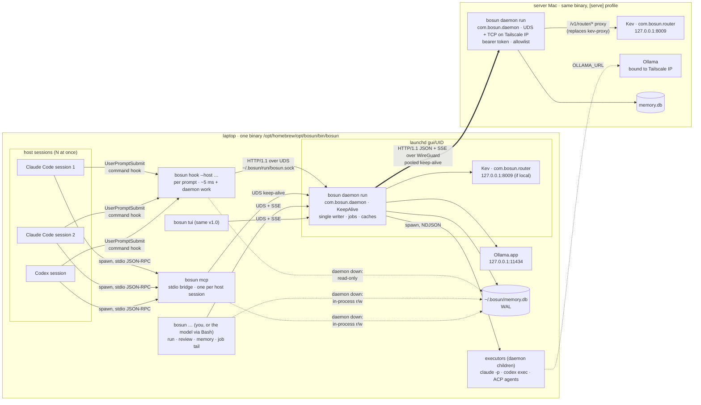
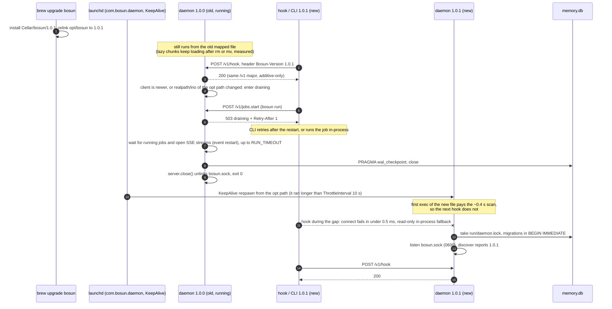

# 05 · One CLI or several, and the process topology

Checked 2026-10-01 on the owner's Mac: Apple M5 Pro, 48 GB, macOS 27.0.1 (Darwin 27.0.0, launchd "Darwin Bootstrapper Version 7.0.0"). Bun 1.4.2 (Homebrew), Node 24.21.0 (real binary). Every number below was measured here unless a source is cited. Topics 1–4 are the baseline and aren't re-measured: Bun 1.4 coded to `node:*`, an approved daemon with a thin hook client, HTTP/1.1 + JSON over a UDS at `~/.bosun/run/bosun.sock`, commander 15, path (a), seven ports, and Claude wired as one plugin folder. **Nothing was installed, no LaunchAgent was loaded, and no bosun code or tests were run.** All probes are standalone scripts in the session scratchpad (`research-05/`).

## 1. Question

**Current design update, 2026-10-04:** [09-opencode-clef.md](09-opencode-clef.md) adds an external managed OpenCode host server/plugin as the primary experience and replaces the proposed Kev service/proxy with Ollama Clef-Flash decision routing. Bosun still has one binary/daemon writer. The old Kev topology and original-Mac measurements below are historical inputs, not Clef/OpenCode measurements or the current selected service inventory; use the revised roadmap for implementation.

The owner said: "maybe is good to have multiple CLIs then one." This note answers:
- How many executables or entry points should bosun v1.0 ship?
- Which processes run, and who starts, stops and upgrades each one?
- How do the hook, the CLI, the TUI, the MCP bridge, executors and the server Mac talk to the daemon? What are the concurrency rules for the one SQLite database?
- What is the v1.0 command tree, and where does each v0.2.0 command go?
- How do install and uninstall stay clean, reversible and scoped?

## 2. TL;DR

- **Ship one executable, `bosun`, built with `bun build --compile --splitting --bytecode`.** Every role is a subcommand: `bosun hook`, `bosun mcp`, `bosun daemon run`, `bosun tui`, and the user commands.
  - **Hook path:** with `--splitting`, the multi-call binary starts as fast as a dedicated hook binary: **5.0–5.3 ms p50 against 5.0–5.1 ms**, round trip to a stub daemon included.
  - **Without `--splitting`** the same binary costs +2 ms (7.1–7.2 ms). An eager-import dispatcher costs +7.4 ms (12.5 ms), and dropping `--bytecode` costs +12 ms (16.8–17.0 ms).
  - **Every other path** (CLI, daemon start, MCP bridge, Ink TUI) matched its dedicated binary within run-to-run noise.
- **Several separate binaries don't pay.** The ~58 MB Bun runtime is embedded in each one.
  - **Size:** five binaries take **303 MB on disk and a 123.6 MB gzip tarball**, against **62.8 MB and 25.7 MB** for one.
  - **First exec after an upgrade:** each freshly written binary pays a **~0.4 s first-exec scan** here (404–537 ms, once 1.65 s). The cost is per file, and symlinks and hardlinks share it. So N binaries pay it N times per upgrade.
  - **Skew and signing:** every pair of binaries needs its own version-skew handling, and each must be signed and notarized.
- **External `bosun-<name>` subcommands on PATH (git, kubectl, gh, docker style): outside the selected scope.** A dispatch costs **+5.2–5.6 ms** (a second runtime start; Node and Bun have no `exec(2)`), and it opens a supply-chain door. Topic 4's ACP, MCP and profiles already cover extension.
- **Daemon lifecycle: one LaunchAgent, `com.bosun.daemon`, with `RunAtLoad` + `KeepAlive`, always on.**
  - **Cost of always-on:** idle it uses **0.1% CPU, ~1 idle wakeup per 10 s and an 8.8 MB footprint** (RSS 26.7 MB). Cold start to first answer is **18.8–18.9 ms p50**.
  - **Restarts and upgrades:** launchd handles crash restart (throttled to one spawn per 10 s). An upgrade is **drain then exit 0**: launchd respawns the new binary from the stable `opt` path.
  - **No auto-spawn:** clients never start the daemon. Every client has an in-process fallback, so the daemon accelerates bosun but is never a hard dependency.
  - **Socket activation works in principle** (`launch_activate_socket` resolved and returned `ESRCH` outside launchd, via `bun:ffi`). But it needs an experimental FFI on both runtimes, so it's deferred.
- **Concurrency rules:**
  - **One daemon per `BOSUN_HOME`,** guarded by launchd plus a `link(2)` lockfile. Measured with 20 concurrent starters: **exactly one daemon in 20/20 trials**, against duplicates in 11/20 for a naive probe-unlink-listen.
  - **The daemon is the single long-lived writer.** When it's down, the hook opens SQLite **read-only** and never writes. The CLI and MCP bridge use the v0.2.0 in-process `MemoryService` under SQLite's own locking.
  - **Cache coherence:** the daemon checks `PRAGMA data_version` before trusting its caches (verified on both runtimes).
  - **Every request carries the client's project context.** Jobs run with the client's cwd and an env allowlist, never the daemon's.
- **Command tree:**
  - **Agent-facing verbs stay top-level and unchanged:** `run`, `review`, `spin`, `card`, `roles`, `memory …`. The skills, the policy and the host permission rules use them.
  - **Admin is grouped by noun:** `daemon`, `host`, `service`, `router`, `model`, `job`, `config`.
  - **Internal entry points:** `hook` and `mcp`.
  - v0.2.0 spellings stay as hidden aliases during migration; decide and document the final compatibility set before the one v1.0 ship gate.
- **Install and uninstall:**
  - **Binary:** Homebrew tap. Every reference (plist, hooks, MCP registrations) points at `/opt/homebrew/opt/bosun/bin/bosun`, which Homebrew documents as stable across upgrades.
  - **One manifest:** `~/.bosun/manifest.json` records every artifact bosun writes outside `~/.bosun`, with a hash, backup and undo, written *before* each change. `bosun uninstall` reverses it exactly, skips anything you've modified, and has `--dry-run`.
  - **No more `~/.zshrc` edits.**
  - **launchd:** 1–3 plists in all (daemon, plus Kev and brew-Ollama only when needed), down from v0.2.0's up to 4 on a server.
- **Server Mac:** the same binary and the same daemon with a `[serve]` profile (a TCP listener on the Tailscale IP, a bearer token, and a Kev proxy). That replaces `bosun serve memory`, `bosun serve kev` and their two plists.

## 3. bosun constraints that matter here

| Constraint | What it means for binaries and processes |
|---|---|
| **Hook budget ≤ 15 ms p95 wall**, a new process per prompt (topics 1–3) | Whatever binary the hook runs must start with only the hook's code loaded. A multi-call binary is acceptable only if its other roles cost the hook nothing (§5.2). |
| **Releases are compiled Bun binaries** (topic 3) | Each executable carries the whole ~58 MB runtime (§5.1). The number of executables multiplies size, download, signing and scanning. |
| **One user, ≤ 2 Macs over Tailscale; built for publishing later** | The same artefact must serve the laptop and the server Mac, and must install and uninstall cleanly for a stranger. |
| **Pollution lesson** (topic 1 §5.3) | A Bun test run wrote test fixtures into the real `~/.bosun` and probably `~/.claude` and `~/.codex`. Tests must not be able to reach the real home, the real socket or launchd, by construction. |
| **Hosts call bosun three ways** | A `command` hook per prompt (both hosts), an MCP stdio server per host session (both hosts), and `Bash(bosun …)` commands under permission rules that match prefixes (Claude: `Bash(bosun run *)`, …). Renaming an agent-facing verb changes the skills, the policy text and those rules. |
| **The daemon is approved, with the in-process fallback** (owner answers) | The daemon must never be required for correctness. That decides auto-spawn (no) and the concurrency rules (§4.4). |
| **macOS only, launchd** | Supervision is launchd's; anything Linux-specific (systemd) waits for a Linux server. |

**v0.2.0 today:** `bin/bosun` → `lib/cli.ts`, with 23 entries in `COMMANDS` (including the internal `_exec`), plus a hook fast path for `route --hook` in `bin/bosun`. `lib/services.ts` writes up to four LaunchAgents (`com.bosun.ollama`, `.router`, `.memory`, `.kev-proxy`). It bakes `process.execPath` + the repo path into their `ProgramArguments`, and `wire.ts` bakes it into the MCP registrations. `install` symlinks `~/.local/bin/bosun` and may append a PATH line to `~/.zshrc`. `state.json` records some of what it changed (`created`, `zshrcLine`, `appEnvPrev`, `configPrev`, `disabledPlugins`, `serve`). None of the `com.bosun.*` plists exist on this Mac (checked `~/Library/LaunchAgents`), consistent with HANDOFF.md.

## 4. Options

### 4.1 Binary layout

| Option | Disk / gzip download (5 roles) | Hook p50 (stub daemon, UDS) | Other paths | Version skew inside one install | Upgrade cost | Verdict |
|---|---|---|---|---|---|---|
| **A. One binary, subcommands, `--compile --splitting --bytecode`** | **62.8 MB / 25.7 MB** | **5.0–5.3 ms** (dedicated: 5.0–5.1) | = dedicated within noise | none: one file | one file to scan (~0.4 s), warmed by the daemon's restart | **pick** |
| A′. Same, but without `--splitting` | 62.8 MB / 25.7 MB | 7.1–7.2 ms | CLI +1–2 ms | none | same | no: +2 ms on every prompt for nothing |
| A″. One binary, eager imports | 62.8 MB | 12.5 ms | – | none | same | no |
| **B. Multi-call (busybox): A plus symlinks `bosun-hook`, `bosund`, `bosun-mcp`, dispatch on argv[0]** | as A, + symlinks | split build via a `bosun-hook` symlink: 5.9–6.2 against 6.0–6.4 for `bosun hook` in the same (noisier) round | = A | none | as A | allowed, but **no symlinks shipped in v1.0**: subcommands do the same job, and there are fewer files to install and remove |
| **C. Separate binaries** (`bosun`, `bosund`, `bosun-hook`, `bosun-mcp`, `bosun-tui`) | **303.0 MB / 123.6 MB** | 5.0–5.1 ms | = A | **yes**: a hook, a bridge and a daemon from different builds can meet; each pair needs a handshake | N files to scan after each upgrade (N × ~0.4 s, paid by whichever process runs each first, often the hook) | no |
| **D. External subcommands** (`bosun foo` → `bosun-foo` on PATH) | +58 MB per extension | n/a | **+5.2–5.6 ms per call** | extension versions are independent of bosun's | each extension upgrades itself | no for v1.0; ACP, MCP and profiles cover extension (topic 4) |

**Evidence:**

- **What a compiled Bun binary sees as its name** (§5.3):
  - `process.argv[0]` is `"bun"` and `process.argv[1]` is `/$bunfs/root/<name>` whatever name it was started under, so neither can drive busybox-style dispatch.
  - **`process.argv0` keeps the invoked name** through a symlink, a hardlink, a PATH lookup and `exec -a`. Node documents `argv0` as "a read-only copy of the original value of `argv[0]`" [node-process].
  - `process.execPath` resolves symlinks (Node's docs say the same) but not hardlinks. So under Homebrew it points at the versioned Cellar file, which is why nothing should bake it in (topic 1 §5.5).
- **Why A works: Bun's code splitting inside `--compile`.**
  - Bun documents that "standalone executables support code splitting. Use `--compile` with `--splitting` to create an executable that loads code-split chunks at runtime" [bun-executables].
  - The built binary embeds separate chunks (`$bunfs/root/cli-impl-*.js`, `daemon-impl-*.js`, `tui-impl-*.js`, …; seen with `strings`). The hook path loads only the entry chunk and `hook.mjs`.
  - **Without splitting,** the whole 595 KB bundle is loaded at start: +2 ms with bytecode, +12 ms without.
  - **Bytecode is mandatory either way.** "Bytecode compilation moves parsing overhead for large input files from runtime to bundle time" [bun-executables].
- **The runtime dominates the size.**
  - An empty compiled binary is 58,079,554 bytes, 14 bytes off Bun's own 58,079,568-byte executable.
  - Without bytecode, the hook and empty binaries are byte-identical in size. Bytecode adds 1.5 MB (hook) to 4.8 MB (multi).
  - gzip can't share the runtime across files, so five binaries compress to almost five times one binary's 25.7 MB.
- **The first-exec scan after an upgrade** (§5.6):
  - **Measured:** the first exec of a freshly written binary took **404–537 ms** in 9 trials, and once 1,649 ms. Later execs took ~15 ms (including the timing script). Microsoft Defender, an Aikido endpoint agent and XProtect were running.
  - **It's per file:** a later exec through a symlink or a hardlink was fast, but an identical-content copy paid again.
  - **What it means for each layout:**
    - Option A pays it once per upgrade, and the daemon's launchd respawn pays it before any hook does.
    - Option C pays it once per binary, and the `bosun-hook` binary pays it on the first prompt after an upgrade.
- **D's cost:**
  - `bin-ext empty` (which spawns `bosun-empty`) took 9.3–9.4 ms against 4.1–4.8 ms direct.
  - `bin-ext cli cmd3` took 11.3–11.6 ms against 6.0 ms direct.
  - Node and Bun have no in-place `exec(2)`, so the parent runtime stays alive and the child starts a second one.

### 4.2 Prior art

| Tool | Layout | Client ↔ daemon | Upgrades and version skew | Lesson for bosun |
|---|---|---|---|---|
| **Docker** | separate binaries: "Docker uses different binaries for the daemon and client" [dockerd]. CLI plugins are `docker-<name>` files in `~/.docker/cli-plugins`, answering a `docker-cli-plugin-metadata` subcommand with `SchemaVersion`, `Vendor` and `Version`. A plugin that "duplicates builtin command" is rejected [docker-cli-src]. | HTTP over a UDS (`/var/run/docker.sock`) [dockerd] | Negotiation: the client "negotiates the highest version of the API supported by both the client and daemon, downgrading to an older version of the API if necessary" [docker-api]. Live here: `docker version` shows client `API version: 1.47 (downgraded from 1.56)` against server 1.55 (minimum 1.40). | Separate binaries make sense when the daemon is a different product on a different release train (here it even runs in a Linux VM). bosun's daemon and CLI are one codebase and one release. **Copy the negotiation, not the split:** bosun already has `/v1` + `discover` + `Bosun-Version` (topic 2). |
| **Tailscale** | `tailscale` + `tailscaled`, but there's an official **combined binary**: built with `-tags ts_include_cli`, "if the file on-disk is named `tailscale`, then the binary will behave like the `tailscale` binary, and if it's named `tailscaled`, then it'll behave like `tailscaled`" [ts-small]. In source: `filepath.Base(os.Args[0]) == "tailscale"` or `TS_BE_CLI=1` [ts-src-d]. On this Mac, `/usr/local/bin/tailscale` is a 68-byte shell script running `/Applications/Tailscale.app/Contents/MacOS/tailscale "$@"`, so the app binary is the CLI. | local API | The CLI warns once, "Warning: client version %q != tailscaled server version %q" [ts-src-cli]. | Multi-call is the vendor-endorsed answer when size matters. A one-line skew warning is the right UX. |
| **Ollama** | **one binary**: `ollama serve` is the server, and every other command is an HTTP client [ollama-cmd]. | HTTP on 127.0.0.1:11434 | On macOS, a refused heartbeat makes the CLI find the `Ollama.app` its symlink points into and run `open -j -a <app> --args --fast-startup`, then wait for the server. Elsewhere it fails with "could not connect to ollama server, run 'ollama serve' to start it" [ollama-start]. | Closest to bosun: one binary, the server is a subcommand, and the app (bosun's equivalent: launchd) owns the server's lifetime. Ollama's on-demand start is a convenience for a GUI-app install. bosun doesn't need it, because its clients have a fallback. |
| **gh** | extensions are repos named `gh-*`; precompiled ones attach release assets named `gh-<name>-<os>-<arch>` [gh-ext-create]. "An extension cannot override any of the core gh commands"; gh checks for extension updates once a day [gh-ext-manual]. | – | Each extension versions itself; gh warns that extensions "are not verified, signed, or endorsed by GitHub" [gh-ext-manual]. | A real extension ecosystem needs install, upgrade and trust machinery. bosun has no third-party ecosystem yet (topic 4). |
| **git** | `git foo` runs a core program from `GIT_EXEC_PATH`, else "`git-<command>` that is runnable by the user in a directory on `$PATH`" [git-doc]. **Locally,** `git --exec-path` (`/Library/Developer/CommandLineTools/usr/libexec/git-core`) holds **144 `git-*` symlinks to `../../bin/git`**: a multi-call binary. The separate executables are the ones that link extra libraries (`git-remote-http` and `git-http-*`, 2.3 MB each, curl) or are scripts. | – | Builtins can't skew; external `git-*` can. | Split out only what has a different dependency footprint. In bosun, the TUI's Ink and React already load only on the TUI path, so they need no split. |
| **kubectl** | plugins are `kubectl-*` executables on PATH. They "cannot override existing kubectl commands" and can't add subcommands to existing ones. kubectl has no plugin manager; krew fills the gap, and its plugins "are not security-audited" [kubectl-plugins]. | – | independent | Same as gh: PATH plugins push install, upgrade and trust onto the user. |
| **Bun** | one binary. `bunx` is "an alias for `bun x`" [bunx], and on this Mac it's a 3-byte symlink `bunx -> bun` in the Cellar. A compiled app can act as Bun itself with `BUN_BE_BUN=1` [bun-executables]. | – | – | The runtime bosun ships on is itself multi-call by argv[0]. |
| **Codex** (Rust CLI) | `codex-rs/arg0` dispatches on argv[0] for `apply_patch`, `codex-linux-sandbox` and `codex-execve-wrapper` [codex-arg0]. | – | – | A coding-agent CLI already uses one binary with argv[0] helpers. |
| **Dory** (the Docker context on this Mac) | app + `doryd` helper | `~/Library/LaunchAgents/dev.dory.doryd.plist`: `KeepAlive` true, `RunAtLoad` true, `ProcessType` Interactive, `ExitTimeOut` 45, logs in `~/.dory/doryd.log`, idle sleep handled inside the daemon (`DORYD_IDLE_SLEEP_AFTER_SECONDS=300`) | – | A third-party CLI daemon on this Mac makes the same launchd choices recommended below. |
| **Apple ssh-agent** | `/System/Library/LaunchAgents/com.openssh.ssh-agent.plist`: `Sockets` → `Listeners` → `SecureSocketWithKey: SSH_AUTH_SOCK`, `EnableTransactions`, `ProcessType` Interactive | launchd-activated UDS | – | Socket activation is the platform's own on-demand pattern. bosun can't use it cleanly yet (§4.3). |

**Takeaways:**
- One binary with subcommands is the norm when the client and the daemon come from one codebase (Ollama, Bun, git builtins, the Tailscale combined build). Separate binaries appear when the daemon is a different product or platform (Docker), or when dependencies differ (git's curl helpers).
- Everyone who splits client and daemon pays for skew handling: Docker's negotiation and Tailscale's warning.
- PATH plugins (git, kubectl, gh, docker) all forbid shadowing core commands, and all hand trust to the user.

### 4.3 Daemon lifecycle on macOS

| Option | Who starts it | Single instance | Idle cost | First request after start or idle | Crash restart | Bun / Node feasibility | Verdict |
|---|---|---|---|---|---|---|---|
| **LaunchAgent, `RunAtLoad` + `KeepAlive: true`** | launchd at login | launchd (one process per label) + a lockfile for manual runs | 0.1% CPU, ~1 idle wakeup per 10 s, 8.8 MB footprint (§5.5) | always warm | launchd, ≥ 10 s apart | plain `node:http.listen(path)` | **pick (installed mode)** |
| On-demand spawn by the first client, plus a lockfile and idle exit | a client (hook, CLI or MCP) | lockfile (`link(2)`: 20/20 single) | 0 when idle | spawn → first answer 18.8–18.9 ms p50, 28.8 ms p95 (+ ~0.4 s once per new binary) | the next client | yes | **no for v1.0**: the hook mustn't spawn processes, and every client already has a fallback. Kept only as `bosun daemon start` without a plist (dev). |
| launchd socket activation (`Sockets` → `SockPathName`, `SockPathMode`) | launchd on first connect | launchd owns the socket: no stale file, no race | 0 when idle | the kernel queues the connect while the job starts (~19 ms) | launchd | `launch_activate_socket` via **experimental** `bun:ffi` (works, §5.4) or Node 26's **experimental** `node:ffi`, or a native addon. Then `net.listen({fd})` + an `http` `'connection'` bridge (topic 2) | **Conditional experiment; no release assignment** |
| Homebrew `service` block + `brew services` | launchd via a `homebrew.mxcl.bosun` plist [brew-cookbook] | launchd | as KeepAlive | warm | launchd | yes | no: tarball installs don't have it, `bosun daemon …` couldn't own its plist, and bosun's own plist is ~15 lines (already in `services.ts`) |

**Evidence from the launchd man pages** (local, macOS 27.0.1; `launchd.plist(5)` dated 30 July 2019, `launchctl(1)`, `launch(3)`):

**`KeepAlive`:**
- "The value may be set to true to unconditionally keep the job alive."
- The dictionary form (`SuccessfulExit`, `Crashed`, `PathState`, `OtherJobEnabled`) refines when to restart, and "the use of this key implicitly implies RunAtLoad".
- `SuccessfulExit: false` would *not* restart after an exit 0. bosun's upgrade path is "drain, then exit 0", so it needs plain `true`.

**Throttling:** `ThrottleInterval` defaults so that "jobs will not be spawned more than once every 10 seconds". That bounds a crash loop. An upgrade respawn is immediate, because the old daemon ran longer than 10 s.

**Idle exit has no launchd support for a Bun process:**
- `TimeOut` "never did anything interesting and is no longer implemented".
- `EnablePressuredExit` needs XPC transactions, and "launchd(8) does not respect EnablePressuredExit for jobs that have KeepAlive set to true".
- So in installed mode the daemon stays up. That's affordable (§5.5) and keeps the hook warm.
- `bosun daemon run --idle-exit 30m` exists only for dev and on-demand use.

**Shutdown:**
- launchd sends SIGTERM, then SIGKILL after `ExitTimeOut`. The plist should set `ExitTimeOut` to 30, like Dory's 45.
- `AbandonProcessGroup` defaults to false: "When a job dies, launchd kills any remaining processes with the same process group ID". So executors die with the daemon. That's wanted (no orphans), and it's why upgrades drain jobs first.

**`ProcessType`:**
- "If left unspecified, the system will apply light resource limits to the job, throttling its CPU usage and I/O bandwidth."
- `Interactive` "should only be used if an app's ability to be responsive depends on it". The per-prompt hook's latency does, and Dory and Apple's ssh-agent both use Interactive.
- **Default: Interactive.** Verify in the spike: hook p95 under launchd with and without it.

**Logs:**
- `StandardOutPath` and `StandardErrorPath` map to files that launchd creates. They are not rotated.
- So the daemon logs through LogTape's rotating sink (topic 3) to `~/.bosun/logs/bosun.log`. launchd's stdout and stderr go to `~/.bosun/logs/daemon.stderr.log`, for crashes only.
- The daemon truncates that file at start when it's over 1 MB (`fs.ftruncateSync(2, 0)`; verified on both runtimes with an append-mode fd, §5.7).

**`Umask`:** don't set it. Executors inherit the umask, and `077` would make every file a worker creates in your repo 0600. Instead, chmod the socket to 0600 explicitly (topic 2).

**`EnvironmentVariables`:** launchd's job environment doesn't carry your shell's PATH. Bake the installing shell's PATH (v0.2.0 does), refresh it on `bosun install`, and run jobs with the *client's* PATH from the request (§4.4).

**Privacy:** "Daemons and agents managed by launchd are subject to macOS user privacy protections". A daemon reading a repo under `~/Documents`, `~/Desktop` or `~/Downloads` may be denied, where the hook, as a child of the terminal, isn't. Not verified here; it's a spike item. Mitigation: the daemon reports `EPERM` per project, and the client does that file work in-process.

**Domains:**
- `gui/<uid>` agents load "only when a user has logged in at the GUI".
- A `user/<uid>` domain "may exist independently of a logged-in user", but loading a `Background` session agent there wasn't tested, since nothing may be loaded.
- **This matters for a headless server Mac** (§7 Q3). Ollama.app needs a GUI login anyway.

**`launchctl` verbs:**
- `bootstrap`/`bootout` replace the legacy `load`/`unload` ("Recommended alternative subcommands").
- `kickstart -k` kills and restarts.
- `enable`/`disable` persist across boots.
- `print` output "is NOT API in any sense at all", so the daemon's own `discover` is the source of truth. `launchctl print` is only "loaded or not": its exit code, 2.7–3.1 ms (§5.7).

**Background items:**
- Since macOS 13, installing a launch agent shows "a single notification", and the item is listed in System Settings > General > Login Items. `sfltool dumpbtm` prints the status [apple-btm].
- The user can switch it off there. `bosun doctor` checks `launchctl print-disabled gui/<uid>` and says so, instead of fighting it.
- `AssociatedBundleIdentifiers` is for apps. bosun has none.

**Socket activation:** the job "must check-in to get a copy of the file descriptors using the launch_activate_socket(3) API". `launch(3)` gives `ESRCH` "The calling process is not managed by launchd(8)" and `EALREADY` for a second activation.
- **Bun (measured):**
  - `dlopen('/usr/lib/libSystem.B.dylib')` resolved `launch_activate_socket`.
  - The call returned **rc = 3 (`ESRCH`)** outside launchd, from a script and from a compiled binary.
  - But "`bun:ffi` is **experimental**, with known bugs and limitations. Do not rely on it in production" [bun-ffi].
- **Node:** 24 has no FFI (`ERR_UNKNOWN_BUILTIN_MODULE`). Node 26 adds `node:ffi`, "Stability: 1 - Experimental", added in v26.1.0 [node-ffi].
- **Verdict:** a conditional experiment within the build, justified only if idle exit matters (for example on battery). The always-on daemon remains the selected baseline; release naming does not require adopting experimental FFI. Activation would remove stale-socket handling and the lockfile. Fall back to self-binding when activation returns `ESRCH`.

**Upgrades: drain, then exit** (§6, sequence diagram):
- **Trigger:**
  - a client sends `Bosun-Version` greater than the daemon's (every request carries it, topic 2), or
  - a 60 s check sees that `realpath()` of the stable `opt` path, or its inode, changed.
- **Draining:** the daemon keeps serving `/v1` (additive within a major), refuses new jobs with `503 draining` + `Retry-After`, and waits for running jobs and SSE streams (it sends `event: restart`). Then it checkpoints, closes the listener (`node:http` unlinks the socket) and exits 0. launchd starts the new binary.
- **Safe to keep running after the file changes:** an old daemon kept loading lazily split chunks after its file was deleted (`rm`, as `brew cleanup` does) and after an atomic replace (`mv`): 8/8 runs (§5.8).
- **The gap is the respawn plus the first-exec scan (~0.4–0.5 s).** Hooks during it fall back in-process in under 0.5 ms (topic 2).
- **A new major version:** the old daemon answers `400 unsupported_version`, and clients fall back until the restart.
- **Zero-downtime handover isn't worth it.** A new daemon can't run under the same launchd label while the old one lives. A child it spawned would be killed with the process group, or, with `AbandonProcessGroup`, end up unsupervised.

**Two daemons for different HOMEs (tests):**
- Every path derives from `BOSUN_HOME`: the socket `$BOSUN_HOME/run/bosun.sock`, the lock `$BOSUN_HOME/run/daemon.lock`, the database and the logs. Two homes never share a socket, a lock or a database.
- **Socket path length:** this scratchpad's socket path is 127 bytes. Bun accepted it, but Node's limit is 103 (topic 2). So the test helper sets `BOSUN_SOCK` under `os.tmpdir()`, and the daemon fails fast with a clear error past 103 bytes.
- `discover` returns the daemon's `home` (realpath of `BOSUN_HOME`). **A client refuses a daemon whose home differs from its own.** A test with a stray `BOSUN_SOCK` can't talk to the real daemon.
- **Tests never call launchctl.** The supervisor module takes an injected `exec`. Its real implementation refuses to run unless `BOSUN_HOME` is the default `$HOME/.bosun` and `BOSUN_TEST` is unset.
- This closes the topic 1 incident class at the daemon layer too.

### 4.4 Who talks to whom, and the concurrency rules

| Process | Started by | Lifetime | Talks to | When the daemon is down | Upgraded by |
|---|---|---|---|---|---|
| `bosun hook --host <h>` | the host, per prompt (`command` hook) | ~5 ms + daemon work | daemon: `POST /v1/hook` over the UDS, 150 ms timeout | lean in-process path, **read-only SQLite**, no writes | the next prompt runs the new binary (stable path) |
| `bosun mcp` | the host, per session (stdio) | the session | daemon: one keep-alive UDS connection; JSON-RPC 2.0 to the host | in-process `MemoryService` (v0.2.0 behaviour), r/w | the next session; a running bridge is fine within `/v1` |
| `bosun <cmd>` (CLI) | you, or the model through `Bash(bosun …)` | the command | daemon: JSON, or SSE for `run` and `job tail` | in-process: memory verbs r/w; `run`, `review` and `spin` run their executor as the CLI's child (v0.2.0 behaviour) | – |
| `bosun tui` (v1.0 interface phase) | you | interactive | daemon: SSE `events.listen` | "daemon down" banner, read-only views | restart |
| **`bosun daemon run`** | **launchd** (`com.bosun.daemon`), or the test or dev harness | login session | DB (single writer), executors, Kev, Ollama, the server daemon | – | drain, then exit; launchd respawns |
| executors (`claude -p`, `codex exec`, ACP agents) | daemon job (or the CLI, in fallback) | the job | NDJSON or ACP on pipes to their parent | – | – |
| Kev | launchd (`com.bosun.router`) | login session | HTTP 127.0.0.1:8009 | – | `bosun service update router` (git pull + uv sync) |
| Ollama | Ollama.app (or `com.bosun.ollama` without the app) | – | HTTP :11434 | – | the app / brew |
| server-Mac daemon | launchd on the server | session | TCP on the Tailscale IP (bearer + allowlist) + its own UDS | laptop processes call it directly with `RemoteStore` (300 ms hook timeout, v0.2.0) | `brew upgrade` there; `discover` skew is a `doctor` warning |

**Concurrency rules** (for topic 6 to encode):

1. **One daemon per `BOSUN_HOME`.**
   - launchd guarantees one process per label.
   - `bosun daemon run` takes `$BOSUN_HOME/run/daemon.lock` first: write `pid` to a temp file, then `link(2)` it to the lock name. `link` is atomic and fails if the lock exists, so no racer ever reads a half-written pid.
   - It steals a lock only when that pid is dead. Then it connect-probes the socket (live: exit 0), unlinks a stale socket file and listens.
   - **Measured, 20 concurrent starters × 10 trials, twice** (§5.9): link-lock gave exactly one daemon in 20/20. An `open('wx')` + write lock leaked once (the empty-file window). Naive probe-unlink-listen gave duplicates in 11/20 (up to 4). An inode self-check gave duplicates in 5/20, so it doesn't replace the lock.
2. **The daemon is the single long-lived writer, and owns the background work:** migrations at start, retention and expiry, access counts, consolidation, the docs index, metrics aggregation, and topic 7's in-memory vectors or graph.
3. **Writes go to the daemon whenever it answers.** The in-process path is used only when the connection fails (refused, missing, timeout), **never after an application error**, so a write is never applied twice. Non-idempotent methods are never retried (topic 2).
4. **Clients never require the daemon** (the owner's fallback rule):
   - The hook's fallback opens the DB with `{ readOnly: true }` (a write fails with "attempt to write a readonly database" on both runtimes, §5.7). It skips access counts, and never creates or migrates the DB.
   - The CLI and MCP bridge fall back to v0.2.0's `MemoryService`: WAL, `busy_timeout=2000`, migrations in `BEGIN IMMEDIATE`. SQLite serializes writers across processes, and v0.2.0's tests already cover concurrent writers and racing migrations (ARCHITECTURE.md).
5. **Cache coherence:**
   - Before serving from any cache, the daemon reads `PRAGMA data_version`. Per SQLite, it differs "if changes were committed to the database by any other connection in the interim" and is "unchanged for commits made on the same database connection" [sqlite-pragma]. That was verified on Bun and Node (§5.7).
   - A change invalidates the caches.
   - If `schema_migrations` is newer than the daemon knows, it drains and exits, because a newer binary migrated the DB.
6. **Schema skew the other way:** a client that finds a DB schema newer than it knows opens it read-only and tells you to upgrade. It never writes.
7. **Project identity travels with the request:** `ctx` = `{ cwd, projectDir, sessionId, host }` from the client's environment (`CLAUDE_PROJECT_DIR`, cwd). The daemon never uses its own cwd. Topic 2 noted that a shared endpoint loses the stdio process's inherited identity, and this restores it.
8. **Jobs run as the client would have run them:** `cwd` = the client's, and env = the client's PATH, HOME, LANG and TERM plus the v0.2.0 `jobEnv` allowlist (`SUBSCRIPTION_ONLY` stripping etc.). Never the daemon's launchd environment.
9. **Concurrent sessions share one event loop.**
   - N Claude and Codex sessions mean N bridges plus per-prompt hooks on one socket. `node:sqlite` calls are synchronous, so requests serialize (a hook retrieve is ~4–5 ms warm, topic 1).
   - Any step that can block for more than ~20 ms (docs re-index of a large repo, consolidation, a 100k-vector scan of 59–65 ms, topic 1) runs as a job, or later on a worker thread, never on the hook's request path.
   - Jobs have a concurrency cap (local model: 1, since `OLLAMA_NUM_PARALLEL=1`).
10. **Remote:** the laptop daemon is the server's client for all laptop processes, with pooled keep-alive (topic 2). The server daemon is the single writer of its DB.

### 4.5 The CLI surface

**Principles:**
- **One binary, three audiences, grouped by noun.**
  - **The model** uses short, stable top-level verbs. Skills and policy name them, and host permission rules match their prefixes.
  - **You** use noun groups for administration.
  - **Hosts** call two internal entry points.
- commander 15 with lazy `import()` per command body (topic 3). Every command body is its own split chunk (§4.1).
- **No separate CLI earns its keep.** The audiences differ, but permission rules already separate them by prefix (`Bash(bosun run *)` is allowed; `bosun memory purge` isn't). The cadence is the same (one repo, one version), and so is the size (one runtime).
- **If the memory layer is ever published for other agents' users,** a second `--compile` target from the same workspace costs one build line. That's a later call, not a v1.0 layout.

```text
bosun                                   help (also -h, --help, help <cmd>)
  # agent-facing: unchanged names; skills, policy and permission rules depend on them
  run [-e local|codex|claude|<runner>] "task" | -f spec | -f -    a daemon job, streamed; in-process if the daemon is down
  review [--pr N] [--base ref] [--vendor …]
  spin [--agent …] [--name slug] [--stacked] "spec" | -f spec
  card <todo|in-progress|in-review|completed> ["comment"]
  roles [--json]
  memory add|search|get|update|delete|purge|review|accept|reject|prune|consolidate|stats|bench|eval
  job list | tail <id> | cancel <id>                              new: daemon jobs (the Orca pane runs `job tail`)
  # you: setup and administration
  install [--host claude,codex] [--replace-plugins] [--profile laptop|server] [--remote <url>] [--dry-run]
  uninstall [--dry-run] [--purge]
  doctor [--json]          status          version          config [edit|get|set|path|migrate]
  host list | install <id> | uninstall <id> | doctor [<id>]       HostAdapter (topic 4)
  agents add <id> | list                                          ACP runners (topic 4)
  daemon status | start | stop | restart [--now] | logs [-f] | run [--idle-exit 30m]
  service status | start | stop | restart | update  [ollama|router|all]
  router ask "prompt" | label | eval | stats
  model use <tag> | list
  tui                                                             v1.0 interface phase
  # hosts: internal entry points (hidden from help)
  hook --host claude|codex                                        the per-prompt thin client
  mcp                                                             the stdio MCP bridge
```

**v0.2.0 → v1.0 command map.** All 23 `COMMANDS` entries, the install flags and the memory verbs:

| v0.2.0 | v1.0 | Notes |
|---|---|---|
| `bosun install [--host claude\|codex\|both]` | `bosun install [--host claude,codex]` | Umbrella: `host install` for each host, plus the daemon LaunchAgent, services and models. `both` is still accepted. Manifest-driven; `--dry-run` prints the plan. |
| `bosun install --replace-plugins` | `bosun install --replace-plugins` / `bosun host install claude --replace-plugins` | Recorded in the manifest with the prior plugin states. |
| `bosun install --serve kev,llm,memory` | `bosun install --profile server [--expose memory,router,llm]` | Writes `[serve]` to `config.toml`. One daemon plist instead of `com.bosun.memory` + `com.bosun.kev-proxy`. |
| `bosun install --remote kev=URL,llm=URL,memory=URL` | `bosun install --remote http://<server>:8788` (+ token) | Service URLs come from the server daemon's `discover`. Per-service overrides go in `config.toml [remote]`. |
| `bosun doctor` | `bosun doctor [--json]` | Adds daemon (version, home, skew), launchd loaded or disabled in Login Items, manifest drift and TCC denials. |
| `bosun uninstall` | `bosun uninstall [--dry-run] [--purge]` | Reverses the manifest exactly (§4.6). `--purge` also removes `~/.bosun`. |
| `bosun config` | `bosun config [edit]` | + `get`, `set`, `path`, and `migrate` (`config.env` → `config.toml`, topic 3). |
| `bosun run …` | `bosun run …` | Unchanged flags. A daemon job with SSE; in-process when the daemon is down. `--no-watch` stays (no pane). |
| `bosun review …` | `bosun review …` | Unchanged. The runner is picked by `caps.vendor` (topic 4). |
| `bosun help` | `bosun help [cmd]`, `-h` | commander. |
| `bosun roles [--json]` | `bosun roles [--json]` | Unchanged. |
| `bosun start\|stop\|restart [ollama\|router\|all]` | `bosun service start\|stop\|restart [ollama\|router\|all]` | Old spellings are hidden aliases in v1.0. `all` no longer includes the split-setup plists (gone). |
| `bosun status` | `bosun status` | Overview: daemon, services, running jobs, router stats. |
| `bosun model [tag]` | `bosun model use <tag>` / `bosun model list` | `bosun model <tag>` stays as an alias. |
| `bosun card …` | `bosun card …` | Unchanged. `Workspace.status` (a no-op without Orca). |
| `bosun spin …` | `bosun spin …` | Unchanged. Headless git-worktree without Orca (topic 4). |
| `bosun _exec <id>` | removed | The Orca split runs `bosun job tail <id>`. The `~/.bosun/runs` rendezvous goes (topic 4). |
| `bosun route "prompt"` | `bosun router ask "prompt"` | `route` stays as a hidden alias. |
| `bosun route --hook --host X` | `bosun hook --host X` | The old form stays accepted until `bosun install` has rewritten both hosts' hook entries. v0.2.0 entries point at `~/.local/bin/bosun route --hook`. |
| `bosun label` / `eval` / `stats` | `bosun router label` / `eval` / `stats` | Hidden aliases in v1.0. |
| `bosun memory <verb>` (14 verbs) | unchanged | add, search, get, update, delete, purge, review, accept, reject, prune, consolidate, stats, bench, eval. They go through the daemon when it's up. `bosun memory` stays **out** of the permission allowlist (README security note). |
| `bosun mcp` | `bosun mcp` | Internal. The SDK v2 bridge (topics 2, 3). |
| `bosun serve memory\|kev [--port N]` | `bosun daemon run` with the `[serve]` profile | `serve` stays as a deprecated alias that prints the replacement. |
| – (new) | `daemon …`, `job …`, `host …`, `agents …`, `version`, `tui` | |

**Permission rules** (`settings.json`): today they're `Bash(bosun run|review|spin|card|roles|route *)`. v1.0 has `Bash(bosun run *)`, `review`, `spin`, `card`, `roles`, `Bash(bosun job *)` and `Bash(bosun router ask *)`. Only `ask`, since `router label` is interactive.

### 4.6 Install and uninstall

**Where the binary lives:**

| | Homebrew tap (pick) | Tarball → `~/.local/bin/bosun` |
|---|---|---|
| Install / upgrade / remove | `brew install <owner>/bosun/bosun`, `brew upgrade`, `brew uninstall`: brew owns the file | `bosun self-update` (atomic `rename`), and `bosun uninstall` removes it |
| Stable path to bake into the plist, hooks and MCP | `/opt/homebrew/opt/bosun/bin/bosun`: "The `opt_` variants generate paths that are stable between updates" [brew-cookbook] | `~/.local/bin/bosun` |
| PATH | already on PATH | **print** the PATH line; never edit `~/.zshrc` |
| Manifest entry | none for the binary (brew's) | `binary` artifact |

**One manifest, `~/.bosun/manifest.json`, is the only source of truth for what bosun wrote outside `~/.bosun`:**
- **It's an intent log.** Each change is written as `pending` before it's made, and as `done` after. A crash mid-install is resumable or reversible.
- **It's the apply side of topic 4's `HostAdapter.plan()`.** Each `FileChange` becomes one entry.
- **Entry fields:** `{ id, kind, path, owner: 'bosun', bosunVersion, sha256OfWhatBosunWrote, backup?, prior?, undo }`.
- **Kinds:**
  - `file` / `dir`
  - `symlink` (target recorded)
  - `md-block` (the `<!-- bosun:begin -->` section)
  - `json-patch` (keys added to `settings.json` or `hooks.json`, with prior values)
  - `launchagent` (plist path + label)
  - `launchctl-env` (key + prior value, for Ollama.app)
  - `host-registration` (`codex mcp add` per Codex home, with its undo command)
  - `plugin-toggle` (prior enabled state)
  - `binary` (tarball installs)
- **Uninstall** walks it in reverse:
  - stop and `bootout` the agents
  - for each entry, act only if the current content still hashes to what bosun wrote. Otherwise keep it and report "modified by you: kept"
  - restore backups and prior values
  - delete the manifest
- `--dry-run` prints exactly this list. `bosun doctor` reports drift: missing, modified or orphaned entries.
- **Migration from v0.2.0:** `bosun install` first *adopts* v0.2.0's artefacts into the manifest:
  - **Artefacts:** the `state.json` keys, the `com.bosun.*` plists, `~/.claude/agents/bosun-*.md`, the skill links, the `route --hook` entries, the `claude mcp add` user registration, and the `~/.zshrc` line.
  - **Validation first:** each one is checked (the path is under `$HOME`, and the marker or target matches) before anything changes. The plan is shown before it runs.
  - **Why:** topic 1 found that the real `state.json` holds test-fixture values, so it can't be trusted blindly.

**What v1.0 writes outside `~/.bosun`** (the full manifest inventory):

| Artifact | Laptop | Server |
|---|---|---|
| `~/Library/LaunchAgents/com.bosun.daemon.plist` + `bootstrap`/`enable` | ✓ | ✓ |
| `~/Library/LaunchAgents/com.bosun.router.plist` (Kev) | if Kev is local | ✓ |
| `~/Library/LaunchAgents/com.bosun.ollama.plist` | only with brew Ollama and no Ollama.app | same |
| `launchctl setenv OLLAMA_*` (prior values kept) | only with Ollama.app | same |
| `~/.local/share/bosun/` (generated Claude plugin bundle, extracted skills, Kev checkout, optional sqlite-vec dylib): one bosun-owned dir | ✓ | Kev only |
| Claude: `~/.claude/skills/bosun` → the plugin bundle (symlink), the `CLAUDE.md` block, `settings.json` permission rules, overlapping-plugin toggles | ✓ | – |
| Codex: `AGENTS.md` block, `agents/bosun_*.toml`, the `hooks.json` entry and `codex mcp add` per Codex home (incl. Orca's), `~/.agents/skills/bosun-*` links | ✓ | – |
| `~/.local/bin/bosun` | tarball installs only | same |
| `~/.zshrc` | **never** (v0.2.0 did) | never |

**The daemon's plist** (rendered by today's `services.ts` `plist()`, with these keys):
- `Label` `com.bosun.daemon`
- `ProgramArguments` `[/opt/homebrew/opt/bosun/bin/bosun, daemon, run]`
- `RunAtLoad` true, `KeepAlive` true, `ProcessType` Interactive (to be verified), `ExitTimeOut` 30
- `WorkingDirectory` `~/.bosun`
- `EnvironmentVariables` `{ PATH }`, baked at install
- `StandardOutPath` and `StandardErrorPath` → `~/.bosun/logs/daemon.stderr.log`
- No `Umask`, and no `Sockets` in v1.0.

## 5. Measurements

**Machine:** Apple M5 Pro, 48 GB, macOS 27.0.1. Bun 1.4.2, Node 24.21.0. Microsoft Defender, an Aikido endpoint agent and XProtect were running (`pgrep`).

**Method:**
- **Timer:** topic 1's `bench.c` (`posix_spawnp`, 5 warm-ups, stdout and stderr to `/dev/null`, stdin from a file; its own overhead is p50 ~1–1.6 ms).
- **Build flags:** `bun build --compile --minify --bytecode --format=esm --no-compile-autoload-dotenv --no-compile-autoload-bunfig` (topic 3), plus `--splitting` where noted.
- **Libraries:** the real npm packages that topic 3 extracted offline from the npm cache: commander 13.1, zod 4.6.5, smol-toml 1.8, ink 5.2.1 + react 18.3.1.
- **Stub daemon:** topic 2's `server.mjs h1` (`node:http` on Bun) on a relative UDS. The request is topic 2's 976-byte `req.json`.
- **Scripts:** in `research-05/` (§9).

### 5.1 Binary sizes

**Entry points** (`mc/`):
- **`hook`:** `fs.readFileSync(0)` + `fetch({unix})` with a 150 ms timeout + `console.log`.
- **`cli`:** commander with 30 commands + smol-toml.
- **`daemon`:** zod (20 schemas + `toJSONSchema`) + `node:sqlite` + `node:http`.
- **`mcp`:** zod + a readline JSON-RPC loop.
- **`tui`:** ink + react render and unmount.
- **`multi`:** a dispatcher on `basename(process.argv0)` or `argv[2]`, which imports `hook.mjs` statically and the others with `import()`.
- **`multi-eager`:** the same dispatcher with static imports of everything.

| Binary | Bytes | gzip -6 bytes | JS bundle |
|---|---|---|---|
| empty (`console.log`) | 58,079,554 (= Bun's own 58,079,568) | – | 4 KB |
| hook | 59,582,146 | 24,207,710 | 4 KB |
| cli | 60,292,162 | 24,578,630 | 64 KB |
| daemon | 60,952,642 | 24,920,912 | 92 KB |
| mcp | 60,011,458 | 24,395,752 | 92 KB |
| tui | 62,158,018 | 25,446,350 | 424 KB |
| **five separate: total** | **302,996,426** | **tar.gz 123,551,180** | – |
| multi (no splitting) | 62,835,010 | 25,747,866 | 584 KB |
| **multi `--splitting`** | **62,801,986** | **25,724,679** | 584 KB in chunks |
| without `--bytecode`: empty / hook / multi | 58,079,554 / 58,079,554 / 58,673,986 | – | – |

### 5.2 Startup per path: dedicated vs multi-call

**Hook path** (`bench 50 req.json <cmd>`, stub daemon up, a real reply checked). p50 ranges over 3–5 rounds; p95 in brackets:

| Command | p50 (ms) | p95 (ms) |
|---|---|---|
| `bin-empty` (floor) | 4.1–4.5 | 4.7–6.9 |
| **`bin-hook` (dedicated)** | **5.0–5.1** | 5.3–6.1 |
| **`bin-multi-split hook`** | **5.0–5.3** | 5.5–5.8 |
| `bin-multi hook` (no splitting) | 7.1–7.2 | 7.8–9.8 |
| `bosun-hook` → `bin-multi` (argv0 dispatch, no splitting) | 7.0–7.8 | 7.7–11.3 |
| `bin-multi-eager hook` | 12.5 | 13.2–13.6 |
| `bin-multi hook` without `--bytecode` | 16.8–17.0 | 18.0–20.0 |
| `bin-hook` without `--bytecode` | 5.5–5.9 | 5.8–6.8 |
| a later, noisier round: `bosun-hook` → `bin-multi-split` / `bin-multi-split hook` | 5.9–6.2 / 6.0–6.4 | 7.0–7.1 / 6.8–7.1 |

**Other paths** (`bench 30 -`, 2 rounds; the probes construct everything but don't listen):

| Path | dedicated p50 | multi-split p50 | multi (no split) p50 |
|---|---|---|---|
| CLI `cmd3 x --limit 5` | 7.6–9.3 | 6.7–9.4 | 8.0–11.4 |
| daemon start (`DAEMON_PROBE=1`) | 9.4–11.6 | 10.3–11.7 | 10.3–12.5 |
| MCP start (`MCP_PROBE=1`) | 8.5–9.0 | 8.4–9.1 | – |
| TUI (ink render + unmount) | 50.8–51.1 | 51.3–51.5 | 52.3 |

### 5.3 argv[0] in a compiled Bun binary (`argv/`)

| Invoked as | `process.argv0` | `process.argv[0..1]` | `process.execPath` |
|---|---|---|---|
| `./bosun x y` | `./bosun` | `bun`, `/$bunfs/root/bosun` | …/argv/bosun |
| `./bosun-hook` (symlink) | `./bosun-hook` | same | …/argv/**bosun** (resolved) |
| `./bosund-hard` (hardlink) | `./bosund-hard` | same | …/argv/bosund-hard |
| `bosun-mcp` via PATH (symlink) | `bosun-mcp` | same | …/argv/bosun |
| `exec -a custom-name ./bosun` | `custom-name` | same | …/argv/bosun |

### 5.4 Socket activation probe (`sa/`)

- **Code:** `bun:ffi` `dlopen('/usr/lib/libSystem.B.dylib', { launch_activate_socket: { args: [cstring, ptr, ptr], returns: i32 } })`.
- **Result:** both `bun sa.mjs` and the compiled `bin-sa` gave `{"rc":3,"meaning":"ESRCH (not managed by launchd)"}`.
- **Node 24.21.0:** `require('node:ffi')` gives `ERR_UNKNOWN_BUILTIN_MODULE`.
- **Not tested:** a real activation, since that needs `launchctl bootstrap`, which is forbidden here.

### 5.5 The daemon: cold start and idle cost (`d/`)

**Setup:** a compiled `daemon.mjs` (one `DatabaseSync` on topic 1's 10k-row `m10k.db`, FTS5 bm25 per request, `node:http` on a UDS, socket chmod 0600, unlinked on SIGTERM).

| Measure | Result |
|---|---|
| spawn → first successful `POST /v1/hook` (`coldstart.mjs`, 20 runs × 2) | p50 **18.9 / 18.8 ms**, p95 1,648.6 (the first-ever exec of the new file, §5.6) / **28.8 ms** |
| `ps` RSS after start / after 200 requests / idle | 26,672 / 26,672 / 26,720 KB |
| `footprint` | phys_footprint **8,817 KB**, peak 9,601 KB |
| `top -l 3 -s 10` while idle | **0.1% CPU, IDLEW 1** per sample, 10 threads, power 0.1 |
| `launchctl print gui/502/com.bosun.none` / `print-disabled gui/502` (read-only) | 3.1 / 2.7 ms p50 |

### 5.6 The first-exec scan of a new binary file (`mc/`)

| Trial | Result |
|---|---|
| `cp bin-empty fresh-N` then exec, 5 copies | first exec **415–432 ms**, second 15–16 ms (perl timing included) |
| copy, then exec, then via symlink, then via hardlink, 2 rounds | first 537 / 417 ms, then **13–17 ms** through the symlink or hardlink |
| a second copy with identical bytes | first exec 404 ms again (the first copy: 411 ms) |
| `coldstart.mjs` on a just-built daemon | 1,648.6 ms for the first spawn |

**Signing:** the binaries are ad-hoc and linker-signed (`codesign -dv`: `flags=0x20002(adhoc,linker-signed)`), and `spctl --status` says "assessments enabled". Whether Developer ID signing and notarization shorten the scan wasn't tested (no certificate here).

### 5.7 SQLite, log and launchctl probes

| Probe | Bun 1.4.2 | Node 24.21.0 |
|---|---|---|
| `PRAGMA data_version` after the same connection's commit | unchanged | unchanged |
| … after another connection's commit | **changed** | **changed** |
| `new DatabaseSync(f, { readOnly: true })`: read / `INSERT` | read OK / "attempt to write a readonly database" | same |
| a 2 MB stderr log (append fd) + `fs.ftruncateSync(2, 0)` at start | 12 bytes after | 13 bytes after |

### 5.8 An old daemon after its binary file changes (`up/`)

**Setup:** a compiled process waits 3 s, then `import()`s a split chunk (zod). After 1.5 s, the binary file is either removed or atomically replaced (`cp` + `mv -f`), for builds with and without `--splitting`.

**Result:** `late import ok`, rc 0, in **8/8 runs**. In an earlier run with only 0.5 s before `rm`, one process printed nothing. That's consistent with `rm` racing the ~0.4 s first exec, and it wasn't investigated further.

### 5.9 The start race (`race/`)

**Setup:** `d.mjs <mode> r.sock`, 20 concurrent `bun` starters per trial, 10 trials. Daemons still alive after 1.5 s were counted with `kill -0`.

| Mode | Live daemons per trial (run 1) | Run 2 |
|---|---|---|
| naive: connect-probe → unlink → listen | 2 4 1 2 1 1 2 2 1 1 | 1 2 2 2 1 2 2 1 2 1 |
| naive + inode/birthtime self-check every 200 ms | 2 1 1 1 1 1 2 1 1 2 → 1 1 1 2 1 1 1 1 1 1 | 1 1 1 1 2 2 3 2 1 1 |
| lock via `open('wx')` + write pid | 2 1 1 1 1 1 1 1 1 1 | (replaced) |
| **lock via temp file + `link(2)`** | **1 1 1 1 1 1 1 1 1 1** | **1 1 1 1 1 1 1 1 1 1** |

In the naive runs, 81 starters failed with `EEXIST … listen` (Bun) after another one bound first.

### 5.10 External subcommand dispatch (`mc/`)

`bin-ext` = `spawnSync('bosun-' + sub, rest, { stdio: 'inherit' })`, PATH lookup included. `bench 40 -`, 2 rounds:

| Command | p50 |
|---|---|
| `bin-empty` direct | 4.1–4.8 ms |
| `bin-ext empty` | 9.3–9.4 ms |
| `bin-cli cmd3 x` direct | 6.0 ms |
| `bin-ext cli cmd3 x` | 11.3–11.6 ms |

## 6. Recommendation

**One `bosun` executable, built with `--compile --splitting --bytecode`. Every role is a subcommand, and argv[0] dispatch is supported but no symlinks ship. One always-on LaunchAgent daemon per Mac, the same binary on the server with a `[serve]` profile, no client auto-spawn, and a manifest-driven install and uninstall.**



**A daemon upgrade:**



**Rationale:**

1. **Splitting removes the only cost of one binary.** The hook path is 5.0–5.3 ms against 5.0–5.1 ms for a dedicated binary, and every other path matches too. What's left are the multipliers that separate binaries bring: 4.8× the disk and download, N first-exec scans per upgrade, N signing and notarization runs, and N-way version skew, for zero speed gain.
2. **One file means one version.** The hook, the bridge and the CLI on a machine are always the same build. Skew can only exist between processes started at different times (a running daemon or bridge) and between the two Macs, and topic 2's `discover` + `Bosun-Version` already handles both.
3. **An always-on LaunchAgent is cheap here and keeps the hook warm.** At 8.8 MB and ~0 CPU, idle exit buys nothing that matters on a 48 GB Mac on mains power.
   - launchd already gives crash restart and single-instance.
   - Upgrades reuse the same mechanism: exit, and launchd respawns.
   - Socket activation needs experimental FFI on both runtimes; evaluate it within the build only if measured idle-exit benefits justify changing the always-on baseline. It has no separate release assignment.
4. **No auto-spawn, because every client can do without the daemon.**
   - That removes the start race from production, since only launchd starts it. The lockfile stays for dev and tests, measured 20/20.
   - It keeps the hook from ever spawning processes.
   - It respects you if you switch the agent off in Login Items.
5. **The server is a profile, not a product.** It's the same contract and code with a TCP listener added. That deletes `bosun serve`'s two processes and plists.
6. **The command tree keeps what the models were trained on by your skills** (`run`, `review`, `spin`, `card`, `roles`, `memory`) and moves only human-facing administration under nouns.

**Risks:**

| Risk | Mitigation |
|---|---|
| A Bun release breaks `--compile --splitting`, or `--bytecode` with splitting | A CI smoke test: build, then run every subcommand's `--help`, the hook against a stub daemon, and the TUI render. The hook-latency budget test (topic 3: ≤ 8 ms p50 against a stub) fails the build. The fallback is to build without `--splitting` (+2 ms on the hook). |
| `ProcessType` Interactive vs the default throttling isn't measured under launchd | A spike: hook p95 with the daemon under launchd, with and without the key. |
| TCC denies the daemon reads in `~/Documents` or `~/Desktop` repos | A spike. The daemon returns `EPERM` per project, the client does that work in-process, and `doctor` lists the affected projects. |
| A user disables the agent in Login Items, or snoozes the notification | Everything still works in-process. `doctor` explains it, and bosun never re-enables it silently. |
| The headless server Mac doesn't run `gui/<uid>` agents without a GUI login | §7 Q3. Ollama.app has the same need, so document auto-login. A LaunchDaemon with `UserName` is the fallback (needs sudo). |
| A long-running MCP bridge from before an upgrade talks to a new daemon | `/v1` is additive-only. On a major bump the bridge gets `unsupported_version` and falls back in-process until the host restarts it. |
| The first exec of a new binary takes ~0.4–1.6 s | The daemon's respawn pays it, not the hook. A Homebrew `post_install` (or `bosun install`) can run `bosun version` once. Re-measure with Developer ID signing and notarization. |
| The manifest drifts from reality (manual edits) | Hash checks, never deleting a modified file, and `doctor` drift reports. |

**What would change the call:**
- **Separate binaries:** if a future role needs a different runtime or native dependency footprint (as git's curl helpers do), for example a native-addon socket-activation shim. Even then, ship it as a helper next to `bosun`, not as a split of the CLI.
- **External `bosun-<name>` plugins:** if third parties ask for custom subcommands that ACP, MCP and profiles can't express. Then copy kubectl's and gh's rules: no shadowing core commands, and an explicit trust note.
- **On-demand or socket-activated daemon instead of always-on:** if battery or idle cost starts to matter (a laptop away from power), or once FFI is stable on both runtimes.
- **`brew services` instead of bosun's own plist:** if bosun drops tarball installs and `bosun daemon …`.

## 7. Open questions for the owner

Only the ones that change the outcome. Each has the default I'll assume.

1. **May bosun install one always-on LaunchAgent (`com.bosun.daemon`) on each Mac?**
   - macOS shows a "Background items added" notification once, and the agent is listed in System Settings > Login Items.
   - **If no:** the daemon runs only when you start it (`bosun daemon start`, with idle exit), and the hook falls back in-process when it's down. Without the agent, the daemon is off after a reboot.
   - **Default:** yes. It costs 8.8 MB and ~0 CPU idle.
2. **Homebrew tap as the install channel,** with references to `/opt/homebrew/opt/bosun/bin/bosun`? The alternative is a tarball in `~/.local/bin` with `bosun self-update`.
   - **Default:** the Homebrew tap. The tarball stays a documented fallback. Neither one edits `~/.zshrc`.
3. **Does the server Mac log into the GUI automatically after a reboot?**
   - **If yes:** the same LaunchAgent works there (Ollama.app needs a GUI login anyway).
   - **If no:** the server needs a system LaunchDaemon with `UserName`, installed with sudo.
   - **Default:** yes, auto-login. `doctor` on the server warns when no GUI session exists.

## 8. Roadmap implications

1. **Build:**
   - one entry, `bin/bosun.ts`, a dispatcher using `basename(process.argv0)` with subcommands, where the hook is static and everything else uses `import()`
   - `bun build --compile --splitting --bytecode --minify --format=esm --no-compile-autoload-dotenv --no-compile-autoload-bunfig` per target
   - **CI budgets:** hook ≤ 8 ms p50 against a stub daemon, binary ≤ 70 MB, and the metafile allowlist for the hook chunk (topic 3)
   - a CI smoke test of every subcommand from the compiled artefact
2. **Paths module:**
   - `BOSUN_HOME` > `$HOME/.bosun`, never `os.homedir()`
   - `run/` 0700, `bosun.sock` 0600, `daemon.lock`
   - `BOSUN_SOCK` override, with a ≤ 103-byte check
   - the test helper puts sockets under `os.tmpdir()`
3. **Daemon lifecycle module:**
   - `daemon run` (lock via `link(2)`, stale-socket probe, migrations, listen)
   - draining (on a `Bosun-Version` newer than its own, or an `opt`-path `realpath`/inode change, checked every 60 s): `503 draining` for job starts, an `event: restart` on streams, checkpoint, exit 0
   - SIGTERM handling within `ExitTimeOut` 30, and truncation of `daemon.stderr.log`
   - `discover` adds `home`, `draining` and `jobs`
4. **Supervisor (launchd) as a function, not a port:**
   - It renders the plist (§4.6), runs `bootstrap`/`bootout`/`kickstart -k`/`enable`, and reads `print` and `print-disabled`.
   - `exec` is injected for tests.
   - It refuses to run unless `BOSUN_HOME` is the default and `BOSUN_TEST` is unset.
   - `bosun daemon status|start|stop|restart [--now]|logs|run` on top of it.
5. **Client transport:**
   - one `connect()` for the hook, CLI, MCP and TUI
   - fallback only on connection failure
   - a `home` check against `discover`
   - an `unsupported_version` → in-process path
   - `Bosun-Version` on every request
   - a one-line skew warning in the CLI (Tailscale's UX)
6. **Concurrency:**
   - the hook fallback opens read-only and skips access counts
   - the daemon checks `PRAGMA data_version` before its caches, and exits on a newer schema
   - a client with an older schema opens read-only
   - `ctx` (`cwd`, `projectDir`, `sessionId`, `host`) on every request
   - jobs take the client's cwd and an env allowlist
   - anything over ~20 ms runs as a job, never on the request path
7. **CLI tree** (§4.5) in commander:
   - retain hidden aliases for `start|stop|restart`, `route`, `label`, `eval`, `stats`, `serve`, `model <tag>` and `route --hook` during migration; decide and document the final supported aliases before the single v1.0 ship gate
   - update `wire.ts`'s `PERMS` (adds `job`, and `router ask` instead of `route`)
   - a new `job` group
8. **Server profile:** a `[serve]` section in `config.toml` (`listen = "tailscale"`, `expose = ["memory", "router"]`, token). The daemon adds the TCP listener and a `/v1/router/*` proxy to Kev. Delete `serve.ts`'s `kevServer` and the `com.bosun.memory` and `com.bosun.kev-proxy` plists.
9. **Install and uninstall:**
   - `manifest.json` as an intent log, kinds as in §4.6
   - `plan()` → `apply()` from topic 4's `FileChange[]`
   - `uninstall --dry-run`/`--purge`
   - `doctor` drift checks
   - a v0.2.0 adoption step that validates `state.json` before trusting it
   - no `~/.zshrc` writes
   - a Homebrew formula in the tap, with `bin.install "bosun"` and a `post_install` that runs `bosun version` (warms the scan)
10. **Spikes (each ≤ ½ day):**
    1. the hook p95 under launchd with `ProcessType` Interactive vs unset
    2. daemon reads in a TCC-protected folder
    3. the server Mac without a GUI login (a `user/<uid>` domain + `LimitLoadToSessionType: Background`, or a LaunchDaemon)
    4. the first-exec scan with a Developer ID-signed, notarized binary
11. **Later, on a trigger:**
    - socket activation (`Sockets` + `launch_activate_socket` via FFI once stable on both runtimes, then `net.listen({fd})` + the http bridge from topic 2)
    - `--idle-exit` in installed mode
    - argv[0] aliases (`bosund` for readable `ps` output: launchd's `Program` key + `ProgramArguments[0]`)
    - external `bosun-<name>` plugins with gh-style rules

## 9. Sources

All checked 2026-10-01 unless a date is given.

**Apple (local man pages, macOS 27.0.1)**
- `launchd.plist(5)` (dated 30 July 2019): EXPECTATIONS (no `daemon(3)`, handle SIGTERM), `KeepAlive` (incl. `SuccessfulExit`, `Crashed`; "implicitly implies RunAtLoad"), `RunAtLoad`, `ThrottleInterval` (10 s default), `ExitTimeOut`, `TimeOut` (not implemented), `EnablePressuredExit` (not with KeepAlive), `ProcessType` (light limits when unset; Interactive), `AbandonProcessGroup`, `StandardOutPath`/`StandardErrorPath`, `Umask`, `EnvironmentVariables`, `Sockets`/`SockPathName`/`SockPathMode`/`SecureSocketWithKey`, `AssociatedBundleIdentifiers`, CAVEATS (privacy protections)
- `launchctl(1)`: domains (`gui/<uid>`, `user/<uid>` "may exist independently of a logged-in user"), `bootstrap`/`bootout`, `enable`/`disable` (persist across boots), `kickstart -k -p`, `print` ("NOT API"), `print-disabled`, `load`/`unload` (legacy; Aqua vs Background session types)
- `launch(3)`: `launch_activate_socket(name, &fds, &cnt)`; `ENOENT`, `ESRCH`, `EALREADY`
- Local plists: `/System/Library/LaunchAgents/com.openssh.ssh-agent.plist`, `~/Library/LaunchAgents/dev.dory.doryd.plist` (read with `plutil -p`)
- [apple-btm] Apple Platform Deployment, "Manage login items and background tasks on Mac" (notification, System Settings > General > Login Items, `sfltool dumpbtm`, macOS 13 or later): https://support.apple.com/guide/deployment/manage-login-items-background-tasks-mac-depdca572563/web

**Bun (docs at v1.4.2)**
- [bun-executables] Single-file executables: multiple entrypoints, "`--compile` with `--splitting`", `--bytecode`, `BUN_BE_BUN=1`, `--asset`, autoload defaults and flags, codesign: https://bun.com/docs/bundler/executables
- [bun-ffi] bun:ffi ("experimental … Do not rely on it in production"; Node-API recommended): https://bun.com/docs/runtime/ffi
- [bunx] bunx ("an alias for `bun x`", auto-installed): https://bun.com/docs/pm/bunx

**Node.js**
- [node-process] `process.argv0` ("a read-only copy of the original value of `argv[0]`"), `process.execPath` ("Symbolic links, if any, are resolved"): https://nodejs.org/api/process.html
- [node-ffi] `node:ffi`, "Stability: 1 - Experimental", added in v26.1.0, `--allow-ffi`: https://nodejs.org/api/ffi.html

**SQLite**
- [sqlite-pragma] `PRAGMA data_version`: https://sqlite.org/pragma.html#pragma_data_version

**Docker**
- [dockerd] dockerd reference ("Docker uses different binaries for the daemon and client"; `/var/run/docker.sock`): https://docs.docker.com/reference/cli/dockerd/
- [docker-api] Engine API versioning and negotiation: https://docs.docker.com/reference/api/engine/
- [docker-cli-src] docker/cli `cli-plugins/metadata/metadata.go` (`NamePrefix "docker-"`, `docker-cli-plugin-metadata`, `SchemaVersion`, `Vendor`, `Version`), `cli-plugins/manager/manager.go` (`~/.docker/cli-plugins`), `cli-plugins/manager/plugin.go` ("duplicates builtin command"): https://github.com/docker/cli/tree/master/cli-plugins
- Local: `docker version` (client 29.8.1, "API version: 1.47 (downgraded from 1.56)"; server 29.6.1, API 1.55, minimum 1.40); `~/.docker/cli-plugins` holds `docker-buildx` and `docker-compose`

**Tailscale**
- [ts-small] "Smaller binaries for embedded devices" (combined binary, `ts_include_cli`, argv[0]; last validated 2026-01-05): https://tailscale.com/docs/how-to/set-up-small-tailscale
- [ts-src-d] `cmd/tailscaled/tailscaled.go` (`beCLI`, `filepath.Base(os.Args[0]) == "tailscale"`, `TS_BE_CLI`): https://github.com/tailscale/tailscale/blob/main/cmd/tailscaled/tailscaled.go
- [ts-src-cli] `cmd/tailscale/cli/cli.go` (`SetVersionMismatchHandler`, "Warning: client version %q != tailscaled server version %q"): https://github.com/tailscale/tailscale/blob/main/cmd/tailscale/cli/cli.go
- Local: `/usr/local/bin/tailscale` is a shell wrapper around `/Applications/Tailscale.app/Contents/MacOS/tailscale`; `tailscale version` 1.102.4

**Ollama**
- [ollama-start] `cmd/start_darwin.go` (`startApp`: `os.Readlink(exe)`, the `Ollama.app` match, `open -j -a … --args --fast-startup`, `errNotRunning`): https://github.com/ollama/ollama/blob/main/cmd/start_darwin.go
- [ollama-cmd] `cmd/cmd.go` (`checkServerHeartbeat` → `startApp`; the `serve` command): https://github.com/ollama/ollama/blob/main/cmd/cmd.go

**gh, git, kubectl, Codex**
- [gh-ext-create] Creating GitHub CLI extensions (`gh-` prefix; precompiled assets `OS-ARCHITECTURE`): https://docs.github.com/en/github-cli/github-cli/creating-github-cli-extensions
- [gh-ext-manual] `gh extension` manual ("cannot override any of the core gh commands", `gh extension exec`, daily update check, "not verified, signed, or endorsed"): https://cli.github.com/manual/gh_extension (local `gh` 2.101.0)
- [git-doc] git(1), `--exec-path`, `GIT_EXEC_PATH` (git 2.56.0 docs, updated 2026-09-28): https://git-scm.com/docs/git ; local `git --exec-path` listing (Apple Git-157, 2.54.0): 144 `git-*` symlinks to `../../bin/git`, plus separate `git-remote-http`, `git-http-*`, `git-daemon`, `git-imap-send` and `git-credential-osxkeychain` executables and shell/Perl/Python scripts
- [kubectl-plugins] Extend kubectl with plugins (no overriding, no extending existing commands, krew, not audited): https://kubernetes.io/docs/tasks/extend-kubectl/kubectl-plugins/ (local kubectl v1.37.1)
- [codex-arg0] openai/codex `codex-rs/arg0/src/lib.rs` (`apply_patch`, `codex-linux-sandbox`, `codex-execve-wrapper` argv[0] dispatch): https://github.com/openai/codex/blob/main/codex-rs/arg0/src/lib.rs

**Homebrew**
- [brew-cookbook] Formula Cookbook: the `service` block (`run [opt_bin/…]`, `keep_alive`, `log_path`, `run_type`; `homebrew.mxcl.<formula>`), "The `opt_` variants generate paths that are stable between updates", post-install steps: https://docs.brew.sh/Formula-Cookbook
- Local: `/opt/homebrew/bin/bunx -> ../Cellar/bun/1.4.2/bin/bunx -> bun`

**bosun code read**
- [lib/cli.ts](../../lib/cli.ts) (`COMMANDS`, `install`/`installServe`/`linkBin`/`doctor`/`uninstall`, `usage`) · [bin/bosun](../../bin/bosun) (the hook fast path, flush and exit) · [lib/serve.ts](../../lib/serve.ts) · [lib/route.ts](../../lib/route.ts) (`main`, `memoryBlock`) · [lib/services.ts](../../lib/services.ts) (`plist()`, `svcOn`/`svcOff`, labels) · [lib/wire.ts](../../lib/wire.ts) (`PERMS`, `hookCmd`, `mcpCmd`, `unwire`, `noteCreated`) · [lib/config.ts](../../lib/config.ts) (`P`, `state`) · [lib/mcp.ts](../../lib/mcp.ts) · [lib/memory/cli.ts](../../lib/memory/cli.ts) (`USAGE`) · [install.sh](../../install.sh) · [ARCHITECTURE.md](../../ARCHITECTURE.md) · [HANDOFF.md](../../HANDOFF.md) · [README.md](../../README.md) · [skills/](../../skills/) and [policy.md](../../policy.md) (the `bosun` verbs they name)

**Local evidence** (session scratchpad, `research-05/`)
- `flags.sh` (build flags)
- `argv/a.mjs` (argv probe)
- `mc/`:
  - entries: `hook.mjs`, `cli-impl.mjs`, `contract.mjs`, `daemon-impl.mjs`, `mcp-impl.mjs`, `tui-impl.mjs`, `e-*.mjs`, `e-ext.mjs`
  - binaries: `bin-*`, `nobc-*`
  - run scripts: `run-start.sh`, `run-paths.sh`
  - logs: `start-hook.txt`, `start-paths.txt`
- `sa/sa.mjs` (`launch_activate_socket` via `bun:ffi`)
- `d/daemon.mjs`, `d/coldstart.mjs` (daemon cold start, RSS, footprint, top)
- `race/d.mjs`, `race/race.sh` (start protocols)
- `up/late.mjs` (lazy import after binary replace)
- `sq/dv.mjs`, `sq/trunc.mjs` (data_version, readOnly, stderr truncation)
- `launchd.plist.5.txt`, `launchctl.1.txt`, `launch.3.txt` (man page dumps)
- Reused: topic 1's `bench/m10k.db`; topic 2's `bench`, `server.mjs` and `req.json`; topic 3's `m/node_modules`
