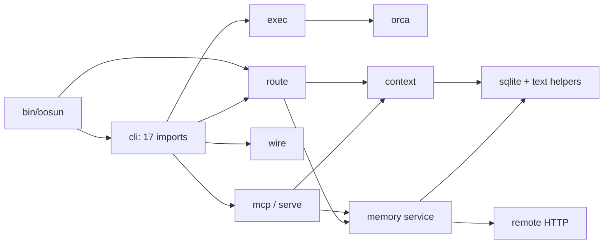
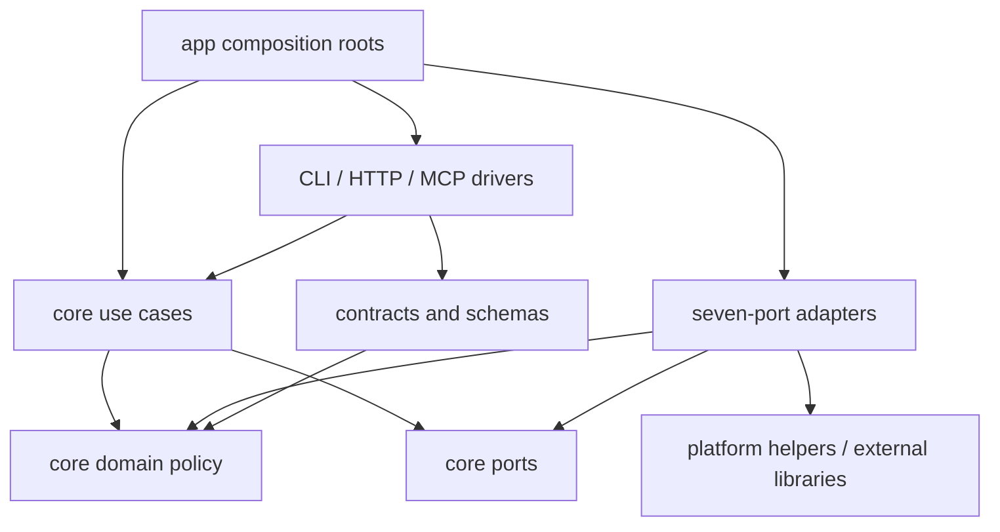
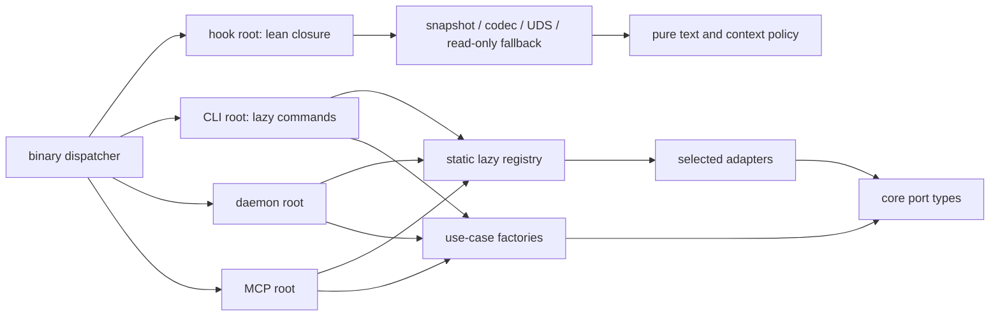

# 06 · Architecture and code structure

Checked 2026-10-04 in this checkout. Structural counts below are observations; the layout, budgets and effort estimates are recommendations. Topics [01](01-runtime.md)–[05](05-cli-topology.md) supply the approved runtime, protocol, libraries, seven ports and one-binary topology. No performance benchmarks, tests, installs or personal-config writes were performed for this note.

Validation: all three Mermaid blocks passed the available Mermaid 11.17.2 parser; this checks syntax, not rendering or architectural correctness.

**Latest host/router revision:** [09-opencode-clef.md](09-opencode-clef.md) adds native OpenCode as the primary integration alongside Codex/Claude and replaces Kev with the Ollama Clef-Flash decision adapter. The seven-port core stays independent; no full OpenCode harness is embedded. The original architecture-only estimate excludes the additional host/router qualification allowance in the revised roadmap.

## 1. Question

How should a 3,008-line TypeScript application, 2,206 lines of test support and one maintainer evolve into an extensible bosun v1.0 without making its hook slower or turning package boundaries into a second product?

## 2. TL;DR

- Use a **single-package modular monolith with ports and adapters**: pure domain policy and use cases inside; host, runner, storage and transport code outside. Group use cases by feature inside those boundaries.
- Keep topic 4's seven ports. Review, jobs, installation, launchd, logging and clocks remain functions/services; no DI container, generic repository layer, CQRS bus or event-sourcing rewrite.
- Ship topic 5's one binary. Four explicit composition roots (`hook`, CLI, daemon, MCP) select lazy adapter factories; the root dispatcher loads only the requested entry point.
- Enforce resolved import edges and cycles with a small Node script, plus Biome feedback. TypeScript project references and separate workspace packages wait for independently published components.
- Tighten the hook to `node:*` plus approved lean bosun modules. **Generate a validated JSON config snapshot administratively** so TOML and Zod stay outside its dependency closure.
- Merge the existing two error classes into `BosunError(code, message, { cause, details })`; keep one safe error payload across transport-specific wrappers.
- Make read-only fallback a distinct adapter: today's constructors, searches and docs reads can write. Never repeat a mutation after an ambiguous timeout or lost response.
- Put most tests around core policies and port contracts; use real temporary SQLite and stub CLIs for adapter tests. **Enforce HOME isolation before importing application code**, then verify it in children and filesystem/process wrappers.
- Evolve in small green steps. Architectural scaffolding/extraction is approximately 10–16 engineer-days; the full seven-port/daemon migration is approximately 6–8 engineer-weeks, overlapping topics 2–5 rather than adding to them.

## 3. bosun constraints

| Constraint | Architectural consequence |
|---|---|
| One owner and maintainer; binaries only | One package, lockfile and release; internal TS interfaces need no public package versioning. |
| Hook ≤15 ms p95 wall with daemon; ≤8 ms p50 against a stub (topics 3–5) | No CLI/schema/logging library or import-time terminal detection in the hook closure; test the compiled artifact. |
| Approved daemon, correct in-process fallback | Core use cases are callable with local adapters; transports never own business rules. |
| OpenCode primary; native Codex/Claude, local models, optional Orca | Preserve runner env/tool fences and native host identity; configuration chooses adapters and provider/models separately. |
| Memory privacy, project isolation, claude-mem read-only | Scope/private filtering survives extraction; external observations stay external. Topic 7 extends the existing source/store seams. |
| Never run the current tests under Bun; install nothing | This research is read-only. Dual-runtime CI below is future work after the guard is implemented and separately authorized. |

Two inherited contradictions need explicit resolution. README/topic 3 allow `smol-toml` in the hook, while the saved prompt and topic 4 say `node:*` only: prefer the stricter closure using the snapshot described below. Topic 5 treats timeout as a connection failure suitable for local fallback; that is unsafe for mutations once bytes may have reached the daemon. Restrict automatic write fallback to failures proven to precede dispatch.

Node 26 is **Current on this check date**, scheduled to enter LTS on **2026-10-28**; Node 24's maintenance date is **2026-10-20**. Use Node 24 LTS now and add/switch to Node 26 LTS after the date and compatibility gate, rather than calling it LTS already. [Official schedule](https://github.com/nodejs/Release/blob/main/schedule.json).

## 4. Options

| Style | Useful part for bosun | Cost / limitation | Call |
|---|---|---|---|
| Ports and adapters | Test use cases without hosts, sockets or SQLite; seven existing extension seams | Requires real enforcement of inward dependencies | Adopt inside one package. |
| Clean architecture | Domain rules independent of framework/transport details | Four ceremonial layers and per-use-case classes add little here | Keep the dependency principle; use functions. |
| Vertical slices alone | `route`, `run`, `review`, `memory` have clear owners | A slice can still mix CLI, SQL and vendor flags | Feature folders within core and CLI, with common port boundaries. |
| Modular monolith | One release and process can contain separated modules | Folders alone enforce nothing | Recommended deployment/package shape with the graph gate. |

Cockburn's original article separates application logic from external technologies, allows several adapters per purposeful port, and demonstrates constructor injection with a fake store. This supports bosun's testing and fallback needs without prescribing a DI framework. [Original 2005 article](https://alistair.cockburn.us/hexagonal-architecture/).

Repository evidence is **prior art, not proof these projects follow one named architecture**. OpenCode separates `agent`, `provider`, `session`, `permission`, `cli`, `server`, `mcp`, `acp` and `worktree` inside its application package, while its workspaces also hold distinct SDK/UI products. Borrow the feature ownership, not its workspace count or dependency stack. [Application source](https://github.com/anomalyco/opencode/tree/dev/packages/opencode/src), [root manifest](https://github.com/anomalyco/opencode/blob/dev/package.json).

The MCP TS SDK publishes distinct server/client/core and optional middleware packages; its documentation says middleware should stay thin. Its publishing audience justifies packages bosun does not yet need. Hono keeps routers, middleware, helpers and adapters under one source tree and exposes selected package subpaths; `@hono/node-server` is a separate runtime adapter. Borrow these seams. [MCP SDK](https://github.com/modelcontextprotocol/typescript-sdk), [Hono source](https://github.com/honojs/hono/tree/main/src), [Hono manifest](https://github.com/honojs/hono/blob/main/package.json), [Node adapter](https://github.com/honojs/node-server).

| Layout | Concrete metadata/build cost | Boundary strength | Decision |
|---|---|---|---|
| One package, strict folders | 1 manifest, 1 tsconfig, 1 lockfile, 1 build; add graph script + Biome config | Explicit CI edge rules, runtime closure check | v1.0 default. |
| Minimal 3 workspaces: core, adapters, app | Root +3 manifests; 3 package tsconfigs + root solution/base config; ≥2 `workspace:*` edges; declaration/build-order setup if using references | Package exports plus CI; relative paths still bypass conventions | Adds ≥6 package-local metadata files without independent products. |
| Package per port/adapter (7+ packages) | ≥7 manifests/tsconfigs/export surfaces, tests and dependency declarations; coordinated release/build graph | More explicit dependency declarations | Reject for one maintainer and one binary. |

Counts describe this proposed layout, **not measured setup time**. Bun workspaces support local packages and `workspace:*`; they become appropriate when a public client, memory SDK or separately versioned product actually exists. The topic 3 workspace choice is conditional on splitting packages, not a requirement to split now. [Bun workspaces](https://bun.com/docs/pm/workspaces).

## 5. Measurements and source audit

Read all 25 `lib` files, all 16 test/support files, `bin/bosun`, `package.json`, `tsconfig.json`, `ARCHITECTURE.md` and `HANDOFF.md`. Commands: `rg --files lib test`, `wc -l lib/*.ts lib/memory/*.ts test/*.ts`, and a TypeScript AST inventory of import/export declarations and literal `import()` calls; the saved JSON inventory was checked against the files. Counts include comments/blanks and exclude dependencies; this is structural work on the resumed Mac, not a repetition of the original M5 benchmarks.

| Observation | Result / implication |
|---|---|
| Production/test size | 25 lib files, **3,008 LOC**; 16 test/support files, **2,206 LOC** (15 `.test.ts` + helpers). |
| Import graph | **No cycles**. `cli.ts`: 328 lines, **17 import declarations**, 14 direct lib targets; `memory/cli.ts`: 161 lines, 14 imports. Counts include type imports and Node imports. |
| Concentrated mixed concerns | `cli.ts` owns parsing/install/doctor/uninstall; `wire.ts` 228 mixes two hosts with backup/apply; `orca.ts` 201 mixes process streaming, rendezvous and workspaces. |
| Storage reach-through | `context.ts` imports text helpers from `memory/sqlite.ts`; `consolidate.ts` imports concrete `ClaudeMem` and memory service helpers; MCP/HTTP open databases directly. |
| Import-time effects | Config reads repo assets at import; `load()` creates/copies config; `util.ts` reads `stdout.isTTY`; metrics/logging write files from read paths. |
| Read-only incompatibility | `openDb()` creates/chmods/migrates; `MemoryService` expires on construction/search/get, search touches counts; `Docs.search()` indexes. `touch:false` alone cannot make these safe. |
| Test containment gap | Tests import app modules before calling `fresh()`; `e2e.test.ts` runs the real Claude executable against a mock endpoint whenever installed. Move that fixture behind explicit opt-in and enforce the guard before imports. |
| Existing tests worth retaining | Scope/private rules, optimistic conflict, dedupe/FTS, migration rollback/races, CLI fences, wire reversibility and HTTP/MCP behavior; see `test/*.test.ts`. |

Current import graph below is a **selected subgraph**, not all 25 files or every edge; arrows mean imports (static or literal dynamic).



## 6. Recommendation

### 6.1 Smallest useful layout and dependencies

```text
bin/bosun.ts                  # tiny role dispatcher, one compiled binary
src/
  core/
    domain/{task,job,role,route,memory,context,review,workspace}.ts
    ports/{host,runner,model,memory,context-source,workspace,router}.ts
    use-cases/{route-prompt,run-task,review-diff,spin-off,retrieve-context,consolidate-memory}.ts
    memory-policy.ts  text.ts  errors.ts
  contracts/{methods,schemas,error-map}.ts   # Zod, wire DTOs; core never imports these
  adapters/
    hosts/{opencode,claude,codex}/{adapter,hook,render}.ts
    runners/{opencode-native,claude-cli,codex-cli,acp}.ts
    models/{ollama,openai-compatible,claude-cli}.ts
    memory/{sqlite,read-only,http,migrations}.ts
    context/{curated,docs,claude-mem}.ts
    workspaces/{orca,git-worktree}.ts  routers/{clef-ollama,llm}.ts
    transport/{http-client,http-server,mcp-server}.ts
  platform/{paths,proc,sqlite,assets,config,log,metrics,manifest,launchd}.ts
  app/{registry,dispatch,hook,cli,daemon,mcp}.ts  # composition roots + dispatcher
  cli/{program,output,commands/}.ts
test/{unit,contracts,integration,smoke,fixtures,golden}/
scripts/{check-boundaries,run-tests,check-hook-bundle,bench-hook}.mjs
docs/adr/  ARCHITECTURE.md  biome.json  tsconfig.json  package.json  bun.lock
```

This is a target tree, not an instruction to create empty files. Use one file until real responsibilities split; `domain` types can start together. `platform` contains concrete helpers, not a universal service locator. Assets remain in `roles/`, `skills/`, `policy.md` until an extraction/build helper embeds them.



Arrows above and below mean compile-time dependencies, **not RPC call direction**. Drivers receive use-case/dispatcher functions; they do not select adapters. Cross-adapter imports are forbidden: share a concrete low-level helper in `platform`, or inject the relevant port from `app`. Do not add a second storage/repository port underneath `MemoryStore` merely to move SQL around.



### 6.2 Complete v0.2.0 migration map

Every existing lib file appears once; multiple destinations mean split responsibilities. LOC are observed; retention follows topic 4's estimates and is not a measured future diff.

| Current file (LOC) | v1.0 destination / treatment |
|---|---|
| `cli.ts` (328) | `cli/program.ts`, `cli/commands/*`, `app/cli.ts`; install/doctor into use cases + manifest; remove manual dispatch. |
| `config.ts` (67) | `platform/config.ts`, `paths.ts`, `assets.ts`; role selection in core; host paths owned by host adapters; no import-time reads. |
| `consolidate.ts` (56) | `core/use-cases/consolidate-memory.ts`; structural summary input via ContextSource, injected ModelProvider/MemoryStore. |
| `context.ts` (82) | `core/use-cases/retrieve-context.ts`, domain scoring/text; `curated` wrapper → `adapters/context/curated.ts`. |
| `exec.ts` (180) | run/review use cases, `adapters/runners/*`, `platform/proc.ts`; keep fences and env rules, replace sync long runs. |
| `llm.ts` (117) | `adapters/models/*`; provider-chain policy in core, usage in platform metrics; remove dependency on `exec.ts`. |
| `log.ts` (17) | `platform/log.ts` with LogTape; hook has a small metadata-only Node sink. |
| `mcp.ts` (138) | `adapters/transport/mcp-server.ts`, `app/mcp.ts`, shared contract/method definitions; retain tool behavior. |
| `metrics.ts` (57) | `platform/metrics.ts`; pure quantiles extracted; inject recording/no-op functions into use cases. |
| `orca.ts` (201) | `adapters/workspaces/orca.ts`, `platform/proc.ts`, core job model; replace `_exec` file rendezvous with daemon jobs. |
| `roles.ts` (44) | core Role type/parser policy; asset read in platform, per-host renderers in `adapters/hosts/*/render.ts`. |
| `route.ts` (204) | core route policy/use case, `adapters/routers/clef-ollama.ts`, lean host hook/plugin codecs, CLI router commands; decision generation stays outside hooks. |
| `serve.ts` (143) | `adapters/transport/http-server.ts` (Hono), `app/daemon.ts`; Kev proxy in router adapter; delete duplicate endpoint policies. |
| `services.ts` (110) | `platform/launchd.ts`; provider/router setup modules and admin commands; manifest records every applied effect. |
| `util.ts` (87) | errors/text → core; subprocess/JSON helpers → platform; output → CLI; delete subset schema validator after Zod adoption. |
| `wire.ts` (228) | `adapters/hosts/{claude,codex}/*` for plans/rendering, `platform/manifest.ts` for apply/undo; preserve preflight/backups. |
| `memory/bench.ts` (93) | `cli/commands/memory-bench.ts`, reusable synthetic fixtures + `scripts/bench-hook.mjs`; Node subprocess tools only. |
| `memory/claudemem.ts` (85) | `adapters/context/claude-mem.ts`; preserve read-only/schema guard; source supplies weight/half-life. |
| `memory/cli.ts` (161) | `cli/commands/memory/*`; remove concrete-class downcasts; administrative maintenance uses explicit callable methods. |
| `memory/docs.ts` (69) | `adapters/context/docs.ts`; separate index job from query; no index writes on read-only hook path. |
| `memory/project.ts` (76) | `platform/project.ts` for filesystem/git identity; normalization in core; host environment decoding in host adapter. |
| `memory/remote.ts` (44) | `adapters/memory/http.ts` + shared HTTP client; validate full response data and normalize transport errors. |
| `memory/service.ts` (237) | `adapters/memory/sqlite.ts`, shared core memory policy; opening/selection moves to composition; add separate read-only reader. |
| `memory/sqlite.ts` (135) | `platform/sqlite.ts` (open/tx), adapter migrations; pure terms/Jaccard → core text; hash function injected. |
| `memory/types.ts` (49) | core domain memory/context, ports memory/context-source, `core/errors.ts`; Source becomes an open string. |
| `bin/bosun`, `package.json`, `tsconfig.json` | TS dispatcher; one package/scripts; expand include paths as files move; strict NodeNext/type-only imports preserved. |
| `config.default.env`, `roles/`, `skills/`, `policy.md` | Typed defaults + one-time env migration; embed/extract assets; keep editable role/skill sources, host-neutral policy. |
| `test/*.ts`, `install.sh`, docs | Move tests by purpose with temporary compatibility imports; installer becomes binary/setup wrapper; update architecture and ADRs after each slice. |

### 6.3 Boundary enforcement

| Rule | Enforced by |
|---|---|
| Core imports only core modules; no IO, env, sockets, subprocesses, schemas or adapter names | Resolved graph allowlist + Biome restricted imports; check type-only imports too; review globals such as `fetch`/`process`. |
| Contracts import domain types, never adapters; drivers receive functions; only app selects adapters | Graph zone rules; reject production→test and cross-adapter edges. |
| No cycles / computed module loads / disguised external imports | Check static imports, re-exports, literal dynamic imports and `require`; reject computed paths, `createRequire`, new aliases or unresolved edges unless explicitly handled. |
| Hook closure includes only lean own modules + `node:*` | Traverse hook entry + fallback closure; deny npm imports, `bun:*`, registry/admin config/logging and terminal detection; inspect the reachable hook chunks in build metafile. |
| No import-time IO or mutable global service instances | Code review + smoke tests importing modules under blocked IO; roots create/close resources. |

Implement `scripts/check-boundaries.mjs` with Node built-ins: enumerate TS, collect allowed literal specifiers, resolve normalized relative paths, apply zone rules, DFS for cycles, traverse hook closure. A ~30-line prototype demonstrates the graph; a trustworthy scanner with fixtures will be nearer **80–150 lines**. Do not claim regex alone handles TS comments, re-exports and dynamic imports reliably. Keep syntax constrained or use an already pinned parser; topic 3 says TS 7's JS API is unavailable, so don't depend on a private compiler API. Test forbidden aliases/relative escapes and ignored comment strings as checker fixtures.

Biome `noRestrictedImports` supplies editor feedback for restricted paths/patterns; the resolved graph remains authoritative for relative-path bypasses and transitive closure. Package `exports` limits package-name entry points, while `imports` provides internal aliases; neither enforces architectural layers against filesystem-relative imports. TS references require composite/declaration outputs and build order: useful later, too much scaffolding now. Dependency-cruiser is the fallback if the local check grows beyond a small maintainable script. [Biome rule](https://biomejs.dev/linter/rules/no-restricted-imports/javascript/), [Node packages](https://nodejs.org/api/packages.html), [TS references](https://www.typescriptlang.org/docs/handbook/project-references.html), [dependency-cruiser](https://github.com/sverweij/dependency-cruiser).

The binary dispatcher legitimately names lazy CLI/daemon/MCP chunks. Check its eager imports separately from the hook entry closure; rejecting every `node_modules` entry in the whole one-binary metafile would reject the approved libraries even when they load only on other paths.

### 6.4 Composition, config and factories

Use named factory functions with typed, narrow dependency records: `createRoutePrompt({ router, retrieveContext, policy })`, `createRunTask({ runners, now, newId })`, `createReviewDiff({ runners, readDiff, role })`. Ordinary clock/id/log functions are dependencies, not additional public ports. Tests pass fakes directly; no decorators, reflection, string-token resolution or global singleton container.

`app/registry.ts` is the compiled static table, e.g. `runners['codex-cli'] = async (deps, cfg) => (await import('../adapters/runners/codex-cli.ts')).createRunner(deps, cfg)`. Type it with `satisfies` against the seven port factory maps. Factories declare resources they close; the root owns `try/finally`, signal handlers and shutdown order. Creating a registry must not instantiate every adapter or probe every executable.

Daemon root: validate config → open writer/migrate → construct selected ports → use cases → shared method table/dispatcher → Hono listener. CLI root: parse cheap command metadata → lazy command action → client, or safe local composition. MCP root: SDK + same method definitions → daemon client/local use cases, with stdout reserved for protocol. Hook root: snapshot/defaults + selected lean host codec → one UDS attempt → lazy read-only fallback; **never import the registry**.

Config precedence: typed defaults < TOML < explicitly mapped `BOSUN_*` env overrides. Parse TOML with smol-toml and validate Zod once per root/reload; pass immutable feature-specific settings into core. Keep `.env`/bunfig autoload disabled for the compiled binary. `config set/migrate` and daemon startup atomically write `$BOSUN_HOME/run/hook-config.json` (0600) containing only hook settings, schema version and config generation/hash, no provider credentials. Manual TOML edits require daemon reload or `bosun config validate` to refresh it; the hook uses the last compatible snapshot/defaults and reports stale state through doctor, without parsing TOML or writing config. Snapshot generation is administrative, never a hook side effect.

Literal `import()` per role/action plus `--compile --splitting --bytecode` keeps lazy chunks embedded in one binary; verify emitted chunks instead of assuming source laziness survives bundling. [Bun executable documentation](https://bun.com/docs/bundler/executables). The daemon is the long-lived writer; CLI/MCP fallback uses SQLite locking only after safe pre-dispatch failures. Hook fallback opens an existing compatible DB read-only, filters expiry in SELECTs, skips counts/migrations/indexing and performs no retention writes. Missing/newer schema → omit memory. No synchronous long subprocess or blocking sleep in daemon request handlers; jobs own heavy indexing/consolidation and bounded event queues.

Keep Bun-specific vanilla-dylib setup and extension loading in the daemon/admin SQLite root, outside the strict hook closure. The hook's `node:sqlite` fallback uses the runtime's default SQLite for standard FTS and does not load sqlite-vec; do not carry topic 1's vanilla-dylib timing into that path. Qualify fallback against an existing database that also contains optional vector tables, with no extension installed. Unsupported schema/module or an exhausted read deadline omits memory and fails open rather than importing `bun:*` or mutating the database.

### 6.5 Domain glossary and use cases

| Term / home | Meaning and invariants |
|---|---|
| Task / `core/domain/task.ts` | User intent/spec + caller project/workspace, requested access and selected role; independent of any executable. |
| Job / `job.ts` | One attempt to execute a Task: id, runner, state (`queued/running/succeeded/failed/cancelled`), events/result; today's `orca.Job` becomes a lower-level ProcessSpec. |
| Lane / Role / `role.ts` | Lane is routing class (`scout/local/worker/main`); Role is instructions + permitted access + configured model/effort. A lane is not a host subagent name. |
| Route decision / `route.ts` | Raw classification/confidence/risk plus final advisory lane and reason; high risk overrides cheap/edit lanes. |
| Memory item / `memory.ts` | Scoped, versioned durable/proposed/session fact with privacy, provenance and expiry; keep current IDs and isolation semantics. |
| Context bundle / `context.ts` | Ranked/deduped source hits, formatted text, budget estimate and provenance; no storage mutation required to compute it. |
| Review / `review.ts` | Diff/base/untracked inputs, selected read-only runner, findings and completion; prefer other vendor, report same-vendor fallback. No Reviewer port. |
| Workspace / `workspace.ts` | Worktree identity/path/branch plus optional pane/status capabilities; distinguish entity `WorkspaceRef` from port `Workspace`. |

| Use case / `core/use-cases/` | Dependencies and placement |
|---|---|
| `route-prompt` | Router + retrieve-context, pure risk/confidence policy; host parse/format outside. |
| `run-task` | AgentRunner selection + job transitions/event stream; env/CLI flags in runners. |
| `review-diff` | Read diff function + role + runner capabilities; enforce read-only and vendor preference. |
| `spin-off` | Workspace + run-task; compensate failed startup and return worktree/job handles. |
| `retrieve-context` | ContextSource[] + pure ranking/budgeting; MemoryStore wrapped by curated source. |
| `consolidate-memory` | Summary-capable ContextSource + ModelProvider + MemoryStore; validate/dedupe proposals, never silently activate. |

Seven port contracts remain topic 4's `HostAdapter`, `AgentRunner`, `ModelProvider`, `MemoryStore`, `ContextSource`, `Workspace`, `Router`. Keep business validation in shared core policy as well as ingress schemas; adapters translate technology errors. Reuse SQL constraints/transactions instead of duplicating a generic repository framework. Graph levels/edges/index choices belong to topic 7; expose provenance/budgeted hits through these existing seams first.

### 6.6 Errors and transport reliability

`BosunError` holds a stable `code`, safe public `message`, optional allowlisted `details` (e.g. current version), and `cause` via `ErrorOptions`. Preserve original diagnostics locally; never serialize raw causes/stacks or arbitrary upstream messages. Root catches unknown errors as `internal`; CLI prints a useful action plus request id, logs contain sanitized operation/code/stack location and safe cause metadata. Replace today's misleading “details in log” when no actual diagnostic was logged.

| Code | HTTP | CLI exit | Meaning |
|---|---|---|---|
| `invalid` | 400 | 2 | Malformed config/input or invalid option. |
| `not_found` | 404 | 1 | Missing or out-of-scope item; preserve existence privacy. |
| `conflict` | 409 | 3 | Optimistic version/dedupe conflict; safe `currentVersion` detail. |
| `unauthorized` / `forbidden` | 401 / 403 | 1 | Transport auth/access, distinct from memory existence checks. |
| `unavailable` / `draining` | 503 | 1 | Dependency unavailable, or explicit refusal before job acceptance. |
| `timeout` | 504 | 124 | Deadline exceeded; include `outcome: unknown` when a mutation may have committed. |
| `cancelled` | No reply after close; otherwise 409 | 130 | Explicit cancellation; job cancellation is a state transition. |
| `unsupported_version` / `internal` | 400 / 500 | 1 | Incompatible API/schema, or unexpected implementation failure. |

One **payload**, not an identical protocol envelope: `{ code, message, requestId, details? }`. HTTP uses `{ ok:false, error:payload }`; JSON-RPC keeps its required numeric errors and stores the payload in `error.data` (reserved parse/method/params codes remain reserved); MCP tool failures return `isError:true` with safe text/structured data, while protocol failures remain JSON-RPC errors. Hook failures yield no added context and exit 0. This mapping is bosun design; JSON-RPC and MCP wrappers must follow their specifications. [JSON-RPC 2.0](https://www.jsonrpc.org/specification), [MCP tools](https://modelcontextprotocol.io/specification/2026-07-28/server/tools).

The method table needs `effect: read|write`, `idempotent` and retry policy. Timeout/reset after send is **unknown outcome**, not proof of non-execution: never re-run a write/job start locally or automatically retry it. Refused/missing socket before send may choose local fallback; explicit `draining` before acceptance may wait/retry. Reads can retry within deadline. A request id alone is not deduplication; implement persisted idempotency keys before permitting mutation retries. Validate both success and error envelopes (`ok:true` without valid data must fail), fixing the current RemoteStore gap.

### 6.7 Tests and enforced HOME isolation

The pyramid: many deterministic core tests; fewer contract/adapter integration tests; a small compiled CLI/hook/MCP smoke layer; live-host/local-model evals remain opt-in. Retain current behavioral assertions while relocating, rather than rewriting 87 tests at once. Fakes test use-case policies; stub executables test argv/env, permissions, malformed NDJSON, signals, failure and cancellation; temporary SQLite tests real SQL/FTS/migration/concurrency. A fake store cannot prove SQLite semantics.

Each port gets a reusable suite factory in `test/contracts/`: HostAdapter plan/idempotent undo + hook codecs; AgentRunner ordered events/one completion/abort/access; ModelProvider structured output/deadline/privacy; MemoryStore scope/private/conflict/dedupe/expiry; ContextSource source IDs/limits/provenance/degradation; Workspace create/remove/capabilities; Router validated lane/confidence/risk/timeout. Every adapter runs the applicable suite with fixtures/stubs; live services are never a requirement. Version/date-specific MCP and ACP protocol fixtures belong to transport/runner integration suites.

`scripts/run-tests.mjs` creates a realpath-resolved temp sandbox **before spawning** the runtime; sets HOME/BOSUN_HOME/XDG paths, host homes and a short unique socket; clears inherited host/session/remote credentials and routes external commands to stubs. Mandatory preload validates `BOSUN_TEST_ROOT`, HOME and all write destinations are under it before app imports; patch `os.homedir()` to the sandbox (and sync builtin ESM exports on Node) or throw on direct use. Application paths still read `$HOME` first. Guard filesystem writes with realpath/symlink containment checks and block real `launchctl`, brew, host registration and network providers through injected process/IO wrappers. Environment assertions alone do not contain native writes or arbitrary child commands: restrict the stub PATH, propagate the guard to child bosun processes, and have child startup reject mismatched home/socket identity.

Make bypass detection a release gate: a test spawning the ordinary test command with missing/outside-root HOME must fail **before any write**; another fixture attempts a symlink escape and a real-supervisor call. All CI/developer suite commands go through the launcher, and the preload also guards direct invocation. This is layered enforcement, not a claim that a JS preload is an OS sandbox. Do not grant installation capabilities to tests.

Future CI: pinned Bun and current Node LTS with the same `node:test` behavioral suites, separate processes per test file, bounded timeouts and stubs using an explicit interpreter path. **The owner's present ban on Bun test runs remains in force here**; guard implementation/review is a prerequisite, not permission. Golden files cover OpenCode JSON/JSONC/agents/plugin/MCP, Claude plugin JSON/agents/hooks, Codex TOML/AGENTS blocks, permissions, manifest plans and launchd plists; normalize temp paths and parse generated configs as well as diffing goldens. All three native hosts run the common contract/acceptance matrix.

Hook performance is a future compiled smoke/benchmark test: repeated fresh processes, warm-up, fixed corpus, output parity, stub daemon + full 10k memory path, daemon-down read-only path, no-memory path, `.env` canary, p50/p95 + binary size. Keep ≤8 ms p50 stub and ≤15 ms p95 warm-daemon targets on a designated comparable Mac; general CI reports timing and uses a coarse regression ratio so noisy runners do not manufacture failures. Report cold first-exec scans separately. No old-machine latency is re-measured or implied for this Mac.

### 6.8 Code and documentation conventions

Keep `strict`, `noEmit`, `verbatimModuleSyntax`, `erasableSyntaxOnly`, NodeNext and explicit Node types. Add `noUncheckedIndexedAccess`, `exactOptionalPropertyTypes` and unknown-at-ingress incrementally; use `import type`, named exports and kebab-case files. No default exports except a library-required entry. No enums/decorators requiring runtime TS transforms; prefer discriminated unions for events/states.

Target **≤250 logical lines per responsibility**, review/explain files over 350; generated schema/migration fixtures are exempt. This is a review heuristic, not a mechanical splitting gate. Comment on invariants, protocol quirks, privacy and why a fallback is safe; require no arbitrary comment-density percentage. Biome recommended correctness/suspicious rules plus `noExplicitAny`, `useImportType`, restricted imports and unused imports; configure relaxed fixtures explicitly, not blanket production disables. Never mix formatting-only churn with extraction.

Async IO/subprocesses on server paths; await all owned promises, use caller-propagated `AbortSignal`, bounded concurrency/queues and `finally` cleanup. Catch only where translating errors, degrading a declared optional source or terminating a root. Synchronous bounded SQLite remains behind its adapter; heavy work moves to jobs and then a worker only when measurements justify it.

Update `ARCHITECTURE.md` to the actual layer tree, import rules, composition/resource ownership, protocol/errors, safe test commands and troubleshooting; retain HANDOFF.md as historical build evidence. ADRs under `docs/adr/NNNN-title.md` use **Status · Date · Context · Decision · Alternatives · Consequences · Verification · Supersedes**. First ADRs: one package/seven ports, hook snapshot/closure, writer/fallback/retry rules, contract errors, enforced test homes. Record departures from preceding research explicitly.

## 7. Open questions for the owner

No answer is needed to start the recommended migration. Defaults: one package; no DI container; generated hook snapshot with manual-edit reload semantics; strict read-only fallback; no mutation retry after ambiguous failure. A separately published memory/client SDK would change the package choice—revisit only with an actual consumer. These are research recommendations, not authorization to install or change a host.

## 8. Roadmap implications: evolve, keep green

Topic 4's **89% vendor-neutral** count and ~90% memory retention justify evolution, but do not mean 89% moves unchanged: expiry, transaction boundaries, privacy and fallback still need review. Use temporary `lib` forwarding modules/aliases; migrate one caller at a time, compare behavior, then delete the forwarding layer. Keep IDs/schema/command behavior stable until a separately reviewed migration changes them. Sizes below are **planning estimates for one experienced developer**, not measured work and not additive to topics 2–5.

| Step | Green boundary / exit criterion | Size |
|---|---|---|
| 0. Test containment | HOME-first paths, mandatory launcher/preload, stub-only process effects, negative escape/launchd checks; no Bun suite until separately authorized | S, 1–2 days; ~150–250 new/changed lines. |
| 1. Pure policy and ports | Extract text/domain/errors + seven contracts, factories/registry; old entry points still call through compatible exports; graph gate initially allows only recorded legacy exceptions | M, 2–3 days; ~250–450 lines extracted/added. |
| 2. Memory/context slice | Inject config/metrics, remove concrete imports, query/index separation, read-only expiry SELECTs, shared scope policy; old memory/HTTP/MCP contract assertions still pass | M, 2–3 days; ~900 existing lines touched, ~150–250 added. |
| 3. Library/transport roots | Shared schema/method/error table, TOML snapshot, lazy commander, MCP SDK and Hono spike; output/config goldens and compiled hook parity | L, 4–6 days; ~500 existing lines replaced, ~500–800 added. |
| 4. Host/runner/workspace adapters | Claude plugin spike then plan/apply manifest; preserve CLI fences; normalized events, ACP, Orca + git-worktree; one adapter at a time | L, 2–3 weeks; ~1,250 existing lines reorganized, ~800–1,200 added. |
| 5. Daemon/jobs + cutover | Single writer, lock/home discovery, bounded jobs/SSE, cache/schema skew and safe fallback; remove file rendezvous only after parity and timeout-ambiguity tests | L, 1–2 weeks; ~500–800 added plus deletions. |
| 6. Remove legacy and document | No forwarding imports, zero boundary exceptions/cycles, golden configs/manifest undo and all entry smoke gates; publish migration instructions | S, 1–2 days; primarily deletions/docs. |

Estimated architecture-only safety/extraction work across steps 0–3/6: **10–16 days**; complete ports/daemon evolution across these overlapping scopes: **6–8 weeks**. Topic 7 changes the memory internals through the retained seams; topic 8's required compact/handoff belongs in use cases using ModelProvider/HostAdapter/Workspace capabilities, not in a new generic agent framework. Re-estimate after the Claude plugin, Hono UDS and ACP spikes.

**Future verification commands**, to be implemented during migration; **not run for this research**, and proposed scripts/paths do not exist yet:

```sh
node scripts/check-boundaries.mjs
node scripts/run-tests.mjs --runtime node
node node_modules/typescript/bin/tsc -p .
./node_modules/.bin/biome ci .
node scripts/check-hook-bundle.mjs
node scripts/bench-hook.mjs --binary dist/bosun --fixture test/fixtures/memory-10k.db
```

The future dual-runtime launcher may expose `--runtime bun` only after guard review and owner authorization. It launches Bun with sandbox HOME already set at process start; never invoke the current `bun test` suite as a migration shortcut. Build/release verification also requires split chunks, every role/subcommand smoke, API/MCP version fixtures, ambiguous-write no-retry tests and manifest dry-run/undo under the guarded temp home.

## 9. Sources

Primary sources checked 2026-10-04 unless noted. Repository branches are mutable layout evidence, not pinned dependency versions; topic 3's selected libraries remain the baseline until a separate version check. All recommendations above are bosun design judgments.

- [Cockburn, original ports-and-adapters article (2005)](https://alistair.cockburn.us/hexagonal-architecture/); [OpenCode source](https://github.com/anomalyco/opencode/tree/dev/packages/opencode/src) and [workspaces manifest](https://github.com/anomalyco/opencode/blob/dev/package.json).
- [MCP TS SDK split packages and thin middleware](https://github.com/modelcontextprotocol/typescript-sdk), [current MCP revision](https://modelcontextprotocol.io/specification/2026-07-28), [MCP tool errors](https://modelcontextprotocol.io/specification/2026-07-28/server/tools), [JSON-RPC specification](https://www.jsonrpc.org/specification).
- [Hono source](https://github.com/honojs/hono/tree/main/src), [package exports](https://github.com/honojs/hono/blob/main/package.json), [Node-server adapter](https://github.com/honojs/node-server), [Bun workspaces](https://bun.com/docs/pm/workspaces), [compiled splitting](https://bun.com/docs/bundler/executables).
- [TypeScript project references](https://www.typescriptlang.org/docs/handbook/project-references.html), [Node package exports/imports](https://nodejs.org/api/packages.html), [Biome noRestrictedImports](https://biomejs.dev/linter/rules/no-restricted-imports/javascript/), [dependency-cruiser](https://github.com/sverweij/dependency-cruiser), [Node release schedule](https://github.com/nodejs/Release/blob/main/schedule.json).
- Local evidence: [lib](../../lib/), [tests](../../test/), [binary entry](../../bin/bosun), [package](../../package.json), [TS configuration](../../tsconfig.json), [architecture](../../ARCHITECTURE.md), handoff (`../../HANDOFF.md`; historical citation, recover via `21d5dc6:PATH`), [research owner decisions](README.md). Scratch inventory: `/tmp/bosun-research-q4qYDt/architecture-inventory.json`; current fetched layouts/schedule in `research-06/` beside it. These temporary files may disappear; the complete 25-file map and counts are preserved here.
