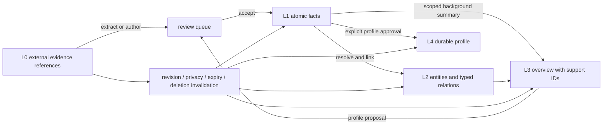
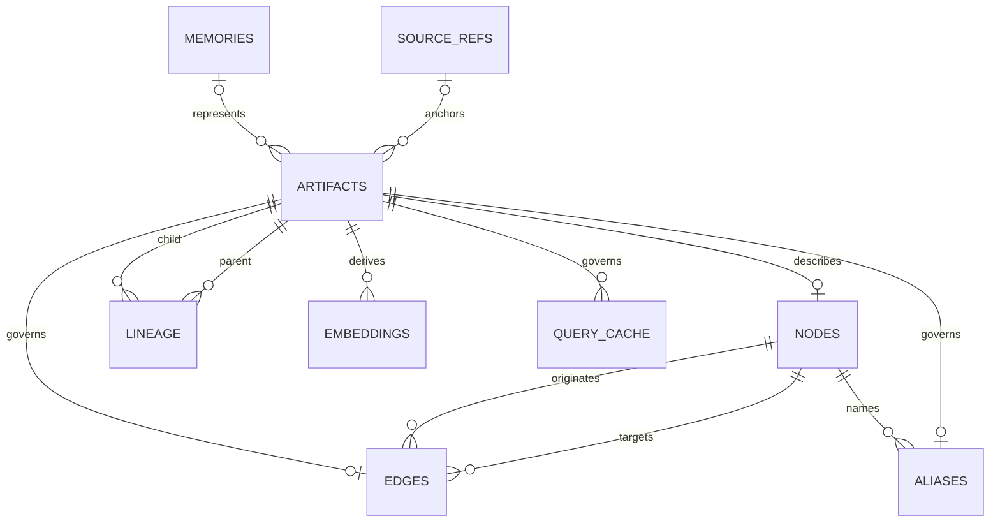
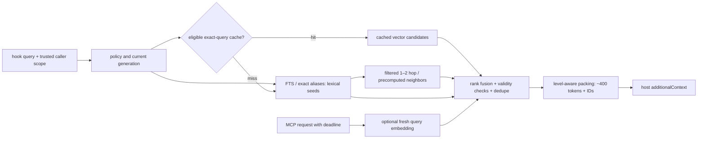

# 07 · Leveled graph memory

Checked 2026-10-04. Research and design only: no installs, tests, benchmarks, model calls or private database reads. The current Mac lacks Ollama and the owner's graphify/CodeGraph installations. Published results below describe their authors' systems; thresholds below are proposed bosun acceptance criteria.

**Owner clarification, 2026-10-04:** Graphify/CodeGraph are optional tools that users install when needed. Their absence or unresolved identity does not block the build or release. Optional configured integrations still require a verified read-only export/MCP contract; bosun never installs these tools automatically. The native graph-memory work below remains in scope.

## 1. Question

What should the owner's “leveled graph memory” mean, and what is the smallest addition that improves bosun's retrieval inside its hook budget?

It should mean **evidence organized at several semantic granularities, with explicit links and reversible derivation**. Levels describe meaning and retention, not separate databases, graph engines or agents. The useful graph connects a fact to its project, decision, file, symbol, tool and supporting source. Its first purpose is finding the right fact when the prompt names something related.

## 2. TL;DR

- Define L0 source events/references, L1 atomic facts, L2 entities and typed relations, L3 scoped summaries, L4 explicitly reviewed durable profiles. Promotion adds a derived view; it does not erase evidence.
- Keep SQLite and existing memory IDs/API. Add graph tables, lineage and FTS5; use bounded recursive CTEs or cached adjacency. Optional sqlite-vec requires topic 1's approved vanilla dylib; unavailable extension means lexical retrieval still works.
- Start with L1–L2: manually supplied or deterministic links over reviewed memories. Graph retrieval ships only if a held-out local eval improves over both current FTS and an improved lexical baseline.
- **No inference on the hook:** lexical/entity seeds → bounded graph neighbors → fusion → ~400-token packing. Corpus embeddings do not eliminate query embedding. A new prompt/cache miss has no vector channel.
- For later background/MCP vector search, default to Ollama `embeddinggemma:300m-qat-q4_0`, 768 dimensions; compare full precision, nomic v1.5 and Qwen3 0.6B on the local eval before activation. There is no measured Apple Silicon latency here.
- Model extraction runs in bounded daemon jobs and produces proposals with source spans, confidence and model/prompt versions. Review relations, contradictions, summaries and profile changes; never silently rewrite an accepted decision.
- **Private means never sent to any model**, including local extraction or embeddings. Preserve privacy, scope, provenance, validity and expiry through nodes, edges, summaries, vectors and caches; source deletion invalidates derivatives.
- Keep claude-mem external and read-only: L0 references it, rather than copying the owner's roughly 7k observations. graphify/CodeGraph become optional ContextSources after their actual identities/export schemas are known.
- Single-Mac first. Later, one authoritative daemon on the server profile serves two Macs; do not synchronize live SQLite/WAL files or add multi-master merging.

## 3. bosun constraints

| Constraint | Consequence |
|---|---|
| One owner, up to two Macs; no server Mac yet | One database and authority; remote topology follows [topic 5](05-cli-topology.md). |
| Hook ≤15 ms p95 wall with daemon; ~400 estimated tokens | Bounded indexed reads; no extraction, query embedding, reranker, graph-tool subprocess, remote request or docs indexing. These are targets inherited from [topics 1–6](06-architecture.md), not new measurements. |
| `MemoryStore` and `ContextSource` already approved | Graph storage stays inside SQLite MemoryStore; expose its retrieval view as a ContextSource. No eighth port or third-party framework runtime. |
| Existing private/project/linked/shared rules and optimistic versions | Graph policy must be at least as strict as curated memory policy. Caller scope comes from trusted environment, never tool arguments. |
| Reviewed consolidation and read-only claude-mem | Preserve proposals and external source references; source schema mismatch degrades quietly. |
| One daemon is the long-lived writer; read-only hook fallback | Jobs own indexing/retention; fallback filters expiry in SELECTs and never migrates, touches access counts or creates a DB. |

Actual code: [types](../../lib/memory/types.ts), [SQLite/migrations](../../lib/memory/sqlite.ts), [service](../../lib/memory/service.ts), [context](../../lib/context.ts), [claude-mem](../../lib/memory/claudemem.ts), [docs](../../lib/memory/docs.ts), [consolidation](../../lib/consolidate.ts), [LLM routing](../../lib/llm.ts), [MCP](../../lib/mcp.ts), [eval](../../lib/memory/bench.ts), [architecture](../../ARCHITECTURE.md), [handoff](../../HANDOFF.md).

Today `retrieve()` caps input at 24 terms, fetches 20 hits/source, normalizes negative BM25 against each source's best hit, adds recency/access bonuses, dedupes hashes/Jaccard ≥0.8, then greedily packs character-capped lines. The hook requires two distinct matched words, capped by query length. This is useful lexical filtering, but misses paraphrases and relationships; normalizing each source's best hit to 1 does not establish relevance. Docs `search()` indexes/writes, and curated `search()` expires/touches rows: [topic 6's separate read-only reader](06-architecture.md) is a prerequisite.

Privacy correction: [README's contract](../../README.md#memory) says private memories never reach the model. Topic 4's `local ⇒ may see private memories` capability sketch conflicts with it, and today's `suggest(..., priv)` only excludes remote Claude while allowing local providers. **The no-model rule wins.** Reject/skip `--private --auto`, embeddings, extraction and model summarization before provider selection. MCP's existing body-only redaction can expose private titles/tags; graph endpoints should return only an opaque private placeholder or “not found”, never derived labels/snippets/paths.

## 4. Options and evidence

### 4.1 Storage choice

| Option | What it buys | Cost/limits | Call |
|---|---|---|---|
| Existing FTS + better aliases/ranking | Exact identifiers, cheap retrieval; no extraction | Paraphrase and multi-hop gaps remain | Required baseline and fallback. |
| SQLite nodes/edges + FTS5 + optional sqlite-vec | Atomic evidence/policy updates, one backup, existing migrator, indexed adjacency | Hand-written SQL; vec0 is a brute-force KNN index, not an ANN graph | **Pick**, incremental and feature-gated. |
| Kùzu embedded Cypher | Native graph traversal, typed property graph, vector/FTS extensions | Native packaging and migration; upstream archived | Reject for new bosun dependency. |
| Full graph-memory framework/server | Ready extraction, traversal and summarization | Provider calls, framework/database processes, larger operational and policy surface | Borrow algorithms; do not embed the stack. |

SQLite supports recursive graph traversal; add explicit depth, visited-node and row limits, since a recursive query's depth alone does not bound high-degree expansion. FTS5 supplies BM25 and external-content tables. [SQLite WITH](https://www.sqlite.org/lang_with.html), [FTS5](https://www.sqlite.org/fts5.html).

sqlite-vec **v0.1.9, 2026-03-31**, supports vector metadata filters and partition keys; auxiliary columns cannot filter KNN. Query permitted scope partitions separately and fuse their hits, with status/expiry filters inside candidate selection and a final policy check. Never query global top-k and rely solely on post-filtering. Small partitions can reduce efficiency; measure before adding partition keys. [v0.1.9 release](https://github.com/asg017/sqlite-vec/releases/tag/v0.1.9), [vec0 metadata and partition constraints](https://alexgarcia.xyz/sqlite-vec/features/vec0.html).

**Kùzu is not maintained by its original repository:** GitHub marks it archived/read-only on **2025-10-10**. Its final published release is **v0.11.3, 2025-10-10**; the versioned README says it preinstalls `algo`, `fts`, `json` and `vector` because Kùzu no longer provides its official extension server. A release archive or existing Graphiti adapter is not evidence of ongoing support. Evaluate a maintained successor only if SQLite later fails a measured requirement. [Repository/archive notice](https://github.com/kuzudb/kuzu), [final release](https://github.com/kuzudb/kuzu/releases/tag/v0.11.3), [versioned README](https://raw.githubusercontent.com/kuzudb/kuzu/v0.11.3/README.md).

### 4.2 Prior art: borrow the useful parts

Versions/releases were checked against the official GitHub API on 2026-10-04. A paper's experiment is not an evaluation of the repository's current release. Costs describe model calls, context and operational shape, not invented dollar prices. Different datasets, readers, scoring and budgets prevent a leaderboard comparison.

| Primary system; checked version/date | Mechanism and retrieval evidence | Cost and what bosun should borrow |
|---|---|---|
| **Microsoft GraphRAG** · [v3.2.0, 2026-09-24](https://github.com/microsoft/graphrag/releases/tag/v3.2.0); [paper v2, 2025-02-19](https://arxiv.org/abs/2404.16130v2) | LLM entities/relations → hierarchical communities → summaries. Paper evaluates global sensemaking on ~1M-token corpora: improved answer comprehensiveness/diversity, not personal-memory recall@5 or LoCoMo. | Expensive extraction/community summaries and global map/reduce query calls. Borrow scoped, precomputed L3 summaries later. Current [repository](https://github.com/microsoft/graphrag) says maintenance mode, with bug/security fixes rather than new features. |
| **LightRAG** · [v1.5.7, 2026-09-02](https://github.com/HKUDS/LightRAG/releases/tag/v1.5.7); [paper v3, 2025-04-28](https://arxiv.org/abs/2410.05779v3) | Entity-level and relationship/theme-level retrieval combined with vectors; incremental updates. Paper evaluates multidomain corpus QA with judged answer dimensions, not bosun or a personal-memory latency guarantee. | Extraction/description calls, vectors, query keyword generation and answer synthesis. Borrow low/high granularity selection and incremental rebuilds; omit query-time generation on the hook. |
| **HippoRAG 2** · [main `2bfd831`, 2026-10-01](https://github.com/OSU-NLP-Group/HippoRAG/commit/2bfd831417202b49cda9da7973e141a456e16872); [paper v2, 2025-06-19](https://arxiv.org/html/2502.14802v2) | OpenIE phrase/triple + passage graph, dense seeding, LLM triple filtering, personalized PageRank. Paper reports ~7-point average associative-task F1 improvement over standard RAG; NQ/PopQA, MuSiQue/2Wiki/HotpotQA/LV-Eval, NarrativeQA. | Offline extraction/embeddings plus online recognition LLM; appendix timings use four H100s, not a Mac. Borrow evidence-linked facts and bounded spreading activation; reserve full PPR/LLM filtering for a future MCP experiment. Last release v1.0.0 predates this checked head. |
| **Zep / Graphiti** · [Graphiti v0.30.2, 2026-09-08](https://github.com/getzep/graphiti/releases/tag/v0.30.2); [Zep paper v1, 2025-01-20](https://arxiv.org/html/2501.13956v1) | Episodic/entity/community graph; valid-time and ingestion-time histories; hybrid full-text/vector/traversal. Paper LongMemEval_s with GPT-4o: 71.2% vs 60.2% full-context, ~1.6k vs 115k context tokens. | Paper total response 2.58 s includes generation, not bosun retrieval. [Graphiti](https://github.com/getzep/graphiti) requires Python, LLM/embedding provider and a supported graph database; Kùzu driver is deprecated. Borrow temporal edges, evidence and invalidation. Current hosted Zep scores are a different system/eval. |
| **Mem0 graph memory** · [TS v3.3.1, 2026-09-25](https://github.com/mem0ai/mem0/releases/tag/ts-v3.3.1); [paper v1, 2025-04-28](https://arxiv.org/html/2504.19413v1) | Fact extraction/update and directed entity relations. Paper LoCoMo Table 2: graph J score 68.44% vs base 66.88%; graph context 3,616 vs 1,764 tokens. | Paper graph search p50 0.476 s vs base 0.148 s. Small quality uplift costs more retrieval/context: require an ablation. Borrow concise facts + selective linking. [2026 README](https://github.com/mem0ai/mem0) distinguishes managed-platform benchmarks/proprietary optimizations from OSS; its new scores do not validate the 2025 graph variant. |
| **Letta / MemGPT** · [Letta 0.16.8, 2026-05-14](https://github.com/letta-ai/letta/releases/tag/0.16.8); [MemGPT paper v2, 2024-02-12](https://arxiv.org/abs/2310.08560v2) | Virtual context: in-context core memory, searchable recall/archival memory and self-editing tools. Original evidence is multi-session conversation and document analysis, not LongMemEval. | Agent-controlled paging introduces tool/inference turns; core memory consumes prompt tokens. Borrow explicit durable profile vs searchable evidence. Do not adopt an own-loop runtime, since topic 4 picked host orchestration. [Current concepts](https://docs.letta.com/v1-sdk/concepts/stateful-agents). |
| **A-MEM** · [main `ceffb86`, 2025-12-12; no release](https://github.com/agiresearch/A-mem/commit/ceffb860f0712bbae97b184d440df62bc910ca8d); [paper v11, 2025-10-08](https://arxiv.org/html/2502.12110v11) | Zettelkasten-style atomic notes, keywords/context, links and evolution of older notes. LoCoMo and DialSim F1/BLEU evaluations across several readers; strengths vary by reader/category. | Model-generated note/link/evolution steps; paper context commonly ~1.2k–2.5k tokens. Borrow atomicity and related-note proposals, with versioned review instead of silently editing accepted historical facts. |
| **RAPTOR** · [main `7da1d48`, 2024-09-03; no release](https://github.com/parthsarthi03/raptor/commit/7da1d48a7e1d7dec61a63c9d9aae84e2dfaa5767); [paper v1, 2024-01-31](https://arxiv.org/abs/2401.18059v1) | Recursive embedding/clustering/summarization tree; retrieval across summary depths. Paper tests NarrativeQA, QASPER and QuALITY; reports +20 absolute accuracy points over prior best on QuALITY with GPT-4. | Embeddings and repeated summarization on ingest; changing leaves invalidates ancestors. Borrow summary→support drill-down for large docs; do not force a summary tree over every short memory. |
| **Cognee** · [v1.6.2, 2026-09-29](https://github.com/topoteretes/cognee/releases/tag/v1.6.2); [optimization paper v1, 2025-05-30](https://arxiv.org/abs/2505.24478v1); [BEAM report at checked head `b32d8af`, 2026-10-01](https://github.com/topoteretes/cognee/blob/b32d8afc59e1064d9291b9828a8a147be9cc8bab/cognee/eval_framework/beam/REPORT.md) | Chunks, extracted graph, vectors, summaries/context tree; hybrid retrieval. Paper examines tuning on HotpotQA/2Wiki/MuSiQue. Later report: 0.79 BEAM 100K, four rounds/20 questions from one held-out conversation; 0.67 at 10M is exploratory with routing selected/scored on the same questions. | Python/provider/storage stack and ingestion calls. Borrow separate retrieval views and honest eval limitations. Neither repeated judge rounds nor 10M tuning is independent held-out evidence for bosun. |
| **MemoryOS** · [V1.2, 2025-07-18](https://github.com/BAI-LAB/MemoryOS/releases/tag/V1.2), [head `587ed77`, 2026-07-07](https://github.com/BAI-LAB/MemoryOS/commit/587ed7755c7aed179965792830ff1b5ad9a6fa92); [paper v1, 2025-05-30](https://arxiv.org/html/2506.06326v1) | Short/mid/long-term personal memory, dialogue pages, heat-based promotion and persona. LoCoMo paper reports 49.11% F1 and 46.18% BLEU-1 improvements over its baselines with GPT-4o-mini. | Paper reports 3,874 retrieval tokens and 4.9 calls/response. Borrow retention tiers and reviewable profile updates; use recall frequency as a ranking signal, never as proof a preference is durable. |
| **claude-mem** · [v13.29.0, 2026-10-03](https://github.com/thedotmack/claude-mem/releases/tag/v13.29.0); [repository](https://github.com/thedotmack/claude-mem) | Captures tool observations and session summaries; SQLite/FTS and Chroma hybrid search. Compact search index → timeline → full observation is its documented progressive-disclosure workflow. No comparable held-out LoCoMo/LongMemEval result was established in the inspected source. | Worker/model compression and vector stack. Documented ~10× token savings are workflow claims, not recall evidence. Borrow IDs-first drill-down; keep bosun's external read-only adapter/schema guard rather than duplicate observations or install another memory service. |
| **Owner's graphify** · identity/version **unresolved**, checked 2026-10-04 | `~/.claude/skills/graphify/SKILL.md` is absent here. Several [public skills share this name](https://github.com/PepoBCN/graphify), while [another graphify project](https://github.com/safishamsi/graphify) has a CLI/MCP/export pipeline. None is proven to be the owner's installation. | No owner-specific retrieval score, cost, API or export format can be asserted. Default: optional read-only ContextSource over a verified export/MCP; borrow source-linked structure after inspection. No guessed package/version or benchmark. |
| **Owner's CodeGraph** · identity/version **unresolved**, checked 2026-10-04 | The named installation is absent. For example, [ColinVaughn/CodeGraph now redirects to Synaptic](https://github.com/ColinVaughn/CodeGraph); that does not identify the owner's hook. No owner-specific quality evidence is available. | Default: optional structural ContextSource for symbols/calls/imports after reading actual configuration and pinned repo. Cost/freshness depend on that tool; keep any inference off the hook. |

The practical inference is that **concise facts and evidence links are the first experiment**. External papers justify trying relations and summaries; they do not establish that bosun needs an entire graph stack, nor that a graph will beat a better lexical index.

## 5. Measurements and source audit

No latency, retrieval or memory footprint measurements were run. Node **24.16.0** was used only to inspect files and fetch public metadata; the owner's earlier M5 Pro/48 GB results in topics 1–5 are historical evidence, not measurements on this Mac. Ollama is unavailable, so Apple Silicon cold/warm embedding latency, extraction throughput and resident memory remain unknown.

Source audit commands used existing Node and public APIs, with scratch under `/tmp/bosun-research-q4qYDt/research-7`:

```js
// GET each official repo plus /releases/latest and /commits?per_page=1
await fetch('https://api.github.com/repos/kuzudb/kuzu');
await fetch('https://api.github.com/repos/kuzudb/kuzu/releases/latest');
// Existence only; no private databases or host configuration contents read
fs.existsSync('/Users/edge/.claude/skills/graphify/SKILL.md');
```

GitHub's `archived:true`, repository archive notice, and final-release date agree. Paper versions/dates were checked against arXiv submission histories. Local source-link and Mermaid checks are document validation only; they do not validate proposed SQL or measure retrieval.

## 6. Recommendation

### 6.1 Define levels, promotion and forgetting

| Level | Concrete items | Promotion and retention default |
|---|---|---|
| **L0 · evidence** | Source references to sessions, claude-mem observations/summaries, docs revisions and memory audit events | External bodies stay external. Keep namespace/id/revision/hash/time/policy metadata; no bulk copy of ~7k observations. Source removal or expiry makes dependent views ineligible. |
| **L1 · atomic memory** | Existing reviewed notes/facts: a convention, decision with rationale, gotcha or preference | Manual write is active; extraction is proposed. Preserve current session TTL 7 days and archive→purge 90 days; durable personal/project facts have no default hard TTL. |
| **L2 · connected memory** | Scoped project/file/symbol/tool/preference/decision entities; typed `about`, `uses`, `depends_on`, `implements`, `supersedes` and `supports` relations | Deterministic IDs/explicit links may activate automatically; model relations require review. Relations inherit evidence validity and expiry. Structural links require repo/revision freshness. |
| **L3 · overview** | A small summary per project/topic or approved community, pointing to supporting L1 facts | Build only after useful retrieval is established. Scope/visibility-partitioned jobs rebuild on changed support; dirty summaries are excluded, not served until a job catches up. |
| **L4 · durable profile** | Explicitly approved current user preferences or project conventions, distilled from supported L1 facts | No automatic promotion from frequency alone. Review at ~90-day intervals; stale support lowers rank/requests review, never silently reverses a preference. |



Promotion is a new view with support links, not increased trust merely because a model summarized it. An accepted derivative retains the support's expiry/privacy/scope; acceptance alone cannot lift those restrictions. To create an independently durable statement, the owner must supply/review new independent evidence, recorded as such. Keep current soft recency half-lives (session 1 day, curated 60, docs 90, claude-mem 30) initially; do not decay hard validity or delete a decision because retrieval has not touched it.

### 6.2 Schema sketch and migration

Keep `memories`, `memory_events`, `docs`, FTS triggers and IDs. Add one policy-bearing artifact record for each derived object, including edges, embeddings and caches; the following is a logical sketch, not migration-ready DDL:

```text
source_refs(id, namespace, external_id, revision, hash, scope, private,
            observed_at, expires_at, available) UNIQUE(namespace, external_id, revision)
artifacts(id, kind, level, memory_id?, source_ref_id?, scope, private, shared,
          status, version, text?, valid_from, valid_to?, recorded_at,
          invalidated_at?, expires_at?, generation, producer, producer_version)
nodes(artifact_id PK/FK, entity_type, canonical_key, label)
aliases(artifact_id PK/FK, node_id FK, alias)
edges(artifact_id PK/FK, from_node FK, to_node FK, predicate, confidence)
lineage(child_artifact FK, parent_artifact FK, source_span?, parent_version,
        PRIMARY KEY(child_artifact, parent_artifact))
embeddings(artifact_id PK/FK, target_artifact FK, model_digest, dimensions, prompt_version, input_hash,
           vector)  // optional vec0 table; no private rows
query_cache(artifact_id FK, query_hash, policy_hash, corpus_generation,
            model_digest?, result_ids, expires_at)  // no stored raw prompt
```



Index edges both ways by `(node, predicate)`; artifacts by `(scope,status,level,expires_at)`; aliases by scope/key; lineage by parent and child. Entity uniqueness is `(scope,entity_type,canonical_key)`, not global spelling. FTS indexes approved textual L1/L3/L4 views and entity aliases. Cycle-check lineage, store confidence as extraction metadata rather than calibrated truth, and require every derivative to have a complete support set.

First migration creates only L1 artifact wrappers, scoped nodes/aliases/edges and minimal lineage, with source references where needed. Following migrations in the same build add L3/L4 artifact kinds; embedding/cache tables arrive with their features. The ER sketch describes the completed v1.0 design, rather than requiring every table in the first migration.

Migration: SQLite-aware backup → additive `BEGIN IMMEDIATE` migration with `schema_migrations` entry → commit → daemon backfill jobs. Preserve `m_…` IDs, categories, events, privacy and project identities. Register existing memories as L1 without re-extraction; proposed/archived remain so. Add source references/cursors as needed, not an observation import. Backfill content-hash/version checkpoints are idempotent; jobs compute outside transactions and verify unchanged inputs inside the short commit. Graph feature off retains original reads; older writers/readers must negotiate schema compatibility rather than bypass derivative invalidation.

### 6.3 Local embedding and extraction policy

| Model candidate; source checked 2026-10-04 | Published package/context/dimensions | Bosun use |
|---|---|---|
| [EmbeddingGemma QAT Q4](https://ollama.com/library/embeddinggemma/tags), digest prefix `101341d65c2c`; [Google card](https://huggingface.co/google/embeddinggemma-300m) | 300M; 239 MB package; 2,048 tokens; 768d with MRL 512/256/128 | Default small candidate, 768d initially; multilingual + code evaluation in card. Full BF16 comparator is 622 MB. Gemma terms apply; do not bundle weights by default. |
| [nomic-embed-text:v1.5](https://ollama.com/library/nomic-embed-text), [Nomic card](https://huggingface.co/nomic-ai/nomic-embed-text-v1.5) | 137M; Ollama 274 MB / advertised 2K context; upstream supports extended context; 768d | Smaller established baseline; do not assume upstream long context equals Ollama tag configuration. Use search-query/document prefixes. |
| [Qwen3-embedding:0.6b](https://ollama.com/library/qwen3-embedding/tags), digest prefix `ac6da0dfba84`; [Qwen card](https://huggingface.co/Qwen/Qwen3-Embedding-0.6B) | 639 MB Q8 package; 32K; ≤1,024d; 100+ languages and code retrieval | Challenger when Polish/English/code recall improves. Pin `0.6b`, since `latest` selects 8B / 4.7 GB. |

Package bytes are not resident RAM or latency. No comparable measured Ollama timings on the owner's Apple Silicon were established; neither an API example's `total_duration` nor a GPU paper is a Mac measurement. Later opt-in eval should report exact Mac/runtime/model digest, cold load vs warm p50/p95 for 32/128/512-token inputs, batch throughput, concurrent coding-model contention and resident memory. Start one bounded job at a time and unload/idle on battery pressure.

Use native [Ollama `/api/embed`](https://docs.ollama.com/api/embed): batched input, `truncate:false`, finite deadline, explicit keep-alive and dimensions. EmbeddingGemma retrieval prefixes differ for query/document; follow the [model card](https://huggingface.co/google/embeddinggemma-300m), verify adapter/template behavior once, and version the exact transformation. Chunk docs below model context rather than silently truncating. Store full model digest/input hash/dimensions; a model change creates a new index, not mixed vector spaces. 10k × 768 × 4 bytes ≈29.3 MiB raw vectors is arithmetic, excluding SQLite/index overhead.

Extraction model default is the configured **local** ModelProvider, explicitly enabled for permitted non-private sources; do not invent a new model choice without its eval. Bound batches (initially ≤8 source excerpts, ≤4k input tokens), schema-validate entities/relations/source spans, cap output and retries, and checkpoint failures. Record input/output tokens, wall time, accepted-candidate rate and review burden; actual cost is unknown here. Secrets/redaction run deterministically before any provider call. Redaction never makes a private source eligible for a model.

Resolve entities deterministically first: existing project identity, repo-relative path, qualified symbol + language + revision, normalized tool ID. Exact canonical IDs/approved aliases merge; embedding similarity proposes a merge, never proves one. Keep aliases scope-bound, preserve split/undo history, and exclude broad/high-degree entities from unrestricted expansion.

### 6.4 Read path and budget



Filter permitted, non-private, active, current-valid, unexpired support **before seeds, each graph hop and final packing**. Summary views are generated separately per scope/visibility partition; mixing project facts into a personal/global summary is forbidden. A shared node or alias cannot serve as a bridge into another project's hidden facts. Linked projects remain explicit read grants, not extraction/summary merge permission. Caches key on project, linked/shared policy, corpus generation, model and query hash; recheck all dependencies on every hit.

For broad “what is current?” queries, select a relevant L4/L3 overview then drill to its L1 supports; specific identifier/error queries prefer L1/L2 directly. Keep evidence below any summary accessible by stable IDs. Hook default: up to 20 lexical seeds, one hop initially (two only after eval), ≤64 visited nodes and ≤128 traversed eligible edges; expansion returns **facts supported by these paths**, not bare entity labels. Precompute bounded neighbors/summary membership in jobs. Full iterative PPR is a later ablation, not required for the first graph.

Use weighted reciprocal rank fusion `sum(weight[channel] / (60 + rank[channel]))` over lexical/vector/graph lists rather than pretending BM25, cosine and graph activation share a scale; 60 and weights are tuning defaults. Bounded spreading activation sums seed relevance × reviewed edge weight × hop attenuation (initially 0.5/hop), limits high-degree hubs and preserves supporting paths. Recency/access are small tie-breakers; automatic injection must not reinforce popularity indefinitely. Calibrate an abstention gate on negative queries: fusion still puts something first when all signals are weak.

**Fresh hook prompts have no query embeddings.** A valid exact-query cache can reuse earlier MCP/background results, but corpus embeddings alone cannot create semantic query scores. On cache miss use lexical/alias seeds + graph/precomputed neighbors only; never synchronously call Ollama or enqueue raw hook prompts for automatic model processing. MCP can explicitly request fresh local query embedding within its larger deadline, then use FTS + vector + graph fusion; timeout/no model gives lexical + graph.

Preserve today's two-word gate for direct FTS injection initially. A graph-derived fact may have zero query-word overlap only if an eligible strong seed and approved path justify it; allow this after measuring packed-context precision separately. For semantic MCP candidates use a calibrated vector/graph gate, not the lexical gate that would discard paraphrase gains. Compare relaxing the hook gate as its own ablation.

Pack at most one ~60–80-token overview plus two or three concise facts, skipping duplicate support; broad summaries never occupy the whole block. Include IDs and validity dates where material, no generated answer or query-time compression. Keep char/4 as an explicitly approximate fast estimate with a margin; eval checks actual host-token counts against 400. MCP retains `memory_search/get` for curated IDs, adds optional level/explain parameters to `context_retrieve`, and later exposes bounded `context_get(source,id)` for external drill-down. graphify/CodeGraph hits retain their namespace; never tell users that `memory_get` resolves every external ID.

### 6.5 Write path, temporal truth and invalidation

Daemon job: trusted-source policy → deterministic secret redaction → allowed extraction → canonical entity resolution → validation/dedupe → proposed facts/edges → human/MCP review → short transaction → invalidate dependent indexes/caches. Existing reviewed notes remain authoritative; model-generated relations do not auto-activate. Source material is untrusted data, so extraction cannot issue tools or obey embedded instructions.

Carry source namespace/id/revision/span, producer/model/prompt version and parent versions through every derivative. Derived visibility is the **intersection** of supporting read scopes, privacy is the OR of all support-private flags, and expiry is no later than the earliest support expiry. Cross-project summaries/merges default to rejection; sharing requires explicit review and independently shareable support. Private handwritten/deterministic links may exist for the owner's CLI but cannot influence model-visible traversal/ranking. Logs/metrics contain only opaque IDs, counts, durations and policy outcomes.

Separate `valid_from/valid_to` (when true) from `recorded_at/invalidated_at` (when bosun knew). Competing `(subject,predicate)` values form a contradiction proposal; don't choose a winner by latest timestamp alone. Reviewer may mark `supersedes`, preserving historical validity for as-of MCP queries while current hook retrieval filters old values. Unknown dates stay unknown. The system must distinguish “owner now prefers X” from “model guessed X”.

On edit, archive, privacy change, scope restriction, expiry or purge, the same transaction increments the policy/content generation and marks dependent artifacts dirty/ineligible. Recursive lineage reaches **edges, nodes with sensitive labels, summaries, profiles, vectors, alias tables and cached result packs**. Deny dirty/expired support at read time even before physical cleanup; deletion then removes vector/FTS/text derivatives and retains only content-free audit metadata. External sources use revision/availability polling in jobs; when a source disappears or cannot be validated, stop serving its derived claims until checked. Persist content-bearing external caches only with explicit retention/policy; default to references.

### 6.6 ContextSources and two Macs

graphify and CodeGraph are project knowledge sources, not authorities over personal memory. Inspect actual `SKILL.md`, repository/commit, command configuration, export schema, licensing and freshness when the original installation is available. Default adapter reads an already-built export or uses an existing MCP search off the hook; schema absence/mismatch → empty source with metadata-only warning. Graph-building remains that tool's responsibility. Store code graph references per project + repo-relative path + worktree/revision; stale structure cannot imply current call/import relationships.

For a second Mac, prefer one authoritative MemoryStore served by topic 5's authenticated HTTP/Tailscale profile; client docs, claude-mem and code graphs stay local ContextSources. Canonical project IDs match clones, but absolute paths and worktree revisions do not. Send only permitted source hits/curated writes, and treat a remote local-model service as a model: private remains excluded. Hook uses local materialized permitted views refreshed asynchronously; tailnet latency never enters the hook deadline. Server outage gives local reads; writes fail visibly until a separately designed offline queue exists. The owner has no server Mac, so replication/conflict protocols wait.

### 6.7 Honest evaluation and shipping bar

Extend [the existing curated eval](../../lib/memory/bench.ts): it currently computes recall@5/MRR on raw FTS with `includePrivate:true`, not hook retrieval, multi-source IDs, abstention or packed-context quality. A model-facing eval must instead use the real permitted read policy and packing. This research did not access the owner's corpus.

Owner-authored, consented local fixture: 100 queries, 20 development + 80 held-out, grouped by source/session so paraphrases do not leak between splits. Include exact identifiers, paraphrases, decision rationale, two-hop relationships, “current vs old”, preferences, broad summaries and ≥20 no-memory/ambiguous queries. Label expected support IDs and graded relevance before tuning. Use redacted/non-private approved exports; synthetic private/out-of-scope/expired/deleted canaries establish policy behavior without reading private databases. Never send private canaries to a model judge.

Compare A current FTS/context; B improved lexical aliases/chunking/ranking; C B + reviewed one-hop links; D C + MCP vectors; E scoped summaries/profiles. Keep hook and MCP evals separate, fixed corpus, same ~400-token hook budget, same query set and source visibility. Report category scores, paired uncertainty and misses, not only an average. If the held-out sample cannot establish an improvement, collect more labels before activation.

| Metric | Proposed activation gate |
|---|---|
| Recall@5, MRR@20 and evidence recall **after packing** | C beats both A and B: ≥8 absolute recall points overall or ≥20% fewer missed supports when near ceiling; MRR does not regress. Relationship subset ≥10-point recall improvement. |
| Packed-context precision / abstention | ≥0.90 relevant-item precision; ≤5% injection on labelled no-memory queries; no regression vs B. Review zero-overlap graph results separately. |
| Policy correctness | Zero private, out-of-scope, expired, revoked or purged evidence/label/cache leakage; required independently of quality scores. |
| Tokens | ≤400 actual host tokens for every hook pack; report estimate error, IDs/header overhead and support lost by truncation. MCP reports its separate budget. |
| Latency | Compiled wall p95 ≤15 ms with warm daemon on designated Mac; graph stage budget ≤2 ms p95 initially. Report cold startup separately; FTS fallback remains within topic 1's 30 ms memory target. |
| Write cost and maintenance | Report cold/warm embedding cost, extraction tokens/time, model residency, accepted-proposal fraction, stale views and review time. Default daily review ≤5 minutes; disable extraction if its burden outweighs benefit. |

These are product gates, not measured results. Require paired comparison across several sessions with reviewed failures; a small uncertain delta does not justify new complexity. Ship C only if it passes; D/E each need their own incremental gain over C under the relevant budget. No graph improvement → retain stronger FTS and explicit links for navigation.

## 7. Open questions for the owner

No answer blocks research or the initial design. Defaults: graph retrieval off until evaluated; L1–L2 before summaries; no model use of private data; local non-private extraction opt-in; EmbeddingGemma QAT Q4 as first candidate; no remote calls on the hook; one authoritative store for two Macs.

No clarification is needed before development. If a user enables an optional graphify/CodeGraph source, inspect that installation's identity/export format then; absent sources remain disabled. Use manually authored/redacted examples for the non-private evaluation fixture by default. Background extraction review frequency remains a setting.

## 8. Roadmap implications

1. **v1.0 prerequisites:** implement topic 6's pure policy/read-only reader; enforce no-model privacy before any provider, including `--private --auto`; fix model-facing private metadata redaction; make expiry/deletion invalidate derived views transactionally.
2. **v1.0 eval + additive foundation:** snapshot approved fixtures, improve lexical baseline, add policy-bearing artifacts/lineage and scoped entity/alias/edge tables, retain old IDs/API. Add manual and deterministic links; provide provenance/explain output through existing ports.
3. **Gated graph retrieval:** shadow-evaluate bounded expansion and fusion with the hook's real packing; activate per project only after quality/privacy/token/latency gates. Keep feature-off and daemon-down FTS paths.
4. **Same-build enrichment:** implement and evaluate Ollama embedding/extraction adapters and daemon jobs; review proposals and entity merges; MCP hybrid retrieval. Pin model/index revisions and rebuild/invalidate safely. Activation remains optional and quality-gated; this work has no separate release assignment.
5. **Complete the v1.0 memory scope:** scoped L3 summaries, reviewed L4 profiles, summary/support drill-down; optional read-only external ContextSources over verified exports/MCP; authenticated remote authority/local read views for a second Mac. Graphify/CodeGraph tool-specific support is enabled only for a verified user-installed/configured source and is not a release dependency. Test remote behavior with isolated daemon instances before real deployment. Full PPR, global communities and offline multi-master sync remain outside the selected implementation scope.

The owner's 2026-10-04 policy puts all selected memory work in the [single v1.0 build](../plans/2026-10-01-bosun-v1.0-roadmap.md). L1–L2 first describes dependency order, not a partial public release. A failed required activation gate needs a disposition before shipping. Optional Graphify/CodeGraph absence is an expected disabled-source state; unsupported compatibility is never claimed.

## 9. Sources

Primary paper/repository/version links are beside every prior-art row; model and storage links are beside their claims. All were opened/fetched on 2026-10-04. Additional local foundations: [research/README](README.md), [runtime](01-runtime.md), [protocol](02-protocol.md), [libraries](03-libraries.md), [abstractions](04-abstractions.md), [topology](05-cli-topology.md), [architecture](06-architecture.md), [README memory contract](../../README.md#memory), [HANDOFF](../../HANDOFF.md).

Audit scratch: `/tmp/bosun-research-q4qYDt/research-7/repo-versions.json` and arXiv submission-history snapshots. Scratch is evidence for this session, not a required installed dependency or release artifact.
