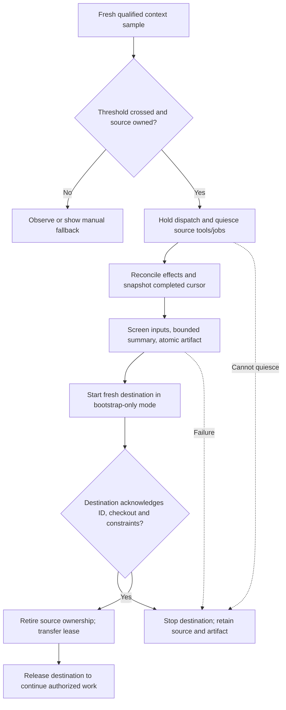

# 08 · Features and optimizations

Checked **2026-10-04**. Repository baseline: `8e835a5`, with the existing research/skill changes left intact. Local client: **Codex CLI 0.160.0**; Claude Code is absent. This is research and a proposed design, with no installation, host control, private database access or model runs.

**Subsequent owner steering, same date:** [09-opencode-clef.md](09-opencode-clef.md) makes OpenCode primary while retaining all three native hosts, and replaces Kev with Clef-Flash through Ollama. This note's handoff matrix and selected router evaluation below include that revision; historical v0.2 findings remain unchanged.

## 1. Question

Beyond the runtime, protocol, libraries, seven ports, daemon, architecture and graph-memory work in [topics 1–7](README.md), which additions earn their implementation cost? The required external-model compact/handoff feature must continue authorized work in a genuinely fresh context and also support moving work between Macs.

## 2. TL;DR

- Build the required **fresh-session handoff controller**, with `[compact] enabled`, `model` and `threshold = 0.70`; keep native host compaction enabled as overflow protection. External summarization and native compaction are separate operations.
- Automate continuation only for sessions owned by a supported adapter. Observe active context occupancy, quiesce work, save durable state, start a fresh session, receive acknowledgement, then transfer ownership. Existing UI sessions get a manual fresh-start/`/clear` path.
- Make the same versioned handoff artifact portable. A summary transfers task state; dirty files, credentials, tools and model access require separate reconciliation.
- Fix **route-log prompt retention** immediately; redact secrets before indexing, extraction and export. Topic 7's rule is absolute: private content never enters any model, including a local model.
- Add **quota-aware holds**, preserving the chosen model and authorization. Work and Codex share usage; they are not two fallback pools. Never repeat a mutation whose outcome is uncertain.
- Evaluate Clef-Flash against held-out, owner-labelled examples and deterministic rules before activating routing thresholds. Track outcomes separately from model self-reports; retain advisory routing and main-thread handling of high risk. No online policy learning.
- Add a content-free, provider-unit-aware job ledger, plus a small deterministic risk/review evidence gate and onboarding diagnostics.
- Complete the Ink dashboard, cache-stability evaluation/rendering, bounded consolidation, local notifications, worktree lifecycle, remote authority/local views and sanitized profile export within the same v1.0 build. Fold the measured stdout fix into hook extraction. Offline multi-master memory sync and a plugin ecosystem remain outside the selected scope.

## 3. bosun constraints

| Constraint | Consequence |
|---|---|
| Owner first, one or two Macs; no server Mac yet; one complete release | Build one-Mac recovery and portable handoff first, then authenticated remote authority/local views within the same build. Test separate daemon instances without provisioning a server. |
| Seven ports, host orchestration, no own agent loop in v1.0 | Add use cases over HostAdapter/AgentRunner/ModelProvider/Workspace; a summary request is not a generic agent loop. |
| Per-prompt hook: no inference, compiled wall target ≤15 ms p95 with warm daemon | Monitoring hooks send tiny samples/IDs; summarization, indexing and quota refresh run in daemon jobs. |
| Recorded `cart-service` incident: ~675k tokens reread per turn, 52% of the day's usage | Owner evidence motivates earlier handoff, but does not establish uncached billable tokens, current occupancy, or a savings percentage. |
| Two Claude usage-limit interruptions during this research | Jobs need durable holds and explicit continuation; neither provider access nor reset telemetry is guaranteed. |
| Existing privacy and scope promises | Restrict every derivative and handoff; preserve deletion/expiry invalidation, and never infer permission from a summary. |
| [Current config](../../lib/config.ts), [routing](../../lib/route.ts) and [wiring](../../lib/wire.ts) | No compact settings, monitor or fresh-session controller exists today. `spec()` parses a different `model:effort` contract. |

These constraints come from [owner decisions](README.md#owner-answers-2026-10-01), portable context (`../../RESUME.md`; historical citation, recover via `21d5dc6:PATH`), [architecture](06-architecture.md) and [graph-memory policy](07-graph-memory.md#65-write-path-temporal-truth-and-invalidation). Earlier foundation estimates must not be added again to this feature list.

## 4. Options and ranked candidates

Engineer-days are **estimates for one maintainer after the relevant foundations exist**, including meaningful adapter validation/docs. They are not measured throughput. H = high value; M = medium; L = low. Ranking combines owner need, avoided failures and effort; mandatory #1 overrides a pure ratio ranking.

| Rank | Candidate: problem → approach | Dependencies | Days | Value | Main risk / call |
|---|---|---|---:|---|---|
| **1** | Huge repeated context → bounded external summaries and acknowledged fresh-session continuation (§6.1) | T2 jobs/events; T4 host/runner/provider/workspace; T5 daemon; T6 ownership; T7 lineage | **12–18** | H, required | Lost constraints or duplicate effects; ship only qualified adapters. |
| **2** | Prompt log contradicts privacy promise; unscreened docs → remove content logs, deterministic ingress/export screening (§6.3) | T3 logging; T6 policy; T7 private/derivative rules | **1–2** | H | Redaction misses/false positives; no “scanner proves safe” claim. |
| **3** | Usage-limit interruptions → quota signal adapters, durable holds and policy-constrained cross lane (§6.2) | T4 runner/router; T5 jobs; T6 uncertain-outcome errors | **5–7** | H | Stale limits, silent model substitution, replay; hold by default. |
| **4** | Machine switches lose task state → export/import the #1 artifact with checkout reconciliation (§6.1.6) | #1 artifact; Workspace; T7 project IDs | **2–4** | H | Summary without actual dirty work; incremental effort beyond #1. |
| **5** | Clef routing/calibration unverified; old eval reuses tuning labels → held-out routing/outcome fixture (§6.4) | #2 privacy; Router; task/job IDs | **3–5** | H | Biased labels and feedback loops; concentration is not accuracy; no automatic fine-tuning. |
| **6** | Timings exist but lane costs do not → provider-specific usage ledger and report (§6.4) | T2 events; T4 runner/provider; T5 job storage | **2–4** | H | Mispriced subscription usage, double-counting parent/child calls. |
| **7** | High-risk policy is prose; reviews can become stale → deterministic dispatch restrictions and revision-bound review evidence (§6.5) | T6 policy; runner fences; #3 holds | **3–5** | H | Heuristics miss risk; main-thread review stays required. |
| **8** | Built but not installed; host assumptions unverified → read-only doctor, capability report and onboarding (§6.5) | T4 wiring; T5 install manifest/release | **2–3** | H | Diagnostics accidentally alter config or start a paid turn. |
| 9 | Volatile injected content can hurt prefix reuse → stable rendering/context packs with cache observations (§6.6) | T7 packing; #6 usage | 1–2 | M | Hook cannot control host cache placement; eval-gated. |
| 10 | Import-time stdout access costs time → lazy terminal formatting and single correct hook output (§5) | T3/T6 hook extraction | 0.25–0.5 | M, cheap | Truncated output on exit; folded into foundation, not new scope. |
| 11 | Consolidation is manual/newest-20 → bounded scheduled proposal jobs with cursor/backpressure (§6.6) | T5 daemon; T7 approved extraction/lineage | 2–4 | M | Quota use, review backlog, stale source; scheduling increment only. |
| 12 | User misses held/done jobs → deduplicated local terminal/desktop notifications (§6.6) | T2 SSE; T5 jobs | 0.5–1 | M | Sensitive text on lock screen; opaque IDs/status only. |
| 13 | Plain worktrees lack lifecycle UI → list/reconcile/prune previews after job retirement (§6.6) | T4 Workspace, T5 job registry | 1–2 | M | Deleting dirty or active work; basic worktree adapter already funded. |
| 14 | Two Macs need consistent memory → authoritative remote store plus permitted local read views | T2 authentication; T5 serve; T7 invalidation | 1–3 | M | Same-build remote phase; estimate covers views after prerequisites. No offline writes or live DB copying. |
| 15 | Dashboard included in v1.0 → Ink view of existing jobs/quota/handoff/events | T3 Ink; T2 SSE; #1/#3/#6 | 4–6 | M | Build after reliable CLI/SSE state, before the single ship gate. |
| 16 | Publishing readiness → sanitized declarative profile/skill export | T4 standards; T5 manifest | 0.5–1 | L | Credential/path leakage; same build, no executable plugin system. |

### Evidence and prior art

The owner incidents support #1/#3/#4; they are reported observations, not independently collected benchmarks. Source-specific telemetry and control evidence appears below. Existing [run/review fences](../../lib/exec.ts), [risk override](../../lib/route.ts), [metrics](../../lib/metrics.ts), [consolidation](../../lib/consolidate.ts), [docs index](../../lib/memory/docs.ts), [roles](../../roles/reviewer.md) and [ship evidence gate](../../skills/bosun-ship/SKILL.md) establish what already exists and what the increments add.

Borrow lifecycle notifications and explicit completion from [Codex app-server](https://learn.chatgpt.com/docs/app-server), not UI keystroke automation. Borrow secret detection patterns from [Gitleaks](https://github.com/gitleaks/gitleaks), which supports stdin/directory scanning; use an optional pinned executable off the hook rather than importing a large detector. [Git worktree](https://git-scm.com/docs/git-worktree) supplies list/lock/remove semantics; Git already refuses normal removal of dirty trees. Cache reuse depends on matching rendered prefixes, not just a stable cache key: [OpenAI caching](https://developers.openai.com/api/docs/guides/prompt-caching), [Claude Code caching](https://code.claude.com/docs/en/prompt-caching).

## 5. Measurements and source audit

**No new performance or quality measurements.** Node `node:child_process` invoked only version/help and schema-export commands. These exited successfully; no agent session or model inference was started:

```sh
codex --version
codex --help
codex exec --help
codex app-server --help
codex app-server generate-json-schema --help
codex app-server generate-json-schema --out /tmp/bosun-research-q4qYDt/research-8/codex-schema
```

Observed: `codex-cli 0.160.0`; `exec` supports explicit model, JSONL, output schema, ephemeral execution and resume/fork. Its app-server schema contains `thread/start`, `thread/tokenUsage/updated`, `thread/compact/start`, `contextCompaction` and `account/rateLimits/read`. `ThreadTokenUsage` has `last`, `total`, nullable `modelContextWindow`; the notification has thread/turn IDs. Schema presence establishes protocol shapes, **not** verified live occupancy semantics, permission boundaries or successful continuation. There is no `codex compact` subcommand in the inspected help. Claude is absent, so no Claude live/version claim.

Prior **same-machine** results from [topic 3 §5.3](03-libraries.md#53-hot-path-probes-processstdout-and-env): touching stdout added +3.6 ms in an empty compiled program and +0.9 ms in a real UDS thin client. These are earlier M5 Pro/Bun 1.4.2 measurements, not a benchmark on this Mac or a guaranteed v1.0 saving. Fix import-time `process.stdout.isTTY` in [util.ts](../../lib/util.ts) during extraction; verify output draining before removing exit flushes.

Cost/latency evidence is limited to those earlier probes, the reported owner incidents, host usage fields and provider docs. No local summarizer speed, accepted-summary rate, subscription-dollar saving or warm-cache improvement was measured. All days, token caps and activation targets below are engineering estimates/proposed product gates.

## 6. Recommendation

### 6.1 Required external-model compact / handoff

#### 6.1.1 Configuration and capability boundary

```toml
[compact]
enabled = true
model = "ollama:qwen3:8b"
threshold = 0.70
# optional adapter-specific settings, validated separately:
# effort = "low"
```

These are planned v1.0 settings. Split `model` at the **first** provider separator: provider `ollama`, model `qwen3:8b`. Do not reuse v0.2's `split(':')` `model:effort` parser; effort is a separate typed option. Resolve any registered ModelProvider, enforce its allowed input policy/context size, and preserve the host continuation model independently. The example model is not installed or selected for this research. Invalid provider/model/window/threshold reports a config error; never silently choose another model.

Enable the feature in the v1.0 profile, but report each session as `automatic`, `manual`, or `unavailable` according to validated adapter capabilities. Automatic requires usage telemetry, source ownership, quiescence, fresh-start control and acknowledgement. A new Workspace capability must return an actual fresh-session handle, not merely a terminal/worktree ID. Starting an Orca agent is a candidate Workspace implementation; its start/ack/retirement behavior still needs qualification. Existing arbitrary Claude/ChatGPT Work/Codex UI chats remain manual; a managed API control is not access to those sessions.

#### 6.1.2 Verified host surfaces

| Host | Reading context / lifecycle | Native controls and trigger limits | Fresh continuation |
|---|---|---|---|
| OpenCode, primary; inspected v1.18.34 source/docs | Native server messages/status/SSE and plugin events; latest completed step/assistant provider/model/usage is the occupancy candidate, not cumulative session totals | Native summarize/abort/status and plugin callbacks; effective context/output reserve differs by model. v1 compacting changes prompt; v2 result hooks are a separate contract | New root session; `noReply` seed is a candidate idle startup barrier. Qualify admission fencing, tool quiescence, deterministic acknowledgement/ownership and destination TUI selection; fork/resume/native summarize are not fresh handoff |
| Claude Code, documented | Statusline JSON: `model.id`, `context_window.context_window_size`, `current_usage`, `used_percentage`. Hooks give `transcript_path`; `PreCompact`, `PostCompact` and `SessionStart(source=compact)` observe native lifecycle. | `CLAUDE_AUTOCOMPACT_PCT_OVERRIDE` lowers supported proactive thresholds; auto-compact window controls are separate. `DISABLE_AUTO_COMPACT` and `DISABLE_COMPACT` exist. PreCompact can block native compaction; it cannot select bosun's summary as its replacement or request a clear. | Controlled new CLI session or qualified Workspace start, summary through SessionStart `additionalContext`/initial input. Manual UI: save artifact, user starts new session or `/clear`, then loads it. |
| Codex 0.160.0 schema + current docs | App-server `thread/tokenUsage/updated`: `last`, `total`, nullable window; model identity comes from thread/turn state. Hooks include transcript path/model, Pre/PostCompact and SessionStart compact; hook transcript format is unstable and occupancy is not supplied there. | `model_auto_compact_token_limit`; scope `total` or `body_after_prefix`. Owned app-server `thread/compact/start` returns immediately; await completed `contextCompaction`. Hooks can stop at compact boundaries, not install an external compactor. | Owned app-server `thread/start` with no history/restore, then summary input; a fresh `codex exec` is another bounded runner path. Resume/fork carry history and are not resets. |

Primary sources: [Claude statusline](https://code.claude.com/docs/en/statusline#context-window-fields), [Claude hooks](https://code.claude.com/docs/en/hooks#precompact), [environment variables](https://code.claude.com/docs/en/env-vars), [model/window controls](https://code.claude.com/docs/en/model-config#context-window-and-auto-compaction), [Codex hooks](https://learn.chatgpt.com/docs/hooks#precompact), [config reference](https://learn.chatgpt.com/docs/config-file/config-reference), [app-server compaction](https://learn.chatgpt.com/docs/app-server#trigger-thread-compaction). Current Claude thresholds vary by model/session; do not hard-code a universal “95%”.

OpenCode sources and qualification details: [native server](https://opencode.ai/docs/server/), [context-only SDK submission](https://opencode.ai/docs/sdk/) and [topic 9's inspected native design](09-opencode-clef.md#6-opencode-integration-design). All three managed hosts belong to the selected release; capability differences need a recorded resolution, not silent support deferral.

**Keep native overflow protection on.** Never set Claude's disable variables or block native compaction by default; leave Codex's native threshold at its supported model setting. Native threshold controls do not appoint an arbitrary external ModelProvider. A SessionStart summary on resume/compact merely adds context; only a fresh session/clear removes prior conversation from the next request. Native compact can be used as a supported recovery option independently, with a visible outcome, never called “external handoff completed”.

#### 6.1.3 Active occupancy contract and trigger

Normalize `sessionId`, `turnId`, `modelId`, `usedTokens`, `windowTokens`, `scope`, `observedAt`, sequence/generation, quality (`observed|estimated|unknown`) and native auto-limit separately. `windowTokens` is the **effective active host/model capacity**, including configured smaller windows; do not substitute an API catalog maximum. The default fraction compares total active input against that capacity, with explicit output/next-tool headroom. Cumulative billed usage belongs to the ledger, never this trigger.

- Claude's documented percentage uses input + cache-create + cache-read tokens, excluding output; cached input still occupies context. Capture model/window and use that formula once, with an output reserve rather than adding cumulative totals. Statusline percentage describes the full model window; a smaller `CLAUDE_CODE_AUTO_COMPACT_WINDOW` controls native compaction separately. **Preserve 0.70's full-window meaning:** if native compaction occurs earlier, report `native_threshold_preempts_handoff`; do not silently reinterpret the denominator or raise the native threshold. For example, a 1M model with a 200k native window can compact before bosun reaches 700k. That configuration has **unsupported automatic handoff** until a documented compatible managed-profile setting or explicitly chosen earlier threshold is validated; a warning/manual artifact is not automatic success. Chain/preserve the owner's existing statusline instead of replacing it.
- For owned Codex threads, `last` is the latest-request usage candidate; do **not** use cumulative `total` or double-add cached input/reasoning breakdowns. Schema alone does not establish exact occupancy, retained-output or prefix semantics. Qualify the adapter with controlled long-turn/native-reset/model-switch fixtures and host-reported context; until then mark occupancy unknown and disable automatic triggering. Unsupported transcript parsing stays an opt-in, version-pinned estimate/manual warning, not a reliable controller.
- Track full prefix + body for bosun's 0.70 trigger. Codex's `body_after_prefix` native setting counts a different scope; record it, never divide a body-only number by a full window. If effective prefix/body/window cannot be established, fall back to unknown/manual. Model changes invalidate the sample and budget until a new matching observation arrives.
- Null/unavailable/pre-first-call samples are unknown, not zero. Reject out-of-order, other-session and stale samples; proposed default freshness ≤30 s **and** matching latest completed turn. Do not repeatedly act on an old statusline replay. Large in-flight tools can outgrow the last observation; native protection remains necessary.
- Trigger once on a fresh crossing, queue at a completed tool/turn boundary, and debounce by session/model/context generation. A first valid already-high sample may queue once. Rearm below 0.60 or after an acknowledged fresh start/native compact **plus** a new usage sample; no reset merely from launching a process. Cancel obsolete queued work on native compaction; reconcile a snapshot already in progress before restarting it.
- Daemon unavailable, summary failure or missing controls → keep source intact, report manual handoff readiness and retain native compaction. Hooks only enqueue IDs/samples within the existing budget; they never summarize, wait for a model, or recursively trigger bosun.

#### 6.1.4 Bounded summarization and model choices

Read only authorized non-private source events, relevant file-state facts and current instructions through adapter/ContextSource APIs. `transcript_path` identifies a potential input, not permission to ingest the entire file. Validate paths/session identity and apply ingress policy before reading/persisting chunks; unknown privacy/scope makes a chunk ineligible for model use. Preserve source revisions/spans, native compaction boundaries and a completed-event cursor; do not count a transcript tool request as proof its effect finished.

Default proposal: fixed deterministic constraints/task block; ≤8k input-token chunks; bounded ≤1k rolling factual summary; final continuation body ≤2k tokens plus the constraints block and evidence references. Validate the complete request against the **summarizer's** effective window/output reserve using its tokenizer or a conservative measured estimate. An initial 16k local context is a candidate to evaluate, not a requirement or hardware guarantee. Split oversized tool outputs, retain small source excerpts/paths for recovery, and persist each accepted chunk/cursor atomically. New summaries cover only events after the cursor; failed/incomplete chunks never advance it. Periodically rebuild from retained evidence to check drift rather than summarizing summaries forever.

A local 8B model cannot accept a ~675k-token history in one configured small-window call. Bootstrap chunking can require many sequential calls and a noticeable pause; incremental summaries during completed turns reduce the final critical path. Do not discard unprocessed history because a deadline was reached. [Ollama context configuration](https://docs.ollama.com/context-length) and [structured outputs](https://docs.ollama.com/capabilities/structured-outputs) support sizing/schema output, not faithfulness or any promised latency.

| ModelProvider | Proposed handoff use | Boundary / evaluation |
|---|---|---|
| `ollama:qwen3:8b`, other local/OpenAI-compatible models | First inexpensive candidate; bounded schema summaries, conservative context cap | Evaluate cold/warm latency, retained constraints, quantization and thinking controls; no model calls with private inputs. |
| Explicit API provider/model | Optional when configured; one bounded summary generation per chunk | Separate API authentication/billing and scope; unavailable access means hold, not subscription credential reuse. |
| `claude-cli:<selected model>` | Optional native `claude -p` summary through user's supported login | Disable built-in tools (`--tools ""`) **and** MCP, hooks/extensions; no persistence; explicit model/effort and output schema. Verify full isolation on installed version. |
| `codex-cli:<selected model>` | Optional native CLI summary, using installed model/schema/ephemeral support | Config documents `features.shell_tool=false`, `agents.enabled=false` and `web_search="disabled"`; these are partial controls. Also fence plugins/MCP/hooks/other tools and prove approved-input-only behavior. 0.160.0 help has no universal no-tools flag; gate until verified. |

The later owner instruction explicitly allows **any ModelProvider, including native CLI summarizers**. This is a narrow handoff-specific exception to [topic 4's no-ChatGPT-plan own-inference default](04-abstractions.md#7-open-questions-for-the-owner), which stays in place for router/consolidation. Native CLIs retain their own supported authentication; bosun never reads/copies/intermediates subscription tokens. No new generic loop or automatic native-model substitutions. The [Claude CLI reference](https://code.claude.com/docs/en/cli-reference#cli-flags) distinguishes tools from permission allowlists; [Codex authentication](https://learn.chatgpt.com/docs/auth) distinguishes subscription and API use.

Keep the summary model independent of the continuing host model; preserve an explicit Sonnet or other selected model. Store effort in its own field and validate per provider/client. Proposed starting eval uses low effort or disabled optional thinking where supported for simple extraction, plus one higher-effort comparison on difficult constraints; do not assume host/API effort labels are interchangeable. [Current Work/Codex models](https://learn.chatgpt.com/docs/models) establish model/effort selection, not access on this account.

#### 6.1.5 Atomic artifact, acknowledgement and recovery

Store a versioned JSON manifest and readable Markdown under `~/.bosun/handoffs/<id>/`, directory 0700, files 0600. Use sibling exclusive temporary files, validate + fsync, rename on the same filesystem, sync the parent directory, then commit a content-free job pointer; never publish half a handoff. Checksums bind the manifest, summary and any export bundle. A crash between filesystem publication and job state is reconciled by immutable handoff ID/generation. [Node filesystem APIs](https://nodejs.org/api/fs.html) provide the necessary primitives; crash durability still needs failure-injection validation on supported macOS/filesystems.

Required fields: objective/latest steering; exact constraints/permissions and pending approvals; accepted decisions with source references; unresolved questions; source host/session/model/effort; completed-event cursor and uncertain tool effects; last completed work and immediate next action; repository identity/relative paths, branch/commit, staged/unstaged/untracked file manifest and hashes; verification commands/outcomes/revisions; running jobs and reconciliation instructions; artifact policy/lineage/version. Keep permission facts deterministically, not solely in model-generated prose. Missing mandatory fields prevents automatic continuation.



The daemon holds one ownership lease/generation per task/worktree. Wait for tools/background jobs to settle, or use a supported cancel and reconcile actual effects. Unknown writes/requests are a blocked reconciliation item, **never automatically replayed**. Enforce the destination barrier in the **controller**, not by a summary prompt saying “wait”: create an idle Codex thread without a work turn, or use a version-verified tools-disabled readiness turn/process gate. Read-only alone can still issue external effects, so close tool/agent dispatch until transfer. If a CLI/Workspace cannot enforce this barrier, safe automatic takeover is unsupported. A protocol startup event proves process/session creation; require a further acknowledgement of handoff ID/hash, fresh session ID, checkout match and exact loaded bootstrap constraints. Validate required MCP/provider availability; carry missing tools as a hold.

After acknowledgement, fence source dispatch and use a durable compare-and-swap from its expected owner/generation to the acknowledged destination, recording retirement in the same ownership transaction; then release destination. Source transcript/files remain recoverable; retirement is not deletion. If source cannot be fenced/retired, automatic transfer is unavailable. Timeout, summarizer crash, checksum mismatch, quota loss, model mismatch or startup failure preserves the source; stop/reconcile destination before resuming source. Crash after acknowledgement but before transfer leaves source ownership and a blocked destination; crash after transfer requires destination release/reconciliation, never source restart. Inspect durable leases before any recovery execution. Content-free events expose `queued/quiescing/summarizing/ready/starting/acknowledged/transferred/failed`.

Resume input: load the explicitly selected artifact via SessionStart `additionalContext` where supported, or an initial fresh-session input. Revalidate it against current repo and authorization. Native compact's SessionStart hook may restore small current constraints, but must not append the full handoff repeatedly. An optional topic-7 **L0 reference** points to the artifact under its scope/expiry policy; do not auto-promote a handoff to an accepted fact/profile. Privacy changes/deletion revoke derivatives and cached packs; exported copies need explicit lifecycle/retention accounting.

#### 6.1.6 Portable machine handoff

Export the same manifest/Markdown by explicit command, with relative repo paths and no local transcripts/credentials by default. Import checks version/checksums/project identity/base commit/files, remaps paths, lists unavailable tools/models/MCP and asks only unresolved task questions. A portable document cannot move dirty files, account access, running processes or live connectors.

An explicit `--include-worktree` export may attach a secret-screened tracked binary patch plus allowlisted untracked files and hashes; preserve staging information separately. Apply only after base/current-file checks in an isolated checkout, with conflicts reported and no overwrite of unrelated user changes. A [Git bundle](https://git-scm.com/docs/git-bundle) can transport committed refs/objects and verify prerequisites; it does not package uncommitted work. Neither option copies live SQLite databases, auth directories or sockets. Cross-machine automatic transfer requires an authenticated ownership acknowledgement from both machines; default is manual export/import while source remains safely held.

#### 6.1.7 Quick summary and continuation eval

Spend **2–3 of #1's days** on a small consented fixture before enabling automatic continuation. No eval was run here. Use 12 sanitized/synthetic sessions spanning short, long, native-compacted, interrupted-tool, changing-instruction and two-machine cases. Label hard constraints, decisions, source IDs and next action before generation. Include malicious transcript instructions and synthetic private canaries that the policy rejects **before** any model call.

Compare A host-native compaction; B fresh handoff with local 8B; C fresh handoff with an explicitly available native CLI/API model; D deterministic document/file-state handoff. A tests native compression, B–D test a different continuation operation: report those arms separately. Use equivalent starting snapshots and caps, local cold/warm runs, and at least three repeats for timing; record exact model/quantization/effort/client/window/chunk sizes and source versions.

Proposed gates: zero lost permissions/prohibitions/accepted decisions; zero private/secret leakage or duplicate tool effects; complete completed-event coverage/cursor; ≥95% labelled actionable facts with no unsupported critical claims; correct immediate next action in ≥11/12 cases. Review failed cases manually and expand the fixture before broader activation. Native overflow fallback must remain functional. Verify that a destination cannot execute a task/tool before ownership transfer; inject failure at each publication/start/ack/CAS/release boundary without an actual destructive tool.

Record summary latency p50/p95, cold model load, final pause, input/cache/output tokens, first destination turn usage, review/recovery time and bootstrap cost. Initial product target: final incremental pause ≤15 s p95 on the designated Mac; bootstrap allowed up to 120 s before falling back to manual readiness. These are targets, not predictions. Compare total session usage/quality over several continuations; savings must include chunk summaries, lost cache prefix and startup calls. A failed 8B quality/latency gate selects no automatic default: leave the configured candidate unavailable or use an **explicitly configured** alternative, with the source preserved.

### 6.2 Usage-limit-aware routing and holds

Use supported quota signals, not private session DBs or scraped account pages. Codex documents `account/rateLimits/read`/updates, nullable windows/bucket IDs and reset times; local schema confirms availability of those shapes. Claude's current statusline documents optional five-hour/seven-day usage/reset fields, and `StopFailure(error=rate_limit)` can supply a failure signal. Neither proves proactive headroom for every client/account. See [Codex account limits](https://learn.chatgpt.com/docs/app-server#6-rate-limits-chatgpt), [Claude rate-limit fields](https://code.claude.com/docs/en/statusline#available-data), [Claude StopFailure](https://code.claude.com/docs/en/hooks#stopfailure).

Normalize provider/account bucket, model-specific restrictions when supplied, observation time, remaining/reset and confidence. Merge sparse updates against a recent supported snapshot; expired/absent data stays unknown. Check at dispatch and on failure, not on every hook. Proposed conservative default: hold new background work with <10% known quota remaining, refresh at reset, and resume only after supported access/state verification. Reset time alone is not proof of renewed access.

The cross lane chooses another **allowed vendor/model before execution** only when the task's policy permits it; it is not a new semantic role. Explicit Sonnet/vendor/effort choices pin the job. Usage-limit interruption persists checkpoint, effects and hold reason; retry only an unstarted task or an established safe read. A started mutation with unknown outcome requires reconciliation even if another provider has capacity. Preserve same-/cross-vendor review status visibly; do not silently relabel a fallback review as independent.

[Work/Codex pricing](https://learn.chatgpt.com/docs/pricing) states their usage is shared. Switching between these surfaces provides no second quota pool. Subscription buckets/credits, API spend and local runtime are separate; a paid overage/reset purchase is never automatic. Missing telemetry means no invented balance; known exhaustion means hold, with local status/notification and explicit override options already permitted by the task.

### 6.3 Secret minimization before writes and export

[route.ts](../../lib/route.ts) logs `prompt.slice(0, 300)` to `route-log.jsonl` and hashes the prompt into a short ID. [README](../../README.md#memory) promises no prompt content in logs. Replace with a random decision ID plus schema-allowlisted timestamp/lane/confidence/risk/model/duration/outcome; no prompt, title, path, plaintext error or deterministic prompt fingerprint. Explicitly labelled redacted eval fixtures live in a separate owner-controlled artifact, not operational logs. Offer a previewed migration to scrub existing route-log content; do not silently delete historical files.

Apply deterministic secret screening **before** docs FTS writes, memory suggestions/extraction/embeddings, transcript chunk storage and handoff/profile/patch export. Candidate baseline: known credential patterns/private-key blocks plus optional pinned Gitleaks stdin/dir scan in daemon jobs. If screening fails or finds a suspected secret, reject the memory/index/model/export operation and expose only a withheld-item reference for owner review; do not persist the matched value in a new quarantine/log. Scanner reports contain rule/opaque IDs, never the matched secret. False positives are reviewed through the owner's CLI; a “no match” cannot override source privacy.

Reuse topic 7's derivative policy: visibility is the intersection of source scopes; private is OR; expiry is earliest support expiry; restrictions/deletion invalidate edges, summaries, vectors and caches before serving them. Redaction cannot make a private source model-eligible. Untrusted source text never overrides instructions or gains tools. This row funds the concrete log fix and ingress/export integration; it does not re-estimate topic 7's full lineage/privacy foundation.

### 6.4 Router evals, outcomes and usage ledger

Current [label/eval code](../../lib/route.ts) calculates threshold coverage/accuracy on the same labelled decisions used for tuning, with no held-out split, risk-miss metric or completed-task outcome. Extend to ~80 redacted owner-authored tasks, grouped by session/repo: 20 development, 60 held-out; include high-risk, ambiguous, simple edits, cross-vendor constraints and no-delegation requests. Compare Clef-Flash and deterministic rules under identical lanes; optionally include existing permitted/redacted Kev results without making the obsolete service a new dependency. Measure harmful delegation/risk misses, abstention, coverage, calibration, override rate, verify failures/escalations and latency, not only raw accuracy. Clef's concentration/confidence is not probability of correctness; tune on development data and freeze before the held-out pass.

Activation target: zero high-risk forbidden delegations on the fixture, ≥90% correct among offered hints, and held-out improvement over the existing rule baseline without breaking the hook budget. Report uncertainty/category failures; a small fixture cannot prove production safety. Outcome labels come from actual verification/review and owner judgement; model self-ratings are not ground truth. Use shadow mode and reviewed threshold proposals; do not retrain the router or change permissions automatically. Clef inference occurs outside hook/plugin callbacks; absent completed hints preserve main-thread handling.

Expand [metrics/LLM usage](../../lib/metrics.ts) into per-job attempts linked by task/job/parent ID, lane, provider, exact model/effort, start/end, reason, active context samples and source unit/coverage. Deduplicate event IDs; split inclusive parent totals from exclusive child attempts. Record actual provider input/cache-write/cache-read/output/reasoning counters only where supplied, with estimates explicitly marked. [Ollama chat](https://docs.ollama.com/api/chat) reports prompt/eval counts, cache counts and durations; native CLI schemas may expose different/missing fields. These are not interchangeable.

Report provider-specific units: subscription bucket percentages/credits when available; API USD only with observed token categories and a dated applicable rate card; local inference seconds/tokens and separately measured energy if available. Missing cache-write or pricing fields means an incomplete estimate, not fabricated dollar savings. Context reread count is not billed usage and a local model is not free hardware/energy. Default retention: 30 days for attempt telemetry, longer content-free daily aggregates; no prompts in ledger exports.

### 6.5 Small policy/review gate and onboarding

Extend existing [decide](../../lib/route.ts), [policy](../../policy.md) and runner fences with deterministic **dispatch** rules, independent of Clef scores: high risk → main planning and read-only reviewer; explicit no-delegation/exact-model restrictions win; unknown risk can abstain; no approval expansion. Map task files/declared operations and narrow risk paths to rules; natural-language keyword detection alone cannot catch risk. This gate constrains bosun-owned jobs, not arbitrary host actions; native host permission/sandbox controls remain authoritative. No general policy DSL or classifier-approved autonomous high-risk execution.

Bind review/check evidence to branch/base/commit plus tracked/untracked content hash and verify-command version. Changed files invalidate that evidence. Reuse `bosun review` only at explicit task/workflow checkpoints; batch related changes and cap retries/review quota. Findings remain proposals verified against code; never auto-fix, merge or approve a diff. This turns the existing skill evidence gate into durable status without replacing main-thread judgement.

Doctor/onboarding should expose binary/daemon skew, effective config provenance, host version/capability matrix, hook trust/install state, privacy policy, summarizer readiness, quota-signal age, manual/automatic handoff mode and exact undo/dry-run. A diagnosis does not start a model, log in, trust hooks, download models or modify personal config. Installation actions remain explicit commands under topic 5's manifest. Publish a concise first-run path, outage/recovery and two-Mac recipes, expected cost units and honest support limitations; docs effort here excludes the already funded binary/installer implementation.

### 6.6 Remaining v1.0 work after core dependencies

Stable context rendering: deterministic item order, stable headers/IDs, no changing elapsed-ms/timestamp in reusable instructions; keep dynamic task context late where the host permits. Today's route hint includes `d.ms`; remove that volatile detail from model-visible prose and keep it in metrics. Reuse a permitted materialized pack only while policy/source generations remain valid. Prompt caching needs exact rendered-prefix reuse, and bosun's hook cannot move host cache breakpoints. Compare actual cache counters and retrieval quality before pinning session memory; never retain stale facts just to obtain cache hits. No padding the ~400-token hook pack to an API cache threshold.

Consolidation scheduling: one bounded daemon worker, completed-source cursor, model/token/time budget, low priority behind interactive jobs, quota holds, cancellation and a small proposal queue (default ≤20 outstanding). Idle daily scheduling is a candidate; accepted facts/relations still require review. Separate the ops increment from topic 7's extraction/index work; avoid newest-20 starvation or re-extracting every summary each day.

Notifications: opt-in local held/failed/ready/done events, deduped by job/state generation, no prompt/file/secret previews. Reuse supported host notifications where adequate; a cross-machine notification service is outside the selected local-notification scope. Worktrees: maintain ownership/branch/job mapping, show prune previews, refuse active/dirty/untracked worktree removal and never use force cleanup by default. [Git's lifecycle](https://git-scm.com/docs/git-worktree) supplies safe primitives; Workspaces are not automatically replicated between Macs.

Memory sync: topic 7's authoritative remote store + asynchronously refreshed permitted local views; maintain invalidation generations and expiry offline, and visibly fail writes during outage. Validate two isolated daemon instances/checkouts in this build; actual server provisioning is separate. No CRDT, multi-writer merge or copied WAL/SQLite files. TUI: a v1.0 dashboard over existing state/SSE, with read-only views and explicit job actions; no extra daemon or separate state machine. Profile sharing: sanitized TOML/Agent Skills exports with credential placeholders, compatibility/capability checks and install preview in the same build; compiled adapters/ACP/MCP remain the extension story.

### 6.7 Hard cut: not building

- A replacement native compactor or a hook that “clears” arbitrary current sessions; resume/fork/SessionStart injection presented as a context reset.
- Whole-history ~675k-token calls to a small local model, summarization on the hook, or blind repeated summaries without source cursor/evidence.
- Subscription token borrowing, default paid overage, hidden model/vendor substitution, or automatic replay after ambiguous mutations.
- Online router fine-tuning/reinforcement learning, auto-promoted memory/profile changes, or a generic bosun model/tool agent loop in v1.0.
- Full policy DSL/OPA service, autonomous high-risk actions, auto-fix/auto-merge review bots, Slack/email integrations or notification service.
- Offline multi-master memory sync, CRDTs, live SQLite/WAL copying, automatic auth/MCP/worktree migration, global memory sharing.
- A plugin marketplace, new executable plugin protocol or cross-platform GUI. The selected Ink dashboard is included in v1.0. HTTP/2/3, multiple binaries and ORM remain cut by topics 1–6.

## 7. Open questions for the owner

No routine answer blocks this research or initial design. Defaults: owned-session automation only; manual UI fallback; preserve selected host model; local `ollama:qwen3:8b` is the first eval candidate; 0.70 total-context threshold; native protection on; no paid fallback; secret-screened explicitly selected inputs; no private model use; CLI/SSE before TUI.

Only later evidence changes the call: a consented non-private fixture for summary/router evals (default synthetic/manually redacted), installed Claude capability validation (default unsupported automatic mode until verified), and a Codex tool-free summarizer contract (default provider gated). A desired paid summarizer or automatic cross-vendor substitution must be an explicit configuration/task policy choice; absence means hold, not a new approval round for writing the research.

## 8. Roadmap implications

1. **Before new inference/export:** land #2's route-log minimization and screening integration alongside topic 7's no-model private policy. Fold stdout fix into the existing hook extraction; do not claim both as independent performance projects.
2. **During foundation migration:** add capability/sample/ownership contracts, durable job states and content-free ledger (#6). Preserve current fallbacks; do not market handoff automation from hooks alone.
3. **Required v1.0 handoff slice:** portable schema/manual export first; bounded summarizer and fixtures; qualified Codex/Claude owned-session adapters; quiesce/start/ack/lease recovery; manual UI route. #1 = 12–18 days including eval; #4 adds 2–4 days for bundle/import UX beyond the same artifact.
4. **v1.0 resilience:** #3 quota holds/cross lane, #5 held-out routing evaluation, #7 deterministic dispatch/review evidence and #8 onboarding. Quota and handoff both preserve exact model/permissions and uncertain effects.
5. **After useful state exists, within the same build:** cache-stability evaluation/rendering, bounded consolidation/notifications, worktree lifecycle, Ink dashboard, sanitized profile export and two-Mac authoritative views. The owner requires all selected work before one v1.0 ship gate. Validate remote software without requiring purchase/provisioning of a server Mac.

Top-eight increments total **30–48 engineer-days** before overlap with existing jobs/privacy/installer work; the remaining selected increments add roughly **10–19 days** after their prerequisites, with stdout already funded in the foundation. These are subsets of the revised 85–135-day integrated envelope (`../plans/2026-10-01-bosun-v1.0-roadmap.md`; historical citation, recover via `21d5dc6:PATH`), which also includes graph enrichment, source qualification and topic 9's third-native-host/Clef migration allowance. Do not add every research total mechanically. Privacy, manual/owned handoff and quota holds form early internal checkpoints; the required automatic controller and remaining selected work must be completed before the single public release. Live adapter qualification and failure-recovery checks remain major uncertainties.

## 9. Sources

All external sources were searched then opened/fetched on **2026-10-04**; live docs can change, so adapter qualification pins actual client versions. The Codex installed help/schema is the local 0.160.0 baseline; Claude docs are current documented capabilities, not an installed-version observation.

- Host telemetry/lifecycle: [Claude statusline](https://code.claude.com/docs/en/statusline), [hooks](https://code.claude.com/docs/en/hooks), [environment variables](https://code.claude.com/docs/en/env-vars), [window/model config](https://code.claude.com/docs/en/model-config), [CLI](https://code.claude.com/docs/en/cli-reference); [Codex hooks](https://learn.chatgpt.com/docs/hooks), [app-server](https://learn.chatgpt.com/docs/app-server), [config](https://learn.chatgpt.com/docs/config-file/config-reference), [authentication](https://learn.chatgpt.com/docs/auth).
- Usage/models/caches: [Work/Codex pricing](https://learn.chatgpt.com/docs/pricing), [models](https://learn.chatgpt.com/docs/models), [OpenAI prompt caching](https://developers.openai.com/api/docs/guides/prompt-caching), [Claude Code caching](https://code.claude.com/docs/en/prompt-caching).
- Local summaries/storage/export: [Ollama context](https://docs.ollama.com/context-length), [structured outputs](https://docs.ollama.com/capabilities/structured-outputs), [chat usage/thinking](https://docs.ollama.com/api/chat), [Node filesystem](https://nodejs.org/api/fs.html), [Gitleaks](https://github.com/gitleaks/gitleaks), [Git worktrees](https://git-scm.com/docs/git-worktree), [Git bundles](https://git-scm.com/docs/git-bundle).
- Local evidence: [README](../../README.md), [ARCHITECTURE](../../ARCHITECTURE.md), HANDOFF (`../../HANDOFF.md`; historical citation, recover via `21d5dc6:PATH`), RESUME (`../../RESUME.md`; historical citation, recover via `21d5dc6:PATH`), [policy](../../policy.md), [research decisions](README.md), and the exact code links beside findings. Skills applied: [bosun-codex](../../skills/bosun-codex/SKILL.md), [bosun-chatgpt](../../skills/bosun-chatgpt/SKILL.md), [bosun-openai-models](../../skills/bosun-openai-models/SKILL.md), [bosun-handoff](../../skills/bosun-handoff/SKILL.md), and system OpenAI Docs.

Audit scratch: `/tmp/bosun-research-q4qYDt/research-8/` contains source snapshots and installed help/schema exports. It is session evidence, not a portable dependency. Only this note and that scratch directory were written by topic 8.
