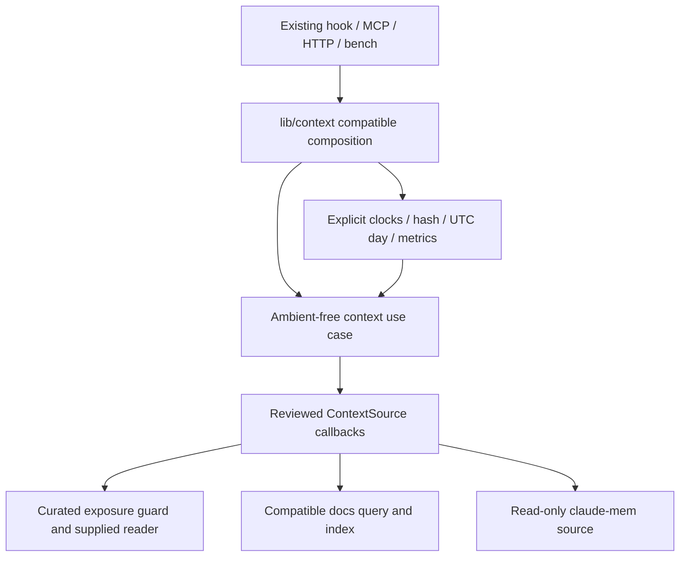
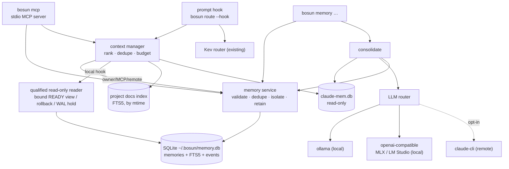
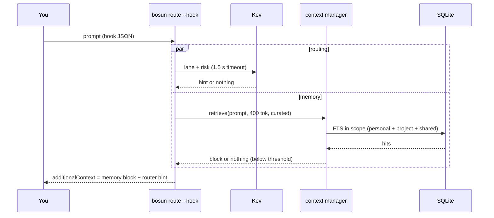
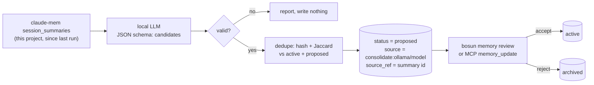
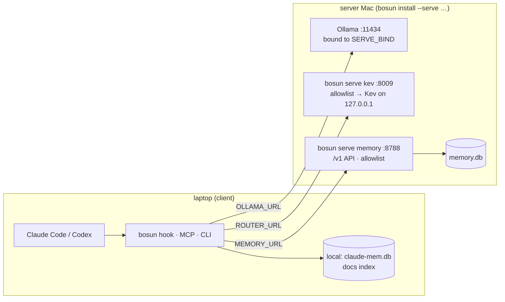

# bosun architecture: memory and context

This covers the memory layer added on 2026-09-29, and the TypeScript port that came with it. The design and its decisions (M1–M13) are in `docs/specs/2026-09-29-bosun-memory-design.md`; the build record, with every ruling, is in `docs/plans/2026-09-29-bosun-memory-ledger.md`. The roles, skills, executors and Orca parts are described in [README.md](README.md).

## Final daemon job spine (2026-10-06)

`src/app/jobs.ts` exposes `openDaemonJobs` for direct final-runtime composition with explicit state/owner paths, selected lazy AgentRunner factories and optional injected admission. Its `assertOwner()` callback lets final UDS/memory composition share the same held authority. It introduces no public port, legacy rendezvous or curated-memory schema change. `src/core/domain/job.ts` defines accepted public tasks, scoped records, state transitions and closed metadata; `src/core/use-cases/jobs.ts` owns sequential admission/dispatch/cancel/release/drain. Explicit model, effort, access, cwd and runner selection reach the existing AgentRunner unchanged. No alternate provider is selected on a hold or failure.

`SqliteJobStore` owns its native state.db lifecycle, request-id/project dedupe, compare-and-swap versions, monotonically sequenced events and separate bounded owner results. Explicit canonical directories/files must already have 0700/0600 modes; no HOME/config discovery or mode adoption occurs. Existing schema or an empty new file is inspected before journal/schema writes; unrelated layouts stay unchanged. A separate native SQLite EXCLUSIVE transaction in `DaemonOwner` holds actual daemon authority through execution and releases on process exit. Startup must explicitly call recover under that lock: persisted running jobs become unknown and never redispatch; queued jobs can run after recovery. Constructors do not recover or replay work.

Input requires own explicit public classification before prompt/task getters, persistence or runner calls. Trusted caller project scope is supplied separately and checked on metadata/result/event reads. Accepted public payloads/results are stored in the owner-only database; metadata events contain only job ID, sequence, state/version/time, fixed kind and finite reason. They contain no task prompt/result, tool names/targets, file paths, provider exception text or model/cwd labels. Event polling is bounded to 100 records. Queued/held cancellation is known cancelled; active cancellation requests abort and stays running until completion. Positive native done records its actual success/failure even after cancellation; absent completion becomes unknown without a tool rollback claim.

Native pre-DML failure returns a known error only after any entered transaction is positively rolled back. COMMIT errors fence the store/service and expose the existing unknown-outcome flag; jobs are not blindly retried. Drain stops new admission and awaits admission/factory/generator cleanup before SQLite and ownership close. An uncooperative callback can therefore hold drain; actual adapter deadlines and positive process/transport shutdown acknowledgement belong in final daemon integration. Early database release would permit late writes and is not used.

Current limits are sequential dispatch, 64 queued/held jobs, 1024 total retained jobs, 32768 total retained events, 32 KiB prompt, 64 KiB accepted input/result and 2048 runner events per run. Queue/record/event caps can be narrowed through composition. Progress cannot consume the event reserve needed to finish/recover outstanding jobs. This is a finite ledger: retained job/event capacity requires explicit owner retention/maintenance in the final runtime, and admission holds when capacity is exhausted. The jobs/core/contracts suites exercise actual native reopen/scope/idempotency/CAS/queue pressure, real synthetic runner generators, cancellation/drain, process SIGKILL recovery, BEGIN-then-error rollback and native COMMIT-then-error persisted state without replay. Final CLI/MCP/host/daemon integration remains the direct-delivery work; no new user command is claimed by this spine.

Quota admission uses pure `domain/quota.ts` and `use-cases/quota.ts`, with buckets and selected runner→pool bindings in the same admitted state.db connection. One selected supported callback returns at most 16 generic/model observations, validated before atomic persistence. Raw account/bucket identities hash at composition; provider content, credentials and credits/paid resets are excluded. Work/Codex share a pool; API/local units stay separate. Native primary/secondary durations are preserved. Known <10% headroom and denied included access latch through sparse/stale/missing/reset-clock updates. Only a newer supported complete matching snapshot with positive included access, all retained windows, known durations and future reset deadlines clears them. Generic and exact model restrictions both apply. Unknown telemetry holds by default; persisted owner-only `allowUnknownQuota` bypasses unknown evidence only. Model setters fail before prompt getters. Async release rechecks owner/state/version/drain after refresh; third admission metadata is immutable and has no prompt. Owner RPC `quota.status/refresh` accepts no user evidence. CLI selects the lazy native Codex reader; Claude/OpenCode lack default supported sources. Refreshes coalesce/cache for 5 seconds; freshness expires after 5 minutes and local waiting caps at 5 seconds. Shutdown prevents late source completion from writing closed SQLite; sources must honor abort and own native cleanup. Storage caps at 128 buckets/bindings, three windows per bucket and 4 KiB per record, requiring explicit owner maintenance when full. Synthetic SQLite/RPC/stdio tests establish these behaviors; live account/provider qualification remains pending. [Native rate limits](https://learn.chatgpt.com/docs/app-server#6-rate-limits-chatgpt) and [Claude statusline](https://code.claude.com/docs/en/statusline#available-data) document sparse fields; the pinned Codex schema also exposes nullable account-bound included-access permission, whose absence stays unknown.

## Final daemon memory composition (2026-10-06)

`openDaemonMemory` in `src/app/memory.ts` opens only an explicitly prepared registered layout and borrows the same daemon `assertOwner()` held by jobs. One private CutoverWriter session checks ownership before, inside and after every synchronous read/transaction; uncertain receipts remain finite unknown outcomes and fence further work without reopening/replay. The direct MemoryStore performs no constructor/read maintenance. Explicit expire/touch/prune and publication are admin/job operations. `project(DocsScope)` provides snapshot docs search, explicit native filesystem indexing and context retrieval from reviewed curated/docs sources, with caller scope supplied separately and curated public classification before payload getters. Closing a borrowed source cannot close the shared writer; runtime close awaits publication and releases only its native handles, never daemon authority. Format1 publication retains cached writer fencing and requires explicit restart. The supported schema is copied unchanged to `sqlite-schema.ts`; `initializeMemory` creates only a new absent owned file with that exact schema, preserving IDs/FTS/audit and refusing existing files. Normal daemon open never initializes or migrates storage. Snapshot/query-time ownership is not a model transport delivery lease; claude-mem, final entry-point wiring and the one supported setup/upgrade remain integration work.

## Compatible core extraction (2026-10-04)

The first v1.0 extraction is implemented while package metadata remains 0.2.0. `src/core/` owns memory/context/task/session/route domain types, deterministic text, coded errors, inference/privacy/capability policy and seven typed ports. Routing has a migrated use case and adapter: `lib/route.ts` calls `createRoutePrompt` through `src/app/registry.ts` and the temporary `src/adapters/routers/legacy-kev.ts`. The writable MemoryStore now has a native SQLite adapter behind compatible owner composition, described below. Existing Kev endpoint/model/config/service selection and advisory risk/confidence behavior remain active. The opt-in Clef adapter and OpenCode protocol prototype below do not replace that lifecycle.

The registry contains literal lazy router factories; constructing it does no adapter import/probe/inference. New inference requests carry `public/private/unknown`; routing and its adapters require an own data-property public classification before sending text. Inherited/getter classifications fail closed. The legacy entry alone retains its documented unmarked-input compatibility. Router metadata uses a trusted configured label, never a provider response field. Managed telemetry/admission/quiescence/fresh-start/seed/readiness controls are typed contracts with fail-closed selection policy; no native host is qualified by these definitions.

`opencode/control.ts` implements a bounded owned-session driver plus `ManagedSessionControl` over pinned native v1.18.34. Constructor inertness, injected ownership/hash/time/IDs, exact public screening and native owner/generation/nonce/model/cwd/agent/permission readbacks protect its create/seed/ready/run flow. Full native history must be empty before seeding; a true `noReply` user message and its explicit part ID are independently read back and hashed before readiness. `freshClaim` supplies an already staged owner with source generation + 1, while `assertDispatchOwner` gates exact owner/generation/native-session work before/after run exchanges. Bootstrap acknowledgement cannot release a destination before durable CAS; source metadata access cannot authorize retired-source dispatch. `resumeFenced` clears only a known current source's matching local fence after full bound native history/model/permissions/idle/tool checks; the controller must separately prove no transfer or uncertain destination, and no turn is restarted/replayed. Turns buffer a valid matching completed reply until native idle and terminal tools. Local fencing precedes probes, concurrent cleanup shares one native abort, and failures never retry effects or mutate/delete the source. Bounds: 16 roots, 64 creation attempts, 32 controlled turns per root, 128 history messages/256 parts per message, 16 KiB seed/32 KiB turn/64 KiB text result, 1 MiB message/history responses and 1,000 polls with configured finite request/run/abort deadlines. All managed capabilities remain unverified: process-local admission is not durable/native fencing; catalog windows and billed usage do not establish effective occupancy, so samples stay unknown and native compaction/model/binding changes invalidate them. Durable ownership transfer/controller/artifact/runtime integration and live qualification remain separate requirements.

`lib/memory/types.ts` forwards domain/port aliases (including the MemoryReader read subset) and MemoryError class; `lib/util.ts` forwards BosunError with its legacy constructor overload and the exact validation functions/types from `src/contracts/schema.ts`. `lib/memory/sqlite.ts` forwards pure text, the unchanged platform content hash and synchronous session/transaction helpers, retaining native open/migration work. Stored IDs/hashes and owner writer/MCP/remote scope/expiry/write semantics remain compatible. The local hook's storage branch now uses the qualified reader below. Legacy context composition delegates scoring to the core use case with only its existing explicitly allowlisted source metadata. New source IDs remain open in core; adding one does not make it trusted.

The model-audience memory policy is wired into MCP memory replies/search and curated context before content access. Only a record with an own boolean `private: false` is eligible; private/missing/malformed classification fails closed, including throwing getters. Denied get/store/update/delete replies are the constant `{memory:{private:true}}`, without duplicate/status or other derivatives. Public replies project known fields into fresh objects/arrays instead of serializing adapter extras, events or `toJSON` hooks. Model-facing memory/context errors use finite text/codes, omitting unverified current-version details. Owner CLI reads and storage mutations remain compatible. Safe WAL fallback, atomic private mutation authorization/races and delivery-time eligibility/revocation qualification, hook snapshot/lean closure, daemon query/maintenance/index caller migration and scheduling, broader error transport migration, full generation/runner screening and remaining port implementations are not finished.

`scripts/check-boundaries.mjs` checks every production `src`, existing `lib` and binary entry file using the local TypeScript 6 parser/resolver/type checker. Core imports only core; other new layers obey inward zone rules; adapters cannot import peers; source imports cannot reach tests or legacy lib. Static/type imports, reexports, import-type queries, literal dynamic imports and existing direct require calls enter the graph. Unresolved/local aliases outside the graph, computed/indirect loaders, unknown zones, source symlinks and cycles fail. Ambient core IO, Date and randomness are rejected; deterministic direct Math operations are allowed. The exact eight extracted memory/contracts files also reject ambient IO/clocks, runtime external imports, platform aliases and unreviewed internal runtime helpers, permitting checked core/reviewed isolation dependencies and type-only node:sqlite, including named type specifiers. Docs query cannot import indexing or its effectful filesystem helper. Other native adapters retain their explicit effects. This is a constrained source gate, not a universal purity/security verifier; isolated typechecking remains separate. TS7 needs a supported parser replacement or a retained dev-only TS6 checker.

Legacy exceptions are exact in the checker and [ADR 0001](docs/adr/0001-compatible-core-extraction.md): existing 25 lib files retain their old internal dependency zone, ten callers have recorded forwarding edges, and `bin/bosun` may import only `enableCompileCache` from `node:module`. [ADR 0010](docs/adr/0010-writable-memory-adapter.md) records the added exact memory/validation/docs seams. New legacy files/edges and new-source imports of lib fail. These seams must be removed as their callers migrate before v1.0 ships. No compiled hook/bundle enforcement result is claimed.

Guarded `core`/`contracts` tests exercise routing/privacy/error identity, capability denial, lazy construction, Router acceptance, actual native SQLite writable/read MemoryStore acceptance and the implemented docs ContextSource. `memoryadapter` selects direct and compatibility MemoryStore fixtures, both plain and registered; `docsadapter` selects direct snapshot queries and explicit/compatible index fixtures. `boundaries` contains positive/negative AST and resolution fixtures. Other port acceptance suites await actual adapters. Every group goes through the mandatory Node containment launcher; Bun runs remain prohibited.

## Context ranking and compatible composition (2026-10-06)

`src/core/use-cases/retrieve-context.ts` owns actual task-term admission, retrieval orchestration, relevance/recency/usage scores, stable ordering, hash/Jaccard dedupe and greedy rendering. Construction snapshots and freezes verified ContextSource metadata/callbacks and injected semantic/monotonic clocks, hash, UTC date label and measurement. It imports only core modules and uses no ambient clock, filesystem, native SQL, network, config or telemetry. Explicit source callbacks own their effects and keep their method receiver. Unsupported/unverified sources are skipped before search acquisition; trusted metadata is a composition contract, not authentication of hostile adapter objects. Mismatched hit identities and insufficient matched counts are discarded before payload access. Output projects only declared Hit fields.

`lib/context.ts` retains `retrieve`, `curated`, Item/Result aliases and the exact forwarded `estTokens` function. Real hook, MCP, authoritative HTTP and owner benchmark callers use this delegation. Its fixed reviewed metadata remains curated 1/60 days, docs 0.8/90 days and claude-mem 0.6/30 days; curated sessions retain a one-day half-life. Unknown/new/prototype legacy names cannot acquire a search callback. Curated classification still precedes every denied record metadata/body getter. The unchanged normalized SHA-256/32-hex hash now lives in `src/platform/content-hash.ts` and is reexported with exact function identity by `lib/memory/sqlite.ts`; context composition no longer imports the writer closure.



Trusted caller scope/options and verified source metadata validate before callbacks. Composition allows at most 64 verified callbacks; a response above 1000 hits holds before hit access, while genuine sources still request 20. Finite rank/usage, Date-range timestamps (including fractional docs mtime), declared strings and optional match/hash fields validate before scoring. Semantic clock/hash/date failures produce finite unavailable errors; provider-domain errors retain their original identity. Monotonic/sink failures cannot change a completed result or domain error; durations are finite nonnegative numbers, and measurements contain only the existing operation/count/character/token fields. Empty-term retrieval retains its unmeasured fast path. These count bounds do not establish provider payload byte bounds or a hard latency deadline.

`contextpipeline` and `contracts` select direct deterministic/dependency/policy fixtures; `context` selects existing real context/hook regressions and retains legacy-suite coverage. [ADR 0012](docs/adr/0012-context-ranking-and-composition.md) records compatibility and malformed-input limits. Reader lifetime through stdout acceptance, HOLD/cancellation and finite-expiry exclusion remain unchanged. Legacy metrics/config, docs indexing and MemoryService expiry/touch still own effects outside core. Hook JSON/config snapshots and full lean closure, daemon scheduling, explicit owner-operation final allocation/recovery, artifact disposition/drain and every native/Clef/handoff/graph/dashboard/remote/release gate remain unfinished.

## Writable memory adapter and maintenance composition (2026-10-06)

`src/adapters/memory/sqlite-store.ts` implements the existing MemoryStore port with real SQL validation, dedupe, scope, mutations, audit events and owner inspection. `sqlite-query.ts` owns SELECT/projection/FTS matching; `sqlite-maintenance.ts` owns explicit expiry, access touch and prune writes; `sqlite-session.ts` owns the internal synchronous SQL callback lifecycle. The adapter receives a caller-owned plain or registered session plus explicit semantic/monotonic clocks, copied/frozen retention settings, ID/hash functions and a measurement sink. It imports no legacy config, log or metrics globals and reads no HOME. IDs and normalized SHA-256 hashes stay compatible. Semantic time and computed TTL expiry must be integer Date milliseconds within 0–8,640,000,000,000,000 before DML; telemetry failures never change a committed result or the original operation error. Measurements contain only fixed operations and finite numeric timing/count/character metadata plus success flags.

Direct construction performs no retention. Direct `search` performs no expiry/access/index writes, even with `touch: true`; it filters unarchived finite expiry at the injected clock and omits malformed non-integer/out-of-Date-range expiry before projection. Explicit archived searches remain owner inspection. Direct `get` returns the persisted in-scope owner row and events: an expired active row stays active until explicit `expire` archives it. This distinction supports the final query/maintenance split; it is not a model-delivery lease or a safe new hook reader. Registered callbacks and native handles remain private, synchronous and subject to existing admission/HOLD/fencing.

`lib/memory/service.ts` remains compatible owner composition for CLI, MCP, context and HTTP callers. It archives expiry on construction and before `get/search`, includes expiry events/version changes in owner `get`, and best-effort touches successful FTS hits. It binds config/time/IDs/hash/metrics only at composition; retention changes require reopening. `openMemory/openLocalMemory`, `FIELDS/PATCH/cleanTags`, `.cfg`, plain `.db`, maintenance and owner cutover helpers remain available. These legacy reads remain writable. The focused fixtures prove unchanged storage footprints for queries using established synthetic sessions, not zero native WAL/SHM effects from arbitrary opens, a zero-IO whole CLI closure, hostile-sameUID isolation or power-loss durability.

Owner add/update map `--unshared` to the existing `shared: false` field; conflicting sharing flags fail before project discovery, input/model work or storage opens. Update also forwards its existing `--status active|archived` option, making status-only restores available. Inside the admitted update callback, exact scope/version/duplicate checks precede one injected operation timestamp. Only an explicit archived-to-active session transition with a valid expired deadline renews expiry, using the current frozen configured session TTL; zero removes expiry. Creation and renewal share the same Date-ms overflow check before DML. The unchanged schema cannot recover a prior selected custom TTL. Future/null deadlines, other categories and normal edits retain their existing TTL semantics; omitted raw private/shared flags and audit/hash/ID behavior remain compatible. Malformed session expiry refuses explicit restore, while ordinary edits preserve it. Legacy constructor/get expiry can advance the version before CLI update selects its expected version. Private or malformed-private MCP restores still return opaque receipts.

Daemon caller migration and explicit retention/access/index scheduling, hook snapshot/lean closure and all remaining one-v1.0 roadmap gates remain tracked. See [ADR 0010](docs/adr/0010-writable-memory-adapter.md).

`sqlite-docs.ts` is the actual docs ContextSource and compatible MemoryProvider: construction and established-session search receive a fixed canonical root/project, optional excluded nested roots and a synchronous SqliteSession. SELECT binds root and project, authorizes that configured project only through trusted caller context or its explicit linked-project policy, and preserves relative IDs, title/snippet/BM25/mtime projection. It imports no filesystem, Git, clock, telemetry or index code. The persisted snapshot is not a live filesystem or model-delivery revocation lease; a newly nested repository requires a freshly validated exclusion scope.

`sqlite-docs-index.ts` explicitly preflights complete successful enumeration and source dispositions before any admitted DML. Initial read-only storage admission failures return held before source inspection; transaction/COMMIT failures stay separate, and core unknown-outcome errors retain only fixed unavailable text and the unknown flag through indexing. `docs-filesystem.ts` resolves the actual canonical Git root, bounds NUL-terminated listing output to 2 MiB/2000 Markdown paths and descriptor reads to 256 KiB per regular single-link file. Symlink leaves/ancestors, dangling links, directories, oversize and removed/ignored owned files are rejected without reading outside source bytes; transient/partial/racing sources hold the whole attempt. Root/ancestor/file stamps are checked after reads, under admission before DML and again after DML. Unrelated projects/worktrees keep their rows; nested .git presence is checked through metadata only. Because the unchanged schema cannot prove which same-project indexer owns a nested descendant, ambiguous rows remain stored and outer queries exclude them.

Indexing bounds total docs to 10,000 rows/16 MiB encoded, using conservative string byte upper bounds for new content. Native storage checks retain the existing source-plus-WAL 64 MiB limit, reserve eight times the new encoded upper bound plus 12 KiB per changed/deleted row before DML, and recheck actual physical bytes after DML. This encoded estimate alone does not prove final-COMMIT/FTS allocation; registered sessions additionally use the central native page/WAL reservation below. Plain sessions and explicit owner-operation allocation/recovery remain storage gates. Telemetry contains fixed operation/finite numeric count/timing/success only and is best effort after commit.

`lib/memory/docs.ts` composes those APIs and preserves default search-triggered indexing until daemon migration. Those legacy MCP/context reads still write. Failed/incomplete/overflow/source-held attempts return no compatible docs for that search and retain existing rows; direct snapshot queries stay separate. Native registered handle privacy, admission, same-inode HOLD and cached-writer fencing remain unchanged. No filesystem deletion/adoption/chmod, schema migration, eighth port or delivery-lease claim is added. Listed files are compared by content/title/mtime, so timestamp-preserving edits refresh and identical snapshots avoid writes. Uncertain descriptor cleanup holds the attempt with an identity-bound retry. [ADR 0011](docs/adr/0011-scoped-docs-query-and-index.md) records exact scope, bounds and qualification.

## Offline native protocol prototypes (2026-10-05)

`src/adapters/routers/ollama-clef.ts` implements the explicitly selected `ollama-clef` Router factory, independently of generative ModelProvider. It defaults its trusted model label to `clef-flash:9b` and accepts explicit model/URL/deadline settings. Private/unknown/unclassified input fails before config/payload/HTTP access. Lane/risk questions put main/high first for ties; typed answers, exact question/probability keys, finite distributions/confidence, usage and response-model equality are validated. Provider echoes are discarded. Input is rejected above 24,000 characters or a full serialized UTF-8 request of 64 KiB; response bodies are capped at 64 KiB, with bounded deadlines, cancellation, no redirects/retries/fallback/pulls and finite error messages. Probability-sum tolerance is a bosun policy for rounded values. The existing deterministic risk fence remains authoritative.

Clef qualification markers remain unverified/unsupported and are not a calibrated dispatcher gate. The adapter is reachable only through explicit factory/API selection; no legacy hook/CLI/default/model/service selection was changed. Confidence is concentration, not correctness. Live model wire/residency, held-out calibration, thresholds, latency and complete Kev lifecycle replacement remain unverified or unfinished.

`src/adapters/hosts/opencode/{protocol,probe}.ts` is a bounded native **v1.18.34 metadata prototype**, not a completed HostAdapter or eighth core port. Construction does no discovery/start/install/auth/model probe. An explicit public-session request can read only loopback health/session/messages via GET. The metadata probe has no Basic-auth or managed wiring; 401 holds with no credential discovery/retry. Codecs follow the actual pinned v1 route/schema sources, not their older generated SDK or separate v2 examples. They preserve explicit provider/model/variant choices, project no transcript/title/path/cost/session-total data, reject mismatched versions/identities, and decode one bounded global SSE message frame; no live SSE subscription is implemented.

`src/adapters/hosts/opencode/runner.ts` implements the existing `AgentRunner` with native v1.18.34 HTTP. Construction is inert; public classification precedes prompt/config/HTTP access. Explicit server and optional Basic username/passwordEnv use only supplied environment values, without auth discovery/mutation. Preflight checks exact health version and the connected provider/model/variant. A fresh scoped session receives deny-all native permissions plus read/glob/grep/list, with native edit permission added only for edit access; MCP resources, external-directory, shell/network and delegation remain denied. Cwd, model, variant, agent and permissions bind before prompting. The synchronous native prompt reply is byte/time bounded; completed parent/model/cwd/agent, terminal allowed tools and idle status precede all output. Only known tool names and numeric step usage enter metadata; text/final result remain separate bounded owner output. Cancellation/timeout independently calls native abort, verifies the bound session and observes idle before settling; failed termination evidence remains unknown, never retried. Undefined effort sends native `default` to suppress an agent's inherited variant; a catalog-defined custom default requires explicit selection. MCP injection and maxTurns are unsupported. Tool permissions are the readOnly capability scope: arbitrary plugin side effects, OS isolation, live hosts, billing/window telemetry and managed handoff are not established by synthetic fixtures.

Latest completed-message/step input plus cache counts form a diagnostic candidate only. ContextSample remains unknown with null used/window tokens; stale, pending, changed-model, reset, failed and absent observations do not become zero/full-window estimates. Pure fresh-root/noReply request recipes send no requests and successful decoding proves no seed acknowledgement, ownership, admission fence, tool quiescence or readiness. Every managed capability remains unverified, so existing capability selection rejects automatic control. Codex/Claude parity, native process/config wiring and the controller remain pending. [ADR 0002](docs/adr/0002-offline-native-protocol-prototypes.md) and [fixture provenance](test/fixtures/native-protocol-provenance.md) record the exact source/qualification boundaries.

## Qualified local read-only memory (2026-10-05)

**Ordinary default WAL installs remain held. Explicitly prepared READY views with independent owner `MEMORY_SOURCE_ID` binding supply qualified non-expiring local notes, including the demonstrated 10,000-row medium-body corpus. Strict owner plan/apply/reconcile and reviewed initial permission/layout preparation are available; verified process drain/restart, broader interrupted-storage recovery, durability, finite-expiry handoff and performance remain same-v1.0 ship gates.** Guarded Node 24.16.0 probes show `readOnly:true` creates/leaves sidecars for closed WAL and changes existing sidecars for live WAL. Exclusive connection mode avoids those effects but safely fails WAL reads. No immutable primary, automatic conversion/checkpoint/copy or snapshot design is introduced here.

`src/adapters/memory/sqlite-readonly.ts` implements only `search/get/close` from the existing MemoryStore port. It uses explicit canonical paths, an injected clock, compatible schema-v1 checks, readonly/defensive native open and connection-only PRAGMAs before schema/content SQL. Qualified rollback-journal fixtures have unchanged bytes/mode/mtime/ctime/directory footprint before, while open and after close, with a closed or idle open writer. Reader imports exclude writer/config/log/metrics/model/services; no retained writes, migrations, expiry/events/access/mode updates, temp files or extension loading occur. Ordinary read access-time updates are outside the comparison.

SQL binds bounded terms/limits/scope/tags, applies personal/own/shared/linked visibility plus public/active/unexpired filters before projection, validates numeric/nullable metadata and preserves IDs/hashes/BM25/matched counts. Audit requests are rejected because history can derive from earlier private versions; owner writer API history stays available. Legacy rollback files cap at 16 MiB and query limits at 50. Missing, corrupt, stale/unknown schema, pending journal, locked, oversized or exhausted-budget reads fail with finite errors. The 250 ms injected-clock check brackets synchronous work and cannot interrupt native CPU work; no strict deadline/designated-Mac latency is claimed. Exclusive rollback reads can hold writer locks until close; concurrent commit throughput is not qualified.

`lib/route.ts` lazily calls its local selector: present/pending/explicit view or source binding requires the strict public reader, while absent default view plus blank binding retains unactivated rollback reading/WAL hold. Invalid bindings never downgrade to primary rows. Both local handoff paths omit finite-expiry records in SQL before packing; ordinary read APIs retain query-time expiry. Public-view schema/identity/READY/generation metadata stays pinned under a retained native transaction through stdout acceptance. The primary is inspected only through filesystem identity/minimal WAL-header checks, never mutable-primary SQLite; backup recovery values are never selected. [ADR 0007](docs/adr/0007-bound-public-memory-reader.md) records the exact lifetime and restore limits. Remote storage and owner CLI/MCP mutation paths remain compatible. Curated packing accepts a search subset. Positive hook fixtures explicitly prepare rollback mode, while unchanged default-WAL negatives expose the hold. Legacy inference and route/context/hook metadata writes remain outside the reader: the entire hook is not zero-IO or a completed lean closure. [ADR 0003](docs/adr/0003-qualified-local-readonly-memory.md) records exact qualification, compatibility edge and remaining gates.

The explicit `sqlite-cutover` adapter holds primary admission through native backup/floor commit and binds source/view/backup identities and epochs. Actual local MemoryService/owner CLI, MCP docs and authoritative serve select registered admission for an applied floor before legacy chmod/migration; synchronous writes, expiry/touch and docs indexing use it. `memory cutover plan/apply/reconcile` provides a strict prepared-layout owner workflow: filesystem-only unverified plans, independent planned source UUID, bounded metadata freshness and exact absent-floor/source-epoch expectations checked under admission before DML. Separate `prepare-plan/prepare` commands review initial absent-view layout actions, pin finite canonical owner descriptors before mutation, narrow only known legacy modes and create only explicitly requested 0700 leaves. They open no SQLite, reject any existing view/unknown inventory and leave conservative partial changes on failure, requiring a new plan. Explicit `recover-plan/recover` adds independently bound incomplete-attempt recovery: planning opens only a journal-free rollback view read-only with a retained native lease, verifies its exact gate/reference and bounds metadata inventory; primary schema/floor remain unverified. Recover requires an absent floor and same-epoch copying/backed gate before effects, then makes a fresh current-source backup under continuous admission and preserves the prior reference. Already-committed floors require reconcile without generation reset. Unreferenced UUID artifacts remain unread with ownership unverified, require retain acknowledgement at both steps and are never adopted/deleted. Reconcile, including explicitly retained multi-artifact inventory, revokes READY to HOLD. `--clients-stopped` is operator attestation; there is no process drain/restart. The default binding remains blank, and no ordinary opener/hook/MCP/server installs or recovers a floor. `memory publish` separately upgrades the same rollback inode with a v2 public schema/marker, commits public rows/FTS/READY and fences cached v1 writers. Mutations commit HOLD before source DML; publication is never automatic. [ADR 0005](docs/adr/0005-explicit-memory-writer-floor-cutover.md), [ADR 0006](docs/adr/0006-explicit-public-memory-publication.md) and [ADR 0008](docs/adr/0008-strict-owner-memory-cutover.md) record authority/recovery/receipt/capacity limits; broader interrupted-storage recovery/orphan disposition, durability, performance and finite-expiry handoff remain gates.

Explicit owner `restore-plan/restore` and `restore-reconcile-plan/restore-reconcile` restore only the current verified referenced backup, with independently saved old/new UUIDs. Immutable owner-only `.restore` presence fences public reading, ordinary opens and cached registered writes; hooks never read capsule/receipt JSON. Under continuous primary admission, same-inode HOLD precedes a fresh current-source native backup and bounded logical memories/events/docs restore, preserving explicit keys and recorded privacy/scope/expiry. Source floor rotates first, then view converges to the new epoch/HOLD before an atomic `.restore-receipt` rename. Reconcile distinguishes exact old/new native floors without replay, preserving current rows and generation; repeated completed reconciliation survives explicit format upgrade and intervening writes. Bounded capsule reads and actual source/view/path/mode/sidecar checks guard fallible checkpoints and pre-COMMIT admission. A pending view journal switches reconciliation planning to capsule/filesystem checks with zero native SQLite opens and an unverified view/reference label. Explicit mutation must prove the independently bound exact old/new floor and reference under primary admission before writable view open/native recovery, then validate recovered schema/gate. Recovery failures retain pending fencing and report uncertain effects. [ADR 0009](docs/adr/0009-owned-memory-restore.md) records the real hot-spill/SIGKILL evidence and trusted-application limits. Referenced mid-backup sidecars, receipt-only journals, arbitrary backup selection, drain/restart and storage/power-loss durability remain gates.

Public publisher/reader share the IO-free format-2 schema and limits: 10,000 rows, 16 MiB encoded projection and 64 MiB physical view. Source plus WAL stays at 64 MiB; canonical owner-only single-link WAL metadata and only its empty/minimal 32-byte header are inspected through read-only filesystem calls. A present WAL inode is retained for replacement checks, while absent/empty housekeeping is permitted. No mutable-primary native open, frame/body hash or backup read occurs. Legacy rollback reading retains its separate 16 MiB file cap. The medium 10k fixture (~9.3 MB encoded/~7.9 MB view) proves READY, scoped IDs/body/hash, zero-write reads, actual useful hook output and native lease/revocation. The former 4 MiB HOLD remains historical evidence, not a current capacity result; finite byte/record/row/physical limits still reject oversized corpora. Synchronous aggregate/query work still has only clock checks around it, without hard interruption or a designated-Mac p95 guarantee.

Registered `CutoverWriter` reads and admitted callbacks repeat canonical path/mode/sidecar/size checks. Connection-local cache_spill OFF and exact private max_page_count controls bound admitted protected source DML, including pending native FTS COMMIT allocation. The conservative 64 MiB reservation charges the larger of current primary length or capped logical pages, the entire existing WAL extent, all capped pages as pending frames, the WAL header and 64 KiB sector padding plus one frame. It covers qualified later checkpoint/last-close file lengths; no source checkpoint/truncation or reclamation assumption is used. Eligible larger legacy stores retain reads/no-DML maintenance while floor checks hold protected DML. Callback PRAGMAs and transaction/schema controls remain denied. An attempted COMMIT without positive rollback evidence, or failed confirmation after native COMMIT, yields finite receipt_unknown/outcome unknown and discards the cached handle without replay. Domain identity/current version survives only a positive uncommitted rollback. [ADR 0013](docs/adr/0013-registered-writer-capacity-and-receipts.md) records the equation, useful capacity, native evidence and trusted-application/apparent-file-length limits. Explicit owner cutover/restore/publication final allocation and recovery, artifact disposition/drain and all remaining v1.0 gates remain required.

`src/app/memory-benchmark.ts` creates a disposable schema2 runtime with the final registered memory adapter and permitted curated packing. It ignores owner configuration/legacy overrides and invokes the actual Node hook with a pinned workspace. Native close/reopen every256 seeded notes respects source+WAL capacity; the separate loading lifecycle distribution avoids claiming uninterrupted10k throughput. Child process wall time and verified synthetic delivery are separate, with no hook telemetry writes or inferred component timing. Published10k establishes20/20 measured deliveries; default held views establish no retrieval latency. All children have fresh process startup and no warm daemon. Actual host tokens, compiled latency and live host behavior remain unverified.

## Overview

Everything runs in-process. There's no daemon, except `bosun serve` on a server Mac in the optional split setup.



## Modules

| Module | Does |
|---|---|
| `lib/memory/types.ts` | Memory, Category, Status, Ctx, Query, Hit, `MemoryApi`, `MemoryProvider`, `MemoryError` |
| `lib/memory/sqlite.ts` | `openDb` (0600, WAL, `busy_timeout=2000`), ordered migrations, `tx`, query terms, hashing, Jaccard |
| `lib/memory/service.ts` | compatibility composition binds dependencies and legacy expiry/touch; `openMemory` picks local or remote |
| `src/contracts/schema.ts`, `memory.ts` | exact shared validator and memory schemas; legacy imports forward unchanged |
| `src/adapters/memory/sqlite-store.ts` | actual writable MemoryStore adapter with explicit dependencies and owner query API |
| `src/adapters/memory/sqlite-query.ts` | query/projection/FTS helpers with no maintenance DML |
| `src/adapters/memory/sqlite-maintenance.ts`, `sqlite-session.ts` | explicit expiry/touch/prune and internal synchronous SQL lifecycle |
| `src/adapters/memory/sqlite-readonly.ts` | qualified rollback `search/get/close` and local public-view selector; no writer imports/effects; ordinary WAL held |
| `src/adapters/memory/sqlite-public-readonly.ts` | independent expected epoch, exact public schema/identity/READY and scoped projection; same-inode native lease retained through delivery |
| `src/adapters/memory/sqlite-public-protocol.ts` | IO-free exact schema/column/bound literals shared by publisher and public reader |
| `src/adapters/memory/sqlite-cutover.ts` | explicit native cutover/recovery/reconciliation/publication; view-only owner reference inspection; admitted expectations; registered v1/v2 admission/revocation |
| `src/adapters/memory/sqlite-owner.ts` | filesystem/header-only unverified plans; reviewed initial layout preparation; independently planned UUID; strict explicit owner apply/reconcile; no drain/restart/restore automation |
| `lib/memory/project.ts` | project identity from the git `origin` URL (read from `.git/config`, no git spawn) |
| `lib/memory/remote.ts` | `RemoteStore`: the same `MemoryApi` over HTTP to `MEMORY_URL` |
| `lib/memory/claudemem.ts` | read-only provider over claude-mem: this repo's observations and session summaries |
| `lib/memory/docs.ts` | compatible search-triggered index composition; direct scoped queries/indexing live in `src/adapters/memory/sqlite-docs*.ts` |
| `lib/context.ts` | compatible `retrieve()`/`curated()` composition and forwards |
| `src/core/use-cases/retrieve-context.ts` | injected retrieval, rank, dedupe, token budget and format |
| `lib/llm.ts` | `generate()`: Ollama → OpenAI-compatible → (opt-in) `claude -p`, retries, JSON validation, usage log |
| `lib/consolidate.ts` | claude-mem summaries → proposed memories |
| `lib/mcp.ts` | `bosun mcp`: JSON-RPC 2.0 over stdio, 7 tools |
| `lib/serve.ts` | `bosun serve memory|kev`: bind, allowlist, the `/v1` API, a Kev forwarder, the `authorize()` point |
| `lib/memory/cli.ts`, `bench.ts` | the `bosun memory` verbs; bench and eval |
| `lib/log.ts`, `lib/metrics.ts` | a JSON-lines log with redaction; op timings and the stats report |

## A prompt, end to end



- The existing skip rules still apply: `/` commands, `!` shell escapes, prompts under 3 words, `#noroute`, and `BOSUN_DEPTH` inside executors.
- Any failure in the memory part leaves it out (fail open) and logs `hook.memory`. The router hint still arrives.
- `bin/bosun` has a fast path for `route --hook`: it loads only the hook's modules (6 ms of imports against 16 ms for the full CLI). Until a first memory exists, the hook opens no database and loads no memory modules.
- `bin/bosun` flushes and exits when a command is done: an aborted request to a host that drops packets would otherwise keep the process alive for ~10 s (the OS connect timeout), past Claude's 5 s hook timeout.

## Storage

`~/.bosun/memory.db`: `memories` (+ `memories_fts`, porter unicode61, external content kept in sync by triggers), `memory_events` (the audit trail), `docs` (+ `docs_fts`), and `schema_migrations`.

- **Keys and dedupe:** `id` is `m_<time base32><random hex>`. `hash` is sha256 of the normalized title and body (lowercase, collapsed whitespace). A partial unique index on `(project, category, hash)` over non-archived rows makes exact duplicates impossible; `store` returns the existing memory instead.
- **Scope:** readable means personal, this project, stored integer `shared=1`, or a project in `MEMORY_LINKED_PROJECTS`. Writable means personal or this project. Ids out of scope are "not found", never "forbidden". Other stored sharing values do not grant cross-project access.
- **Legacy classification:** only stored integer `private=0` is public. The INTEGER-affinity legacy schema permits empty/text/blob/nonzero flags; their DTOs remain protected, and public search filters them in SQL before payload/tag projection. Owner inspection and `includePrivate` still expose in-scope content. Duplicate requests and edits with omitted flags retain the exact stored flags, IDs, versions and audit behavior; only an explicit owner patch reclassifies a record as public.
- **Versions:** `update` needs the version you read (optimistic concurrency). A mismatch returns `conflict` with the current version.
- **Retention:** session memories expire after `MEMORY_SESSION_TTL_DAYS` (7), applied when the database opens, each with an `expire` event. `prune` purges archived memories older than `MEMORY_PURGE_AFTER_DAYS` (90). Events outlive a purge.
- **Migrations:** each one runs with its version row inside one `BEGIN IMMEDIATE`; a failure rolls back and leaves the database as it was. The version is re-read inside the transaction, so processes opening a new database at the same time migrate it once.
- **Concurrency:** WAL plus `busy_timeout=2000`. The switch to WAL retries on `SQLITE_BUSY`, because SQLite skips the busy handler for that lock upgrade (two processes creating the database at once used to fail).

## Ranking

For each source (curated, docs, claude-mem), the context manager fetches up to 20 hits and scores each one:

```
score = bm25_norm × weight + 0.3 × 2^(−age / halfLife) + 0.05 × ln(1 + access_count)
```

- **bm25_norm:** FTS5 `bm25()` divided by the best hit of that source (0–1).
- **weight:** curated 1.0, docs 0.8, claude-mem 0.6.
- **halfLife:** session memories 1 day, other curated 60, docs 90 (by file mtime), claude-mem 30.

Then:
- **Dedupe:** same hash, or a word-set Jaccard ≥ 0.8. The higher score wins.
- **Gate:** a hit must contain at least `minMatched` distinct words of the task (counted by FTS5's own `highlight()`, so stemming counts; the hook uses `CONTEXT_HOOK_MIN_TERMS`, 2). Normalizing by a source's best hit gives that hit a relevance of 1.0 however weak the match, so without this gate one shared common word ("first", "uses") would inject a note.
- **Budget:** greedy by score. Each line is at most `CONTEXT_ITEM_CHARS` (400) characters; the whole block fits `budgetTokens`, estimated as characters ÷ 4 and always shown as `~`. Nothing below `minScore` (the hook uses 0.35).
- **Query:** stop words go; identifiers are kept and split (`fetchCart` → `fetchcart fetch cart`); at most 24 terms, each quoted, OR-joined. User text never becomes FTS syntax, and a 50 KB prompt is still a small query.

**Known limit:** `minScore` still mostly prunes the tail; the word gate does the real filtering. Use `bosun memory eval` with your own labelled queries before tuning either.

## MCP

`bosun mcp` speaks newline-delimited JSON-RPC 2.0 on stdio, with protocol `2025-11-25`; it echoes `2025-06-18` and `2025-03-26` when asked for them. stdout carries protocol messages only.

| Tool | Hints | Notes |
|---|---|---|
| `memory_search` | read-only | private memories left out |
| `memory_get` | read-only | private/unclassified records return only an opaque private placeholder |
| `memory_store` | not destructive | public duplicate returned instead of a second copy; private receipt hides duplicate state |
| `memory_update` | destructive, idempotent | `expectedVersion` required; `status: active` accepts a proposal |
| `memory_delete` | destructive, idempotent | archives (soft); private receipt hides ID/status |
| `context_retrieve` | read-only | curated + docs + claude-mem, default budget ~1000 tokens |
| `project_knowledge_search` | read-only | docs + claude-mem |

- **Inputs:** every schema has `additionalProperties: false`, so a tool argument can't set the project.
- **Errors:** validation and business errors come back as `isError` results. Memory errors expose only fixed text and a closed `structuredContent.error.code`, never provider messages, private duplicate IDs or current-version details. The HTTP context endpoint applies the same finite mapping; owner memory API transport is unchanged. Output is capped at `MCP_MAX_CHARS` (20,000).
- **Local mutation replies:** store/duplicate, update and delete classify the current SQLite row and construct their reply DTO inside synchronous write admission. MCP projects that captured DTO; private and malformed flags yield opaque receipts while existing private edits/deletes remain supported. This is transaction-time classification, without a delivery-time revocation or retained MCP transport lease guarantee.
- **Protocol errors:** unknown method (including `server/discover`) → `-32601`, batch → `-32600`, parse error → `-32700`, unknown tool → `-32602`.
- **Registration:** `bosun install` registers the server with `claude mcp add --scope user`, and with `codex mcp add` in each Codex home (Orca's too). Uninstall removes them, and `bosun doctor` checks them.

## Final reviewed consolidation (2026-10-08)

The final daemon registers `bosun-consolidation` in the existing jobs executor. Owner-only `consolidation.run/status/proposals/abandon` methods share the CLI contracts. Generic job submission cannot invoke the reserved runner. Queued interactive, maintenance and handoff summary jobs precede consolidation; FIFO order is preserved within each class, without preempting an active job. Scheduling defaults off and polls only registered owner scopes while the executor is idle.

Queued payloads hold source IDs, versions, hashes, cursor and explicit provider/model, without source bodies. At dispatch, the registered memory writer claims that bounded window and publishes the public read view before inference. Current scope/privacy/status/expiry/credential eligibility is rechecked before content capture. One tool-free provider call returns citations and proposed artifacts; publication atomically revalidates sources/parents and commits all proposals, processed versions and cursor, then restores the public view. No SQLite transaction or retained public-view hold spans HTTP inference.

Three narrow schema2 tables persist the scope cursor/reservation, last processed source versions and proposal kind/citation metadata. They use the existing writer/floor, with no source-copy database, second executor or independent replay loop. Lost commit receipts fence the writer; unknown generation outcomes retain reservations. Only an explicit owner abandonment advances past uncertain work. Durable request lookup precedes source/provider/admission access so repeats return the exact original job even after newer evidence arrives.

The configured graph provider retains the local-first policy: no native subscription CLI calls. Compatible APIs require both owner opt-in and separate positive admission evidence at enqueue and dispatch. Default caps are20 outstanding proposals,8 sources,4 proposals and24KiB input. Generated text is screened and citations must be exact source-body excerpts. Model output cannot promote facts or invent authority; proposals require version-bound owner graph review. Owned L1 extraction is implemented; external L0 extraction, vectors and quality activation gates remain required.

## Final portable profiles and retained jobs (2026-10-08)

Owner-only `profile.export/inspect/preview` project explicitly selected role/provider/router/local model choices into one closed portable schema. TOML and canonical Agent Skills preserve exact models, while endpoints/auth become placeholders and commands/homes/accounts/source IDs/absolute paths are omitted. Optional L4 instructions require current reviewed public lineage and exact version; recognized sensitive lines are replaced and known credential content refuses export. Import provenance stays unverified. The dry preview lists exact changes/conflicts and finite capabilities/reconfiguration without writing config, enabling hooks, downloading models or approving installation. Already exported copies cannot be revoked automatically; actual host installation/ownership/undo remain required.

The same final state schema contains permanent content-free job receipts and daily archival usage. A bounded transaction compacts only settled succeeded/failed/cancelled jobs after the configured30-day retention, preserving original IDs/request scopes/versions and rolling available counters into exact scope/day/runner/model/effort/billing/vendor/pool groups. Unknown pools isolate independent attempts; missing/ambiguous complete totals remain null with coverage counts. Daily queries cover archived attempts, not every activity in a partially compacted day. Active/queued/held/unknown jobs, quota latches and managed/handoff evidence are never expired to admit new work. Receipt/group capacity holds rather than evicts no-replay evidence. Native rollback/lost-COMMIT/reopen fixtures qualify this flow, without a power-loss claim.

Daemon shutdown rejects new admission immediately, allows already running work a bounded configured grace, then requests cancellation while retaining owner/storage until its iterator/process positively settles. Uncertain retention COMMIT runs through the same core storage guard, fences subsequent work and aborts active controls. An elapsed grace is not evidence that a native effect or process has stopped.

Ink job actions use the existing scoped cancel/release methods. Selection is bound to an exact job ID; metadata refresh cannot silently move a prior selection to another row. One pending action and its callbacks settle before UI cleanup. A malformed/lost mutation receipt yields a finite unknown notice, with no automatic retry; explicit refresh can record a newer observed non-unknown version. The UI has no execution/recovery authority of its own. Synthetic native UDS/Ink tests cover keyboard selection, quota hold, release, cancellation, no foreign/unknown dispatch and terminal restoration.

## Final owned Git workspaces (2026-10-08)

The existing state.db writer persists a bounded workspace registry. Request deduplication precedes base resolution; an exact repository/common-dir/project/path/base/branch intent commits before native Git creation. Lost reservation or final COMMIT fences the same core authority. Native receipt loss remains unknown, with no automatic second creation after reopen. Same-origin clones share memory scope while workspaces remain bound to their actual Git common directory.

The Workspace port uses binary-safe bounded stdout through the existing process lifecycle, a selected clean environment, disabled hooks/fsmonitor/submodule recursion and filter-config preflight. It never copies dirty source contents, overwrites existing destinations, runs external checkout filters or deletes branches. Owner CLI/shared methods create/list/get/reconcile and return a read-only prune preview. Candidate eligibility requires exact branch/common-dir identity, clean tracked/untracked/ignored status, no locks/prunable markers, merge ancestry into the originating checkout and no active/unknown jobs in the path. Revision rechecks and a closed digest bind the observation; preview itself authorizes no deletion.

Operations have a total10s deadline, at most8 pending callbacks and64 permanent records. Shutdown aborts/waits callbacks before closing state and releasing the same owner. Capacity preserves uncertain intents rather than evicting receipts. Native Git/SQLite/UDS fixtures qualify these flows; Orca integration and revision-bound review remain unfinished.

Workspace launch uses the existing jobs executor and atomic job/event transaction. One content-free workspace_jobs table preserves original job-to-worktree mapping across archival retention; accepted payload/admission metadata bind an owner-selected workspace ID/version/path. Spin screens public inputs before Git creation, dedupes by the original request and then queues; unknown creation cannot enqueue or replay. Before dispatch/release, native workspace identity qualification precedes the existing quota/runner checks. A generic job in a registered path with no matching binding holds. Canonical spin instructions and embedded assets use this actual job workflow; Orca card/terminal integration and revision-bound review remain unfinished.

## Final revision-bound native reviews (2026-10-08)

The existing jobs executor queues owner-only read-only review jobs; one review_artifacts table retains immutable checkout/selection metadata and links the job in its original job/event COMMIT. Durable request lookup precedes duplicate model/content getters. Known uncertainty retains the original record/job without replay. Public input classification precedes source access; identical project IDs from same-origin clones do not grant another checkout's review access.

Snapshots bind actual root/common directory, branch/base/head, staged OIDs/modes, status bytes and SHA256/modes of tracked/untracked working contents. Native captures repeat metadata and file observations before accepting a revision; stored snapshot and immutable request hashes protect the projection. Exact selected-file batches bound prompt content and expose their coverage, while the full checkout revision invalidates them after any source change. Git status/diff and worktree inspection repeat filter preflight through the shared bounded binary process helper. No SQLite transaction spans source capture or inference.

Admission/release rechecks the original revision before the existing quota and native runner gates. Completed findings retain their positive job result while current evidence becomes stale/withheld; outputs remain proposals and never approve, fix or merge. Source bodies live only in the bounded owner job payload, with metadata-only durable review records. Verification-command outcome/version evidence, deterministic dispatch policy, actual effective-vendor qualification and native PR fetching remain incomplete. Declared source harness comparison is separate from observed vendor identity. Shutdown aborts/waits pending review callbacks before the same owner is released.

## Final verification receipts and dispatch policy (2026-10-08)

Reserved bosun-checks executes explicit owner verification in the existing jobs spine. One state.db check_artifacts table retains immutable review/revision/command identity and native receipts. Selected executable SHA256/mode/size, exact arguments, selected environment hash and deadline bind command version. Job creation links the check in its original transaction; terminal job/result/verification receipt commit together. Native stdout stays a bounded digest/count, not copied text. A new private HOME avoids inherited authentication; the existing process lifecycle waits for positive group closure.

Source and command are rechecked before native dispatch and after completion. Positive exit does not establish usable evidence if source/command changed; unknown effects remain sticky without replay, including lost COMMIT/restart/retention. Review status exposes recorded-command coverage and latest explicit results while retaining older receipts. It does not select every necessary test, qualify arbitrary transitive dependencies or approve/fix/merge. Model transports have no check tools.

The core dispatch gate evaluates closed declared operations/files, exact-model and no-delegation restrictions before admission callbacks and during release. Protected edit work holds for main planning; read-only review remains admissible subject to native/quota gates. Model-origin unknown editing scope holds, and authority-assigned origin cannot be forged through public inputs. Explicit owner requests without policy retain manual delegation/unknown classification. Only registered non-model owner runners bypass model dispatch policy; owner-only native model tasks still use it. The gate does not rely on Clef confidence or expand host sandbox/tool permissions.

## Historical v0.2 LLM router and consolidation

- **Chain:** `LLM_PROVIDERS` (default `ollama`; `openai` means an OpenAI-compatible server such as `mlx_lm.server` or LM Studio).
- **Timeouts and retries:** each attempt times out after `LLM_TIMEOUT_S` (60). Timeouts and connection errors are retried `LLM_RETRIES` (1) times, with backoff. Bad or schema-invalid JSON counts as a failure, is not retried, and moves on to the next provider.
- **Remote:** `claude -p --restricted` (haiku) is added only when `LLM_REMOTE=claude`, the caller allows remote, and the content isn't private.
- **Usage log:** each attempt writes one line to `~/.bosun/llm-usage.jsonl`, with no content.



## Split setup



- **API:** `GET /v1/health`; `POST /v1/memory/{store,search,get,update,delete,accept,reject}`; `POST /v1/context/retrieve`.
- **Requests and replies:** every request carries `ctx`, and every reply is `{ ok, data | error: { code, message } }` with `not_found`, `conflict`, `invalid` or `unavailable`.
- **Limits:** JSON only, bodies ≤ 64 KB.
- **Client ranking:** the client ranks curated hits from `/v1/memory/search` together with its own local docs and claude-mem hits.
- **Safety:** the bind address (Tailscale by default, never `0.0.0.0` unless you set it) plus a source-IP allowlist. There are no tokens in v1; clients already send `MEMORY_TOKEN` as a Bearer header, and `authorize()` is where checking it goes.

## Measured numbers

Historical measurements from the previous machine/session: Apple M5 Pro,48GB, Node24.21.0, SQLite3.53.4. They describe the earlier runtime, not qualification of the current Node24.16.0 final tree. Current synthetic reports and limits appear in the dated checkpoints; use the final benchmark for fresh observations.

| What | Number | How |
|---|---|---|
| store | p50 0.15 ms, p95 0.32 ms | `bosun memory bench`, 10,000 synthetic memories (seed 42), one transaction each |
| search (FTS5, limit 10, with matched-word counts) | p50 3.83 ms, p95 5.53 ms | same, 200 queries |
| context retrieve (curated, ~400 tokens) | p50 5.11 ms, p95 7.22 ms | same |
| budget adherence | 200/200 within ~400 tokens (max ~398, average ~315) | same |
| hook, memory part | p50 30.6 ms, p95 40.1 ms | same corpus, 20 hook runs, Kev unreachable |
| hook, wall clock | p50 75 ms, p95 94 ms | same |
| hook wall clock by store | no memory yet 51 ms, 10k store 73 ms; pre-memory JS 48 ms; bare `node -e 0` 24 ms | 30 runs each, compile cache warm |
| `bosun help` | 51 ms (TS port before memory: 39 ms; JS baseline §2: 58 ms) | 20 runs |
| test suite | 87 tests, 13.8 s (baseline: 43 tests, 12.8 s) | `npm test` |
| type stripping cost | cold 67 ms vs plain JS 32 ms for ~3,000 lines; with the compile cache 33 ms | synthetic module graph |

**The spec target is missed at 10,000 memories.** The memory part of the hook was to stay under a p95 of 30 ms; it measured 36.6–40.1 ms across runs (this machine's run-to-run noise is several ms).
- **What was fixed:** project identity no longer spawns `git` (that was 17 ms), the hook no longer loads every CLI module (10 ms), and with no memories yet it costs about 3 ms over the pre-memory hook.
- **What's left:** a cold-process SQLite open, plus bm25 over the thousands of rows each synthetic query matches (the generated vocabulary has no stop words).
- **Next steps if it matters:** a long-lived memory process, or capping FTS matches.

No token savings are claimed: the stats report shows estimated tokens injected per prompt, and nothing has been measured before and after.

## Limitations and future work

- **Deferred by design (spec §9):**
  - Cognee: re-evaluate if `bosun memory eval` shows a gap on multi-hop questions.
  - Embeddings and vectors: add them only if eval shows a full-text gap.
  - Rust.
  - MCP protocol `2026-07-28`.
  - For the split setup: tokens and TLS, an offline queue and sync, multiple users, a Linux server.
- **Not verified here (needs the real install):** `claude mcp add`/`codex mcp add` argument formats on your versions; whether Codex starts MCP servers in the project directory (the project id comes from the server's cwd when `CLAUDE_PROJECT_DIR` is absent); `claude -p --output-format json` usage fields; Ollama's handling of `format` with every schema keyword we send; a real Tailscale bind.
- **Git edge cases:** project identity reads `.git` directly, so an origin set through `includeIf` or a `GIT_DIR` override falls back to a path-based id.
- **Docs index:** Markdown only, files over 256 KB are skipped, and repos without git aren't indexed.
- **Consolidation:** it skips near-duplicates rather than proposing them. The report lists each one, with the memory it resembles.

## Final Orca card receipts (2026-10-08)

The workspace port exposes a bounded card control, implemented by src/adapters/workspaces/orca-card.ts. The selected session executable is resolved once without a shell or fallback; the exact supported CLI version is checked before metadata/update operations. Current lookup comes from the enclosing cwd. Subsequent selectors use identity:local|<full-worktree-id>; missing/remote host IDs, changed Git root/common/project or response identity are withheld. Native stdout/stderr share the existing bounded process lifecycle and clean selected environment; no app start, terminal creation, task dispatch or background retry occurs.

src/app/cards.ts exposes owner submit/get/reconcile/acknowledge through shared methods/CLI. Public comments are screened before effects, with only hashes retained. The existing daemon authority owns bounded permanent card_receipts in state.db: intent before update, native completion before terminal receipt, CAS version checks for bosun receipts, startup pending→unknown, and original-request lookup before duplicate comment/status getters. A pending or unacknowledged unknown receipt prevents another update to that target. Reconcile is read-only; explicit owner acknowledgement binds a fresh observation hash/version and preserves the original unknown outcome. Concurrent app metadata writes have no Orca-side CAS guarantee. Shutdown aborts/waits for the native process and receipt settlement before daemon ownership is released.

## Final generated host profiles (2026-10-08)

HostAdapter now has concrete native renderers under src/adapters/hosts/{opencode,codex,claude}/host.ts. Plans contain closed serializable write/link data and literal launch arguments. Canonical role definitions, configured per-host model/effort and embedded skills supply one shared policy/skill tree in each owned profile, with host discovery links pointing to it. No executable callback or arbitrary shell command belongs to the file-change plan. Version detection reads executable metadata only; native capabilities remain unverified until actual qualification.

src/app/host-install.ts implements reviewable owner plan/apply/status/undo. The existing private installation manifest retains bounded host profile receipts without changing its source ID, installation ID or memory schema. Plans bind manifest/configuration hashes, selected executable, exact shipped file changes, native profile version and request ID. Apply takes the same daemon authority, stores intent before filesystem effects, writes/fsyncs a private staging tree, verifies files/links, renames it into the owned namespace and records the positive receipt. Original requests return before duplicate change getters. Uncertain native/manifest returns hold with a retained receipt and no effect replay. Namespace bounds64 files/128KiB each/1MiB total/16 permanent profiles/128KiB manifest.

Codex discovery uses explicitly scoped repository .agents/skills links with root/parent inode bindings. Matching unmanaged skills are observed and preserved; newly owned links/directories are recorded before effects and positive directory identities checkpoint afterward. A new request cannot adopt an existing managed profile's links. Undo verifies owned links and source identity, removes only matching new links, preserves unrelated files and retires a matching generated profile into an archive. Changed or ambiguous partial files remain held. This is the supported profile flow, not a general orphan recovery system.

OpenCode1.18.34's source performs package setup for custom config directories, so launch metadata uses OPENCODE_CONFIG plus explicit canonical skill paths. Native configuration precedence remains intact. Codex's existing skills.config overrides are not replaced, nor is its home/auth/hooks.json edited. Claude plugin agents omit ignored permissionMode/hooks/mcpServers fields and pair built-in restrictions with separately qualified native controls. Actual hook registration, plugin trust, managed source/destination controls and live native schema/tool-policy qualification remain incomplete.

The private administrative writer now treats entering native rename as an uncertain receipt boundary: a post-rename error cannot be mislabeled as a pre-effect failure merely because a JS assignment did not run. Profile diagnosis validates canonical private parents before any file payload read. Tests cover these boundaries with synthetic native filesystem faults; no powerloss or hostile-sameUID claim follows.


## Final preparation diagnostics and manual host launch (2026-10-08)

src/app/doctor.ts performs owner-only read-only preparation checks using src/platform/diagnostics.ts. It inspects canonical private filesystem metadata, bounded SQLite headers/sidecar identities, manifest/configuration/hook bindings and generated profile hashes. It never opens SQLite, recovers journals, creates shared memory, contacts a socket or invokes a host/service. Unsafe runtime parents hold before payload reads. Pending rollback journals withhold schema information; WAL-backed headers never establish a current schema. The report names filesystem-only coverage, nativeCalls:false, databaseOpened:false and unverified schema qualification. Prepared means required metadata checks passed, with native capability/service/schema authority still unverified.

The profile receipt now retains the selected bosun binary used to re-render its exact canonical role/MCP/skill recipe. src/app/host-install.ts hostLaunchPlan checks the reviewed receipt version/hash, current configuration, owned profile tree, project skill identity and exact shipped files/arguments before resolving the selected native executable. Preview performs no native call or auth read. Codex launch remains bound to its installed repository skill workspace.

src/app/host-launch.ts performs an explicit bounded native --version inspection, repeats the profile/workspace/executable-identity checks and starts a foreground UI through src/platform/foreground-process.ts. The inherited terminal is kept with the native process. The selected native home/auth/environment stay with that same client; only explicit profile overrides and model-caller/runtime binding are added, with inherited bosun/session markers removed where needed. No top-level model override, alternate host, version fallback, auth-file copy, automatic retry, service startup or managed-session adoption is introduced. Native exit status propagates; interruption waits for native parent close, without claiming descendant tool quiescence or ownership transfer. Close sessions using a profile before undo. Native hooks/plugin trust, exact live controls, installed Codex0.161 support and automatic handoff remain qualification work.


## Owned native evidence windows (2026-10-09)

OpenCode control now captures admitted public text/native references through the existing HostAdapter managed-control facet. Paged known-owned history has per-response/total/deadline bounds and validates every original user/model/part/owner association. Paired idle snapshots bind the projection before return; unknown tools or invalid classifications hold rather than return a partial window. Complete public text is screened before UTF8 chunking. Prefix-hash cursors bind session/owner/generation/model/access/cwd/association; window exhaustion cannot skip evidence or persist a cursor. Projection hashes deliberately exclude omitted tool/reasoning/file/snapshot payloads, retained through native references. Source capture makes no model call and can feed the existing exact-excerpt summary use case. Native occupancy/ingress/tool/trust qualification and actual daemon-managed startup/turn/artifact/ack/UI composition are still required; the new source facet does not enable automatic support.


## Final managed source authority (2026-10-09)

The existing daemon executor now owns a reserved non-inference bootstrap runner and wraps native task runners only when an owner job carries a closed managed binding. Startup job/request/managed_jobs linkage commits before source effects. managed_ownership transitions starting -> seeding -> active, retaining the selected native model/access/effort, seed hash, checkout inode/device and config revision. Positive native IDs and seed/readiness acknowledgement precede activation; uncertain native/COMMIT returns retain held receipts without replay. Root-level admission blocks unbound jobs and checks the original bootstrap succeeded before work. Task policy and native quota identity remain shared with ordinary jobs; only bootstrap has the registered non-model exemption. Source links survive archival telemetry, and close/reopen preserves held or retired outcomes rather than reconstructing a native lease. Retirement requires settled linked jobs and a native fence/idle/terminal-tool check, retains history and performs no deletion. All public methods are owner-only and absent from model tools. Source/artifact/fresh-session/ack composition now uses the managed handoff flow below. UI switching and native qualification remain required unfinished work.

## Managed handoff composition (2026-10-09)

Owner-reviewed public authority artifacts attach by CAS. The reserved managed handoff runner remains inside the existing jobs executor; it invokes the existing tool-free summary implementation inline, avoiding a queue wait on itself. Fenced native capture and Git snapshots bind immutable incremental artifacts. Paired source/checkout checks after publication prevent stale seeding. Deterministic authority fields survive independently of excerpt selection. Missing window usage prevents manufactured complete totals.

The controller creates and seeds a fresh native root without inference, validates exact seed/model/access/effort and readiness, then atomically retires/selects native ownership. Dispatch also requires the outer activation job's durable success. Definite pre-fence failures preserve active ownership; uncertain post-fence/COMMIT receipts remain held. Automatic scheduling coalesces by source, requires all six qualified controls and repeats current observed active-total telemetry before fencing. Production controls remain unverified; no public capability override exists. Synthetic end-to-end tests verify the composition and lost-receipt handling; UI retargeting, native/live qualification and evaluated retention quality remain incomplete.

## Explicit supported legacy upgrade (2026-10-09)

The owner CLI composes a closed reviewed upgrade plan, one durable intent and the existing native cutover/publication adapter. Normal setup/daemon/hook paths never import legacy configuration or initialize unknown storage. The pure legacy config importer preserves direct executor/cross-reviewer and subagent model bindings independently, plus local/provider/context/memory settings. Original config, logs, installer state and completed run receipts remain; credentials and old services are not activated. Unknown fields/layouts or unsettled run receipts hold.

Apply checks exact plan hash, canonical scope/inodes/file hashes and stopped-client attestation. For a closed sidecar-free source, an immutable read-only schema preflight rejects unknown databases before intent/permission changes. Node24.16.0 enables SQLite URI handling in [its primary source](https://github.com/nodejs/node/blob/v24.16.0/src/node_sqlite.cc#L873-L880). The actual schema and source selection repeat under BEGIN IMMEDIATE before a SQLite-aware original backup. Graph migration and floor triggers commit together; target WAL format is established after that confirmed commit and before publication. The old rows, raw flags, audit and source inode persist. Cached uncooperative old writes hit native floor triggers.

An upgrade manifest binds its intent ID/hash/source/installation. A ready manifest is insufficient when its intent is applying/unknown. Lost schema COMMIT or actual ready-manifest rename returns therefore leave activation fenced without replay. Native busy admission, source/config drift and unsupported input preserve original data. The test guard allows only exact immutable=1/mode=ro read-only URIs after resolving their underlying contained path, including Buffer paths; backup URIs and extra VFS/query/mode/fragment forms remain denied. This establishes contained Node behavior, not hostile-sameUID, power-loss, live drain or Bun/compiled qualification.

## Authenticated remote memory authority (2026-10-09)

The optional Hono TCP/TLS server stays inside the same daemon owner lifetime and shared dispatcher. Registered project roots map opaque canonical project IDs to server-owned workspaces; body scope cannot supply filesystem paths or linked grants. CIDR and per-project owner/model credentials are checked before body dispatch, and root/origin bindings repeat. The client validates pinned authority identity, compatible protocol/schema/project and clock window before each operation, follows no redirects and preserves unknown mutating outcomes without replay. TLS validates hostname and the configured/default CA chain.

Client dispatch delegates memory/graph operations while jobs remain local. Curated context uses a checked remote ContextSource together with client-local docs/external sources. Failed remote reads contribute no manufactured local L1 records; writes never fall back. Client-side model projection repeats classification/scope/content-hash checks. Hook config binds remote authority/client/source identity and config revision. An explicit public materialized view now supplies lean offline hook reads without touching old client L1 or performing a network request. Explicit graph ContextSource and owner consolidation now delegate to the authority as described below; full remote/live qualification remains required. Two isolated guarded Node daemon processes plus disposable HTTPS fixtures qualify the implemented RPC path, not a live deployment or the full remote feature.

## Permitted remote views (2026-10-09)

The internal RemoteLeaseStore remains behind the existing memory composition. Its rollback database stores bounded permanent scope/client/source/grant receipts under the same daemon owner. Lease acquisition commits before source reads; every borrowed memory/graph/docs transaction checks active leases under actual primary write admission. Active leases block source DML even after the daemon restarts or TCP serving is disabled. Server leases never expire automatically.

RemoteViewCache owns one fixed private client rollback database and retains the caller-generated pending intent before any acquisition request. RemoteViewReadOnly uses a closed pure snapshot validator, bounded scope/hash checks and a native read transaction that survives packing/stdout acceptance. HOLD commits before release acknowledgement, with native BUSY refusing release. Restart commits HOLD without a network call or automatic adoption. Unknown acquire/release/HOLD/COMMIT receipts remain held; explicit reconciliation reads original authority state without replay. The hook imports neither the cache writer nor Zod. Model callers cannot acquire or release owner grants.

Two isolated guarded Node daemons qualify useful offline delivery, private/expiry/proposal exclusions, scope and binding checks, reader-held release, source privacy/delete isolation, server/client restart, observed credential revocation, expiry/backward clocks and actual lost acquire/release/native COMMIT returns. Local expiry checks do not establish a hard cutoff across OS/event-loop stalls; the authority lease still blocks privacy changes. This is trusted-application containment, not hostile sameUID, power-loss, Bun/compiled or live-host qualification.

## Remote authoritative enrichment (2026-10-09)

Explicit client graph context uses remote.graph.search, a bounded model-audience projection from the authority graph ContextSource. Registered project/session scope comes from the shared request mapping; client paths and linked grants cannot redefine it. Server graph eligibility validates active source/parent lineage before projecting. Client validation classifies before content, closes the envelope/hit schema, binds project/session and checks a separate payload hash while retaining the original64-character graph artifact hash. Weight/decay and packing remain the same core policy; graph is still explicit and ordinary automatic activation remains subject to evaluation. Outage adds no client L2 fallback.

Owner consolidation and graph administrative methods delegate before client-local storage/configuration. The existing server executor owns source capture/reservation, tool-free generation, model/admission checks, review proposals, quota/usage and permanent request idempotency. Native arbitrary runner submission and job mutation remain outside the remote method set. Read-only job metadata/results can resolve at the authority after a definite local not-found. Source privacy/version/revocation filters later graph projections; the client stores neither L1 nor graph/consolidation copies. Synthetic two-daemon/provider fixtures establish one original inference request, exact model choice and proposed/accepted/private behavior; they do not establish a live host/model or remote event-stream deployment.

## Manifest-owned runtime installation (2026-10-09)

The owner-only CLI install plan/apply/status/undo composes pure closed installation metadata, bounded filesystem helpers and the existing native DaemonOwner. A manifest installation field remains the single ownership authority for external writes. Plans bind user/runtime root inodes/modes, exact source binary identity/hash, original replacement file/link, safe known directory creation, original manifest/configuration hashes and generated dormant plist. A retained private plan repeats receipt path ownership before status/undo; editing a receipt cannot redirect removal to an unowned executable.

Apply repeats inputs before and after the selected bounded version probe, records applying before file effects, retains old inode by rename, copies/fsyncs the exact reviewed bytes and publishes with an atomic link that refuses an unexpected existing leaf. Ready manifest/receipt loss becomes unknown and fences ordinary activation. Undo validates original backup, installed inode/hash/mode and created-directory identity before its own durable intent. Removal/restoration receipt loss stays unknown; there is no automatic repair/replay. Data/configuration storage stays present and byte-identical in tested flows. Homebrew stable references remain external ownership and survive undo.

Doctor adds owned file/root/definition drift checks through filesystem reads only, without opening memory or probing any service. Current plist preparation is private/dormant; service lifecycle and onboarding are incomplete. The installed launchctl(1) manual explicitly forbids treating print output as a programmatic API. Further service control must use documented selectors/status plus bosun's own identity/readiness and owner admission, without parsing that diagnostic output into authority.

## Owned daemon lifecycle and onboarding (2026-10-09)

An internal launchd adapter uses fixed GUI selectors, checks the caller's UID/Aqua context and decodes only a bounded documented legacy list. Unknown formats remain unverified. Service control is serialized by its own native metadata lease, separate from the daemon writer so bootstrap/shutdown can acquire/release that writer. All manifest writers also take a metadata mutex and reject decreasing or conflicting installation versions. Service updates CAS only the installation field under that same mutex, preserving concurrent profile fields.

Enable records original operation intent, creates/records only known safe parent directories, publishes the generated matching plist and records native bootstrap acknowledgement. Actual UDS status ties readiness to its deployment ID, installation ID, protocol/version and native-listed PID. Disable validates original published inode/hash, known ownership and PID before bootout; known namespace absence and writer ownership release precede retention of the original plist. Unknown native/fs/metadata returns retain the original operation and cannot replay. Reconciliation records observed current state separately from the uncertain original operation and never repeats native control. Archives refuse overwrite, and exact installer undo removes only matching empty created directories after service/profile retirement.

Onboarding is read-only composition of existing configuration/install/profile receipt inspection. It renders literal-safe shell arguments or JSON, preserves configured native homes/models and chooses OpenCode first with Codex/Claude paths. Native profile preparation precedes first service start; held source/profile/service states stay held. It is saved-state guidance, not proof of current live service, native trust or automatic handoff. Synthetic fixtures exercise the actual final daemon/UDS/native ownership across independent Node processes; live launchd/GUI/Bun/compiled behavior remains unqualified.

## Final memory projections and suggestions (2026-10-09)

Model projections classify own strict privacy flags before payload or duplicate-state access. Explicit private mutations return an opaque receipt even if a buggy adapter returns a public row. Curated and model search create plain declared-field arrays rather than invoking returned array species/serialization hooks; model queries explicitly exclude private records at local and remote authorities. Owner reads retain IDs, malformed raw flags and audit access. Modern SDK/daemon fixtures replace the obsolete MCP wire expectations.

The final docs facet repeats metadata-only membership checks for persisted paths, including cold facets whose previous indexing exclusions are unavailable. Nested repositories, symlinks and uncertain membership are withheld without document body reads or implicit indexing. Missing files can still serve their trusted stored snapshot; incomplete explicit indexing preserves rows. The direct SQLite snapshot adapter remains independent of filesystem discovery.

Memory title/tag suggestions are a reserved owner job through the existing executor and ModelProvider port. Private titles use a deterministic first-line rule and never select a provider. Public source content is screened before provider access, exact model/tool-free capabilities are enforced, explicit fields override generated fields and the body is immutable. API opt-in and matching admission are required; local metadata is checked before/after inference and workspace identity is repeated before storing. Cancellation, malformed output and rebinding retain original unknown receipts without replay. The remote method delegates before client model selection or L1 effects, and the authority owns generation and storage. No new public port or compatibility runtime was added.

## Scoped router observations and feedback (2026-10-09)

The existing daemon state stores strict scoped route observations and versioned labels/events under the same native owner and transaction guard as jobs. The canonical unshipped state schema includes three bounded metadata tables; no new public port, compatibility runtime or intermediate migration was added. Records contain only declared primitive decision fields, a random UUID, exact model/digest/threshold and hashed native session grouping. Classification privacy and source screening precede inference; no prompt text/hash or provider extras enter observations. A metadata failure returns held/unknown alongside independently valid advice.

Owner-only route.observations/label/stats methods back final router CLI commands. Label CAS preserves original events and refuses stale repeat effects. The4096-record/4096-label/16384-event limits hold capacity without pruning originals. Native COMMIT return loss fences state while keeping original committed rows; owner inspection after reopening cannot reapply the old label version. Scoped model callers can request public advice but cannot inspect or mutate feedback, and MCP exposes no feedback tool.

Explicit historical inspection uses bounded descriptor-based reads of the two fixed old filenames in the private runtime home. It filters duplicate/malformed IDs, never displays prompt/provider extras and never rewrites/chmods/copies originals. Old append-only labels remain read-only references with version zero and unknown time; explicit daemon feedback takes precedence. Both file stamps are repeated around label DML, with source changes rolling back label and history. Historical rows remain unscoped and cannot qualify Clef calibration. Stats are diagnostic only; the required held-out outcome evaluator remains separate unfinished scope. Hooks perform no inference for all hosts, with dynamic advice outside the prompt callback.

## Held-out router evaluator (2026-10-09)

Closed corpus contracts require80 public cases,20 development/60 held-out with disjoint canonical project and session groups, unique task texts/evidence references and all required risk/ambiguity/mechanical/implementation/inspection/vendor/no-delegation categories in both splits. Every case classification is checked before payload/schema reads; secret screening covers the entire corpus before a classifier is selected. Expected labels, categories, split/group IDs and outcome data are excluded from model prompts.

The pure engine selects the highest-coverage development threshold meeting zero harmful delegation and90% offered accuracy, freezes it, then compares held-out offers with the same deterministic permissions/model policy. It reports risk misses, unavailable decisions, harmful delegation, coverage/abstention, correctness/95% intervals, concentration reliability bins, policy overrides, actually attributed failures/escalations, per-category results and separate warm/cold/unknown latency. Concentration is not a calibrated probability. Threshold proposals remain manual; no permissions/config/model substitution or online learning.

One reserved owner job pins a regular workspace-contained dataset by SHA256, model tag and reviewed digest. It captures development first, writes a bounded private immutable selection before held-out requests, rechecks file/workspace/freeze identity across waits and returns a bounded owner report. Actual publication return loss preserves the original frozen file and unknown job, with no held-out dispatch/replay. Cancellation and changed sources/digests likewise retain originals. Other generic/workspace/spin commands cannot select this control runner. Offline CLI and the mandatory Node-contained eval-router script share the engine and perform no inference.

Outcome verification resolves existing owner check receipts against exact project/revision, closed process/command/checkout and observed exit code. Owner assertions, synthetic outcomes and stale references stay unverified. Current fixture is explicitly synthetic, so its favorable metric gates do not qualify live accuracy or activation. Owner-authored evidence, actual selected-model/cold resources and hook-budget qualification remain release requirements.

## Final memory evaluation and owner curation (2026-10-10)

`memory eval` composes a public preflight/closed corpus schema, shared bounded workspace JSON reader, disposable native registered store and the real permitted FTS/packing pipeline. Core scoring distinguishes positive-query recall/MRR, graded/visible packed support, negative injection, precision, estimated tokens and truncation. Labels never enter a model: evaluation calls none. Exact100/20-development/80-held-out and disjoint source/session groups prevent cross-split source reuse; B–E remain unavailable until implemented and compared. Synthetic reports cannot enable graph or other enrichment. Actual-token and compiled-host latency proof remain separate requirements.

Owner stats apply the same project/linked/shared scope predicate to metadata aggregates without row payload projection. They retain persisted expired/archived state without implicit maintenance. Purge reuses admitted scoped archived-only deletion and preserves audit; model transports omit owner methods. CLI review lists proposals for explicit decisions. Authenticated remote stats/purge use the authoritative endpoint and leave client L1 unchanged. The shared reader lives in `src/platform/evaluation-file.ts`; no router forwarding module remains.

Final evidence:998 application tests,939 pass/59 fail plus19 containment; broad185/185 and focused22/22 plus containment pass. Strict typecheck and boundaries232/1216/zero pass. Full remains a failed release check; native/UI, enrichment/real quality, installation/build/performance and cleanup gates remain open.

## Lexical and reviewed one-hop comparison (2026-10-10)

`SqliteMemoryStore.searchLexical` uses the existing permitted/expired/scope filters with native BM25 weights5/1/2. `core/lexical-source.ts` composes its read subset with reviewed graph aliases: private/unclassified records are denied before payload/identity getters, alias sources repeat version/hash and graph eligibility after the asynchronous get, and excerpts depend on query text rather than labels. Ranking fuses bounded direct/alias candidates; the result retains original curated IDs/hash. No L1 copy, derived index, provider inference or read maintenance is introduced.

Explicit context selects either curated or lexical; graph is independent explicit opt-in. Reviewed semantic paths omit an unavailable word count instead of setting a false count of1, which the400-token policy previously discarded for multiword queries. Curated FTS retains its actual gate. Remote graph/lexical share a bounded classified projection transport, current canonical project/session and separate payload hash while retaining original source hashes. Known credentials are screened before projection/query transport; remote session visibility remains the existing client rule.

Evaluation seeds approved reviewed graph exports only into disposable registered storage, preserving approved IDs and source citations. Equivalent labelled graph quotes must cite the original source/quote, preventing representation double-counting or unsupported alternatives. A/B/C use identical queries/visibility/budget; C includes reviewed one-hop L1/L2, excluding E's L3/L4. Paired uncertainty resamples source/session groups2000 times. Numeric gate checks raw/packed gain or near-ceiling miss reduction, MRR, relationship improvement, precision/negative injection and positive paired intervals. It cannot qualify policy review, real corpus, actual tokens or compiled latency.

Explicit graph-source stage timing excludes alias lookup, which remains included in lexical search/packing totals. Saved synthetic stage p95 approximately2.9ms exceeds the proposed2ms budget; no compiled/warm-daemon claim follows. Synthetic no-gain graph remains held. Final broad112/112, focused37/37 plus19 containment; fresh full1006/947pass/59fail302.525674958s, no skips/cancellations. Strict typecheck, new6-module lint and boundaries235/1238/zero pass. D/E, MCP/real quality/performance and full final-runtime/release work remain open.

## Scoped E and native MCP evaluation (2026-10-10)

Explicit `overview` selects L3/L4; C's graph source selects L1/L2. A combined selection uses one graph source with the union of levels, avoiding duplicate source counts. Reviewed export parents must already exist in the same scope/source/session group and retain their supporting citations; native creation/review validates current versions/hash/levels. E scores independent paired incremental recall, MRR, precision/negative injection and token estimates over C; it never inherits C activation.

Optional candidate inspection projects only permitted source/id pairs from the ranked/deduplicated list before packing, capped20, and delivered source/id pairs separately. Default output is unchanged. The same schema table exposes inspection through the actual MCP tool; private/unclassified records remain absent.

`app/memory-evaluation-mcp.ts` uses the installed pinned Client SDK with native Node stdio clients and the final bridge/daemon. No mock frame parser or fabricated delivery occurs. The app owns a disposable runtime, canonical synthetic workspace registrations and a logical→replica scope map; original source IDs remain. Corpus-time memory/context clocks match during seed/read without freezing job/process clocks. The temporary daemon receives empty runners/quota/providers/external sources, so capture makes no inference/host calls. Clients bind workspace/session outside tool arguments, repeat original workspace identity/project and corpus source validation, and maintain at most8 active peers with no retries. All peers/daemon close before private cleanup.

MCP raw policy is actual pre-pack permitted context candidates (minimum display budget50); packing uses its own default1000/max4000. Hook remains separately400. Reply bytes/character estimates include protocol result content and are not actual host tokens. Actual E fixture:100 queries/800 calls/40 clients created, original owner footprint unchanged, no models; E gain1/64 with95% interval0–0.046875 and precision failure remains held. Strict typecheck, changed4-module lint, boundaries236/1249/zero and whitespace pass. Fresh full1010/951pass/59fail351.658759459s plus19 containment; broad105/105, focused43/43. D, real quality/policy, compiled/native/performance, remaining runtime regressions and release remain open.

## Embedding model contract and protected derivative storage (2026-10-10)

Optional embedding methods/capability extend ModelProvider rather than adding a port. Core input projection checks top-level and every batch privacy flag before any payload getter, then finite text/title/shape/dimension limits and credential screening. Exact versioned query/document transforms precede generation; the Ollama adapter checks selected local tag/full digest/embedding capability before and after one `/api/embed` call, with finite total deadline, `truncate:false`, dimensions and keep-alive. Partial/malformed/model/digest uncertainty after an attempted request is unknown and never replayed. Result projection retains finite vectors and declared native token/time units only.

The final schema2 normal table holds normalized little-endian float32 vectors with source/chunk/range/version/hash, exact model space and input hash metadata, never private sources. It belongs to the existing protected-table floor; no detached writer or cache DB is introduced. Store rechecks current active/permitted/public/nonexpired source, canonical content and transformed input hash in the admitted transaction. Source mutation/purge triggers remove embeddings atomically; actual native COMMIT with lost return still clears derivatives and fences replay. Source records/audit stay unchanged by embedding writes.

Exact scoped reference ranking materializes only permitted current vectors before distance computation and rejects capacity/space/shape errors. It is not sqlite-vec qualification. Owner background indexing/configuration and explicit MCP/remote query generation are implemented below. Native extension, D incremental quality and actual cache/residency/time qualification remain unfinished. Source-schema identity changed deliberately to6ff81a0129ab188ee178c3e0b82397815f5970f7b8529ef56386b2fe9d0dd713; new setup and the supported schema1→final2 upgrade use it. Old unshipped schema2 layouts hold rather than receiving a compatibility programme.

Provider18/18, storage/graph/upgrade40/40, broad123/123 plus19 containment pass. Fresh full1021/962pass/59fail352.052930542s; zero skips/cancellations. Strict typecheck, new3-module lint, boundaries240/1266/zero and whitespace pass. No real provider/native extension/host qualification, owner data changes, installs or version/commit changes follow.

## Embedding runtime composition and query cache (2026-10-10)

The owner-only memory.embed method reserves an internal executor runner, scopes stable request receipts to the project and stores IDs/scope/configuration metadata rather than note bodies. Whole-window privacy/screening precedes provider selection. Unicode-safe chunks are collected across bounded batches before one protected native store; owner/workspace and exact source version/hash/eligibility checks repeat before and after asynchronous metadata and inference. Unknown or cancelled effects preserve original receipts.

The vectors ContextSource is explicit and requires public classification before task projection. It pins the native eligible model/digest/dimensions/transform space, repeats corpus generation across awaits, applies current native scope/session/expiry/privacy before distance and retains original source IDs/hash. Authenticated remote.vectors.search projects authority results with an independent payload hash; clients select no local model and copy no L1. Ordinary/hook retrieval defaults have no vector inference.

The optional query cache is process-local and defaults disabled. Capacity0–64 and TTL1–30000ms bound hashed keys plus finite vectors. Keys bind exact transformed query/model space/configuration and project/session/linked scope to a SHA256 native snapshot of current eligible derivative metadata. Hits repeat owner/workspace/space/generation checks and current native search; no note/query bodies are stored. Source changes invalidate reuse; ambiguous results are not cached. Reference backend and synthetic request counts establish policy composition only. Native backend, quality/token-cost/residency/compiled latency remain qualification gates.

## Evaluated vector layer through the final runtime (2026-10-10)

Optional MCP embedding evaluation requires an explicitly public selection, full digest and supported reference backend. The selection and public dataset fingerprint are frozen before model work. Source notes are seeded into disposable final schema2 storage and grouped by trusted project/session bindings. The existing owner executor indexes bounded batches; evaluation observes each original job and validates its successful model/space/count receipt without retrying uncertain jobs.

The provider wrapper repeats source validity before/after metadata and embedding, with whole-batch classification and screening before any provider payload access. Only source excerpts and current queries reach the tool-free provider, never support labels. MCP client scope is established outside tool arguments, and vector calls carry explicit public classification. The report separates declared provider usage and measured Node transport latency from physical model, host token and compiled qualification.

The common evaluator now supports A/B/C/D/E. D measures lexical+graph+vectors against C with clustered paired uncertainty and independent precision/negative/budget checks. E measures overview on D when vectors are selected, otherwise C. Source identities are deduplicated and actual packed quotes determine support; zero-overlap vector evidence is reported separately for review. Neither numeric passes nor synthetic reports activate enrichment. No inference enters hook/default evaluation paths.

## Final CLI metadata and owned lifecycle spellings (2026-10-10)

Final configuration maps the closed legacy role/operator environment names into the same typed model/effort bindings, then applies canonical BOSUN overrides. It enumerates declared setting names without reading unrelated authentication. Inherited constructor/prototype paths are rejected before value access/traversal. The roles JSON option retains the final id/bindings projection.

CLI install undo and top-level uninstall use one owner operation; install enable/disable and start/stop use one service controller. Restart composes deterministic disable/enable request IDs through that controller and stops on an uncertain first phase. Repeated completed or unknown requests use existing durable receipts instead of repeating effects. Primitive id/version/hash validation precedes filesystem/storage admission. This is current manifest-owned lifecycle, not permission to infer legacy global ownership.
