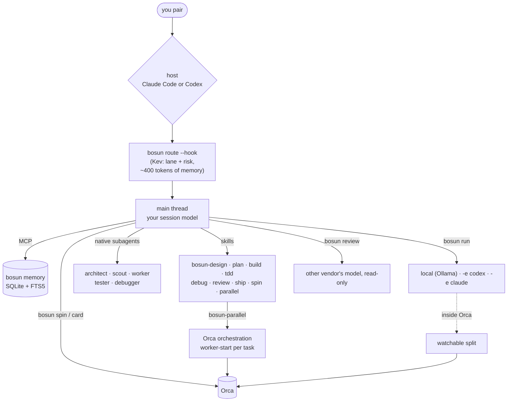
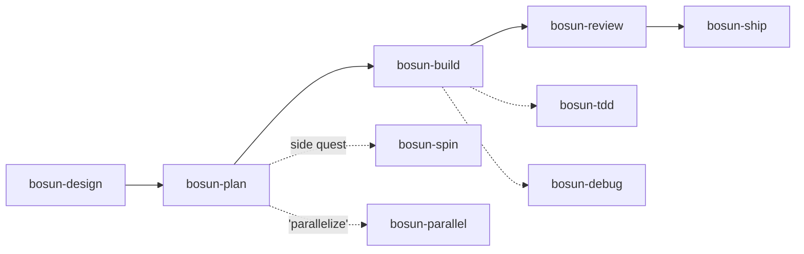
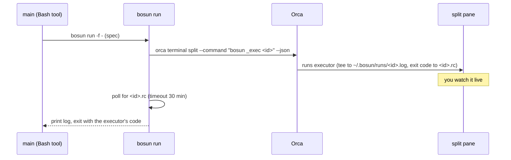
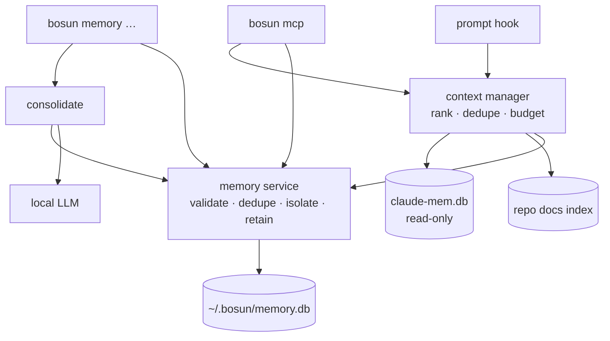
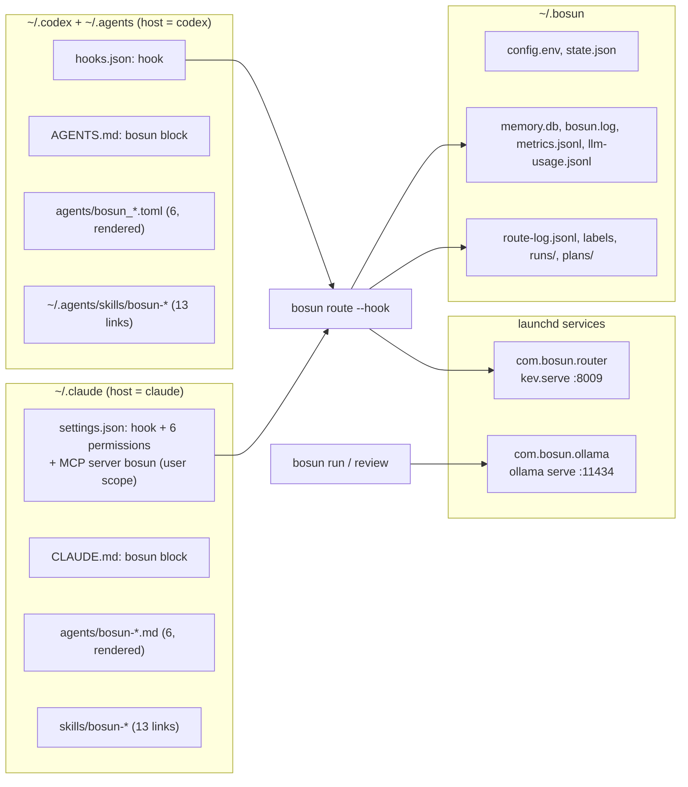

# bosun

**Pair with one agent; bosun routes the rest.**

You drive a native OpenCode, Codex or Claude Code session. OpenCode is the primary host; bosun gives that session:
- a crew of roles
- a full skill set
- a local model for mechanical edits
- the other vendor's model as reviewer
- Orca for side quests and, when you ask, parallel work
- a local-first memory: curated notes you review, a few of them added to each prompt, and MCP tools on demand

The unshipped final runtime uses Node ≥24, native host subscriptions or explicitly configured providers, and the project dependencies in package.json. Package0.2.0 remains until the complete v1.0 ship gate; native hosts, installation, automatic handoff and other remaining capabilities still need qualification. Sections describing the retired runtime below remain historical until the final documentation cleanup.



## Roles

Each role has one source file, `roles/<role>.md`. It's rendered as a Claude subagent (`bosun-<role>`) and a Codex agent (`bosun_<role>`), so the two rosters can't drift. Models come from `~/.bosun/config.env`; `bosun roles` prints the live table.

| Role | Claude | Codex | Can | For |
|---|---|---|---|---|
| **main** | your session (Opus) | your session (gpt-6-sol) | everything | you pair here and it decides |
| architect | opus · high | gpt-6-astra · high | read-only | 2–3 options, a recommendation, an executor-ready spec |
| scout | haiku | gpt-6-luna · low | read-only | where is X, call sites, summaries |
| worker | sonnet | gpt-6-luna · high | edit + test/lint/tsc | spec'd edits that need reasoning |
| tester | sonnet | gpt-6-luna · high | test files only | tests, and the red step of TDD |
| debugger | sonnet | gpt-6-luna · high | read + run, no source edits | repro → hypotheses → root cause; hands off to the architect after 2 misses |
| reviewer | `bosun review`: **gpt-6-sol** from Claude, **opus** from Codex | | read-only | every diff before it ships (the subagent is only the fallback) |
| local | `bosun run` → qwen3.6 in Ollama | same | fenced edits | mechanical edits, $0 |

## Skills

Thirteen skills in `skills/`; the installer links the same files into `~/.claude/skills` and `~/.agents/skills` for both hosts. The four context and OpenAI guidance skills also have repository-local links in `.agents/skills`, so Codex can discover them in this checkout without installing bosun. Reload skill discovery or start a new session if they do not appear yet.



| Skill | When | What it does |
|---|---|---|
| bosun-design | a change with an open decision | at most 3 questions → architect options → you pick |
| bosun-plan | an approved design or a clear goal | task specs (lane, files, change, must-not-change, verify) in `~/.bosun/plans/` |
| bosun-build | a plan or a spec | per task: dispatch by lane, read the diff, run verify yourself, escalate after 2 failures |
| bosun-tdd | test-first | the tester writes red, local or worker makes it green, then refactor |
| bosun-debug | a bug or failing test | the debugger reproduces and finds the root cause, then a minimal fix through build |
| bosun-review | before shipping, or `--pr N` | the cross-vendor reviewer → each finding checked against the code → fix the real ones |
| bosun-ship | ship / commit / PR | an evidence gate, then messages; commits or PRs only when you ask |
| bosun-spin | "spin this off" | a self-contained spec → a new Orca worktree + agent; you keep pairing |
| bosun-parallel | "parallelize this" | independent tasks → supervised Orca workers with each role's model |
| [bosun-openai-models](skills/bosun-openai-models/SKILL.md) | model choice or migration | dated GPT-6.1 Sol / Astra / Luna guidance, reasoning controls, and bosun config mapping |
| [bosun-codex](skills/bosun-codex/SKILL.md) | Codex integration work | CLI, config, skills, MCP, hooks, sessions, and native compaction |
| [bosun-chatgpt](skills/bosun-chatgpt/SKILL.md) | ChatGPT product or integration questions | Chat / Work / Codex distinctions, access, shared usage, and supported tools |
| [bosun-handoff](skills/bosun-handoff/SKILL.md) | save or resume task context | portable resume documents and checking the planned automatic handoff |

**Auto-handoff status (2026-10-04):** designed as a required v1.0 feature in [topic 8](docs/research/08-features.md) and [the completed roadmap](docs/plans/2026-10-01-bosun-v1.0-roadmap.md), but not implemented in v0.2. The proposed `[compact]` settings do not work in the current environment-file config. The handoff skill supports manual task-state transfer; it does not create a background context monitor.

**Release plan:** all selected work, including graph enrichment, the Ink dashboard and remote support, belongs to one v1.0. The roadmap uses internal implementation phases and one final ship gate; package-version changes wait until shipping.

**Latest v1.0 direction:** OpenCode becomes the primary experience, with native OpenCode, Codex and Claude Code support behind the same core. Local Ollama Clef-Flash replaces Kev's execution router and separate Python service; the handoff summarizer stays a separate model. See [the host/router revision](docs/research/09-opencode-clef.md). Legacy v0.2 entry points still use Kev; final runtime APIs are landing in `src/`.

The final `createOpenCodeRunner()` API now implements `AgentRunner` against an explicitly configured OpenCode v1.18.34 server. It preserves `provider/model`, native variant, canonical cwd and read/edit tool permissions, accepts optional Basic auth through an explicit username/password environment variable, and never starts a host or changes provider authentication. Public input is required before content/config access. Completion is bounded and requires a completed native reply plus idle status; cancellation sends native abort and waits for idle, with uncertain outcomes retained as unknown. Native MCP injection and turn limits are rejected. The permission allowlist does not establish OS isolation or constrain arbitrary plugin side effects; live host qualification and managed handoff remain pending. See [fixture provenance](test/fixtures/native-protocol-provenance.md).

The internal `createOpenCodeControl()` driver creates only bosun-owned roots with explicit native model, cwd, permissions and an independent owner/generation association. Its `create → seed → ready → run` flow proves empty native history before a true `noReply` seed, then reads back the bound message/part and exact seed hash before controlled turns. Fresh preparation requires a controller-staged next-generation claim; destination turns remain blocked until its dispatch gate selects that exact native session. Quiescence checks both native idle and terminal tool parts; uncertain mutations remain held without replay or source deletion. Its admission fence is process-local. An explicit known-source resume rechecks the matching fence, current dispatch owner and native state; it does not reopen unknown sources or retry effects. Effective context occupancy, durable/native fencing and live automatic handoff remain unverified; arbitrary UI sessions stay manual. `managedcontrols` selects the guarded native HTTP fixtures.

Final daemon jobs hold when quota is unknown or any known window has <10% remaining. `bosun quota status` shows retained metadata; `bosun quota refresh --host codex --model <exact-model>` asks the configured native source. Work/Codex share a pool; API/local units are separate. Exhaustion survives restart and reset times until fresh supported complete access evidence clears it; a recovered short window cannot clear an exhausted weekly window. The owner may use `bosun run --allow-unknown-quota` for missing/stale/unavailable telemetry, never known exhaustion or low headroom. Model callers cannot opt in. Claude/OpenCode currently need that explicit opt-in because they have no default supported quota source; no balance, paid overage or reset purchase is invented or automatic.

`bosun install --replace-plugins` turns off the plugins that overlap with these (superpowers, mattpocock-skills, code-review) and records what it disabled. `bosun uninstall` turns back on only those.

## Router feedback in the development runtime

Explicit `bosun route '<public task>'` returns Clef advice and a random observation ID. Stored observations contain only finite decision metadata, the model/digest/threshold and project/session grouping. Prompt text and prompt hashes are omitted. Hooks perform no inference.

```sh
bosun router observations
bosun router label <observation-id> main
# correct a label using its current version:
bosun router label <observation-id> worker --version 1
bosun router stats
```

These owner-only commands require a prepared running daemon. Feedback retains prior label events; an unknown commit requires inspection and cannot replay the old version. Historical metadata is available explicitly through `router observations --legacy`, `router label <id> <lane> --legacy` and `router stats --legacy`. Original logs and labels remain read-only; raw historical prompts are never displayed. Historical file labels have version zero and unknown time until replaced by explicit daemon feedback, and remain separate from current project evidence.

Stats report diagnostic label agreement and latency, with calibration unverified and automatic dispatch disabled. The final evaluator accepts80 explicitly public cases:20 development and60 held-out, separated by canonical repository and session groups. It freezes the threshold on development data before held-out capture and compares Clef with the deterministic policy baseline.

```sh
# analyze existing observations without inference:
bosun router eval evaluation.json --public
# explicitly capture the configured Clef model using a reviewed file hash:
bosun router eval evaluation.json --public --run --hash <sha256> --request-id evaluation-1
bosun job get <job-id>
bosun job result <job-id>
bosun router frozen <job-id>
# guarded offline synthetic software check:
node scripts/eval-router.mjs --fixture test/fixtures/router-eval.json
```

The file must be a regular owned JSON file inside the selected workspace; capture pins its hash and the exact model digest. The schema is [router-evaluation.ts](src/contracts/router-evaluation.ts). The included80-case corpus is synthetic test data. Reports include risk/forbidden-delegation, abstention/coverage, concentration reliability, uncertainty, attributed verification failures/escalations and warm/cold latency. Closed revision-bound verification receipts provide stronger outcome evidence; missing evidence remains unverified. Imported/synthetic results stay held. The evaluator never changes configuration or permissions, and an unknown job cannot replay inference. Owner-authored real tasks and authorized live/cold/hook-performance qualification remain required before a production threshold claim.

## Native host profiles (unshipped)

`bosun host plan opencode --native-version 1.18.34 --request-id setup-1 --output host-plan.json` prepares a reviewable plan. Inspect its generated files, skill links, model bindings, native arguments and hash. With the foreground daemon stopped, `bosun host apply host-plan.json --hash <planHash>` materializes only the reviewed profile under the prepared bosun runtime. `bosun host status <id>` reports receipt and file/configuration state; `bosun host undo <id> --version <version>` retires a matching profile into a retained archive. Changes, unexpected files or lost receipts require inspection. Repeated requests return their original receipt.

Current templates cover OpenCode1.18.34, Codex0.160.0 and Claude2.1.292. Codex planning accepts `--workspace <repository>` (default: cwd); missing repository .agents/skills links point to the canonical generated skills, while matching user skills and enablement settings are preserved. Undo removes matching owned links and empty directories whose recorded identity still matches. Generated read restrictions and MCP configuration require native qualification. A prepared profile starts no host and trusts no hook. Live activation, current installed Codex0.161 compatibility, plugin/hook controls and managed automatic handoff remain required v1.0 work.

OpenCode uses a custom config file and explicit skill paths, preserving personal/project JSON/JSONC and provider/model/plugin settings. Codex uses literal per-invocation role/MCP arguments and keeps native login, selected home and Orca-managed hooks untouched. Claude supplies a local plugin and appends the generated policy. Native launch metadata stamps model audience for bosun commands; this is a trusted-app guard, not an OS sandbox. All host capability/activation qualification remains explicit.

## Local Orca card checkpoints (2026-10-08)

From an owner session inside Orca, `bosun card in-review "public checkpoint" --public --request-id checkpoint-1` updates the enclosing Git worktree. Status-only checkpoints need no comment classification. Outside Orca the CLI returns a skipped result. Model callers cannot update cards. The adapter supports the source-inspected Orca1.4.222 CLI contract and holds other versions; live app qualification remains pending.

Updates bind the local execution host, full Orca worktree ID, actual Git root/common directory and project. The daemon records an intent before the update, retaining only comment/request hashes. Repeating a request returns its original receipt. Lost, malformed or mismatched responses remain unknown and block another update to that card. `bosun card get <id>` reads the receipt; `bosun card reconcile <id>` observes current status/hash without retrying. An owner can explicitly acknowledge a reviewed unknown receipt with `bosun card acknowledge <id> --version <version> --observation <hash>`, preserving its unknown outcome while allowing a later explicit request. Orca exposes no version check for its update, so this does not provide atomic coordination with simultaneous edits in the app.

## Orca

- **Watchable runs.** Inside Orca, `bosun run` opens a split next to you and runs the executor there. You watch it live: Claude runs stream each step (`→ Edit src/order.ts`), Codex prints its own progress. The main model gets only the final result and the exit code.
  - Closed split: if you close it mid-run, `bosun run` returns right away (exit 130, partial log).
  - Split never starts: after 30 s it runs inline instead, and never twice.
  - Timeout: after `RUN_TIMEOUT_MIN` (30), bosun stops the executor.
  - Placement: the split opens next to the terminal that asked for it.
  - Cleanup: runs older than a week are pruned from `~/.bosun/runs`.
- **`bosun spin`** creates a child worktree with `claude`, `codex` or `local` working on a self-contained spec. It starts from the default branch unless you pass `--stacked`.
- **`bosun card <status> "comment"`** keeps your worktree card current. Skills call it at checkpoints, and it does nothing outside Orca.
- **bosun-parallel** drives Orca's own `orchestration` skill: `worker-start --worktree new-child --agent … --model … --effort …`.



## Memory

With the prepared final runtime running, `bosun memory add --category project --private --auto --body '<note>'` derives its title from the first line without inference. Explicit `--title` and comma-separated `--tags` take precedence; the stored body and audit remain intact.

Public `--auto` queues an owner job when either title or tags is missing:

```sh
bosun memory add --category project --auto --body 'Public coding convention' --request-id note-1
bosun job get <returned-job-id>
bosun job result <returned-job-id>
```

Suggestions use `providers.default`, or the explicitly selected `--provider`, with its exact model. Supplying both title and tags skips generation. API providers require `--allow-remote-api` and supported admission; native CLI own inference remains unverified. Unknown or cancelled jobs retain their original request and cannot be replayed. Remote clients submit this job to the authority, which saves the original note without a client L1 copy. These are development-runtime commands; the older interfaces below remain historical pending final cleanup.

bosun keeps **curated** memory: facts you or the assistant chose to keep, such as decisions and why, conventions, gotchas and your preferences. It lives in `~/.bosun/memory.db` (SQLite with FTS5, mode 0600). claude-mem stays as it is: bosun reads its database read-only, and never stores the same thing twice.

**Local hook limitation during the v1.0 build:** ordinary default WAL installs remain held. An explicitly prepared READY public view can supply non-expiring local notes only with an independent owner `MEMORY_SOURCE_ID` binding from the initial plan/cutover receipt. Missing/mismatched bindings or invalid/pending/stale views hold without falling back to primary rows. Strict owner apply/reconcile is available below; no configuration or storage is activated automatically. Compatible unactivated rollback stores retain qualified reads. Owner CLI, MCP and remote memory behavior remain compatible. [ADR 0007](docs/adr/0007-bound-public-memory-reader.md) records the public reader, demonstrated bounded capacity and remaining restore/performance gates.

For qualified local public-view or rollback reads, router work finishes before the reader opens. Both local paths omit every finite-expiry note in SQL before packing: a pipe write can cross expiry under backpressure or an event-loop stall, and the timer cannot prove a hard delivery deadline. Non-expiring notes remain useful; finite-expiry local handoff support is still a ship gate. The connection stays held through packing and the actual native stdout callback, then releases. Memory delivery currently requires Node on POSIX pipe/socket stdout; file/TTY/Windows/Bun sinks omit local notes before DB open. Advice remains available, with no synchronous-sink latency guarantee. Local envelopes cap at 16 KiB; larger notes are dropped before advisory delivery. A pending write error/signal/250 ms event-loop timeout ends the one-shot hook with the reader retained to teardown, because native probes showed stdout `destroy`/`closed` can still flush later. That path records no completion/injection metric. This is native acceptance, not host acknowledgement or a total latency guarantee; [ADR 0004](docs/adr/0004-wal-read-view-protocol-qualification.md#local-caller-handoff-slice-7b1) records the evidence and remaining activation gates.

An explicit production storage primitive keeps primary write admission across a native SQLite-aware owner backup and persistent writer-floor commit. Real local memory/owner CLI, MCP docs and server callers recognize an applied explicit floor and use registered synchronous admission; normal unactivated stores remain compatible. Initial installation is available only through the explicit owner cutover commands below. Default paths are `<db-dir>/memory-view/public.db` and `<db-dir>/memory-backups`, with `MEMORY_VIEW_PATH`/`MEMORY_BACKUP_DIR` overrides; pending/unknown/mismatched gates fail closed before legacy chmod/migration. Cutover requires canonical owner-only 0700 directories/0600 single-link files. Strict plans report missing directories and legacy0755 modes as BLOCKED; the separate reviewed preparation commands can prepare the initial absent-view layout. [ADR 0005](docs/adr/0005-explicit-memory-writer-floor-cutover.md) records native admission and writer fencing.

```text
bosun memory cutover prepare-plan [--create-view-directory] [--create-backup-directory] [--json]
bosun memory cutover prepare --plan TOKEN --clients-stopped [--json]
bosun memory cutover plan [--retain-unreferenced] [--json]
bosun memory cutover apply --plan TOKEN --clients-stopped [--json]
bosun memory cutover reconcile --plan TOKEN --source-id UUID --clients-stopped [--retain-unreferenced] [--json]
bosun memory cutover recover-plan --source-id UUID [--retain-unreferenced] [--json]
bosun memory cutover recover --plan TOKEN --source-id UUID --clients-stopped [--retain-unreferenced] [--json]
bosun memory cutover restore-plan --source-id OLD_UUID [--retain-unreferenced] [--json]
bosun memory cutover restore --plan TOKEN --source-id OLD_UUID --new-source-id NEW_UUID --clients-stopped [--retain-unreferenced] [--json]
bosun memory cutover restore-reconcile-plan --source-id OLD_UUID --new-source-id NEW_UUID [--retain-unreferenced] [--json]
bosun memory cutover restore-reconcile --plan TOKEN --source-id OLD_UUID --new-source-id NEW_UUID --clients-stopped [--retain-unreferenced] [--json]
```

Stop every memory/MCP/docs/server client yourself. If the initial layout needs preparation, request only the missing leaf directories with the create flags, review every exact path/action in `prepare-plan`, then run `prepare` with that token and the stopped attestation. Preparation narrows only known owner directories at 0755/0750 to 0700 and single-link primary/WAL/SHM files at 0644/0640 to 0600; it can create only explicitly requested view/backups leaves at 0700 under existing owner parents. It holds any existing view, unknown/pending/orphan inventory, links, unowned paths, unsupported headers/sizes and other modes. It never recursively creates/changes permissions, deletes, opens SQLite, installs a floor or writes binding/configuration. Partial failures leave conservative changes and require inspection/replanning; permission broadening and deletion are never rollback actions.

After preparation, obtain a fresh strict `cutover plan`. Planning uses filesystem metadata and minimal headers without opening mutable SQLite; schema, floor and clients remain unverified. An absent view/empty backup directory produces an apply candidate and a new source UUID: **save that UUID independently before applying**. Both kinds of token bind configured paths/identities/metadata for a five-minute admission window; they are editable review/freshness bindings, not authorization seals or proof of drain. `--clients-stopped` is operator attestation, and no process drain/restart is automated. Existing CLI initialization can still create config as before; the whole CLI is not zero-IO.

Apply verifies the fresh plan and exact native schema under write admission, installs the planned UUID/floor and returns HOLD. Keep clients stopped through separate explicit publication and owner `MEMORY_SOURCE_ID` binding, then reopen all authorities; cached pre-floor/v1 writers are fenced. A strict reconcile plan is an unverified filesystem candidate, requires your independently saved `--source-id` before mutation, and **revokes READY to HOLD**. If an apply receipt is lost, a committed floor can reconcile using that saved planned UUID and a fresh token. Failed operations may have an unknown outcome; inspect and replan before reconciliation or eligible incomplete recovery.

`recover-plan` requires the independently saved initial UUID and inspects only the journal-free rollback view through native read-only SQLite, retaining a lease while verifying its exact gate/reference. Primary SQLite schema/floor remain unverified until admission. A valid format-1 copying gate can reference an empty/unfinished artifact with null digest; a backed gate requires its completed artifact's exact digest. `recover` requires absent primary floor and same-epoch gate before effects, then makes a **fresh exact backup of current source** under continuous admission, preserving the prior referenced artifact and source epoch. Already-committed floors require explicit reconcile; no generation is reset. Applied-without-floor, unknown pre-intent views and journals remain held; current-reference restore has its separate workflow below.

Bounded inventory permits up to 32 UUID `.db` owner-only single-link files, 64 MiB each and 256 MiB total; recovery requires capacity for one more artifact. Unreferenced files have **unverified ownership**: only metadata/count is reported, their bytes are never read/hashed/adopted/deleted. If they coexist, review `--retain-unreferenced` at both planning and mutation; it acknowledges preservation, not ownership. Use `plan --retain-unreferenced` followed by matching explicit reconcile for a committed floor with retained leftovers. Recovery automatically preserves its previously verified reference; the receipt distinguishes that reference from separately acknowledged unrelated files. Unknown names/links/modes/oversize/sidecars remain blocked. Ordinary open/hook/MCP/server never recover automatically. Verified external drain/restart, general orphan disposition, broader interrupted-storage recovery and durability remain ship gates. [ADR 0008](docs/adr/0008-strict-owner-memory-cutover.md) records exact scope and sidecar/freshness limits.

`restore-plan` verifies the current referenced backup and generates a new source UUID before effects: **save both old and new UUIDs independently**. `restore` preserves a fresh native backup of current source, restores recorded memories/audit/docs with explicit keys and privacy/scope/expiry, rotates the epoch and returns HOLD. An immutable pending intent fences readers/cached writers; hooks inspect only its filename. After an unknown outcome, obtain `restore-reconcile-plan` with both saved UUIDs. Reconciliation checks the exact old/new native floor, never replays restore, and preserves intervening writes/generation. A pending owned view journal is planned using only filesystem/minimal database metadata and the immutable capsule: no native SQLite handle, journal payload or backup bytes are opened, and view/reference remain **unverified**. Only explicit reconciliation after actual source-floor admission may let SQLite recover it; unknown floors/layouts and invalid recovered schema stay held. Reopen authorities and separately publish/set the new owner binding. Referenced mid-backup sidecars, receipt-only journals and arbitrary backup selection remain held. [ADR 0009](docs/adr/0009-owned-memory-restore.md) records the state machine, bounds and trusted-application qualification.

`bosun memory publish [--json]` explicitly publishes a public snapshot only for an already-applied local floor. It upgrades the fixed rollback inode and writer format, fences cached old writers, and commits validated public rows/FTS/READY under primary admission. Supported mutations revoke it to HOLD until another explicit publish; no automatic rebuild runs. Private/unclassified/expired/audit/docs/owner-backup data is excluded from public tables/receipts, while the owner recovery metadata remains in its own table. HOLD is audience revocation, not physical erasure. A post-commit cleanup failure may report an unknown outcome if a lease prevents re-HOLD. Publication and reading share finite limits of 10,000 rows, 16 MiB encoded and a 64 MiB view; source plus WAL remains capped at 64 MiB. The guarded 10,000-row medium-body corpus now publishes READY and supplies correct scoped get/search and actual native hook notes. The earlier 4 MiB encoded-cap HOLD is historical; this functional result does not qualify every 10k corpus or performance. Oversized preflight artifacts remain unchanged and ineligible even if their stored marker was READY. The reader retains its same-inode lease through native delivery and omits finite-expiry local notes; broader interrupted-storage recovery, verified drain/restart, durability and finite-expiry handoff remain gates. [ADR 0006](docs/adr/0006-explicit-public-memory-publication.md) records measurements and exact limits.

Doctor's memory check creates/migrates nothing: missing stays absent, mutable WAL is held without claiming its schema is verified, and compatible rollback files report their queried migration version. The writer-discovery probe can open WAL and perform native sidecar housekeeping; it is not the zero-write hook reader.

- **Categories:** `personal` (you, in every project), `project` (this repo), `session` (expires after `MEMORY_SESSION_TTL_DAYS`, 7).
- **Projects:** a project is the hash of the repo's normalized `origin` URL. Every clone, worktree and machine of a repo shares one project memory. Projects can't see each other, unless a memory is `shared` or you list a project in `MEMORY_LINKED_PROJECTS`.
- **Each prompt:** when the storage path is qualified/available, the hook adds up to ~400 tokens (estimated) of the most relevant curated notes, next to Kev's hint. A note must share at least `CONTEXT_HOOK_MIN_TERMS` (2) distinct words with the prompt and score `CONTEXT_HOOK_MIN_SCORE` (0.35); otherwise the hook stays silent. It fails open when anything goes wrong, and until you store a first memory it opens nothing at all. The ordinary read APIs filter expiry without archiving; local hook handoff additionally omits finite-expiry notes. Readers never touch access/version/events/mode. Legacy hook/context telemetry and routing inference still run outside that reader; the whole hook is not yet zero-IO or lean.
- **On demand (MCP, `bosun mcp`):** `memory_search`, `memory_get`, `memory_store`, `memory_update`, `memory_delete`, `context_retrieve` (curated + this repo's Markdown docs + claude-mem, ranked and fitted to a budget) and `project_knowledge_search` (docs + claude-mem).
- **Private:** `--private` memories stay out of hook/search/context output. MCP get/store/update/delete replies for private or unclassified records contain only `{memory:{private:true}}`, without title, body, tags, provenance, IDs, hashes, events, timestamps, versions, duplicate or status details. Explicitly private input is blocked before every inference provider, including local models. `memory add --private --auto` uses the first line (up to 80 characters) and no suggested tags; explicit title/tags win. Logs and metrics use finite metadata fields and never serialize titles, bodies, prompts, arbitrary nested objects, or error messages/causes.

**Foundation privacy fixes (2026-10-04):** private auto suggestions now make zero model calls, and new route observations contain validated decision metadata plus a random ID per observation. Prompt snippets and text-derived route hashes are no longer written. Historical logs are left unchanged; their prompts are never redisplayed by label/stats/eval. Existing stored memory IDs, scope and content hashes retain their storage semantics.

Legacy SQLite privacy flags are conservative: only stored integer `0` is public, and only stored integer `1` enables sharing across projects. Empty, text, blob and other numeric flags stay protected or unshared. Owner get/search can still inspect in-scope content; duplicate requests and edits that omit flags preserve the stored values. Use the owner CLI's explicit `memory update <id> --public` to reclassify a protected note. MCP continues to permit opaque private edits/deletes and cannot make a note public.

Use `memory update <id> --unshared` to remove sharing across projects; the owner and explicitly linked projects retain read access. `--shared` enables sharing, and `memory add` accepts both choices. Combining `--shared` and `--unshared` fails before project discovery, file reads, model calls or opening memory storage.

`memory update <id> --status active` restores an archived note or accepts a proposal; `--status archived` archives it. Restoring an expired archived **session** note renews its deadline from the update time using the current configured `MEMORY_SESSION_TTL_DAYS` (zero disables expiry). The old schema stores the deadline, not the selected TTL duration, so a previous custom `--ttl-days` duration cannot be recovered. Unexpired deadlines, ordinary edits and other categories keep their existing expiry behavior. Malformed session expiry blocks explicit restore without changing the row. Legacy CLI/MCP construction and reads still perform expiry maintenance, which can advance the version before an update; omit `--version` to use the current version or read it again explicitly. Private MCP restore replies remain opaque.

Use `bosun route --private …` or `route --hook --private` to skip routing and retrieval for a private request. Hook payloads can also mark `private: true` or `privacy: "private"`; malformed explicit privacy markers fail closed. Unmarked v0.2 hook input retains its existing routing behavior until typed host adapters carry classification. There is no automatic secret detection: mark private input explicitly. Full v1.0 screening, enrichment and live-host qualification remain implementation work in [the roadmap](docs/plans/2026-10-01-bosun-v1.0-roadmap.md).
- **Proposals:** `bosun memory consolidate` has the local model turn this repo's recent claude-mem session summaries into **proposed** memories. Nothing becomes durable until you accept it in `bosun memory review` (or with MCP `memory_update`).

| You want | Do |
|---|---|
| Remember something | `bosun memory add -t "Use pnpm" --tags tooling "Always pnpm install; npm breaks the lockfile"` (`--auto` suggests title and tags) |
| Find it | `bosun memory search lockfile`, `bosun memory get <id>` (with its audit trail) |
| Change, restore or drop it | `bosun memory update <id> -b "…"`, `bosun memory update <id> --unshared`, `bosun memory update <id> --status active`, `bosun memory delete <id>` (archive), `bosun memory purge <id>` |
| Review proposals | `bosun memory consolidate`, then `bosun memory review` |
| Housekeeping | `bosun memory prune` (expired → archived, archived > 90 days → purged) |
| Numbers | `bosun memory stats` (scoped persisted counts and project ID), `bosun memory bench`, `bosun memory eval <public-memory-eval.json> --public` |



More in [ARCHITECTURE.md](ARCHITECTURE.md): the schema, the ranking formula, and measured numbers.

## Split setup (optional)

Kev, the LLMs and memory can each run on another machine, for example a Mac Studio, with your laptop as the client. Each has its own URL: `ROUTER_URL`, `OLLAMA_URL`, `MEMORY_URL`. Empty means local, as before.

```bash
# on the server Mac: only the listed services, bound to its Tailscale IP
bosun install --serve kev,llm,memory
# on each client: it prints the exact line to run
bosun install --remote kev=http://100.x.y.z:8009,llm=http://100.x.y.z:11434,memory=http://100.x.y.z:8788
```

- **Bind:** `SERVE_BIND` defaults to the server's Tailscale IPv4. Without Tailscale, install refuses until you set a LAN IP. It's never `0.0.0.0` unless you set it.
- **Allowlist:** `bosun serve` answers 403 to any source outside `SERVE_ALLOW` (default `127.0.0.1/32,100.64.0.0/10` plus the bind address's subnet). Ollama can't filter by IP, so it relies on its bind address.
- **No tokens yet (v1):** anyone who can reach the memory port can read your memory, so keep it on a private network. The API is versioned (`/v1`), and one `authorize()` point is ready for auth later.
- **Transport:** plain HTTP. Tailscale encrypts it (WireGuard); a plain LAN doesn't.
- **When the server is down:** the hook's memory part gives up after `REMOTE_HOOK_TIMEOUT_MS` (300) and stays silent. After `REMOTE_TIMEOUT_MS` (5000), the owner CLI retains "memory server unreachable at …"; MCP returns "memory unavailable" with the closed `unavailable` code. There's no offline queue: writes while offline fail visibly.
- claude-mem, the docs index, the hook and the MCP server always run on the client. Only the curated store moves.
- `bosun doctor` checks each URL, the server's `/v1/health` (a version mismatch is a warning), and the model on the remote Ollama. `bosun uninstall` removes the server's services, and on a client puts the URLs back.

## Install (not run yet)

```bash
cd ~/Developer/bosun
npm test                                     # 87 offline checks: no installs, no network, sandboxed HOME
./install.sh --host both --replace-plugins   # or --host claude / --host codex; drop --replace-plugins to keep your plugins
```

It sets up Ollama (≥ 0.34) with a 64K context and one model at a time, pulls `qwen3.6:35b-a3b-coding-nvfp4` (~22 GB), installs Kev (`kev-0.8b`), links `~/.local/bin/bosun`, wires each host (including the `bosun` MCP server: `claude mcp add --scope user`, and `codex mcp add` in each Codex home), runs `bosun doctor`, and ends with a smoke test in which the local model fixes a one-line bug. **Codex only:** open `codex` once, run `/hooks`, and trust the bosun hook.

**Codex inside Orca:** Orca gives Codex its own home folder (`CODEX_HOME`) and manages its `hooks.json`. bosun writes its rules and agents there too, so Codex in Orca gets the same roles and skills. The Kev hint appears only in Codex outside Orca, because Orca rewrites that `hooks.json`.



- **What it preserves:** wiring is idempotent. Your hooks (codegraph, orca, …), permissions and rules are kept. `settings.json` and `hooks.json` are backed up to `*.bak-bosun` first.
- **Broken config:** a `settings.json` or `hooks.json` that isn't valid JSON, or a hand-broken bosun marker in `CLAUDE.md`/`AGENTS.md`, stops install, uninstall and rewiring before anything is changed.
- **Uninstall:** `bosun uninstall` undoes only what bosun did:
  - removes its services, hook, permissions, rules, agents and skills, plus any file it created
  - removes its own `~/.local/bin/bosun` link and its own `~/.zshrc` PATH line
  - puts your own Ollama.app launchctl values back
  - moves your own files that it had set aside back in place
  - re-enables the plugins it disabled (`--replace-plugins` stays in effect across re-installs until then)

  It keeps the models, the Kev checkout, `~/.bosun` and the `*.bak-bosun` backups.

## Daily use

| You want | Do |
|---|---|
| Normal work | `claude` or `codex` as usual; the bosun block and Kev's hint steer delegation |
| Force a lane | say it: "architect this", "have the tester write the red test", "offload to local" |
| Skip the router once | add `#noroute` |
| Local edit by hand | `bosun run "add nullable deliveryWindow to OrderDto + mapper; verify: yarn tsc --noEmit"` |
| Other plan's model | `bosun run -e codex "…"` (GPT) / `bosun run -e claude "…"` (Sonnet) |
| Cross-vendor review | `bosun review`, `bosun review --pr 123` |
| Side quest | `bosun spin --agent codex "…"` |
| Health | `bosun doctor`, `bosun status`, `bosun roles` |
| Free RAM | `bosun stop` … `bosun start` (hosts keep working; hints and local runs pause) |
| Other local model | `bosun model devstral-small-2:24b` |
| Tune the router | `bosun label`, then `bosun eval` (after about a week) |
| Memory | `bosun memory add …`, `bosun memory search …`, `bosun memory review` (see [Memory](#memory)) |

`bosun label` displays only observation ID/time and decision fields, including for historical rows. Correlate these with your own current session before assigning a ground-truth lane; skip observations you cannot identify. Metadata cannot reconstruct an old task, so the label workflow no longer provides prompt replay or groups repeated prompts by a content hash. Legacy ten-character IDs still join their existing labels for evaluation; historical prompt records are never automatically rewritten or deleted.

## Local model and harness

| Model | Size | Notes |
|---|---|---|
| **qwen3.6:35b-a3b-coding-nvfp4** ✅ | 22 GB | SWE-bench Verified 73.4, Terminal-Bench 2.0 51.5; MoE with 3B active on Ollama's MLX engine |
| devstral-small-2:24b (fallback) | 15 GB | 65.8, from a different model family, so a Qwen template bug won't take out both |
| muse-glimmer:30b-nvfp4 | 17 GB | 76.0 but dense (slower); try it for harder edits |
| qwen3.8:27b-mlx | 18 GB | strongest agentic scores, but Ollama #17778 breaks tool loops for now |

- **`LOCAL_HARNESS=claude`** (the default) runs `claude -p --bare`: 3 tools, a system prompt of about 400 characters, and a dummy `ollama` key. It never touches your subscription.
  - Why `--bare`: Ollama's Anthropic endpoint doesn't cache prompts (#18431), so the full ~27K-character prompt would be re-read on every turn.
- **`LOCAL_HARNESS=codex`** runs `codex exec --oss` in the macOS sandbox: repo-only writes, `.git` protected, no network.
- **Executor rules** travel inside the prompt, because Ollama's Responses API drops developer-role messages (#18305).
- **LiteLLM was removed.** Both CLIs talk to Ollama directly.

## Safety

- **Local Claude executor:** `--bare`, the dummy key, and `ANTHROPIC_AUTH_TOKEN` plus the parent session's own `CLAUDE_CODE_*` variables stripped. The e2e test asserts that no `Authorization` header ever reaches the endpoint.
- **Executor fence** (Claude, `dontAsk`):
  - The only commands that run: read commands, `git mv`, `mkdir -p`, test/lint/tsc, and `git status/diff/log/show`.
  - `-e claude` and the Claude reviewer also run `--restricted`: your user and project settings can't widen what they're allowed to do.
  - Always denied: commit, push, reset, checkout, restore, clean, stash, rebase, `rm`, and the web.
- **Codex executors:** the OS sandbox with no network.
- **Reviewer:** read-only on both vendors (Claude: Read/Glob/Grep only; Codex: `-s read-only`).
- **Codex host:** `bosun` commands need localhost and `~/.bosun`, so the Codex rules block tells the model to ask to run them outside the sandbox. You approve once.
- **Guard:** `BOSUN_DEPTH` keeps executors from spawning more work, and the hook stays silent inside them.
- **Spin-offs and parallel workers** are told not to commit, push, or fan out further. Orca's depth limit backs that up.
- **High-risk prompts** (payments, orders, invoices, auth, data, infra) always go to the main thread.
- **Memory:** `bosun memory` is never auto-allowed for the model (the owner CLI shows private content and can purge), and MCP can mark a memory private but never make it public again. Project isolation comes from your environment (cwd, `CLAUDE_PROJECT_DIR`), never from tool arguments. Out-of-scope ids read as "not found". MCP and curated context check classification before accessing returned content, even when a remote adapter ignores filtering; model exposure requires an own boolean `private: false`. Denied mutation/read replies use a constant opaque placeholder. Model-facing memory errors carry finite text/codes without provider messages or current-version details. Stored IDs/scope, owner CLI reads/mutations and historical files remain unchanged. The local reader is qualified for bounded legacy rollback stores and independently bound READY public views; safe WAL fallback, atomic private mutation authorization, races and writer/index/expiry separation remain implementation work. Remote generation rejects explicitly private input and `LLM_REMOTE=claude` is off by default.

## Tests

`npm test` uses the mandatory Node launcher. It verifies containment before importing application code, then runs the offline suite sequentially against isolated HOME, bosun/host/XDG/temp roots, stub CLIs, registered ephemeral loopback mocks and fixture databases. Inherited credentials, provider settings and user configuration are removed. Installer/supervisor/model commands use stubs; filesystem, SQLite, child-process and network guards prevent accidental external effects. Every test rejects direct `node --test` invocation. **Never run bosun tests under Bun.**

Supported commands (no dependency installation or model pulls):

```sh
npm test
node scripts/run-tests.mjs --suite containment --runtime node
node scripts/run-tests.mjs --suite legacy --runtime node
node scripts/run-tests.mjs --suite privacy --runtime node
node scripts/run-tests.mjs --suite exposure --runtime node
node scripts/run-tests.mjs --suite readonly --runtime node
node scripts/run-tests.mjs --suite jobs --runtime node
node scripts/run-tests.mjs --suite daemonmemory --runtime node
node scripts/run-tests.mjs --suite memoryadapter --runtime node
node scripts/run-tests.mjs --suite docsadapter --runtime node
node scripts/run-tests.mjs --suite publicreader --runtime node
node scripts/run-tests.mjs --suite readview --runtime node
node scripts/run-tests.mjs --suite hooklease --runtime node
node scripts/run-tests.mjs --suite benchmark --runtime node
node scripts/run-tests.mjs --suite core,contracts,boundaries --runtime node
node scripts/run-tests.mjs --suite router,opencode --runtime node
npm run boundaries
npm run typecheck
```

`all` is the default suite; it contains containment probes, legacy tests, privacy/exposure canaries, core/Router/MemoryStore/implemented-docs-ContextSource acceptance tests, native protocol fixtures, native read-only SQLite/read-view qualification and boundary fixtures. `readview` tests a synthetic WAL writer/public rollback-view protocol, backup, revocation, process crashes and explicit bypass limits; it activates no production view. `hooklease` qualifies actual local reader lifetime through child stdout handoff/cancellation on POSIX. `benchmark` selects the existing memory/benchmark/eval regressions while retaining their legacy coverage. `exposure` covers private memory metadata, malformed adapters and actual legacy SQLite flags, opaque receipts and safe error replies, including guarded stdio MCP and transaction-time mutation classification. `readonly` proves the implemented MemoryStore read subset and real local hook. `memoryadapter` exercises the actual writable SQLite adapter and legacy owner composition on plain and registered native sessions, query footprints, deterministic maintenance, dependency/clock failures and content-free best-effort telemetry. Direct owner queries perform no maintenance; legacy CLI/MCP/HTTP composition still expires/touches. Native WAL opens and the full caller closure have separate qualification limits, described in [the adapter decision](docs/adr/0010-writable-memory-adapter.md). `contracts` selects `core`, Clef `router`, `readonly`, `memoryadapter`, `docsadapter` and `jobs`; `contextpipeline` is also included as described below. `router` and `opencode` use synthetic loopback fixtures, never live models/hosts. Known comma-separated groups are supported and selected files run once. Every selected application suite runs the containment probes first. Unknown options, groups and runtimes fail instead of skipping checks. The typecheck launcher uses the existing local compiler with the same isolated environment.

`docsadapter` exercises the actual scoped docs snapshot ContextSource on native plain/registered sessions, unchanged query footprints, admitted index writes, worktrees/nested repositories, complete bounded enumeration, file rejection/source races, native READY leases/HOLD, finite telemetry and real CLI/MCP/context canaries. Direct `SqliteDocs` queries index no files and read the persisted configured root/project snapshot using trusted caller/linked-project policy. The compatible `Docs` source still indexes during search until daemon scheduling migrates; held attempts return no docs and preserve saved rows. Index bounds are 2000 files, 256 KiB per file, 2 MiB listing and 16 MiB total encoded docs/10,000 saved rows. Ambiguous same-project nested rows are retained and excluded from outer queries. Snapshot queries are not live filesystem revocation leases. Conservative encoded reservation and post-DML checks preserve 64 MiB eligibility; registered sessions additionally enforce the native page/WAL reservation in [ADR 0013](docs/adr/0013-registered-writer-capacity-and-receipts.md). Plain/explicit owner-operation allocation and broader recovery remain storage gates. Listed source bodies are verified within the finite budget even when their timestamp is unchanged; identical content avoids DML, and descriptor cleanup failures hold indexing. See [ADR 0011](docs/adr/0011-scoped-docs-query-and-index.md).

`contextpipeline` exercises the actual core context use case with injected clocks/hash/UTC date labels/measurement, deterministic ranking/ties/dedupe/token edges, source capability/identity checks before content, declared-field projection, finite errors, denied curated getters and direct imports with unusable ambient state. It is also part of `contracts`; `context` selects the existing ranking/provider/native-hook tests. Real `lib/context.ts` callers delegate through fixed reviewed source metadata, while the core imports no config, filesystem, SQLite or ambient clocks. The unchanged content hash has a lean platform helper and exact SQLite compatibility forward. Existing MemoryService expiry/touch, compatible docs indexing, hook telemetry and retained native stdout leases keep their behavior. At most 64 verified callbacks and 1000 returned hits per source are admitted; these are count bounds, not payload byte or latency guarantees. [ADR 0012](docs/adr/0012-context-ranking-and-composition.md) records the exact limits. Hook snapshots/lean closure, daemon scheduling, explicit owner-operation allocation/recovery, artifact disposition/drain and the remaining v1.0 gates still require implementation.

`writer` includes actual cached capacity/sidecar admission, native dirty-page/FTS COMMIT/FULL probes, conservative page/WAL boundary and checkpoint/close/reopen checks, and committed-data unknown-receipt/no-replay tests. Registered writers recheck the 64 MiB source-plus-WAL eligibility limit and use a stricter native reservation for protected DML; usable capacity depends on existing pages and retained WAL. Larger eligible legacy stores retain queries and no-DML maintenance while mutations may hold. Failed COMMIT without positive rollback evidence or failed post-commit confirmation reports `receipt_unknown` with outcome `unknown`, discards the cached writer and performs no replay. These trusted-application apparent-file-length bounds do not qualify owner cutover/restore/publication final allocation, arbitrary callbacks, power loss or overall storage completion. See [ADR 0013](docs/adr/0013-registered-writer-capacity-and-receipts.md).

`cutover` exercises the explicit production backup/floor primitive only on guarded synthetic WAL databases: exact data preservation, persistent old-writer fencing, real process-crash recovery, fresh backups after rolled-back attempts, identity/epoch rejection and finite cleanup failures. It activates no owner database or public view.

`writer` covers registered real local APIs, owner CLI, stdio MCP, authoritative HTTP serve, docs writes, retention/touch, path overrides/holds and read-only doctor behavior. `memory` selects existing memory/MCP/serve/context compatibility tests and retains their legacy coverage. Both use synthetic guarded roots; registered fixture floors are prepared only with the production explicit primitive.

`publication` covers production explicit publication/CLI, v2 writer fencing, native leases, multiprocess contention/crashes, actual hot-journal recovery, private/backup projection, late clocks/expiry, capacity and uncertain post-commit receipts. It activates no owner database.

`publicreader` qualifies the production bound public reader, scoped projection and unchanged reader footprint, expected epoch/schema/identity holds, independent row/encoded/physical/source-WAL limits, native retained revocation/delivery/cancel/kill/backpressure, finite-expiry omission/stalls, and pending hot-journal holds. `hooklease` also covers the legacy rollback expiry omission. `publication` includes useful scoped and native hook delivery from the 10,000-row medium-body corpus. All fixtures are synthetic; broader interrupted-storage recovery, verified process drain/restart, durability, finite-expiry handoff and designated-Mac p95 remain unqualified.

`owner` includes current-reference restore, new-epoch fencing, seven native process-kill checkpoints, old/new-floor no-replay reconciliation, bounded capsule/identity races and explicit retention. It also covers filesystem-only real CLI plan footprints, reviewed initial legacy-layout preparation and partial/close/identity failures, strict permission/layout blockers, independently planned source UUID and explicit apply/reconcile, closed/live WAL admission freshness, private/audit/ID preservation, stale/invalid inputs, native fencing, READY revocation, receipt-loss reconciliation and finite adversarial errors. It does not stop/restart clients or activate owner storage/configuration.

`bosun memory bench --n 10000 --public-view` creates only a temporary final runtime and publishes its synthetic view. It opens no owner storage/configuration and writes no owner telemetry. Store/search/packing measurements and writer close/reopen costs are separate. The writer closes/reopens every 256 loading notes to retain its native source+WAL bound; this does not qualify uninterrupted10k writing. Without `--public-view`, the view stays held. Measured child attempts start fresh Node processes without a daemon. A successful envelope containing exactly the known synthetic note IDs qualifies delivery; empty output is held, and failed/unqualified output supplies no retrieval timing. The 10k fixture delivers 20/20 measured injections. Reports include first-run/full wall time and verified-injection wall time, with no inferred hook component timing. Actual host tokens and compiled warm-daemon/designated-Mac latency remain unverified.

Evaluate an approved public export with the final FTS and packing policy:

```sh
node bin/bosun memory eval public-memory-eval.json --public
node scripts/eval-memory.mjs --fixture test/fixtures/memory-eval.json --baseline fts
```

The CLI file must be relative to the current workspace, regular, owned, bounded and unchanged through evaluation. Its schema is illustrated by the synthetic fixture: public notes/cases,100 queries split20 development/80 held-out, disjoint source/session groups, graded support IDs/quotes, and at least20 negative queries. Private/unclassified entries and known credentials are refused before payload traversal. Approved exports load into disposable registered storage with their original IDs; owner databases, models and services are untouched. Reports distinguish raw recall@5/MRR@20 from evidence actually visible after400-token-estimate packing, precision, negative injection and truncation losses. The fixture proves execution/policy behavior only. A/B/C lexical and reviewed one-hop comparisons are implemented. Scoped summary/profile E and actual MCP evaluation are implemented. Vector comparison and real-corpus/actual-token/compiled-latency qualification remain unfinished; automatic activation stays held.

`memory stats` returns scoped persisted-row counts by category/status/privacy, without content or maintenance. `memory purge <id>` permanently removes an archived note while retaining its audit events. `memory review` lists scoped proposals for explicit `memory accept <id>` / `memory reject <id>` decisions. These owner functions are unavailable to model RPC/MCP; remote configurations send stats/purge to the authority. [The current checkpoint](HANDOFF.md) records full-suite failures and remaining v1.0 work.

The [offline Clef/OpenCode prototype](ARCHITECTURE.md#offline-native-protocol-prototypes-2026-10-05) adds an explicitly selected decision adapter and pinned native metadata codecs/read-only probe. The existing Kev default/service remains active. Fixtures establish no model calibration, loaded readiness, verified context occupancy or automatic handoff; native host wiring and complete lifecycle migration remain implementation work.

`npm run boundaries` checks the production import graph with the existing local TypeScript AST/TypeChecker API: core dependencies/globals, resolved aliases, type imports/reexports, literal dynamic imports, loader indirection, cycles and production/test/cross-adapter edges. It checks source structure, not compiled-hook size/latency or arbitrary JavaScript purity. [The current extraction](ARCHITECTURE.md#compatible-core-extraction-2026-10-04) records the remaining legacy seams.

The suite covers:

- config precedence
- router hints and the cases where it stays silent
- roles rendering for both hosts
- wiring twice, then unwire restoring everything
- plist escaping
- the exact executor and reviewer flags
- the watch/fallback/closed-split paths
- spin and card
- a lint that every role, skill and command a skill mentions actually exists
- memory: storage, updates and version conflicts, duplicates, project isolation, retention, privacy, migrations, concurrent writers, FTS-safe queries
- context ranking, dedupe and budgets; the hook with memory (silent, fail-open, a 50 KB prompt); the claude-mem and docs providers
- the LLM router (timeouts, retries, bad JSON, fallback, remote gating), consolidation and review
- a real stdio MCP session; MCP registration in both hosts
- the split setup: `bosun serve` + the remote client (same results as local), the allowlist, unreachable and foreign servers, `install --serve` and `--remote`

The real-Claude fixture is excluded from the default runner and does no executable discovery at import. It requires an explicit absolute `BOSUN_TEST_REAL_CLAUDE` setting and a qualified live-host launcher; that launcher is not implemented or authorized yet. The offline guard rejects real host binaries even if installed.

This guard prevents accidental effects in trusted repository tests. It is not an OS security sandbox: arbitrary native code, inherited file descriptors, deliberate monkeypatch removal and native helpers cannot be treated as hostile-code isolation. SQLite file opens/ATTACH and known native helper operations are checked explicitly; symlink checks do not eliminate concurrent filesystem races. Real native Git is pinned from an existing local installation, with sandbox cwd, clean config, disabled hooks and file-only transport. External services, DNS, UDP, socket paths and unregistered loopback ports are denied; registered mocks can serve HTTP/HTTPS clients across guarded children. Run-root cleanup retires registered detached Node test children before removing their files.

The final daemon job API is available through `openDaemonJobs` in `src/app/jobs.ts`. Composition supplies explicit owner/state paths, selected lazy AgentRunner factories and admission policy. Call `recover()` at owned startup, `submit(input, trustedScope)`, then `runQueued()`; `get/result/list/events`, `cancel/release` and asynchronous `drain/close` operate on persisted scoped state. Unknown jobs never automatically rerun. Prompts/results stay in bounded scoped records and event metadata excludes source content. The ledger has finite queue/record/event limits; owner-only rows remain hidden from model callers. Drain waits for callbacks to settle before storage/ownership close. [The architecture](ARCHITECTURE.md#final-daemon-job-spine-2026-10-06) records the implemented behavior. The actual CLI and MCP bridge now use these shared methods.

`job retention` reports scoped content retention and capacity; `job prune --limit <n>` compacts only settled content older than `daemon.jobRetentionDays` (default30). Original scoped request receipts are retained so repeated IDs return their completed job without executing it again. Queued, held, running and unknown jobs retain their evidence. Finite receipt/aggregate capacity holds further cleanup instead of evicting that evidence. `usage --daily` reports archived-attempt coverage, separated by exact scope/model/effort/billing/pool; recent attempts remain under `usage`, and missing/ambiguous totals stay null. `daemon.drainMs` (default5000) grants already running work a grace before cancellation; shutdown still awaits positive runner/process settlement before releasing authority.

The final memory API is `openDaemonMemory` in `src/app/memory.ts`, supplied a registered layout, the jobs runtime's `assertOwner` and explicit dependencies. Its direct memory store and project docs/context queries use persisted snapshots; expire/touch/prune, docs `index()` and `publish()` are explicit daemon jobs. Borrowed source close keeps the shared writer alive; runtime close retains externally supplied daemon authority. `initializeMemory` is an explicit new-file setup primitive, while normal daemon open refuses unregistered layouts. [The architecture](ARCHITECTURE.md#final-daemon-memory-composition-2026-10-06) describes ownership, cached format fencing and query/delivery limits. CLI memory/context/docs operations and MCP model tools now share this authority.

The final MCP bridge uses the pinned v2 SDK with fixed model scope. Owner installation, consolidation and profile commands are excluded from tools. Structured model replies are bounded to20,000 UTF8 bytes; partial lists/text are marked `truncated`, and an oversized successful public memory mutation retains its id/version receipt without its body. Unknown mutation outcomes still require inspection and never trigger replay.

Local notifications default disabled. With `notifications.enabled = true`, committed job transitions can submit an opaque job reference and queued/held/failed/done state through the local macOS adapter. `notifications status` reports scoped receipts, missing/unsupported delivery, pressure and uncertainty; it sends nothing. Default capacity is4096 receipts and64 pending. Native command exit0 acknowledges submission, while OS visibility remains unverified. Unknown delivery is retained without automatic retry, and shutdown waits for pending callbacks before releasing daemon ownership. These flows were tested with synthetic callbacks and a guarded command stub; no actual notification was displayed.

The development entry uses `src/app/cli.ts` or the lean `src/app/hook.ts`. New-runtime commands include `setup`, `doctor`, `host`, `daemon run`, `status`, `dashboard`, `config`, `roles`, `memory`, `graph`, `consolidation`, `profile`, `context`, `docs index`, `run`, `job`, `quota`, `usage`, `route`, `handoff` and `claude-mem`. Existing usage examples above still describe the older runtime and will be replaced at final cleanup. All selected features remain in one v1.0; package metadata stays 0.2.0 until shipping.

`doctor` inspects local preparation through private-file metadata, SQLite headers, configuration/hook bindings and owned host-profile hashes. It opens no database, creates no journal/shared memory, contacts no daemon or service and changes no configuration. Missing, unsafe or changed preparation returns a nonzero exit. A prepared report means its filesystem checks passed; database schema/authority, daemon liveness, native versions/auth/hooks and live services remain unverified. Changed environment overrides can invalidate the saved hook binding. Pending rollback journals and unsafe sidecars require review.

`host plan <opencode|codex|claude> --native-version <version> --request-id <id> --output <file>` creates a reviewable profile recipe. Codex also binds the selected repository through `--workspace <repository>` (default cwd). `host apply <file> --hash <plan-hash>` takes the free daemon authority and materializes only the owned profile/scoped links. `host status <id>` inspects it, and `host undo <id> --version <receipt-version>` retires only matching owned content. These commands start no native host or installer. Current profile versions are OpenCode1.18.34, Codex0.160.0 and Claude2.1.292; other versions hold.

`host launch <id> --version <receipt-version> --hash <plan-hash> --preview` reports literal native arguments and explicit path overrides without calling the host or inspecting credentials. Omitting `--preview` explicitly checks the selected native version, repeats profile/workspace/executable identity checks and starts the foreground UI with its inherited terminal. Native exit codes propagate, and interruption waits for the native parent to close. The selected native home/authentication and top-level model precedence stay with that client; inherited environment values are not printed or persisted. Close sessions using the profile before undo. This is a manual native workflow; it does not establish managed tool quiescence, plugin trust, hook activation or automatic handoff. The host retains its normal startup behavior.

`handoff create --facts <file>` accepts the [strict factual manifest](src/contracts/handoff.ts); `handoff get`, `export --output <file>` and `import <file>` preserve checksums and permissions for manual review. Imports inspect the current commit/branch/file hashes and report unavailable or mismatched files. Dirty contents, staged blobs, processes, credentials and connectors are not transferred. The managed controller enforces a durable destination barrier, but live host capabilities remain unverified and automatic native handoff is gated.

`handoff summarize <file>` queues an owner job over a screened public evidence window using the configured provider. Chunked extraction accepts only exact source excerpts and binds hashes/cursors; factual permissions, checkout state and the next action stay outside inference. Incremental requests bind the prior artifact and exact source cursor. `handoff list` exposes scoped artifact pointers. Unknown jobs do not automatically rerun. Managed capture and qualified-driver handoff composition are implemented below. Native qualification, complete retention and live model evaluation remain unfinished.

`graph create <file>` proposes an artifact with current memory IDs/versions/hashes; `graph accept <id> --version <n>` reviews it. Query/get/explain, rejection/revocation, bounded source-reference backfill and reviewed profile export share the existing registered memory writer. Source changes atomically invalidate derivatives and their FTS entries. Query expansion stops at two hops,64 artifacts and128 edges. `context <task> --sources graph` explicitly packs reviewed graph hits; ordinary context and hooks retain the lexical baseline until held-out evaluation qualifies enrichment. New setup creates the complete schema2; schema1 remains readable with graph disabled until the supported upgrade is implemented.

With `graph.extraction = true`, `consolidation run --request <stable-id>` queues one bounded public-memory window through `graph.provider`; `consolidation status` and `proposals` inspect its cursor, reservation and owner review backlog. Facts, duplicates, merges, contradictions, entities, summaries and profiles remain proposals until `graph accept`; accepted L1 facts are preserved. Defaults allow20 outstanding proposals,8 sources and4 suggestions per batch. Queued interactive, maintenance and summary jobs run first. Native subscription CLI inference is refused; a compatible API requires explicit `graph.consolidation.allowRemoteApi` and separate positive admission evidence, otherwise it holds.

`graph.consolidation.schedule.enabled` defaults to false. When enabled, idle polling considers only owner scopes explicitly registered through consolidation commands in the current daemon session; it never starts a second executor or retries unknown work. A failed or cancelled generation retains its exact source reservation. After reviewing that outcome, `consolidation abandon <reservation-id> --version <n>` advances past the reserved window without replaying it. This first flow uses owned L1 sources; external L0 extraction, vectors and held-out quality evaluation remain unfinished.

`profile export --name <name> --description <text> --roles worker --providers default --format toml` exports explicitly selected model choices with local reconfiguration placeholders. Use `--format skill` for the matching Agent Skills document, or the default JSON bundle for both formats. Optional `--reviewed-profile <id> --version <n>` includes only a current approved L4 profile; unsafe machine/account lines are replaced and known credentials refuse export. Auth values, endpoint names, commands, source IDs and absolute paths are excluded. `profile inspect <file> --format toml|skill` validates the closed document; `profile preview <file> --format toml|skill` lists exact choice changes, conflicts and unresolved requirements without applying them. Imported provenance remains unverified and existing model/configuration choices are preserved. Host profile installation/undo uses the separate owner commands above.

`dashboard` provides Ink views of scoped jobs, quota, usage and handoff metadata over the same daemon and native SSE. Keys1–4 switch views; arrows select a job or scroll other views. `c` explicitly requests selected-job cancellation, while `l` requests release of a held job through the existing admission check. Known quota holds remain held and unknown jobs cannot restart. A lost action receipt is displayed as unknown and never retried; `r` reads fresh metadata for inspection/reconciliation. `q` quits and restores terminal input without cancelling jobs. `dashboard --once` renders one snapshot for noninteractive use. It displays no prompts/results/account credentials. Missing usage/billing stays unknown; short and weekly quota holds remain separate. Native UDS and synthetic terminal checks cover these flows; compiled/native-terminal qualification is still required.

`claude-mem revision` reports only the external file revision. After reviewing records in the native application, `claude-mem approve <file>` accepts bounded public reference metadata under the current project. Context reads those exact reviewed rows without copying observations; source changes revoke old review eligibility. Schema v40 rollback databases are qualified by synthetic checks; WAL and unsupported formats remain held. `route <text>` requests configured Clef advice; calibration remains unverified and it does not automatically dispatch work.

Owned Git worktrees use the same daemon authority. `workspace create <name> --request-id <stable-id> [--base <revision>]` creates a branch from a committed base; dirty source contents stay in the source checkout. `workspace list`, `get <id>`, `reconcile <id>` and `prune-preview <id>` inspect owned records. A preview binds repository/job revisions and refuses dirty or ignored files, locks, unmerged commits, active/unknown jobs and uncertain creation receipts. It leaves files and branches untouched. Unknown native/COMMIT receipts persist across restart without automatic creation replay. These commands are owner-only; tests use temporary repositories. Orca composition and card/review flows remain required.

`spin -f <public-task-file> --host opencode --model <selected-model> --request-id <stable-id>` creates an owned committed worktree and queues its task in the existing executor. Positional public text and `-f -` are also supported. Selected worker role bindings can supply model/effort. The reply identifies the worktree and job; `job get/wait/result` inspect progress. Creation uncertainty returns no job, and repeated request IDs retain the original worktree/job without replay. `workspace run <id> <public-task> --version <workspace-version>` queues another task with the same host/model options. Native admission rechecks worktree identity at dispatch; quota overrides cannot bypass a missing binding or changed checkout. No Orca terminal is started by these commands.

`review --public --host <native-host> --model <selected-model> --request-id <stable-id> [--base <revision>] [--paths <exact-file-list>]` queues a revision-bound read-only owner job. The default base is `main`; configured reviewer role bindings can supply model/effort. Exact-file batches use literal pathspecs and report their coverage while retaining the whole checkout revision. Review captures committed/staged/working/untracked changes, refuses private/credential or over-budget sources, and preserves original requests without replay. `review get <id>` reports current freshness and the original job; `job result <id>` reads completed finding proposals. Changed evidence holds queued work and marks prior findings stale. Completed review jobs do not approve changes: verification-command evidence still reports unverified. Native PR fetching, verified effective cross-vendor identity and actual live host qualification remain unfinished.

`check run <review-id> --command <executable> --args <JSON-array> --request-id <stable-id>` runs an explicit owner verification command through the existing executor. Use `[]` for no arguments and `--timeout <ms>` for a bounded deadline. It binds executable bytes/mode, literal arguments, selected environment and checkout revision, and uses a new private HOME with authentication excluded. `check get <id>` reports the actual receipt and current usability; `review get <id>` lists recorded-command coverage and latest checks while retaining earlier receipts. Positive commands that change source remain recorded but cannot verify the original snapshot. Unknown effects stay retained without replay. This evidence covers selected commands and does not approve or merge code.

For model jobs, `run`, `spin` and `workspace run` accept `--operation <kind> --files <exact-path-list>`, `--no-delegation` and `--exact-model <model>`. Protected operations/paths hold editing tasks for main planning and read-only review. Model-origin editing needs declared task scope; explicit owner requests without policy retain unknown risk/manual delegation semantics. `job policy <id>` explains a policy hold. Declared paths/operations are bounded rules, not a classifier for every effect or an expansion of native permissions.

## Files

```
bin/bosun            entry            lib/cli.ts       commands        lib/config.ts   settings + paths
lib/roles.ts         role rendering   lib/route.ts     hook (Kev+mem)  lib/services.ts launchd, Ollama, Kev
lib/orca.ts          watch/spin/card  lib/exec.ts      run + review    lib/wire.ts     host wiring + MCP registration
lib/context.ts       rank + budget    lib/mcp.ts       MCP server      lib/serve.ts    bosun serve memory|kev
lib/llm.ts           LLM router       lib/consolidate.ts proposals     lib/log.ts, metrics.ts  logs + numbers
lib/memory/          store (service, sqlite, project, remote), providers (claudemem, docs), CLI, bench
roles/*.md           6 roles          skills/bosun-*/  13 skills       policy.md       the CLAUDE.md/AGENTS.md block
config.default.env   defaults         test/            node:test       docs/           specs, plans, ledgers
ARCHITECTURE.md      memory design, data flow, measured numbers
```


## Managed native sources in the development runtime

`managed start --public --seed-file <file> --model <provider/model> --request-id <id> [--host opencode] [--effort <effort>] [--read-only]` queues one owned native source through the existing daemon. It creates and seeds an idle root without model inference, stores intent/known native/ready receipts and returns the source ID and original job. Use `job wait/get` and `managed get <id>` to inspect it. OpenCode's configured server must already be explicitly running; these commands start no server, install nothing and alter no native login.

`managed turn <id> <public-task> --public --version <source-version> --request-id <id>` queues a task with the source's exact native model/effort/access. `--allow-unknown-quota` is an owner choice for unknown quota; known blocks remain held. `--operation`/`--files` use the existing task policy. The native runner ID and executor remain shared, while unbound jobs on an active/uncertain source checkout hold. `managed capture <id> [--after <cursor>]` reads its permitted incremental text/reference window without inference.

`managed retire <id> --version <source-version>` requires settled linked jobs and verified native idle/terminal tools, then retains the source/history and retirement receipt. Unknown effects and changed/restarted source bindings remain held; another request cannot replay them. The default implemented driver is OpenCode1.18.34. Native capabilities remain unverified. Native Codex/Claude managed control, UI switching and live qualification remain unfinished.

`managed authorize <id> --facts <file> --version <source-version> --request-id <id> --public` binds reviewed task authority using [the factual schema](src/contracts/handoff.ts). It preserves permissions, prohibitions, pending approvals and the next action outside model output. The version increases on successful attachment. Uncertain effects and running jobs must be reconciled first.

`managed handoff <id> --version <source-version> --request-id <id>` queues capture, summary/artifact creation, fresh seeding and exact acknowledgement in the existing executor. It requires an attached authority artifact, settled linked jobs and all six qualified native controls. Source and checkout changes during summarization hold the attempt. Seed publication and native acknowledgement precede ownership transfer; destination work waits for the outer job's durable success. Source history remains available. Unknown attempts retain their original receipt and cannot be released or replayed.

With `[handoff].enabled`, qualified sources are checked after completed managed turns. Only current observed active-total telemetry above the threshold schedules a handoff; the controller repeats the check before fencing. `--automatic --latest-turn <native-turn-id>` requests that same check explicitly. The production driver's unverified capabilities keep automatic scheduling disabled and manual takeover jobs held. Synthetic qualified-driver tests verify composition; they do not qualify a live native server or UI.

## Upgrade an existing v0.2 home

The development runtime supports the original local migration-1 memory schema with config.env, or a config-only home. It retains original files, memory IDs, raw sharing/privacy flags, scopes, versions, docs and audit rows. A SQLite-aware backup is verified before graph DDL and the writer floor commit together. The primary then uses WAL; a bound public view and hook snapshot publish before the final manifest becomes ready. Direct worker/reviewer bindings import as roles.executor and roles.cross-reviewer, independently of generated subagent role choices. Authentication values and old service/host configuration are retained in their original files rather than activated.

Stop legacy writers, MCP clients, hooks and executors first. Their completion/closure is an operator attestation; this command kills no process or service. Missing/empty/invalid legacy run exit receipts, WAL/SHM or rollback journals, unrecognized files/schema, live write admission, unsupported provider chains/remote authorities and changed plans remain held. Existing explicit cutover layouts need manual review. Unknown schemas are inspected without creating upgrade files or narrowing permissions. The implementation uses an immutable read-only open only for a closed, sidecar-free source, then repeats eligibility under actual write admission; it is not a reader for a live WAL database.

Prepare and review an owner plan outside the legacy home:

```sh
bosun upgrade plan --request-id upgrade-v1 --output ./bosun-upgrade.json
bosun upgrade apply ./bosun-upgrade.json --hash <printed-hash> --clients-stopped
bosun upgrade status
```

Planning reads bounded owned file metadata and config without opening SQLite; saving the chosen plan is an explicit separate file write. Review model selections and any permission narrowing before apply. Input credentials are omitted from the plan. A complete original request returns its receipt without repeating migration. An interrupted or uncertain attempt keeps its intent and backup, blocks activation, and cannot be replayed or automatically recovered. Keep old clients stopped while inspecting it. Source databases are bounded to64MiB. This flow does not retire Kev services, install hosts, import native auth or perform a general data downgrade; those remaining delivery workflows are separate.

## Authenticated remote authority in development

A prepared server daemon can enable [remote], register project roots and serve the same memory/graph methods under CIDR filtering and separate owner/model bearer credentials. Each registered remote.projects entry names a server-owned workspace and can select tokenEnv/modelTokenEnv overrides; default names are BOSUN_REMOTE_TOKEN and BOSUN_REMOTE_MODEL_TOKEN. Configure random distinct32–512-character base64url tokens in those named environment variables. The app creates no tokens, changes no login or starts any model. Use TLS keyFile/certFile references for a nonloopback bind; cleartext is limited to loopback/tunnels.

A client config sets remote.authority and pins remote.authorityId to the server's installation ID shown in its owner daemon status. Optional remote.caFile names an explicitly trusted CA certificate. Canonical Git-origin project IDs match clones; client filesystem paths and linked-project claims are not sent as authority. Native jobs, local docs and external sources stay on the client. Model credentials cannot become owner credentials, and private replies remain opaque.

Remote memory writes fail visibly during outage, without an offline write queue or second L1 authority. Lost/malformed mutating replies remain unknown and are never retried automatically. Client context can continue with client-local sources. Explicit graph context retrieves bounded public projections from the authority, while local docs/external sources stay on the client. Owner consolidation run/status/proposals/abandon and graph review/revoke/backfill/profile export delegate to that same authority; read-only job receipts resolve through its existing executor. The server retains the configured extraction model, original requests and source-lineage privacy checks. Clients create no local graph or consolidation copy. This development checkpoint does not qualify a live two-Mac deployment.

Owners can explicitly permit one offline view per client home:

```sh
bosun remote-view refresh --public --ttl-ms 300000
bosun remote-view status
bosun remote-view invalidate
# after an unknown acquire/release, inspect the original authority state:
bosun remote-view reconcile
```

Refresh reserves a durable server lease before copying at most50 public, active, non-expiring L1 notes for the current project/session into a private client rollback database. It does not copy private/proposed records or source audit history into the view. The lean hook reads this view with no network call and keeps its native reader transaction through stdout acceptance. Authority/source/grant and client/config bindings, hashes and local expiry are checked; an absent, unbound, expired, corrupt or held view supplies no notes. Default lifetime is five minutes; supported lifetimes are1000–3600000ms.

An active lease holds all memory/graph/docs writes to the authority database. Before a source change, invalidate each client's view: this commits local HOLD only after readers finish, then acknowledges the original lease release. A busy reader prevents release. Local expiry, daemon shutdown, a disconnect or a clock change does not release server permission. Client restart makes the old view unreadable without refreshing or replaying; server restart retains active leases. Unknown acquisition/release requires reconciliation, which only reads the original lease status; an active result stays held until a separate explicit invalidation. Capacity is64 active and4096 permanent lease receipts, retained without automatic pruning.

A definite authentication/identity/clock rejection observed by the client invalidates its view. During a partition the server retains its permission lease; immediate remote credential revocation and a hard wall-clock delivery cutoff during an OS/event-loop stall are not established. Local expiry is checked at reader admission and before delivery. No authoritative private/delete mutation can succeed through the registered daemon while an active lease remains.

## Reviewed runtime installation in development

Prepare a new runtime with `bosun setup`, or complete the reviewed supported upgrade first. Then review the exact binary and destinations:

```sh
bosun install plan --binary /absolute/path/to/bosun --request-id install-1 --output install-plan.json
bosun install apply install-plan.json --hash <planHash> --clients-stopped
bosun install status
bosun install undo <id> --version <receiptVersion> --hash <planHash> --clients-stopped
```

Planning performs filesystem checks and hashes; it starts no binary, service, model or installer. Apply acquires the same native daemon ownership and checks plan age, root/source identities, manifest/configuration hashes, exact generated paths and the selected executable's bounded `--version` reply. Managed mode copies only that executable to `~/.local/bin/bosun`, with no shell configuration edit or downloads. Existing files or links refuse unless `--replace-existing` explicitly includes their retained original in the reviewed plan. Undo restores the original inode or removes only the matching installed executable. Changed binary/backup/directory/receipt bindings hold; unrelated files and runtime memory/audit/jobs/configuration stay intact.

With `--homebrew`, the selected binary must use `/opt/homebrew/opt/bosun/bin/bosun` or `/usr/local/opt/bosun/bin/bosun`. Bosun records the external reference and never copies, removes or runs brew to change it. This code does not yet supply a published tap or qualified release artifact.

The manifest records installation intent before external file changes. Actual native copy/publication/undo or manifest-rename receipt loss remains unknown; status can inspect it, normal activation refuses it and repeated apply/undo cannot replay. Retained installation bundles and originals stay private, with64 bounded permanent attempts and no automatic pruning. Profiles using the installed path must be undone before removing it.

Installer apply prepares a dormant daemon plist under the private installation bundle. The explicit service commands below publish and control it after owner review. Its fields follow [Apple's launchd guide](https://developer.apple.com/library/archive/documentation/MacOSX/Conceptual/BPSystemStartup/Chapters/CreatingLaunchdJobs.html) and the installed launchd.plist manual. It preserves BOSUN_HOME/BOSUN_SOCKET, uses KeepAlive/RunAtLoad, a30-second exit timeout and decimal63 umask. Credentials and native auth/home changes are absent. Explicit service lifecycle and guided onboarding now compose those prepared artifacts; compiled/live qualification remains unfinished.

## Owned daemon service and onboarding in development

`bosun onboard` inspects saved configuration/receipts and prints the next reviewed owner action. OpenCode is the default; `--host codex` and `--host claude` choose the corresponding native path. `--json` returns bounded action arguments for inspection. New setups prepare the native profile before the first daemon start. Existing data goes through the supported upgrade; changed/incomplete/uncertain attempts require their original status or reconciliation. Onboarding starts no process or model, changes no files and retains selected models/homes. Launch previews and native trust remain separate owner actions.

After reviewed installation/profile preparation, service controls use the current installer receipt:

```sh
bosun install enable <id> --version <receiptVersion> --hash <planHash> --request-id start-1 --clients-stopped
bosun install disable <id> --version <receiptVersion> --hash <planHash> --request-id stop-1 --clients-stopped
bosun install reconcile <id> --version <uncertainReceiptVersion> --hash <planHash>
```

Enable publishes only the exact generated owner plist, then bootstraps its unique label in this user's GUI domain. Known native load does not imply readiness: the service must return the matching installation/deployment ID, protocol/version and PID through its owned local socket. Disable verifies original ownership and refuses changed definitions or a mismatched PID before native stop. Removal requires namespace absence plus release of the daemon's native writer ownership; matching plists are retained in private archives and unrelated files remain.

Unknown native returns stay held with their original request/phase. Reconcile repeats observations, confirms current owned readiness or shutdown, and can retire a matching known published plist after shutdown; it never repeats bootstrap or bootout. Unconfirmed publication ownership and changed archives remain held. A known loaded service which never became ready can be explicitly stopped with a new owner request. At most64 permanent service requests are retained per installation. Reusing an original completed/reconciled request returns its original recorded outcome, without another effect.

The adapter bounds the documented legacy list/context observations and rejects format/context drift. It does not parse `launchctl print` diagnostics into authority. The primary local [launchctl manual](/usr/share/man/man1/launchctl.1) documents selectors and the legacy list, and warns against programmatic reliance on print output. Synthetic controls launch real isolated Node daemons in guarded fixtures; live macOS launchd/GUI/native trust, Bun/compiled and release qualification remain unverified. No live service installation is authorized by this development checkpoint.

## Memory evaluation checkpoint (2026-10-10)

Final memory evaluation/benchmark and owner CLI regression pass under guarded Node. Fresh full:998 application tests,939 pass/59 fail plus19 containment; zero skips/cancellations. Package remains0.2.0; v1.0 is unfinished. See [the complete verification log](docs/research/checkpoints/2026-10-10-memory-final-full-node.log) and [synthetic baseline report](docs/research/checkpoints/2026-10-10-memory-synthetic-report.json). Synthetic perfect recall/precision does not qualify owner-corpus retrieval, graph activation, actual host tokens or compiled latency.

## Explicit lexical and graph comparison checkpoint (2026-10-10)

```sh
node bin/bosun context 'public question' --sources lexical
node bin/bosun context 'public question' --sources lexical,graph
node scripts/eval-memory.mjs --fixture test/fixtures/memory-eval.json --baseline fts
```

Choose `curated` or `lexical` for curated notes. Lexical retrieval uses native title/body/tag weights5/1/2, bounded query-selected excerpts and reviewed aliases; original note IDs/hash/audit remain unchanged. Graph and alias eligibility repeats source privacy/scope/version/hash checks. Semantic evidence does not fabricate a keyword count. Default retrieval is unchanged; selecting an explicit strategy does not activate it automatically. Remote contexts retrieve these projections at the authority without client L1 storage/fallback.

The approved public evaluation export may include reviewed graph records and equivalent graph supporting quotes. Alternatives must cite the same labelled source/quote; recall counts each logical support once. A/B/C run the same permitted100-query corpus at the same400-token-estimate budget. C uses reviewed one-hop L1/L2; L3/L4 and vectors require separate comparisons. Reports include grouped paired95% intervals, miss reduction, relationship results, zero-overlap IDs and explicit graph-source timing. Numeric success still cannot qualify actual host tokens, compiled latency, policy review or synthetic quality.

Current synthetic corpus shows no improvement and leaves graph held. Its explicit graph-source p95 is approximately2.9ms, above the proposed2ms stage budget and excluding alias lookup; it is not compiled warm-daemon evidence. Fresh full:1006 application tests,947 pass/59 fail plus19 containment; broad112/112 and focused37/37 plus containment pass. See [full evidence](docs/research/checkpoints/2026-10-10-memory-comparisons-full-node.log) and [comparison report](docs/research/checkpoints/2026-10-10-memory-comparisons-synthetic-report.json). Package remains0.2.0; v1.0 and all remaining selected qualification are unfinished.

## Scoped overview and MCP evaluation (2026-10-10)

```sh
node bin/bosun context 'public question' --sources overview
node bin/bosun context 'public question' --sources lexical,graph,overview --candidates
node bin/bosun memory eval public-memory-eval.json --public --surface mcp --budget 1000
node scripts/eval-memory.mjs --fixture test/fixtures/memory-overview-eval.json --baseline fts --surface mcp
```

`overview` selects reviewed L3/L4 summaries/profiles with current source/parent lineage; `graph` selects L1/L2. Both stay explicit and default retrieval remains unchanged. Source privacy/version/hash/expiry/purge changes revoke their descendants before further model retrieval. `--candidates` opts into permitted ranked IDs before packing; it reveals no private/unclassified records.

Hook and MCP evaluation are separate. Hook packing keeps its400-token estimate. MCP uses the real Client SDK→Node stdio bridge→disposable final daemon, pinned2026-07-28, at its own50–4000/default1000 budget. Corpus projects/session scopes bind to isolated replica workspaces outside model arguments; the report declares logical→replica IDs while preserving original memory/graph IDs. Owner configuration/databases and models/services remain untouched. The capture clock stays fixed for corpus visibility. At most8 clients are active, with teardown before private replica cleanup.

MCP raw metrics use permitted context candidates before packing, with reply bytes/char4 estimates distinct from actual host tokens. E compares its own incremental quality over C; the synthetic report's1/64 gain has an interval including zero and leaves E held. See [MCP E report](docs/research/checkpoints/2026-10-10-memory-overview-mcp-synthetic-report.json) and [full evidence](docs/research/checkpoints/2026-10-10-memory-overview-mcp-full-node.log). Fresh full1010 tests,951 pass/59 fail plus19 containment; broad105/105 and focused43/43 plus containment pass. D vectors, real-corpus/policy/host-token/compiled/native qualification and final release remain unfinished. Package0.2.0; no final commit yet.

## Embedding provider/storage checkpoint (2026-10-10)

The final tree now has public-only embedding types and an Ollama provider adapter, plus protected derived vector storage. Owner CLI/background indexing and explicit MCP/remote vector retrieval are now available in the following checkpoint; automatic activation remains disabled. Private/unclassified batch entries and known credentials hold before metadata/generation; the adapter pins the selected model/full digest/dimensions/transform across a single bounded request, with truncation disabled and explicit keep-alive. Unknown attempted outcomes never retry or substitute another model. No models/extensions are installed or pulled.

Derived records bind original source ID/version/hash/span and exact transformed-input SHA256. All source changes/privacy/status/expiry/scope and purge delete vector bytes in the source's admitted transaction, preserving source IDs/flags/audit. The current exact scoped search is a reference implementation for verification; the optional sqlite-vec production backend and MCP D quality comparison remain unfinished. New final schema2 fingerprint6ff81a0129ab188ee178c3e0b82397815f5970f7b8529ef56386b2fe9d0dd713 remains within the single unshipped v1.0 build; supported schema1 upgrade passes.

Fresh full1021 tests,962 pass/59 fail plus19 containment. Targeted123/123 plus containment, strict typecheck/lint/boundaries pass. See [storage proof](docs/research/checkpoints/2026-10-10-embeddings-storage-node.log) and [full log](docs/research/checkpoints/2026-10-10-embeddings-full-node.log). Real model/template, tokens and compiled/Mac performance remain unqualified. Package0.2.0, no final commit.

## Embedding indexing and explicit vector queries (unshipped)

Owner indexing is now available through the final daemon:

```sh
bosun memory embed m_example --public --request-id index-1
bosun job get JOB_ID
bosun context "Which package manager?" --sources lexical,vectors --public
```

Use actual source/job IDs. Indexing captures public, active, owned notes and queues one durable background job; a repeated request ID returns its original receipt. Private/proposed/foreign sources cannot be indexed. Source edits, privacy changes and purge remove derived vectors in the source transaction. Unknown jobs require inspection; they do not retry.

Vectors and their query cache default off. The separate `[graph.embedding]` table selects model, URL, full digest, dimensions, transform, timeout, keep-alive and minimum cosine. `graph.vectors=true` plus `backend="reference"` enables the current bounded diagnostic engine; the optional sqlite-vec production backend remains unfinished. Configure a model already installed by the owner. This workflow installs or pulls nothing and changes no generative or native-host model binding.

`queryCacheSize` defaults0 and accepts0–64; `queryCacheTtlMs` defaults5000 and accepts1–30000. The RAM cache stores only hashed keys and query vectors. Exact model/configuration/input, project/session/linked scope and current eligible corpus generation bind reuse. Every hit repeats ownership/workspace/visibility checks; edits, revocation and reindex invalidate it. An uncertain query result is never cached. The hook still performs no embedding calls.

MCP requires `privacy:"public"` when selecting `vectors`. Remote indexing/query inference belongs to the authority; clients receive a checked public projection with original source IDs and keep their L1 empty. Ordinary retrieval defaults stay as before.

Broad178/178 and final focused41/41 tests plus19 containment pass, as do typecheck/lint/boundaries. See [integration evidence](docs/research/checkpoints/2026-10-10-embedding-jobs-broad-node.log) and [final focused evidence](docs/research/checkpoints/2026-10-10-embedding-jobs-proof-node.log). Real model/native backend, D quality, token cost and compiled/Mac performance remain unqualified. The last full suite has59 failures; this is development progress, not release readiness. Package remains0.2.0.

## Explicit MCP vector evaluation (unshipped)

`bosun memory eval public-export.json --public --surface mcp --vectors` evaluates an approved workspace-relative export using the configured embedding model/full digest and current reference backend. It freezes the selection, seeds a disposable final-runtime replica, indexes through owner jobs, and measures actual MCP A/B/C/D plus E when the export contains summaries/profiles. D compares against C; E compares against D when selected. Ordinary and hook evaluation make no embedding calls. No owner memory or model installation is involved.

For an offline synthetic protocol/policy demonstration:

```sh
TMPDIR=/tmp node scripts/eval-memory.mjs --fixture test/fixtures/memory-vector-eval.json --baseline fts --surface mcp --vectors-synthetic
```

This guarded command uses a registered HTTP fixture, requires an explicitly synthetic corpus and calls no installed model. It distinguishes declared embedding token counts from actual host tokens and captures original IDs, pre-packing candidates, packed support and zero-overlap cases.

The [synthetic D report](docs/research/checkpoints/2026-10-10-memory-vector-mcp-synthetic-report.json) measured800 MCP calls and a1/64 gain over C with a95% interval including zero; D stays held. The combined D/E test measures1000 calls and verifies E's D baseline. Real model/owner quality, native backend, token costs and compiled/Mac performance still require qualification.

Broad182/182 tests plus19 containment pass. The [full run](docs/research/checkpoints/2026-10-10-memory-vector-mcp-full-node.log) is1035 tests/976pass/59fail, with the existing failure list unchanged. The remaining runtime cleanup and release audit are still open; package0.2.0 and the single final-commit policy remain.
