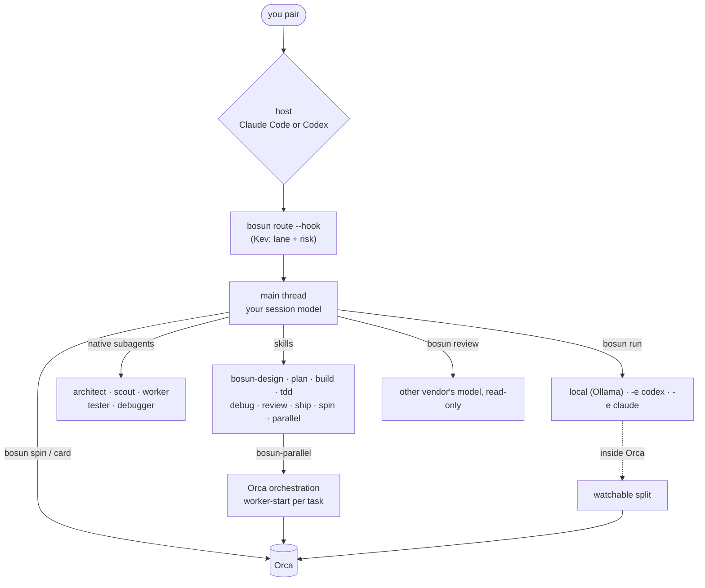
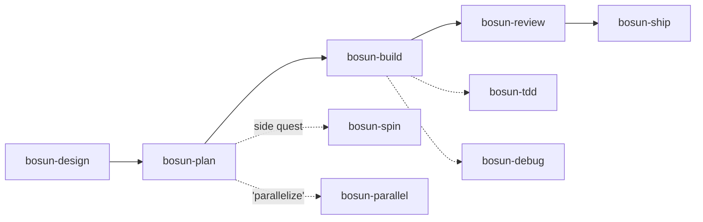
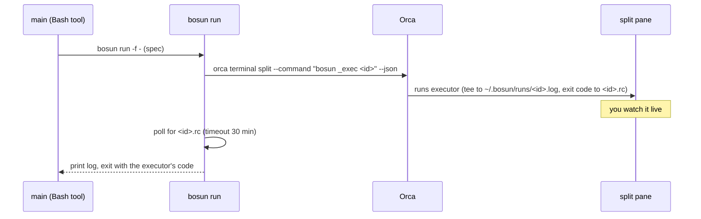

# bosun: design spec

**Date:** 2026-09-28 · **Status:** awaiting review · **Replaces:** ai-offload (built and tested offline, never installed)

## 1. Intent

**What you asked for:**
- One setup that is your **primary AI workflow**.
- It works with **Claude Code or Codex**, whichever you choose.
- It is integrated with **Orca**.
- It has a **better agent roster** (architect and others) and a **full, self-contained skill set**.
- It is called **bosun** and written in **Node** instead of Python.
- Nothing gets installed until you run the installer yourself.

**Working style: pairing + offload.**
- You drive one session. bosun gives it better roles and pushes work down to cheaper, local or other-vendor models.
- Orca adds visibility and, only when you ask, parallelism.

**Success looks like:**
- In a normal session you get:
  - an architect for design
  - a cross-vendor reviewer on every diff
  - mechanical edits done by the local model in a split you can watch
  - side quests spun off to their own Orca worktree
  - "parallelize this" working through Orca's supervised workers
- It works the same whether the host is Claude Code or Codex.
- Everything can be removed cleanly.

**Assumptions** (from the earlier session, not re-asked):
- **Machine:** M5 Pro, 48 GB, subscription logins.
- **Work:** TS/Node services in `~/Developer`.
- **Kept from ai-offload:** the router, local executors, fences and tests.

## 2. Decisions

| # | Decision | Why |
|---|---|---|
| D1 | Name **bosun**, used for the CLI, skill prefix, repo (`~/Developer/bosun`), state (`~/.bosun`), launchd (`com.bosun.*`) and markers (`<!-- bosun:begin/end -->`) | Chosen by you. Free on this machine. A bosun runs the deck crew under the captain. |
| D2 | **Approach A**: roles are native subagents per host, and the `bosun` CLI fills the gaps: cross-vendor, local, Orca | Fast and parallel, and keeps the main context clean. The CLI only does what agents can't. |
| D3 | **Node ≥ 20, zero npm deps** for everything bosun owns. Kev stays an upstream Python server run by `uv`. | You asked for it. Node 24.21 is the Volta default and no repo pins Node through Volta. JSON-native, with `node:test` built in. |
| D4 | Roles: architect, scout, worker, tester, debugger, reviewer, local | Chosen by you |
| D5 | Debugger on **sonnet / gpt-6-luna high**, handing off to the architect after 2 disproven hypotheses | Chosen by you (cheaper) |
| D6 | **Full own skill set** (9 skills), shared by both hosts | Chosen by you |
| D7 | `--replace-plugins` disables superpowers, mattpocock-skills and code-review, recorded so uninstall restores them | Chosen by you. Those plugins overlap bosun, and superpowers' SessionStart hook forces its own skills. |
| D8 | Kev keeps **4 lanes** (scout, local, worker, main) plus risk. Skills and main pick architect, tester and debugger. | More choices would make Kev's zero-shot guesses worse |
| D9 | Orca: watchable runs, side-quest spin, card status, parallel on request | All four chosen by you |
| D10 | One role source, rendered per host (not hand-written twice) | Claude and Codex rosters can't drift, and models come from config |

## 3. Architecture



## 4. Roles and models

A single source per role lives in `roles/<role>.md`. It holds frontmatter with `description`, `access: read | edit | tests` and `hosts`, and a body with the instructions. At install it is rendered to:
- **Claude:** `~/.claude/agents/bosun-<role>.md`, with frontmatter `name`, `description`, `model`, `tools` (plus `effort` if Claude Code supports it in agent frontmatter; to be verified during implementation).
- **Codex:** `~/.codex/agents/bosun_<role>.toml`, with `name`, `description`, `model`, `model_reasoning_effort`, `sandbox_mode` and `developer_instructions`.

| Role | Claude default | Codex default | Access | Claude tools | Codex sandbox |
|---|---|---|---|---|---|
| architect | `opus:high` | `gpt-6-astra:high` | read | Read, Glob, Grep, Bash (read commands only) | read-only |
| scout | `haiku` | `gpt-6-luna:low` | read | Read, Glob, Grep, Bash | read-only |
| worker | `sonnet` | `gpt-6-luna:high` | edit | Read, Edit, Write, Glob, Grep, Bash | workspace-write |
| tester | `sonnet` | `gpt-6-luna:high` | tests (instructions allow test files only; checked by main via diff) | same as worker | workspace-write |
| debugger | `sonnet` | `gpt-6-luna:high` | read + run (no source edits, by instruction) | Read, Glob, Grep, Bash | workspace-write (tests need to write caches) |
| reviewer (fallback) | `sonnet` | `gpt-6-luna:high` | read | Read, Glob, Grep, Bash | read-only |

- **Main** is your session: Opus xhigh in Claude, gpt-6-sol in Codex. bosun doesn't change it.
- **Reviewer:** the cross-vendor path is the CLI (§6). The subagent is only the fallback when the other CLI is missing.
- **Local** is `bosun run`, which is not a subagent. A Codex subagent inherits its parent's `model_provider`, so it can't be local.
- **Config:** every model is set in `config.env` as `ROLE_<ROLE>_<HOST>=model[:effort]`. `bosun roles [--json]` prints the resolved table, and skills read it instead of hard-coding models.

## 5. Skills

`skills/bosun-*/SKILL.md` is one folder, symlinked into `~/.claude/skills/` (host claude) and `~/.agents/skills/` (host codex).
- **Format:** the same on both hosts: frontmatter `name` and `description`.
- **Role names:** host-neutral, e.g. "the architect role". The policy block maps each role to "Claude: Agent tool, `bosun-architect`; Codex: spawn `bosun_architect`".



| Skill | Trigger | Steps | Uses | Card |
|---|---|---|---|---|
| bosun-design | a change with an open decision | at most 3 clarifying questions, one at a time → architect returns 2–3 options + a recommendation → you pick → the decision is recorded | architect | in-progress · "designing" |
| bosun-plan | an approved design, or a clear goal | task specs (lane, files, change, must-not-change, verify command, order) saved to `~/.bosun/plans/<repo>-<yyyymmdd>-<slug>.md` | architect or main | "plan ready (n tasks)" |
| bosun-build | a plan, or a single spec | for each task: dispatch by lane (local → `bosun run`, worker, tester), then main reads `git diff` and runs verify; after 2 failures escalate a lane (local → worker → main) | run, worker, tester | "task i/n" |
| bosun-tdd | "test first", or new behaviour | per behaviour: tester writes a failing test (red, shown) → worker or local makes it pass (green, shown) → refactor while staying green | tester, worker | – |
| bosun-debug | a bug, failure or regression | reproduce (command + output) → hypotheses ranked → debugger gathers evidence for one at a time → root cause → minimal fix spec → build. After 2 disproven hypotheses, go to the architect. | debugger, architect | "debugging: <symptom>" |
| bosun-review | before ship, or "review this", or `--pr N` | `bosun review` → check each finding against the code (reject wrong ones and say why) → fix the real ones through lanes → re-run verify | reviewer | in-review |
| bosun-ship | "ship", "commit", "PR" | evidence gate (verify, tsc, lint and tests output quoted), commit message; `git commit` / `gh pr create` **only when you ask** | – | completed on merge or PR |
| bosun-spin | "spin this off", or a side quest found mid-task | self-contained spec → `bosun spin` → report the worktree id and handle → continue the current task | spin | child card |
| bosun-parallel | "parallelize this" | plan → independent waves → per task `orca orchestration worker-start --spec … --worktree new-child --agent <host> --model/--effort` from `bosun roles` → supervised loop per Orca's `orchestration` skill → review each result → gather | Orca | per worker |

**Shared rules** (every skill repeats them briefly):
- Specs follow the Orca task-spec contract: target, change, constraints, ownership, observable acceptance.
- Main never trusts an executor's summary: it reads the diff and runs verify itself.
- `risk high` areas are planned in main and reviewed line by line.

## 6. CLI (Node)

```
bin/bosun        entry + dispatch
lib/config.js    env > ~/.bosun/config.env > config.default.env
lib/services.js  Ollama + Kev setup, launchd plists (XML-escaped argv)
lib/wire.js      render roles, link skills, policy block, hook, permissions, plugins, state.json
lib/exec.js      run (local | codex | claude), review
lib/orca.js      detect, watch split, spin, card
lib/route.js     Kev hook, stats, label, eval
```

| Command | Behaviour |
|---|---|
| `install [--host claude\|codex\|both] [--replace-plugins]` | Ollama + model, Kev, link `~/.local/bin/bosun`, unwire then wire each host, doctor, smoke test |
| `doctor` / `status` / `start` / `stop` / `restart` / `uninstall` / `config` / `model` | as in ai-offload. Doctor also flags overlapping plugins and Codex hooks that aren't trusted yet (a reminder). |
| `run [-e local\|codex\|claude] "task" \| -f spec \| -f - [--no-watch]` | the ai-offload executors, unchanged: local claude `--bare` with a dummy key + `dontAsk` fence; local codex `--oss` with workspace-write, no network, `--ignore-user-config`; `-e codex` / `-e claude` on the subscriptions |
| `review [--pr N] [--base ref] [--vendor claude\|codex]` | Diff = `git diff $(merge-base <base> HEAD)`, which includes uncommitted work, or `gh pr diff N`. The `<base>` default is `origin/HEAD`, then `main`, then `master`; the first one that exists wins. The vendor is the *other* one: `CLAUDECODE=1` means host claude, a `CODEX_*` env means host codex; `--vendor` overrides. Codex path: `codex exec -m <REVIEW model> -s read-only --ephemeral -` with prompt + diff on stdin. Claude path: `claude -p --model <REVIEW model> --setting-sources project,local --permission-mode dontAsk --tools Read,Glob,Grep,Bash` with read-only allow rules. Output is findings ranked `P0`/`P1`/`P2` in the form `file:line`, what's wrong, why, and the fix. The prompt includes a money/orders/auth checklist: idempotency, decimal money and rounding, currency, authz checks, PII in logs, migrations, retries/timeouts. |
| `spin "spec" \| -f spec [--agent claude\|codex\|local] [--name slug] [--stacked]` | Inside Orca: `orca worktree create --name <slug> --parent-worktree active [--base-branch <current> if --stacked] --agent <a> --prompt "<spec>\n\nWhen done: bosun-build, then bosun-review, then bosun card in-review." --json`. For `local`: create without an agent, then `orca terminal create --worktree id:<id> --command "bosun run -f <spec>"`. Prints the worktree id and handle. Outside Orca it exits with an error. |
| `card <todo\|in-progress\|in-review\|completed> ["comment"]` | `orca worktree set --worktree active --workspace-status … --comment … --json`. Silent no-op outside Orca. |
| `roles [--json]` | the resolved role → host → model/effort table |
| `route` / `label` / `eval` / `stats` | as in ai-offload (4 lanes) |

**Watchable run.** It applies when `WATCH=auto`, `ORCA_PANE_KEY` is set and `orca status` is ok:



`--no-watch`, `WATCH=off`, being outside Orca, or a failed split all mean it runs inline as before. The run is never lost.

**Guard.** `BOSUN_DEPTH=1` is set in every executor that `bosun run` or `bosun review` starts:
- The hook is silent there.
- `run`, `review` and `spin` are refused there.

Spin-off and parallel workers are ordinary top-level sessions, since Orca's `--agent` launcher takes no per-call environment variables. They do get the hook and can offload locally. Their prompt says "no further spin-offs or parallel fan-out", and Orca's orchestration depth limit backs that up for nested workers.

## 7. Wiring, install and uninstall

| Host | Writes | How it's reversed |
|---|---|---|
| claude | `~/.claude/agents/bosun-*.md` (rendered, with a `generated-by: bosun` header), `~/.claude/skills/bosun-*` (symlinks), the policy block in `~/.claude/CLAUDE.md`, hook + permissions `Bash(bosun run *)`, `Bash(bosun review *)`, `Bash(bosun spin *)`, `Bash(bosun card *)`, `Bash(bosun roles *)`, `Bash(bosun route *)` in `settings.json` | delete files with the header and our symlinks, strip the block, remove the hook and rules |
| codex | `~/.codex/agents/bosun_*.toml` (rendered, header comment), `~/.agents/skills/bosun-*` (symlinks), the policy block in `~/.codex/AGENTS.md`, the hook in `~/.codex/hooks.json` | same |
| `--replace-plugins` | sets `enabledPlugins[<id>] = false` for the overlapping plugins that are enabled now, recorded in `~/.bosun/state.json` | re-enables only the recorded ids |

- **Common to both:** first-time backups `*.bak-bosun`, and idempotent (wire, wire gives the same result).
- **Parse errors:** invalid JSON fails loudly and never overwrites.
- **The policy block** is a short map: roles and how to call each per host, lanes, which skill applies when, and the diff/verify rule.

## 8. Safety

These carry over from ai-offload, where they are tested:
- **Subscription isolation:** local `--bare` with a dummy key, and no `ANTHROPIC_AUTH_TOKEN` passed through.
- **Executor fences:** `dontAsk` + allowlist, the deny list, and the Codex sandbox with no network.
- High risk goes to main.
- Local-only services on 127.0.0.1.

**New in bosun:**
- **Reviewer is read-only** on both vendors.
- **Spin-offs** base on the default branch unless `--stacked`. Their prompt tells them not to commit or push, and they finish by setting their card to in-review for you.
- **`bosun-ship`** commits or opens PRs only on your explicit ask.

## 9. Testing

`node --test test/` runs offline, in a temp HOME, with nothing installed. Stubs for `claude`, `codex` and `orca` record argv and env. Mock servers written in Node stand in for Kev, Ollama `/api/tags` and Anthropic `/v1/messages` over SSE.

| Area | Checks |
|---|---|
| config | env > user > defaults; an old or partial config gets the new keys |
| route | lane hint per host, risk override, silent on: low conf, `/`, short, `#noroute`, depth, Kev down |
| wire | wire ×2 then unwire restores `settings.json` and `hooks.json` semantically (same JSON) and `CLAUDE.md` and `AGENTS.md` byte for byte, including plugin toggles. Rendered agents are valid (YAML frontmatter, TOML parse via a minimal check). |
| roster lint | every role renders for both hosts; every role or command a skill names exists; skill frontmatter is valid |
| services | the plist is valid XML (`plutil -lint`) with escaped argv and env |
| exec | exact argv and env for the 4 executor paths and the watch-split path (stub `orca` runs the split command); guards |
| review | picks the other vendor from env; read-only flags; diff passed on stdin |
| orca | `spin` (agent / local / stacked) and `card` argv; no-op outside Orca |
| e2e | the real `claude` binary against the mock Anthropic endpoint: dummy key, no Authorization header, 3 tools, tiny prompt (skipped if claude is absent) |

## 10. Out of scope
- Automatic PR merging or pushing. Telemetry or dashboards. Linux/Windows. Fine-tuning Kev (it's documented instead). More Kev lanes.
- Deleting or migrating ai-offload state: none exists, since it was never installed.

## 11. Risks and unverified items
- **Claude agent frontmatter `effort`:** if Claude Code doesn't support it, the effort is dropped for Claude roles and the model alias alone is used.
- **Codex:** `sandbox_mode` in an agent TOML is documented but not visible in the source; the role instructions also state the limits.
- **Host detection** for `review`: `CLAUDECODE=1` is known. The Codex env var name gets verified against the source during implementation, and `--vendor` always overrides.
- **Orca split-pane lifetime** after the command exits isn't known. It doesn't matter for correctness: the log and exit code come from files.
- **Carried over from ai-offload:** real model tool-calling, Kev accuracy, and memory at 64K.
