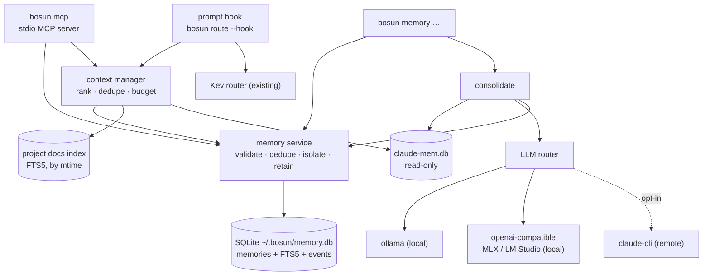
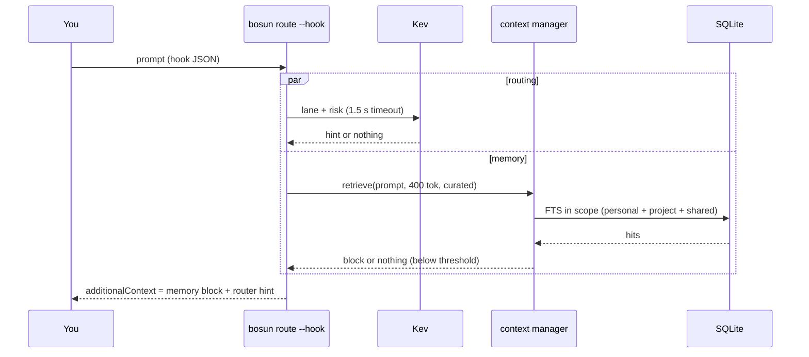
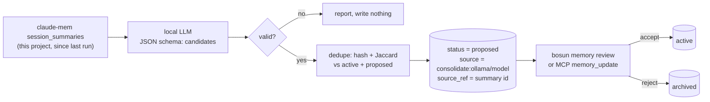
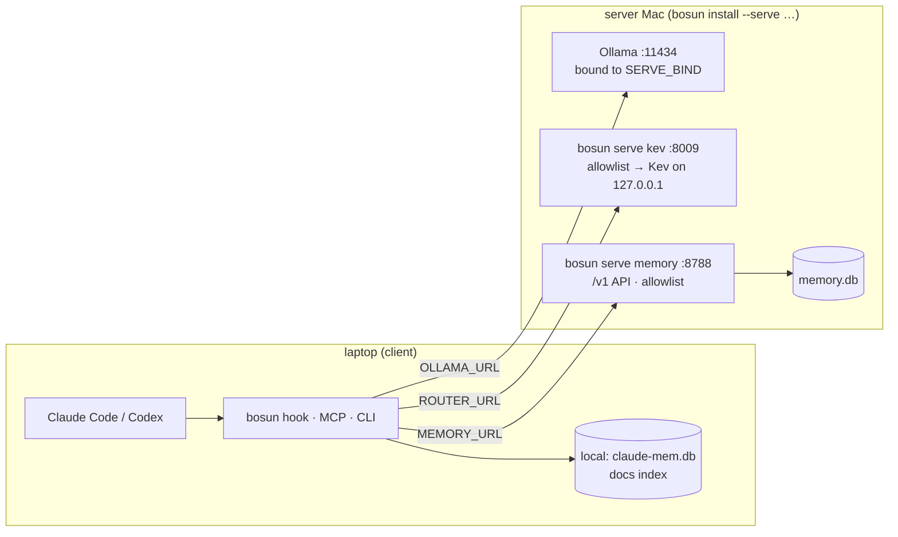

# bosun memory: design spec

**Date:** 2026-09-29 · **Status:** approved 2026-09-29, implemented (plan: docs/plans/2026-09-29-bosun-memory.md; ledger: docs/plans/2026-09-29-bosun-memory-ledger.md) · **Builds on:** `docs/specs/2026-09-28-bosun-design.md`

## 1. Intent

**The task (a pasted brief, applied to bosun, which you chose as the target):** evolve bosun into a local-first memory and context system. It needs:
- persistent memory
- intelligent, budgeted context retrieval
- local LLM integration
- measured token efficiency

The rules: TypeScript as the main language, SQLite by default, Cognee evaluated as an optional extra, MCP tools, tests for everything, no invented numbers, and no rewrite from scratch.

**Your choices while brainstorming:**
- **Target:** bosun, with memory added.
- **claude-mem:** bosun stores **curated** memory only. It reads claude-mem **read-only** as one more source, so nothing is stored twice.
- **TypeScript:** **port the whole codebase** now, not only the new code.
- **Capture:** explicit writes, plus **local-LLM proposals** that you review. Nothing becomes durable memory unreviewed.
- **Context:** **small automatic injection** in the prompt hook, plus MCP tools on demand.
- **Architecture:** approach A, in-process modules with no daemon. All four design sections were approved.
- **Split setup (added later):** Kev, the LLMs and memory can each be local or remote, independently, and even on different machines. Single user, the server is an Apple Silicon Mac, and **no tokens in v1**; API-to-API auth comes later (§8).

**Success means:**
- Claude and Codex get the few memories relevant to the task, within a budget, fast.
- You can store, review, update, delete and audit every memory.
- Projects stay isolated.
- It all runs locally with zero runtime dependencies.
- Every performance claim is a measured number.

## 2. Audit (Phase 1)

| Area | Found |
|---|---|
| Code | bosun: `bin/bosun` → `lib/cli.js` dispatch. 10 CommonJS JS modules (~1,260 lines): config, util, roles, route (Kev hook), services (launchd), orca, exec (executors, reviewer), wire (host wiring). Zero runtime dependencies. |
| Tests | 43 offline `node:test` tests (~1,085 lines), sandboxed HOME, stub CLIs, mock HTTP, plus an e2e run of the real `claude` binary. **Baseline: suite 12.8 s, all passing.** |
| Entry points | CLI commands; the `UserPromptSubmit` hook (`bosun route --hook`); the watch-split `_exec`. |
| MCP | none |
| Memory | none; only the router's decision log (`route-log.jsonl`) |
| LLM | Kev (a System-1 classifier over HTTP, with timeout, fail-open, JSONL log, label/eval); Ollama only as an agent executor (`claude -p --bare`, `codex exec --oss`); no direct generate/chat calls |
| Performance baseline | CLI startup **58 ms**; hook with Kev down (fail-open) **50 ms**; SQLite probe (node:sqlite, FTS5): 10k inserts in one transaction **8.3 ms**, full-text query over 10k rows **2.2 ms** each, statement prepare included |
| Reusable | `config` (env > config.env > defaults, `state.json`), the `route.ask` pattern (HTTP + timeout + fallback), the hook plumbing, `wire` (host registration), the test sandbox |
| Gaps | memory abstraction, storage, context manager, MCP server, general LLM router, TypeScript, structured logging, metrics |
| Architectural issues | Module-level paths computed from `HOME` at load time, so the tests reload CommonJS modules to switch HOME. That's impossible under ESM, so these become lazy getters. |
| Bottlenecks | None today. The hook pays about 50 ms of Node startup per prompt, so the memory part of the hook must stay small (target p95 < 30 ms). |
| Environment | Node 24.21: `node:sqlite` (SQLite 3.53.4, FTS5 ✓), native TypeScript type stripping ✓, `require(esm)` ✓. Present: **claude-mem** (7,049 observations, 29 MB SQLite + FTS5, schema v40, MCP search) and Claude Code's own memory files in 4 projects. |

## 3. Decisions

| # | Decision | Why |
|---|---|---|
| M1 | Port all code to **TypeScript ESM**, run by Node's native type stripping. `engines` becomes **node ≥ 24**. | You chose a full port. Node 24 is the only version tested here, and no build step is needed. |
| M2 | Keep **zero runtime deps**. Add devDependencies **`typescript`** and **`@types/node`**, used only for `npm run typecheck`. | Type checking needs a compiler. Runtime needs nothing. |
| M3 | Architecture A: in-process modules, **no daemon by default**. Optional `bosun serve` processes run on a server machine for the split setup (§8). | Measured database costs are a few milliseconds. Services exist only where you choose to move a component elsewhere. |
| M4 | SQLite through **`node:sqlite`**, with FTS5, WAL and migrations | Built in, fast enough by measurement, and needs no dependency. |
| M5 | Curated store plus a **read-only claude-mem provider**. The hook injects curated memory only. | No duplication; claude-mem already injects its own context at session start. |
| M6 | A **hand-rolled stdio MCP server**, protocol `2025-11-25` (echoes `2025-06-18` and other supported versions). `server/discover` → `-32601`. | Codex 0.158 defaults to the older protocol and Claude Code falls back to it. The v1 SDK would add 94 packages. |
| M7 | Project identity = hash of the **normalized git `origin` URL**, falling back to the realpath of `git rev-parse --git-common-dir` when there is no remote | The same repo on two machines, and every Orca worktree of it, then shares one project memory. That matters for a remote memory server. |
| M8 | **Cognee deferred**, through an interface. No code now. | A Python sidecar, auth and telemetry on by default, weekly breaking changes (research, 2026-09-29). |
| M9 | **No embeddings, vectors or Rust** now. `bosun memory eval` measures full-text recall first. | "Only if measurable benefit": measure before adding. |
| M10 | LLM only where needed: consolidation and the optional `--auto` metadata. Everything else is deterministic. | As the brief asks, and it keeps latency predictable. |
| M11 | **Per-service URLs**: `ROUTER_URL` (Kev), `OLLAMA_URL` (LLM router and local executors), `MEMORY_URL` (memory and context API). Each is local or remote independently. | You choose exactly what to split, and components can live on different machines. |
| M12 | **No tokens in v1.** Safety comes from a private-interface bind (`SERVE_BIND`: the Tailscale IP by default, never `0.0.0.0` unless set) plus a source-IP allowlist (`SERVE_ALLOW`), enforced by `bosun serve` for memory and Kev. The API is versioned under `/v1` with a single auth-middleware point, so auth can be added later. | Your call: auth comes later. Without a token, whoever can reach the memory port can read your memory, so the defaults keep it on a private network. |
| M13 | Memory transport = `LocalStore` (SQLite) or `RemoteStore` (HTTP to `MEMORY_URL`), behind one interface. claude-mem and the docs index always stay on the client. No offline queue or sync in v1. | One code path for the memory service; the local files stay where they are. |

## 4. Architecture



```
bin/bosun                  entry → lib/cli.ts
lib/{cli,config,util,roles,route,services,orca,exec,wire}.ts   ported 1:1
lib/log.ts                 structured JSON-lines log (~/.bosun/bosun.log), redaction
lib/metrics.ts             op timings, counts, sizes → ~/.bosun/metrics.jsonl
lib/memory/types.ts        Memory, Category, Status, Query, Hit, MemoryProvider
lib/memory/sqlite.ts       store: open, migrations, CRUD, FTS search, transactions
lib/memory/claudemem.ts    read-only provider over claude-mem
lib/memory/docs.ts         project docs index
lib/memory/service.ts      MemoryService: validation, dedupe, provenance, retention, isolation
lib/memory/project.ts      project identity (origin URL hash, fallback git common dir) + scope rules
lib/memory/remote.ts       RemoteStore: HTTP client for MEMORY_URL (same interface as the SQLite store)
lib/serve.ts               `bosun serve memory|kev`: /v1 memory API, Kev forwarder, bind + allowlist, auth middleware point
lib/context.ts             context manager
lib/llm.ts                 LLM router
lib/consolidate.ts         proposals
lib/mcp.ts                 MCP server
test/*.test.ts             ported + new
```

**Breaking changes:**
- engines: Node ≥ 20 becomes ≥ 24.
- Tests are `.ts`.
- Config paths are getters (internal).

No CLI command, flag or config key is removed.

## 5. Memory model and storage

**Database:** `~/.bosun/memory.db`, mode 0600, `journal_mode=WAL`, `busy_timeout=2000`, `foreign_keys=ON`.

```sql
-- migration 1
CREATE TABLE memories (
  seq INTEGER PRIMARY KEY,                      -- FTS5 content rowid
  id TEXT NOT NULL UNIQUE,                      -- m_<time-sortable base32 + random>
  category TEXT NOT NULL CHECK (category IN ('personal','project','session')),
  project_id TEXT,                              -- NULL for personal
  session_id TEXT,                              -- session memories only
  title TEXT NOT NULL, body TEXT NOT NULL, tags TEXT NOT NULL DEFAULT '[]',
  status TEXT NOT NULL DEFAULT 'active' CHECK (status IN ('active','proposed','archived')),
  shared INTEGER NOT NULL DEFAULT 0, private INTEGER NOT NULL DEFAULT 0,
  source TEXT NOT NULL, source_ref TEXT, hash TEXT NOT NULL,
  created_at INTEGER NOT NULL, updated_at INTEGER NOT NULL, expires_at INTEGER,
  accessed_at INTEGER, access_count INTEGER NOT NULL DEFAULT 0, version INTEGER NOT NULL DEFAULT 1,
  CHECK ((category = 'personal') = (project_id IS NULL))
);
CREATE UNIQUE INDEX memories_dedupe ON memories(COALESCE(project_id, ''), category, hash) WHERE status <> 'archived';
CREATE INDEX memories_scope ON memories(project_id, category, status);
CREATE INDEX memories_expiry ON memories(expires_at) WHERE expires_at IS NOT NULL;
CREATE VIRTUAL TABLE memories_fts USING fts5(title, body, tags, content='memories', content_rowid='seq', tokenize='porter unicode61');
-- triggers keep memories_fts in sync on insert / update / delete
CREATE TABLE memory_events (id INTEGER PRIMARY KEY, memory_id TEXT NOT NULL, op TEXT NOT NULL, at INTEGER NOT NULL,
  source TEXT NOT NULL, hash_before TEXT, hash_after TEXT);
CREATE TABLE docs (path TEXT PRIMARY KEY, project_id TEXT NOT NULL, mtime INTEGER NOT NULL, title TEXT, body TEXT NOT NULL);
CREATE VIRTUAL TABLE docs_fts USING fts5(title, body, content='docs', tokenize='porter unicode61');
CREATE TABLE schema_migrations (version INTEGER PRIMARY KEY, applied_at INTEGER NOT NULL);
```

**Migrations:** an ordered list in code. Each runs inside `BEGIN IMMEDIATE … COMMIT`, together with its `schema_migrations` row. Any error rolls it back and aborts with the database unchanged. Opening the database runs any pending migrations.

**Operations** (`MemoryService`). These names become the MCP and CLI verbs:

| Operation | Behaviour |
|---|---|
| `store(input, ctx)` | Validate: category enum; title 1–200 characters; body 1–4,000; tags ≤ 12 × 40 `[a-z0-9-]`; project/session rules. Compute the hash (normalized: lowercase, collapsed whitespace). An existing active or proposed memory with the same key returns `{ memory, duplicate: true }`. Otherwise insert, plus an event, in one transaction. |
| `search(query, ctx)` | FTS over this scope only, BM25 ranking, filters (category, status, tags), limit ≤ 50. Updates `accessed_at` and `access_count` in one batched statement. |
| `get(id, ctx)` | By id, with the scope enforced. Out-of-scope ids return *not found*, never "forbidden", so no existence is leaked. |
| `update(id, patch, expectedVersion, ctx)` | Transaction: check the scope and version (a mismatch returns `conflict` plus the current version); apply; bump the version; recompute the hash (a duplicate returns a conflict); log an event. |
| `delete(id, ctx)` | Archives the memory (soft), with an event. `purge(id)` hard-deletes archived memories only. |
| `consolidate(opts, ctx)` | See §7: creates `proposed` memories. |
| `accept(id)` / `reject(id)` | Proposed → active, or proposed → archived. |
| `prune()` | Archives expired memories; purges archived ones older than `MEMORY_PURGE_AFTER_DAYS` (default 90). |

**Scope and isolation:**
- `ctx = { projectId, sessionId, linked[] }` always comes from the caller's environment, never from tool arguments. The project directory comes from, in order: the `CLAUDE_PROJECT_DIR` env var, then the MCP server's or hook's cwd. The project **id** is the hash of its normalized git `origin` URL (so `git@github.com:org/repo.git` and `https://github.com/org/repo` match), falling back to git's common dir. With a remote memory server, the client sends `ctx`, and the server (single user) trusts it.
- Readable = personal, plus `project_id = ctx.projectId`, plus `shared = 1`, plus `project_id IN MEMORY_LINKED_PROJECTS`.
- Writes go only to personal or `ctx.projectId`.

**Retention:** session memories get `expires_at = now + MEMORY_SESSION_TTL_DAYS` (7). Other categories get an optional `ttl_days`. Expiry is applied lazily when the database opens (a single UPDATE).

**Privacy:**
- `private = 1` memories are excluded from the hook, from `context_retrieve` and `memory_search` output going to the host, from reviewer prompts, and from any remote LLM. `memory_get` on a private id returns its metadata with the body redacted.
- The CLI shows everything locally.
- Logs and metrics never contain titles, bodies, prompts, tokens or keys.

**claude-mem provider:**
- It opens `~/.claude-mem/claude-mem.db` with `readOnly: true`. The path can be changed with `CLAUDE_MEM_DB` and the provider turned off with `CLAUDE_MEM=off`.
- It checks the tables and columns it needs (`observations`/`observations_fts`, `session_summaries`/`session_summaries_fts`) and queries them filtered by `project` = the repo name.
- Any error returns `[]` plus one warning in the log. It never throws into the hook or MCP.

## 6. Context, hook and MCP

**Context manager:** `retrieve(task, { budgetTokens, sources, minScore })`.
1. **Query:** deterministic tokens. Stop words go; code-like identifiers are kept and split (`fetchCart` becomes `fetch cart`); terms are OR-joined and quoted for FTS5. User text never becomes raw FTS syntax.
2. **Fetch:** each source returns up to 20 hits.
3. **Score:** normalized BM25 (per source, 0–1) × source weight (curated 1.0 · docs 0.8 · claude-mem 0.6), plus recency `0.3 × 2^(−age/halfLife)` (session 1 day, other curated 60 days, docs by mtime 90 days, claude-mem 30 days), plus usage `0.05 × log(1 + access_count)`.
4. **Dedupe:** by hash, and by word-set overlap (Jaccard ≥ 0.8), keeping the higher score.
5. **Budget:** greedy by score. Each item is at most `CONTEXT_ITEM_CHARS` (400) and the total at most `budgetTokens` (estimated as characters ÷ 4, and labelled `~`). Nothing below `minScore`.
6. **Output:** `{ items[], text, estTokens, sources, ms }`. `text` is the compact block, where each line gives source, category, date, id and snippet.

**Hook:**
- `bosun route --hook` runs `context.retrieve(prompt, { budgetTokens: CONTEXT_HOOK_BUDGET (400), sources: ['curated'], minScore: CONTEXT_HOOK_MIN_SCORE (0.35) })` in parallel with the Kev request, then joins the memory block and the router hint into one `additionalContext`.
- The existing skip rules stay (`/` commands, `!` shell escapes, prompts under 3 words, `#noroute`, `BOSUN_DEPTH`).
- Failures fail open, and every hook run records its metrics.

**MCP** (`bosun mcp`):
- stdio, newline-delimited JSON-RPC 2.0. stdout carries only protocol messages; `console.log` is redirected to stderr. The server exits on end of stdin.
- **Methods:**
  - `initialize`: echoes the requested version if supported (`2025-11-25`, `2025-06-18`, `2025-03-26`), otherwise `2025-11-25`. Capabilities `{tools:{}}`; `serverInfo` gives bosun and its version; plus `instructions`.
  - `notifications/*`: ignored.
  - `ping` → `{}`.
  - `tools/list` and `tools/call`.
  - Everything else → `-32601`. A batch array → `-32600`; a parse error → `-32700` with `id: null`.
- **Tools:**
  - `memory_search` (read-only)
  - `memory_get` (read-only)
  - `memory_store` (not destructive)
  - `memory_update` (destructive, idempotent)
  - `memory_delete` (destructive, idempotent)
  - `context_retrieve` (read-only)
  - `project_knowledge_search` (read-only)

  Every tool has `openWorldHint: false`, a JSON Schema 2020-12 `inputSchema` with `additionalProperties: false`, descriptions under 300 characters, and results as `structuredContent` plus the same JSON as text.
- **Errors and limits:** validation and business errors come back as `isError: true` with a short message, never echoing stored content. Unknown tool → `-32602`. Output is capped at `MCP_MAX_CHARS` (20,000).
- **Registration** (in `wire`):
  - Claude: `claude mcp add --scope user bosun -- <node> <repo>/bin/bosun mcp`.
  - Codex: for each Codex home (`~/.codex`, plus Orca's if present), `CODEX_HOME=<home> codex mcp add bosun -- …`, only if codex is installed.
  - Unwire removes each registration, and doctor checks them.



## 7. LLM router and consolidation

**Router:** `llm.generate({ task, messages, schema?, allowRemote })` returns `{ ok, text, json?, provider, model, ms, tokensIn?, tokensOut?, error? }`.
- **Providers**, from config `LLM_PROVIDERS=ollama` (default; comma-separated chain):
  - `ollama`: `POST /api/chat`, `stream: false`, `format` = the JSON schema when one is given, `options.num_ctx = CTX`. It reads `prompt_eval_count` and `eval_count` for token counts.
  - `openai`: `POST {LLM_OPENAI_URL}/v1/chat/completions`, for `mlx_lm.server` or LM Studio; `response_format` json_schema when given.
  - `claude-cli`: `claude -p --restricted --model haiku --output-format json`. Remote, used only when `LLM_REMOTE=claude` **and** `allowRemote` is true **and** the content includes nothing private.
- **Timeout** `LLM_TIMEOUT_S` (60). **Retries** `LLM_RETRIES` (1) on timeouts and connection errors only, with 500 ms × 2ⁿ backoff. **Fallback:** the next provider in the chain.
- **JSON output:** parsed and validated against the schema by a small built-in validator. It supports the subset we use: type, properties, required, enum, maxLength, items, maxItems. Invalid output counts as a failure.
- **Usage log:** `~/.bosun/llm-usage.jsonl` gets `{ts, task, provider, model, ms, ok, tokensIn, tokensOut, error_kind}` and no content.

**Consolidation:** `bosun memory consolidate [--since 7d] [--limit 20]`



**Deterministic by default:** category rules, hashing, dedupe, query building and ranking involve no LLM. `memory add --auto` is the only other LLM use, for a suggested title and tags, which you can override.

## 8. Split setup (optional remote services)



- **Components:**
  - Kev (`ROUTER_URL`)
  - LLMs (`OLLAMA_URL`, used by the LLM router and the local executors)
  - memory (`MEMORY_URL`, which also serves context)

  Empty means local on this machine, as today. Any of them can point at another machine, and they may sit on different machines.
- **Server install:** `bosun install --serve kev,llm,memory` on the server Mac sets up only the listed services, reusing the launchd code.
  - **llm:** Ollama gets `OLLAMA_HOST=<SERVE_BIND>:11434`.
  - **kev:** Kev keeps its own 127.0.0.1 port, and `bosun serve kev` (launchd `com.bosun.kev-proxy`) listens on `<SERVE_BIND>:8009`, forwarding after the allowlist check. Kev's own bind option isn't verified.
  - **memory:** `bosun serve memory` (launchd `com.bosun.memory`) listens on `<SERVE_BIND>:8788` and runs the same `MemoryService` over the server's SQLite.
- **Bind and allowlist:**
  - `SERVE_BIND` defaults to the machine's Tailscale IPv4 (`tailscale ip -4`) if present. Otherwise install refuses until you set a LAN IP. `0.0.0.0` only if you set it explicitly.
  - `SERVE_ALLOW` defaults to `127.0.0.1/32,100.64.0.0/10` (Tailscale) plus the subnet of `SERVE_BIND`. `bosun serve` rejects other source IPs with 403.
  - Ollama can't filter by IP, so it relies on its bind interface.
- **Transport:** plain HTTP. Over Tailscale it's encrypted by WireGuard; over a plain LAN it isn't. The docs say so.
- **Memory API** (`/v1`, JSON). Every request carries `ctx` (project id, session id, linked projects), and every response carries `{ ok, data | error: { code, message } }`. Errors are `not_found`, `conflict`, `invalid` or `unavailable`, and never echo stored content.
  - `GET /v1/health` returns bosun's version, the schema version and `{ memory: true }`.
  - `POST /v1/memory/store`, `/search`, `/get`, `/update`, `/delete`, `/accept`, `/reject`
  - `POST /v1/context/retrieve` (curated source only; the client merges its local docs and claude-mem hits)
  - Limits: request bodies ≤ 64 KB, JSON only.
- **Ready for auth later:** one `authorize(req)` middleware runs before every route (a no-op in v1), and the client already sends an `Authorization` header when `MEMORY_TOKEN` is set (ignored in v1). Adding tokens or mTLS later changes no routes.
- **Client install:** `bosun install --remote kev=URL,llm=URL,memory=URL` writes the URLs to `config.env` and skips setting up local services for remote components.
  - Doctor checks reachability, `/v1/health` and the version match (warning on a mismatch), and the model's presence on the remote Ollama (`/api/tags`).
- **Failures:**
  - **Hook:** the memory part times out at `REMOTE_HOOK_TIMEOUT_MS` (300) and fails open.
  - **MCP and CLI:** they time out at `REMOTE_TIMEOUT_MS` (5000) and return `unavailable` ("memory server unreachable at …").
  - **Executors:** they report "Ollama unreachable at …".
  - **No offline queue, no sync, no automatic fallback to local.** Writes while offline fail visibly.
- **Unchanged on the client:** the claude-mem provider, the docs index, the MCP server and the hook all run on the client. Only the store behind `MemoryService` moves.
- **Uninstall:** `bosun uninstall` on the server removes only the services it created. On the client it clears the remote URLs.

## 9. Deferred (documented, not built)

- **Cognee:** re-evaluate if `bosun memory eval` shows a gap on multi-hop or relationship questions. The path would be a REST adapter over `/api/v1/remember` and `/api/v1/recall`, with one dataset per project, a pinned version and `TELEMETRY_DISABLED=1`.
- **Embeddings:** `bosun memory eval <queries.jsonl>` reports full-text recall@5 and MRR on your labelled queries. If they show a gap, add Ollama `/api/embed` (a local model), vectors stored as BLOBs, and brute-force cosine similarity, which is fast enough below 100k memories. No sqlite-vec or Qdrant.
- **Rust:** none. Candidates for later: bulk indexing of very large doc trees, and retrieval over corpora above ~1M rows.
- **Newer MCP protocol (`2026-07-28`):** add when Codex's default moves to it.
- **Split setup, later:** tokens and API-to-API auth (the middleware point exists), TLS or mTLS in bosun, an offline write queue and sync, multiple users, and a Linux (systemd, CUDA) server.

## 10. Metrics and benchmarks

- **`lib/metrics.ts`** appends `{ts, op, ms, n, chars, estTokens, provider?}` to `~/.bosun/metrics.jsonl` for:
  - memory store, search, get, update and delete
  - context retrieve (and the hook)
  - database opens and migrations
  - claude-mem queries
  - docs indexing
  - LLM calls, which also go to the usage log
- **`bosun memory stats`:** p50/p95 per operation, average context size and item count, hook injections vs skips, LLM calls, ms and tokens, and remote calls, which should be 0 by default.
- **`bosun memory bench [--n 10000]`:** a temp database with a synthetic corpus. It measures store, search, context p50/p95 and budget adherence, and prints the numbers. The final report quotes only these measured outputs, plus the baseline in §2.
- **Token claims:** only as measured `estTokens` per injection (characters ÷ 4, labelled as an estimate). No claimed savings without a before/after measurement.

## 11. Testing

The suite runs offline with no credentials: `node --test`, sandboxed HOME, stub CLIs, mock HTTP (Ollama, Kev, Anthropic), and fixture claude-mem databases built by the tests.

| Area | Tests |
|---|---|
| Existing | the whole current suite, ported to TS, passing (behaviour unchanged) |
| Storage | store/get/search round trip; FTS ranking; tags filter; limit caps |
| Update and delete | version conflict; hash recompute and duplicate conflict; archive; purge only archived; audit events written |
| Duplicates | exact duplicates return the existing memory; near-duplicate proposals flagged |
| Isolation | project A can't see B; ids out of scope → not found; personal visible everywhere; `shared` and linked projects; worktrees and clones on other machines = one project (origin URL id); a tool argument can't change the project |
| Retention | a session TTL expires into archived; prune purges old archived memories |
| Privacy | private is excluded from the hook, `context_retrieve` and remote LLMs; `memory_get` redacts it; logs contain no bodies |
| Context | ranking (relevance vs recency), dedupe across sources, budget respected at the edges, min score, output format |
| Hook | memory block + router hint combined; silent below threshold; fails open with a broken database; latency recorded |
| LLM | Ollama success (mock); timeout; retry then success; bad JSON; fallback chain; remote never used by default or for private content; usage log has no content |
| Providers | claude-mem missing; schema mismatch; database locked → `[]` + warning; docs index incremental |
| Migrations | fresh database → latest; v1 → v2; a failing migration rolls back and leaves the database as it was |
| MCP | a real stdio session: initialize (version echo and fallback), tools/list (schemas valid), each tool, isError paths, unknown method/tool, batch → -32600, parse error, `server/discover` → -32601, stdout carries only JSON |
| Consolidation | proposals created with provenance; invalid LLM output writes nothing; accept/reject |
| Wiring | MCP registration and unregistration in Claude and Codex (stubbed CLIs); doctor checks |
| Split | `bosun serve memory` plus a `RemoteStore` client in one process on random ports: every memory operation round-trips with the same results as `LocalStore`. Allowlist rejects an outside IP (403); bind never defaults to `0.0.0.0`. Unreachable server: the hook fails open within its timeout, MCP returns `unavailable`. Health check with a version mismatch gives a warning. Project id matches across ssh and https origin URLs. `bosun serve kev` forwards and applies the allowlist. The real `claude --bare` runs against a remote `OLLAMA_URL` (mock). |
| Types | `npm run typecheck` passes (strict) |

## 12. Deliverables mapping (for the final report)

1. Existing architecture: §2.
2. Proposed architecture: §4–§8.
3. Files changed: from the plan and the ledger.
4. Dependencies: none added at runtime; devDependencies `typescript` and `@types/node` added (why: type checking only).
5. Features, 6. test results, 7. measurements: the actual outputs of `npm test`, `npm run typecheck` and `bosun memory bench`.
8. Limitations and 10. future work: §9 plus the ledger.
9. Running locally: README / ARCHITECTURE.md.
